# Docket — executive summary

*Terminales Andinas de Carga S.A. (TAC) · assisted mailbox filing · case date: 2026-11-18*

Docket does Martha's filing ("radicación") work over the mailbox: it reads every e-mail and its attachments, decides what each document is, extracts the data that matters, applies the rules she described, proposes department, action and due date, and —only when she approves— continues her Excel ledger with the `TAC-2026-ER-#####` consecutive. When it is not sure, it does not guess: the document is left for a person with the reason in plain sight. Each role has its own workspace: Martha lands on the inbox; Dra. Herrera lands on deadlines and a "Por verificar" queue where she resolves invoices held for possible fraud after calling the supplier: she releases them to the department or confirms the fraud, so a held invoice no longer dead-ends as "Retenida". Under "Cumplimiento" she also has the document retention schedule (TRD, Ley 594 de 2000) with controlled disposal, and the data-subject requests of habeas data (Ley 1581 de 2012). She can also ask an AI assistant through MCP (read-only).

Details: [architecture](01-arquitectura.md) · [features](02-features.md) · [solution and traceability](03-solucion.md) · [domain model](04-modelo-dominio.md) · [quality attributes](05-atributos-calidad.md).

## a) Components, data flow and where AI is involved

```mermaid
flowchart LR
    MB[("Filing mailbox<br/>.eml")] --> ING["1 Ingestion<br/>splits e-mail into documents"]
    ING --> TXT["2 Text extraction<br/>native PDF · body · DOCX"]
    ING --> OCR["2b Local Tesseract OCR<br/>scanned PDF"]
    TXT --> CLS["3 Rule-based classification<br/>type + margin"]
    OCR --> CLS
    CLS -- "low margin and AI enabled" --> LLM["Optional AI (Claude)<br/>OFF by default<br/>masked text<br/>only suggests the type"]
    LLM -- "suggestion flagged<br/>CLASSIFIED_BY_ASSISTANT" --> RUL
    CLS --> RUL["4 Martha's rules<br/>master · PO · duplicates · fraud<br/>business-day deadlines"]
    CAT[("Supplier master<br/>departments")] --> RUL
    LED[("Filing ledger<br/>DB + client's Excel")] --> RUL
    RUL --> INB["5 Inbox<br/>READY / NEEDS_REVIEW + reasons and evidence"]
    INB --> HUM{{"Martha reviews,<br/>corrects and approves"}}
    HUM --> NUM["6 Consecutive on approval"]
    NUM --> LED
    NUM --> OUT["Outbox<br/>(simulated forwarding)"]
    LED -- "held invoice" --> VER{{"Dra. Herrera verifies by phone<br/>releases or confirms fraud"}}
    VER --> LED
    VER --> OUT
    HUM --> AUD[("Audit<br/>append-only")]
    LED --> DL["Deadlines<br/>weekly report"]
    DL --> WEB["Web app / PWA<br/>Martha and Dra. Herrera"]
    INB --> WEB
    LED --> MCP["MCP server<br/>read-only, localhost"]
    MCP --> AI2["Dra. Herrera's AI assistant<br/>'what is due this week?'"]

    classDef ai fill:#fde68a,stroke:#b45309,stroke-width:2px,stroke-dasharray:5 3,color:#000
    classDef rules fill:#dcfce7,stroke:#15803d,color:#000
    classDef human fill:#dbeafe,stroke:#1d4ed8,color:#000
    class LLM,AI2 ai
    class ING,TXT,OCR,CLS,RUL,NUM,DL rules
    class HUM,VER human
```

*Green: deterministic and auditable. Dashed yellow: AI (optional / read-only). Blue: human decision.*

**Components.** Python API (FastAPI) organized by feature (ingestion with a background import queue, classification, filing, ledger, deadlines, catalogs, audit, records retention, privacy); Prometheus metrics, JSON logs and a readiness check; installable Next.js web app (PWA, responsive); database (SQLite on-prem, Postgres optional); the client's Excel is preserved: historical rows are never touched, Docket only adds and updates its own rows; read-only MCP server. Everything runs with `docker compose` on a TAC server.

**Where AI is NOT involved:** department routing, due dates, consecutive numbers, duplicates, fraud checks and approval. These are deterministic rules; each leaves a reason code and evidence. OCR is local Tesseract, not a language model.

**Where it may be involved:** only if IT enables it, to suggest the *type* of ambiguous free text when the rules lack enough margin. It receives masked text; its suggestion goes through the same rules and is flagged `CLASSIFIED_BY_ASSISTANT`, which forces human review.

**Why:** IT has not approved any AI tool; errors are expensive (double payment, fraud, a lawsuit ("tutela") over an expired petition); rules can be explained to Martha and audited by Accounting and Legal; marginal cost is ≈ 0; and it works without going to the cloud.

## b) How I know it is right and what happens when it is wrong

- **Client's expected results:** 8/8 match (type, department, action and due date).
- **Full table (16 e-mails, 17 documents):** 17/17 with OCR available, including the scanned invoice SE-77821 (→ Accounts payable, `TAC-2026-ER-04821`) and filing numbers 04818…04831 in reception order. Without Tesseract on the host, that scan goes to review as `DOCUMENT_UNREADABLE`: 16/17 automatic and 1 correctly routed to a person, never guessed.
- **Confidence:** all classifier margins ≥ 2. In the sample, 1 of 17 documents needs review (the suspected fraud invoice); 2 without OCR.
- **Blind set (documents the rules never saw):** 60 e-mails / 65 documents written by an agent that never read the code, from the interview and the client's files only, with 26 documented judgment calls (`api/tests/blind/`). Result: **45/65 correct, 14 routed to a person, 6 wrong**. The 6 errors: 4 valid travel requests returned to the sender because the approval on differently laid-out forms is not recognized; 1 scanned invoice whose purchase order OCR missed (→ Procurement instead of Accounts payable); 1 consultation taken as a complaint (wrong department and 15 instead of 30 days). All 5 fraud holds and all 3 duplicates were caught. The rules were **not** tuned to this set: `test_blind_baseline.py` is a floor (≥ 45 correct, ≤ 6 wrong, money-safety cases never silently wrong); raising it requires a new blind set. See [evaluation](../features/evaluation.md).
- **Automated tests:** 138 backend test functions, more cases once parametrized (rules, calendar, ledger and Excel sync, import queue, verification, retention, habeas data, observability, API, MCP, golden table, blind baseline), 26 frontend tests in 9 files (Jest + RTL) and 5 Playwright E2E tests in 3 specs (clerk on desktop, coordinator incl. compliance, phone). See [03-solucion](03-solucion.md).

**When it is wrong:** nothing is forwarded or filed without Martha's approval, and no held invoice is released without the coordinator's phone check and written note; every proposal shows reasons and evidence; a correction keeps the original proposal (audit) and becomes the accuracy measure per type; repeated corrections become new rules and golden-table cases. The bias is deliberately toward REVIEW for money and legal matters. Filing numbers are never reused.

## c) What it costs to process a document

Rules path: CPU on TAC's server, marginal cost ≈ 0 (measured in the Docker image: median 20 ms per native PDF or e-mail body, max 50 ms; scanned PDF with OCR 1.9 s; whole mailbox 2.2 s; approving everything 0.2 s).

Optional AI: ≈ 500 input + ≈ 5 output tokens per call. With 200 documents/week ≈ 870/month:

| Scenario | Claude Haiku 5.5 | Claude Sonnet 5.5 |
|---|---|---|
| Rules only (default configuration) | US$ 0 | US$ 0 |
| AI only for ambiguous docs (≈ 20 %) | ≈ US$ 0.01/month | ≈ US$ 0.18/month |
| AI for every document | ≈ US$ 0.05/month (US$ 0.0000525/doc) | ≈ US$ 0.91/month (US$ 0.00105/doc) |

Anthropic list prices (Haiku US$ 0.10 / 0.50 and Sonnet US$ 2 / 10 per million input/output tokens; table dated 2026-10-06): verify on the pricing page before quoting. On-prem infrastructure: an existing TAC server (marginal ≈ 0). The cloud demo (Render + Vercel): a few to tens of dollars a month.

## d) How much time it saves Martha

**Baseline (interview):** ~3 h a day for ~40 documents (200/week ÷ 5) ≈ 4.5 min/document. Her per-type estimates over the sample give ≈ 4.2 min/document: consistent.

**With Docket:** READY document ≈ 0.5 min (read the proposal and confirm, often in batch); NEEDS_REVIEW ≈ 2 min. Assuming 20 % need review in production (conservative versus 6–12 % in the sample): 0.8 min/document → saving ≈ 3.7 min/document.

| % needing review | Min/doc with Docket | Daily saving | Weekly saving | Monthly saving |
|---|---|---|---|---|
| 10 % | 0.65 | ≈ 2.6 h | ≈ 12.8 h | ≈ 55 h |
| **20 %** | **0.8** | **≈ 2.5 h** | **≈ 12.3 h** | **≈ 53 h** |
| 40 % | 1.1 | ≈ 2.3 h | ≈ 11.3 h | ≈ 49 h |

The biggest value is not quantified: the risk avoided (double payment, account-change fraud, expired petition → tutela). **How to validate it:** a timed session with Martha over the 16 sample e-mails, and in production the audit trail (`DOCUMENT_PROPOSED` → `DOCUMENT_APPROVED`) plus the correction rate per type.

## e) Technical debt taken on for speed and what it needs to be used for real

- **Integrations:** read the real mailbox (Microsoft Graph / Gmail API) and really send the outbox; supplier master synced from the ERP instead of CSV upload.
- **Identity:** corporate SSO instead of demo tokens; today the audit records the role, not the person.
- **Data:** Postgres with backups and encryption at rest; numbering safe across processes (today: in-process lock + unique constraint); the shared Excel lives in a local or mounted folder: a SharePoint / Google Drive adapter is pending, and the sync runs in a single process.
- **Audit and privacy:** audit rejected approvals; the retention schedule (TRD) values are a proposal that TAC's Comité Interno de Archivo must approve.
- **Quality:** the blind set is synthetic (written from the interview, not real mail): measuring on a sample of real TAC mail, and the correction rate per type in production, are still pending; the 6 blind errors (travel-request approval on other layouts, purchase order on poor scans, consultation vs complaint) are open; OCR on worse scans; holiday calendar validated for future years.
- **AI and MCP:** AI requires IT approval (DPA, data region) before turning it on; MCP has no authentication (localhost only).
- **Operations:** deployment configs written but not deployed yet; metrics and readiness exist, but no alert rules or dashboards are shipped; one worker thread per API process.

**Already implemented (was debt):** pagination of inbox and ledger ([inbox](../features/inbox.md), [ledger](../features/ledger.md)); background import queue for month-end peaks ([ingestion](../features/ingestion.md)); monitoring: Prometheus metrics at `/metrics`, `/api/ready`, JSON logs with `X-Request-ID` ([observability](../features/observability.md)); document retention under Ley 594 de 2000 with controlled disposal ([records](../features/records.md)); habeas data under Ley 1581 de 2012: inventory and data-subject requests ([privacy](../features/privacy.md)); masking of free-text discard reasons in the audit ([audit](../features/audit.md)); a larger blind evaluation set ([evaluation](../features/evaluation.md)); two-way sync with the shared Excel that merges people's edits and rows typed by hand ([ledger](../features/ledger.md)).
