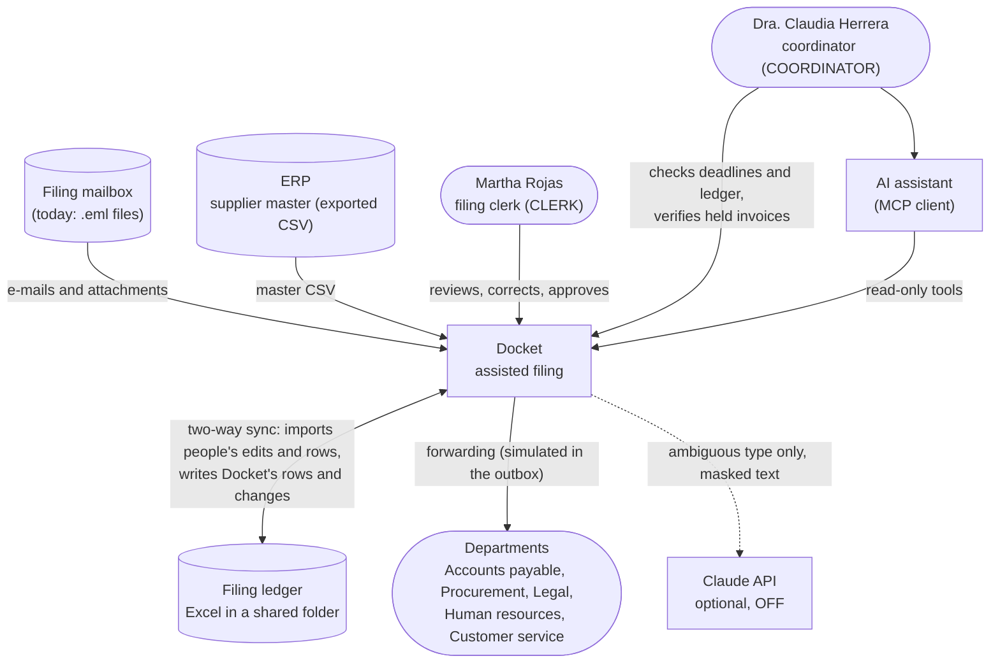
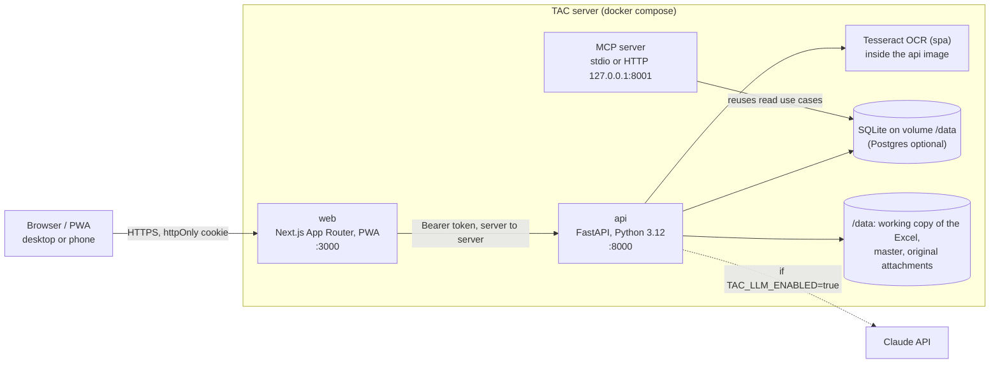
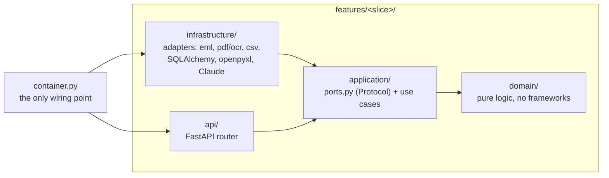

# 01 — Architecture

How Docket is built, how data flows, how it is deployed and —IT's question— where each piece of data lives and who sees it. Summary: [00-resumen-ejecutivo](00-resumen-ejecutivo.md). Per-feature details: [../features/](../README.md).

## 1. Context (C4 level 1)



## 2. Containers (C4 level 2)



| Container | Technology | Responsibility |
|---|---|---|
| `web` | Next.js, Tailwind v4, shadcn/ui, Serwist | Spanish UI; keeps the token in an httpOnly cookie and calls the API from the server |
| `api` | FastAPI, SQLAlchemy 2, pdfplumber, pytesseract, openpyxl, `holidays`, `prometheus_client` | Ingestion (with a background import worker thread, `ImportWorker`), classification, rules, ledger, deadlines, audit, retention, habeas data; `/metrics` and `/api/ready` |
| `mcp` | MCP Python SDK | Read-only tools for an AI assistant |
| DB | SQLite (on-prem) / Postgres | Documents, proposals, ledger, audit, outbox, import queue (`import_jobs`, `import_job_files`) |

## 3. Backend: vertical slices + hexagonal

Each feature is a folder in `api/app/features/<slice>/` with four layers:



**Dependency rule:** `domain <- application <- infrastructure / api`. The domain imports nothing from FastAPI, SQLAlchemy, openpyxl, pdfplumber or the Anthropic SDK. A slice uses another only through its use cases or ports, never through its infrastructure.

| Slice | What it does | Document |
|---|---|---|
| `ingestion` | Reads `.eml`, splits attachments and body, extracts text, OCR; import queue for month-end peaks (`EnqueueImport`, `ProcessNextImport`, `JobQueue` port → `SqlJobQueue`, `ImportWorker` thread started in the app lifespan when `TAC_WORKER_ENABLED`) | [ingestion](../features/ingestion.md) |
| `classification` | Rule-based document type with margin; field extraction; optional Claude adapter | [classification](../features/classification.md) |
| `filing` | Martha's rules (`domain/rules.py`), inbox, correction, approval, outbox; the coordinator's verification of held invoices (`application/verify_hold.py`, `api/verifications_router.py` → `/api/verifications`) | [filing](../features/filing.md) |
| `ledger` | Consecutive numbers, duplicates, client's Excel with two-way sync (`SyncLedger`, three-way merge per cell in `domain/sync.py`, `SqlSyncStore`; periodic `PeriodicTask`, `TAC_LEDGER_SYNC_SECONDS`) | [ledger](../features/ledger.md) |
| `deadlines` | Deadline states, weekly report | [deadlines](../features/deadlines.md) |
| `catalogs` | Supplier master and departments | [catalogs](../features/catalogs.md) |
| `audit` | Append-only log | [audit](../features/audit.md) |
| `records` | Document retention under Ley 594 de 2000: retention schedule (TRD) per document type, what is due, controlled disposal (content purged, ledger row kept as index) | [records](../features/records.md) |
| `privacy` | Habeas data under Ley 1581 de 2012: personal-data inventory and safeguards, data-subject lookup with the legal answer deadline | [privacy](../features/privacy.md) |
| `mcp/server.py` | Read-only tools | [mcp](../features/mcp.md) |

Shared: `shared/domain/models.py` (enums and models), `business_calendar.py` (Colombian business days), `identifiers.py` (NIT, accounts), `pagination.py` (`Page[T]`, `PageRequest`, default 50, max 200), `privacy.py` (`mask_personal_data`, `mask_identifier`, used by the Claude adapter and the audit); `shared/infrastructure/client_vocabulary.py` translates English codes into the Spanish values of the Excel; `shared/infrastructure/observability.py` holds the Prometheus metrics, the JSON log formatter with `request_id`, and `MeteredAuditLog`, a decorator over the `AuditLog` port that turns audited business events into metrics without touching the domain.

## 4. Frontend: screaming architecture + atomic design

```
web/src/
  app/(app)/inbox | documents/[id] | ledger | deadlines | verifications | compliance | settings   routes; each page.tsx composes a template
  app/(app)/error.tsx                                                error boundary: retry or sign in again
  app/login, app/offline, app/manifest.ts, app/sw.ts                 session and PWA
  features/inbox | document-review | ledger | deadlines | verifications | compliance | settings | session
     components/ (molecules, organisms, templates)  api/  hooks/  model/ (types + mappers)  __tests__/
  shared/ui/ primitives -> atoms -> molecules -> organisms -> templates
  shared/i18n/es.ts   shared/lib/api-client.ts (server)   shared/theme/tokens.css
```

No feature imports another; shared pieces move to `shared/`. Navigation is per role (`shared/ui/organisms/AppNav.tsx`: `ROLE_NAV`, `ROLE_HOME`): the clerk gets Bandeja, Vencimientos, Libro, Ajustes and lands on `/inbox`; the coordinator gets Vencimientos, Por verificar, Libro, Bandeja, Cumplimiento and lands on `/deadlines`. Inbox and ledger pages live in the URL (`?offset=`, shared `Pagination` molecule). Login redirects to the home of the role the API returns. The API's `UPPER_SNAKE_CASE` codes are translated to Spanish only in `shared/i18n/es.ts`.

## 5. End-to-end data flow

```mermaid
sequenceDiagram
    actor M as Martha (CLERK)
    actor H as Dra. Herrera (COORDINATOR)
    participant W as web
    participant API as api
    participant ING as ingestion
    participant CLS as classification
    participant FIL as filing (rules)
    participant LED as ledger
    participant DB as DB
    participant AUD as audit

    M->>W: "Leer buzón" (read mailbox)
    W->>API: POST /api/ingestion/jobs/mailbox
    API-->>W: 202 IMPORT_QUEUED (job id)
    loop until DONE / FAILED
        W->>API: GET /api/ingestion/jobs/{id}
    end
    API->>ING: ImportWorker claims the job, imports .eml (idempotent)
    ING->>ING: split into documents, text / local OCR
    ING->>CLS: text + subject
    CLS-->>FIL: type + margin (+ AI suggestion if enabled)
    FIL->>LED: duplicate? (NIT + number)
    FIL->>FIL: master, PO, fraud, business-day terms
    FIL->>DB: immutable proposal + READY / NEEDS_REVIEW status
    FIL->>AUD: EMAILS_IMPORTED, DOCUMENT_PROPOSED
    M->>W: opens a document, sees reasons and evidence
    opt the proposal is wrong
        M->>W: Correct
        W->>API: POST /api/inbox/{id}/correct
        API->>AUD: DOCUMENT_CORRECTED (changed fields)
    end
    M->>W: "Aprobar y radicar" (one, or "Aprobar listos")
    W->>API: POST /api/inbox/approve | /approve-ready
    API->>LED: next consecutive (lock + unique constraint)
    LED->>DB: ledger row TAC-2026-ER-#####
    API->>DB: outbox message (simulated)
    API->>AUD: DOCUMENT_APPROVED / DOCUMENTS_APPROVED
    opt invoice held for possible fraud (HOLD_FOR_VERIFICATION): never approved (409 HOLD_REQUIRES_ESCALATION)
        M->>W: "Alertar a la Dra. Herrera" → "Enviar alerta"
        W->>API: POST /api/inbox/{id}/escalate
        API->>LED: filing number, ledger ON_HOLD
        API->>DB: outbox FRAUD_ALERT (nothing to payables)
        API->>AUD: HOLD_ESCALATED
        H->>W: "Por verificar": arrived vs master, phone call to the supplier
        W->>API: POST /api/verifications/{id}/release | /reject + note
        API->>LED: ON_HOLD → DELIVERED (VERIFIED_BY_PHONE) or REJECTED (FRAUD_CONFIRMED)
        API->>DB: outbox FORWARD_TO_DEPARTMENT or FRAUD_CONFIRMED
        API->>AUD: HOLD_RELEASED / HOLD_REJECTED
    end
    M->>W: Export Excel
    W->>API: GET /api/ledger/export (sync first; the shared book, or a copy if it is open)
```

## 6. Deployment

| Environment | How | Status |
|---|---|---|
| **On-prem (recommended)** | `docker compose up --build` on a TAC server: `web` :3000, `api` :8000, `docket-data` volume at `/data` with SQLite | Configuration ready (`docker-compose.yml`) |
| **Cloud demo** | API on Render (Docker web service, `starter` plan, 1 GB disk at `/data`, generated tokens) via `render.yaml`; web on Vercel. Fictitious data only | Configs prepared, **not deployed yet** |

MCP runs next to the API, over stdio (the assistant launches it locally) or HTTP bound to `127.0.0.1:8001`.

Operations: each API instance exposes Prometheus metrics at `GET /metrics` (HTTP counts and latency by route template, proposals, review reasons, approvals, corrections, resolved holds, import job duration and queue size; counts only, no personal data) and readiness at `GET /api/ready` (database, ledger template, OCR — `DEGRADED` when Tesseract is missing —, import worker; `READY` 200 / `NOT_READY` 503). Logs are JSON lines with a `request_id` taken from or returned in the `X-Request-ID` header. On boot, jobs left `RUNNING` by a crash go back to the queue. No alert rules or dashboards are shipped yet. See [observability](../features/observability.md).

## 7. Security and data: where everything lives and who sees it

| Data | Where it lives | Who sees it | Control |
|---|---|---|---|
| Original e-mails and attachments | DB (`DocumentRow.source_file`) on TAC's server | Authenticated CLERK and COORDINATOR | Served only by the API with a token |
| Extracted text / OCR | DB; OCR is **local** Tesseract | Same | Nothing leaves TAC |
| Proposals and decisions | DB (immutable proposal + current decision) | Same; only CLERK modifies; only COORDINATOR resolves held invoices | Role checked on every endpoint (`require_clerk`, `require_coordinator`) |
| Filing ledger | DB + the client's shared Excel, synced both ways (bases in `ledger_sync_base`, last state in `ledger_sync_state`) | Accounting and Legal (as today, and they keep editing it), Docket users | Columns and formats untouched; Docket writes only the cells it changed, people's edits win on conflict, never written while open, deleted rows restored, every merge audited |
| Supplier master (bank accounts) | `/data` volume | Docket users; replaced only by CLERK, audited | Invalid upload rejected, previous one kept |
| Audit | DB, append-only table | Docket users (`GET /api/audit`) | No edit or delete endpoint; free-text discard reasons and disposal record references masked (`mask_personal_data`) |
| Data-subject lookups (habeas data) | Answered on the fly from ledger and inbox; only the audit event `PRIVACY_SUBJECT_LOOKUP` is stored | COORDINATOR only | Identifier sent in the request body, never in the URL or access logs; audit keeps it masked (`***` + last 4) |
| Documents past their retention term | Original file and extracted text purged; the ledger row stays as index (flag `DISPOSED`) | Disposal by COORDINATOR only, with the committee's record (acta) | Only `DUE_FOR_DISPOSITION` + `DESTROY`; audited as `RECORD_DISPOSED` |
| Metrics and logs | `/metrics` per API instance; JSON logs on stdout | Whoever operates the server | Counts and route templates only (never raw ids, identifiers or text) |
| Session token | **httpOnly** cookie, `SameSite=Lax`, `Secure` in production, 12 h | Not readable by browser JavaScript | The API is called from the Next server |
| Text sent to AI | Only if `TAC_LLM_ENABLED=true` (default `false`) | Model provider | Masking of e-mails, IDs/NITs and long numbers; max 6,000 characters |
| Assistant queries (MCP) | DB reads | Whoever runs the assistant on the machine | Read-only (`readOnlyHint` annotations), bound to localhost, no authentication (gap) |
| Client `material/` | Disk, **read-only** | — | Tests and CLI work on copies |

Roles: `CLERK` (Martha: import, correct, discard, approve, escalate a suspected fraud with `POST /api/inbox/{id}/escalate`, replace the master) and `COORDINATOR` (Dra. Herrera: reads everything and resolves held invoices with `POST /api/verifications/{id}/release` or `/reject`; an approval attempt returns `FORBIDDEN`, see `api/tests/api/test_api.py::test_coordinator_cannot_approve`, and so does the clerk trying to resolve a hold, see `test_only_the_coordinator_resolves_held_invoices`). `GET /api/verifications` is open to both roles. Disposing of a record (`POST /api/retention/{filing_number}/dispose`) and data-subject requests (`POST /api/privacy/subject-requests`) also require `COORDINATOR`; the retention schedule and list and the personal-data inventory are readable by both. Known gaps in [05-atributos-calidad](05-atributos-calidad.md).
