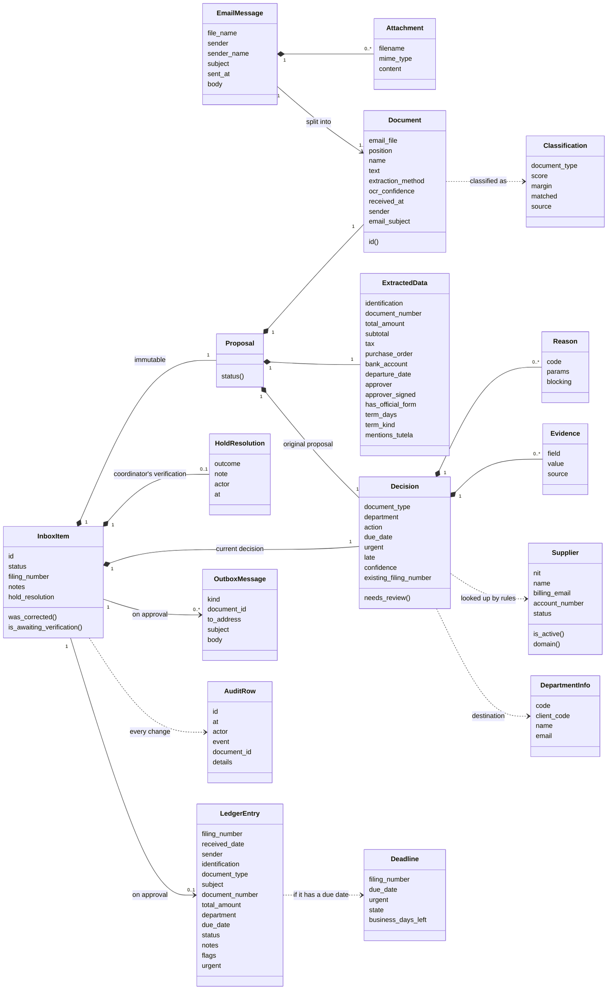
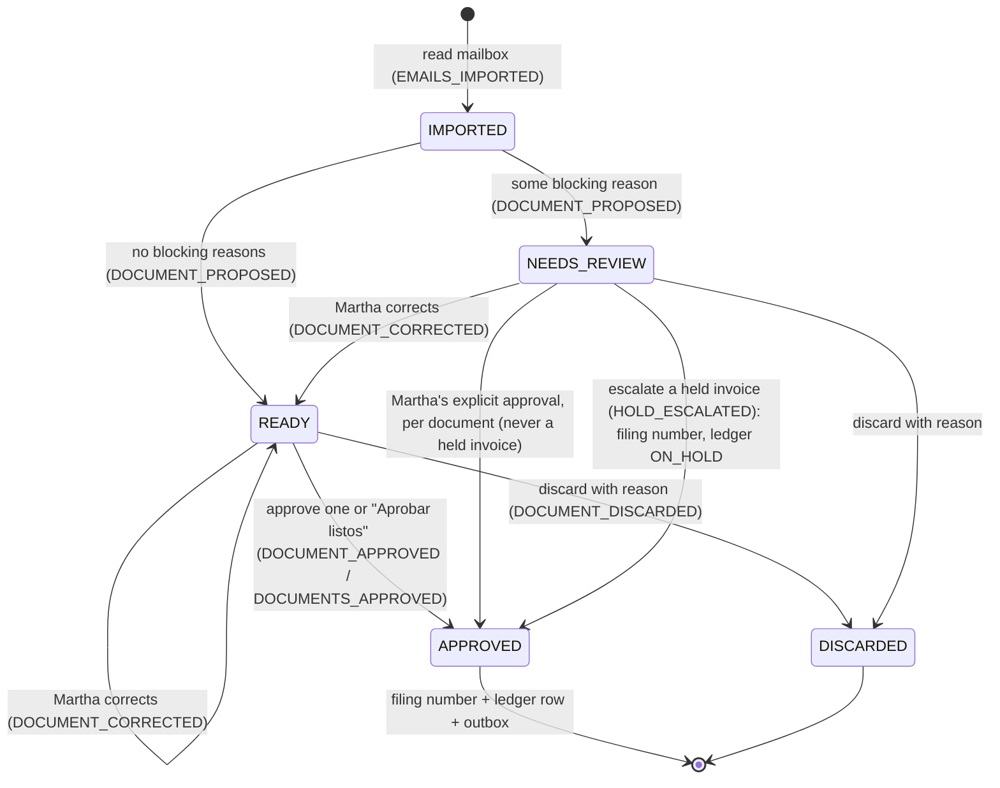
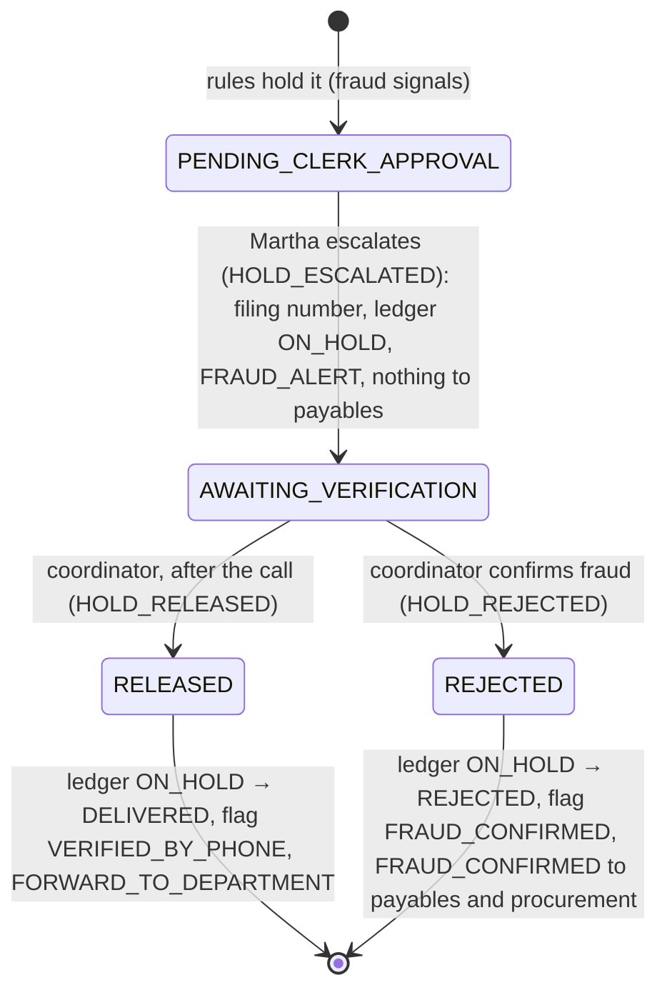

# 04 — Domain model

Entities, enumerations and the life cycle of a document. Names are the code's (English); the UI and the Excel translate them to Spanish. Main source: `api/app/shared/domain/models.py`.

## 1. Class diagram

| Entity | Where | Note |
|---|---|---|
| `EmailMessage`, `Attachment` | `features/ingestion/domain/email_message.py` | The parsed `.eml` |
| `Document` | `shared/domain/models.py` | Fileable unit: an attachment or the body. `id = "<email>__<position>"` |
| `Classification` | `features/classification/domain/classifier.py` | Type, score and margin over the runner-up; `source` says whether it came from rules or AI |
| `ExtractedData` | `shared/domain/models.py` | The fields that matter for the type |
| `Decision`, `Reason`, `Evidence` | `shared/domain/models.py` | What it proposes, why (stable codes) and backed by which fragments |
| `Proposal` | `shared/domain/models.py` | Document + data + decision; its `status` derives from blocking reasons |
| `InboxItem` | `features/filing/domain/inbox_item.py` | Immutable proposal + current decision (after corrections) + filing number; `is_awaiting_verification` = escalated (status `APPROVED`), held and not yet resolved |
| `HoldResolution` | `features/filing/domain/inbox_item.py` | The coordinator's verification of a held invoice: `outcome` (`HoldOutcome`), `note` (≥ 5 characters), `actor`, `at` |
| `LedgerEntry` | `shared/domain/models.py` | A ledger row with the 12 columns of the client's Excel |
| `Supplier`, `DepartmentInfo` | `features/catalogs/domain/catalogs.py` | Supplier master and departments |
| `Deadline` | `features/deadlines/domain/deadline.py` | Due date with state and business days left; includes documents not filed yet |
| `OutboxMessage` | `features/filing/domain/outbox_message.py` | What would be sent (simulated) |
| `AuditRow` | `shared/infrastructure/db.py` | Audit event, append-only |

## 2. Enumerations

| Enum | Values | Meaning (Spanish label) |
|---|---|---|
| `DocumentType` | `INVOICE`, `TRAVEL_EXPENSE_REQUEST`, `PETITION`, `OVERSIGHT_NOTICE`, `COMPLAINT`, `QUOTATION`, `ADVERTISING`, `OTHER` | Factura, solicitud de viáticos, derecho de petición, oficio de ente de control o juzgado, queja, cotización, publicidad, otro |
| `Department` | `ACCOUNTS_PAYABLE`, `PROCUREMENT`, `HUMAN_RESOURCES`, `LEGAL`, `CUSTOMER_SERVICE`, `ADMIN_COORDINATION`, `SENDER`, `NONE` | Cuentas por pagar, Compras, Talento humano, Jurídica, Atención al usuario, Coordinación (fraud verification), the sender, none |
| `Action` | `FILE`, `RETURN_TO_SENDER`, `DO_NOT_FILE`, `REPLY_WITH_EXISTING_NUMBER`, `HOLD_FOR_VERIFICATION` | File, return, do not file, reply with the existing number, hold for verification |
| `DocumentStatus` | `READY`, `NEEDS_REVIEW`, `APPROVED`, `DISCARDED` | Ready, needs review, approved, discarded |
| `LedgerStatus` | `DELIVERED`, `IN_PROGRESS`, `ON_HOLD`, `REJECTED` | Delivered to the department, in progress (term running), on hold (verification with the supplier), rejected (fraud confirmed by the coordinator; Excel: "Rechazada - fraude confirmado") |
| `HoldOutcome` | `RELEASED`, `REJECTED` | Verified by phone with the supplier and released for payment; fraud confirmed, never paid (`features/filing/domain/inbox_item.py`) |
| `VerificationState` | `PENDING_CLERK_APPROVAL`, `AWAITING_VERIFICATION`, `RELEASED`, `REJECTED` | Where a held invoice stands: still in Martha's inbox, filed and waiting for the coordinator's call, released, fraud confirmed (string constants in `features/filing/application/queries.py`) |
| `DeadlineState` | `OVERDUE`, `DUE_TODAY`, `DUE_THIS_WEEK`, `DUE_NEXT_WEEK`, `LATER` | Overdue, due today, this week, next week, later |
| `OutboxKind` | `FORWARD_TO_DEPARTMENT`, `RETURN_TO_SENDER`, `REPLY_EXISTING_NUMBER`, `FRAUD_ALERT`, `FRAUD_CONFIRMED` | Kind of simulated message (`FRAUD_CONFIRMED`: "do not pay" notice to Accounts payable and Procurement) |

Reason codes (`Reason.code`) are listed in [filing](../features/filing.md).

## 3. Life cycle of a document

- `IMPORTED` is transient: within the same import the document is classified, rules are applied and it is stored as `READY` or `NEEDS_REVIEW`. The code only has the four `DocumentStatus` states.
- A correction stores the new decision, keeps the original proposal (`InboxItem.was_corrected`), turns the reasons non-blocking (still visible), adds `REVIEWED_BY_HUMAN` and moves the document to `READY`: a person has reviewed it.
- "Aprobar listos" (approve ready) never takes `NEEDS_REVIEW` documents; those are approved by selecting them explicitly, after Martha reviews them. The API refuses to file (`FILE` or `HOLD_FOR_VERIFICATION`) a document without a department. A `HOLD_FOR_VERIFICATION` document is never approved (`HOLD_REQUIRES_ESCALATION`), not even after a correction left it `READY`: it is escalated.
- On approval (or escalation, for holds): `FILE` and `HOLD_FOR_VERIFICATION` get a filing number and a ledger row; `RETURN_TO_SENDER`, `REPLY_WITH_EXISTING_NUMBER` and `DO_NOT_FILE` get no number. Each produces its outbox message where applicable.
- `APPROVED` and `DISCARDED` are final: they cannot be corrected or discarded again (`DOCUMENT_ALREADY_CLOSED`). The only later change is the coordinator's resolution of a held invoice, which sets `hold_resolution` and updates the ledger row, not `DocumentStatus`.

### Held invoice (`HOLD_FOR_VERIFICATION`) after escalation

- States are `VerificationState`, derived by `verification_state()`: a `hold_resolution` gives its outcome; otherwise `APPROVED` means `AWAITING_VERIFICATION` and anything else `PENDING_CLERK_APPROVAL`. Discarded held documents are not listed.
- `VerifyHold` only acts when `is_awaiting_verification` is true and the ledger row is `ON_HOLD` (otherwise `HOLD_NOT_PENDING`); the flag `HOLD_FOR_VERIFICATION` is removed from the row. On release the department is `release_department()`: `ACCOUNTS_PAYABLE` if the invoice has a purchase order, else `PROCUREMENT`.
