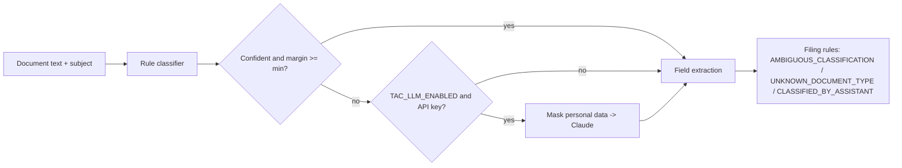

# Classification

## Purpose

Decides **what each document is** and **extracts the fields that matter** for that type (NIT, invoice number, purchase order, bank account, totals, travel dates, approver, terms written in a notice, tutela mentions). This is the "lo abro, miro qué es" step of Martha's routine, and the input every filing rule needs.

The core is deterministic (weighted Spanish phrases + regular expressions). An optional AI second opinion exists but is **off by default** because TAC's IT has not approved any AI tool.

## Who uses it

- **Clerk (CLERK)**: indirectly. She sees the resulting `document_type`, the extracted `data` and, when the system is unsure, the reasons `AMBIGUOUS_CLASSIFICATION` / `UNKNOWN_DOCUMENT_TYPE`. She can change the type with a correction (see [filing](filing.md)).
- **Coordinator (COORDINATOR)**: reads the result; decides with IT whether the AI second opinion may be enabled.
- **AI assistant via MCP**: no access to classification itself; it only reads its results through the ledger and `pending_review`.

This slice has no HTTP router: it runs inside the import, called by `ProposeFiling`.

## How it works

1. `classify(text, subject)` (`classification/domain/classifier.py`) folds the subject + text (lowercase, no accents) and scores each type by the weighted signals in `SIGNALS`, e.g. `factura electronica` (3), `cufe` (3) for `INVOICE`; `th-f-012` (4) for `TRAVEL_EXPENSE_REQUEST`; `derecho de peticion` (4), `solicito` (1.5), `les pido` (1.5) for `PETITION`; `contraloria`, `procuraduria`, `personeria`, `juzgado` (3) for `OVERSIGHT_NOTICE`; `queja` (3), `placa`, `bascula`, `transportador` for `COMPLAINT`; `cotizacion` for `QUOTATION`; `webinar`, `no deseas recibir` for `ADVERTISING`.
2. The best type wins if its score is at least `MIN_SCORE = 3`; otherwise the type is `OTHER`. The result carries the **margin** against the runner-up and the patterns that matched.
3. `ClassifyDocument` (`classification/application/classify_document.py`) flags the result as **ambiguous** when it is not confident or the margin is below `TAC_MIN_CLASSIFICATION_MARGIN` (default 2.0).
4. Only if it is ambiguous **and** the assisted classifier is enabled **and** there is text, the LLM is asked for a type. Its answer replaces the type with `source="LLM"`; filing then adds the blocking reason `CLASSIFIED_BY_ASSISTANT`, so a person always confirms it.
5. `extract_for(type, text, company_nit)` (`classification/domain/field_extractor.py`) extracts the fields for the chosen type:
   - `INVOICE` / `QUOTATION`: supplier NIT (the first NIT that is **not** TAC's own `900.100.200-3`), document number, purchase order `OC-YYYY-NNNN`, bank and account, subtotal, IVA, total, issue date.
   - `TRAVEL_EXPENSE_REQUEST`: name, national ID, `TH-F-012` present, departure date, approver, "Firma del jefe (firmado)", amount requested.
   - `PETITION` / `OVERSIGHT_NOTICE` / `COMPLAINT`: official number, national ID, term written in the notice (`cinco (5) días hábiles` → `5`, `BUSINESS_DAYS`; also `calendario`), whether "tutela" is mentioned.



### Optional AI second opinion

- Wiring (`app/container.py`): `ClaudeClassifier` is built only when `TAC_LLM_ENABLED=true` **and** `TAC_ANTHROPIC_API_KEY` is set; otherwise `DisabledClassifier` (never suggests anything) is used. Model: `TAC_LLM_MODEL`.
- Before sending, `mask_personal_data` (`shared/domain/privacy.py`, shared with the audit and the [privacy](privacy.md) slice) replaces e-mail addresses with `[EMAIL]`, dotted IDs/NITs with `[ID]` and long digit runs (accounts, phones) with `[NUMBER]`; the text is truncated to 6,000 characters.
- The model must answer with exactly one `DocumentType` code; anything else, or any `APIError`, is ignored and the rule result stands (which already goes to review because it was ambiguous).
- `GET /api/health` reports `data.llm_enabled`.

## Business rules

| Rule | Source | Where in code |
|---|---|---|
| A petition does not need the words "derecho de petición": "solicito", "les pido que me informen"… also count, unless it is a terminal user's complaint | Martha: *"a veces no dice 'derecho de petición' en ningún lado: la gente escribe 'solicito', 'les pido que me informen', y si no es una queja de un usuario del terminal, eso también es una petición."* | `SIGNALS[PETITION]`, complaint signals (`placa`, `bascula`, `transportador`) |
| Letters from Contraloría, Procuraduría, Personería or a court are oversight notices (urgent, own term) | Martha: *"Cuando escribe un ente de control —Contraloría, Procuraduría, Personería— o un juzgado"* | `SIGNALS[OVERSIGHT_NOTICE]` |
| The term of an oversight notice is the one written in it, not the legal one | Martha: *"el plazo es el que diga el oficio, no el de la ley"* | `extract_term` |
| Tutela threat makes a request urgent | Martha: *"También si el ciudadano dice que va a poner una tutela: urgente."* | `TUTELA_RE` → `mentions_tutela` |
| Travel requests use form TH-F-012 signed by the boss | Martha: *"mandan el formato TH-F-012 con la firma del jefe"* | `extract_travel_request` |
| When unsure, ask rather than guess | Martha: *"que cuando no esté seguro me pregunte, en vez de inventarse algo"* | ambiguity margin, `OTHER` below `MIN_SCORE` |
| AI is optional and off; personal data is protected | Dra. Herrera: *"Sistemas todavía no ha aprobado ninguna herramienta de IA"*; *"les pido cuidado con la información"* | `DisabledClassifier`, `mask_personal_data`, `TAC_LLM_ENABLED=false` |

## API endpoints / screens

No endpoints of its own. Its output appears in the inbox item returned by `GET /api/inbox/{id}` (`decision.document_type`, `data`, reasons), and `GET /api/health` → `HEALTHY` with `{"llm_enabled": false}`.

## Codes

Document types (`DocumentType`):

| Code | Meaning (EN) | Significado (ES) | Blocking? |
|---|---|---|---|
| `INVOICE` | Supplier invoice or "cuenta de cobro" | Factura o cuenta de cobro | No |
| `TRAVEL_EXPENSE_REQUEST` | Travel expense request (form TH-F-012) | Solicitud de viáticos (formato TH-F-012) | No |
| `PETITION` | Right-of-petition request (explicit or implicit) | Derecho de petición (explícito o implícito) | No |
| `OVERSIGHT_NOTICE` | Notice from a control body or court | Oficio de ente de control o juzgado | No |
| `COMPLAINT` | Complaint from a terminal user (carrier, customer) | Queja de usuario del terminal (transportador, cliente) | No |
| `QUOTATION` | Supplier quotation | Cotización | No |
| `ADVERTISING` | Advertising / newsletters | Publicidad | No |
| `OTHER` | Could not be identified | No se pudo identificar | Yes, via `UNKNOWN_DOCUMENT_TYPE` |

Reasons produced from classification results (emitted by the filing rules):

| Code | Meaning (EN) | Significado (ES) | Blocking? |
|---|---|---|---|
| `UNKNOWN_DOCUMENT_TYPE` | No type reached the minimum score | Ningún tipo alcanzó el puntaje mínimo | Yes |
| `AMBIGUOUS_CLASSIFICATION` | Two types are too close (`params.candidates`) | Dos tipos quedaron muy parejos (`params.candidates`) | Yes |
| `CLASSIFIED_BY_ASSISTANT` | The type was suggested by the AI assistant and must be confirmed | El tipo lo sugirió el asistente de IA y debe confirmarse | Yes |

## Limitations

- Keyword rules were written from the sample mailbox. On the blind set (60 e-mails nobody tuned the rules to) 4 travel requests with a different layout were not recognized as approved and 1 consultation was taken as a complaint; see [evaluation](evaluation.md). New document styles may need new signals in `SIGNALS`, validated on a new blind set.
- Extraction is regex-based: unusual layouts (NIT without the "NIT" label, invoice numbers outside the `No. XX-NNNN` pattern) yield empty fields, which filing turns into `INVOICE_MISSING_FIELDS` (review), not a wrong value.
- Masking does not remove personal **names**. `mask_personal_data` is covered by `test_assisted_classifier.py::test_personal_data_is_masked_before_leaving_tac` and by the masked discard reasons test in [privacy](privacy.md); the live Claude call is not exercised by the tests.
- The LLM is only a classifier: it never extracts fields or takes decisions.

## How it is tested

- `api/tests/features/classification/test_classifier.py`: every mailbox document gets the expected type, implicit petition without the words "derecho de petición", empty text is `OTHER`.
- `api/tests/features/classification/test_field_extractor.py`: invoice fields, invoice without purchase order, travel request fields, term in words and digits, account change announced in the body.
- `api/tests/features/filing/test_rules.py`: `test_ambiguous_classification_needs_review`, `test_unknown_type_needs_review`.
- Golden: `api/tests/golden/test_golden.py` against `material/4-para-medirte/esperado-parcial.csv` and `api/tests/golden/esperado-completo.csv`. Tests always run with `llm_enabled=False` (`tests/conftest.py`).

```bash
./scripts/harness-verify.sh api/tests/features/classification/test_classifier.py api/tests/features/classification/test_field_extractor.py
```

## Changelog

- 2026-11-24: `mask_personal_data` moved from the classification adapter to `shared/domain/privacy.py` (also used by the audit); limitations now point to the blind evaluation.
