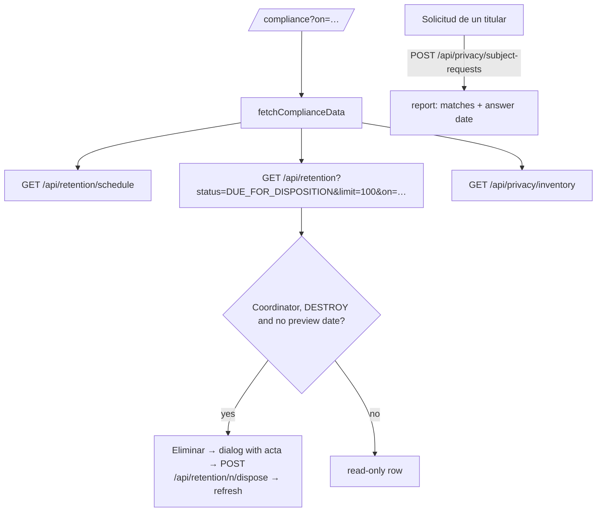

# Compliance (screen)

## Purpose

`/compliance` ("Cumplimiento") is the coordinator's page for the two legal duties Docket's data brings with it: **document retention** (Ley 594 de 2000) and **personal data protection** (Ley 1581 de 2012). In one place Dra. Herrera sees the proposed retention schedule (TRD), the records whose term has ended (today or at a future date) and disposes of them with the committee's record, reads the personal data inventory and its safeguards, and answers a data subject's inquiry or claim with the legal deadline. Backend side: [records](records.md) and [privacy](privacy.md).

## Who uses it

- **Coordinator (COORDINATOR, Dra. Herrera)**: "Cumplimiento" is the fifth item of her menu (see [session](session.md)). She sees everything and is the only one with the "Eliminar" button and the "Solicitud de un titular" form.
- **Clerk (CLERK, Martha)**: the page is not in her menu. If she opens it by URL she sees the schedule, the due list and the inventory read-only: no disposal button and no subject request form (the API would answer `FORBIDDEN` anyway).
- **AI assistant via MCP**: no access.

## How it works

1. `app/(app)/compliance/page.tsx` renders `ComplianceTemplate` (Server Component) inside `<Suspense>` with `ComplianceSkeleton` (`aria-busy`, "Cargando cumplimiento").
2. The preview date comes from the URL (`?on=YYYY-MM-DD`); `parsePreviewDate` (`model/labels.ts`) accepts only ISO dates, anything else means today.
3. `fetchComplianceData` (`api/compliance-queries.ts`) makes three API calls in parallel on the server: the schedule, the records `DUE_FOR_DISPOSITION` (first 100, with `on` when previewing) and the inventory. The template also reads the session to decide what the role may do.
4. **Disposal** is a Server Action (`disposeRecordAction`) that posts the disposal record and then `refresh()`es the route, so the record leaves the due list.
5. **Subject request** is a Server Action (`subjectRequestAction`) that sends the identifier **in the body** and returns the report to the client component, which renders it without reloading.



### Screens and states

- **Header**: eyebrow "Coordinación", title "Cumplimiento", description "Retención documental (Ley 594 de 2000) y protección de datos personales (Ley 1581 de 2012)."
- **"Tabla de retención documental"**: note that it is an initial proposal the Comité Interno de Archivo must approve and that years count from the close of the reception year; table with Tipo documental, Gestión, Central (e.g. "2 años"), Disposición final ("Conservación total", "Eliminación", "Selección (comité)") and Fundamento.
- **"Documentos que cumplieron su retención"**: "Nada se elimina antes de tiempo ni sin acta." A GET form "Ver a la fecha" (the design-system `DatePicker`: the app's own calendar in Spanish, "Hoy" = the case date, "Borrar"; its hidden input submits `on`) + "Consultar" reloads the page with `?on=`. Empty state: "Ningún documento ha cumplido su tiempo de retención" (plus "al <date>" when previewing). Each due record shows filing number · type · "retención hasta <date>" · disposition, and for the coordinator, when the disposition is "Eliminación" and she is not previewing, an **"Eliminar"** button.
- **Disposal dialog**: "Eliminar TAC-2026-ER-#####"; explains that the original file and the text with personal data are deleted and the ledger row is kept as index with the date and the record; field "Acta de eliminación del comité de archivo" (placeholder "Ej.: Acta 03 de 2037"); "Cancelar" / "Eliminar contenido" (disabled until 3 characters; spinner while running). Success toast: "TAC-2026-ER-#####: contenido eliminado; el índice queda en el libro."
- **"Datos personales"**: inventory table (Dato, Titulares, "Finalidad y base legal", "Quién lo ve") and the safeguards as green cards with a shield icon.
- **"Solicitud de un titular"** (coordinator only): "Cédula o correo del titular", "Tipo de solicitud" ("Consulta (art. 14)" — "Responder en 10 días hábiles"; "Reclamo (art. 15)" — "Corrección o supresión: 15 días hábiles") and "Buscar" (disabled under 3 characters). The result reads "Titular ***.456: N registro(s). Responder a más tardar el <date>.", lists each match (reference; "Libro" or "Bandeja"; matching fields as "Identificación", "Remitente", "Texto del documento", "Cuerpo del correo"; date; "contenido eliminado" when disposed of) and closes with "La búsqueda queda auditada con el identificador enmascarado." (`aria-live="polite"`).
- **Errors**: toasts with the Spanish label of the code (see Codes).

### On phones and offline

- Tables scroll horizontally inside their own rounded container; wide text cells wrap. The subject request form is one column on phones and a three-column row from `md`. Inputs are 44 px (`h-11`).
- **Offline**: not cached by the service worker (it holds personal data); the offline page is shown instead (see [pwa](pwa.md)).

## Business rules

| Rule surfaced in the UI | Where in code |
|---|---|
| Nothing is destroyed early or without the committee's record: only due `DESTROY` records get the button, and the dialog requires the record | `ComplianceTemplate` (`v.disposition === "DESTROY"`, `!previewDate`), `DisposeButton` (`reference.trim().length < 3`) |
| A preview date is for planning only: no disposal from a future view | `!previewDate` condition |
| Disposal keeps the index: the dialog and the toast say the ledger row stays | `DisposeButton` texts |
| Only the coordinator disposes and runs subject lookups | `isCoordinator` in `ComplianceTemplate`; API `CoordinatorRole` |
| The data subject's identifier never goes in the URL | `subjectRequestAction` posts it in the body |
| The answer deadline is shown with the legal article | `SubjectRequestForm` select descriptions and result |
| The lookup is audited without the identifier | result caption; API `PRIVACY_SUBJECT_LOOKUP` |

## API endpoints / screens

Route: `/compliance` (`web/src/app/(app)/compliance/page.tsx`), feature `web/src/features/compliance/`. All calls run on the Next.js server with the token from the httpOnly cookie.

| Called from | Method | Path | Used for |
|---|---|---|---|
| `fetchComplianceData` | GET | `/api/retention/schedule` | TRD table |
| `fetchComplianceData` | GET | `/api/retention?status=DUE_FOR_DISPOSITION&limit=100[&on=…]` | due list |
| `fetchComplianceData` | GET | `/api/privacy/inventory` | inventory and safeguards |
| `disposeRecordAction` (Server Action) | POST | `/api/retention/{filing_number}/dispose` (`record_reference`) | "Eliminar contenido" |
| `subjectRequestAction` (Server Action) | POST | `/api/privacy/subject-requests` (`identifier`, `kind`) | "Buscar" |

Main components: `ComplianceTemplate`, `ComplianceSkeleton`, `DisposeButton`, `SubjectRequestForm`; labels in `model/labels.ts` (`dispositionLabel`, `retentionStatusLabel`, `matchFieldLabel`, `parsePreviewDate`).

## Codes

Errors are shown with `describeError` (`shared/i18n/es.ts`).

| Code | Meaning (EN) | Spanish label shown | Blocking? |
|---|---|---|---|
| `RETENTION_NOT_EXPIRED` | The term has not ended | Aún no se cumple el tiempo de retención: no se puede eliminar. | Yes |
| `DISPOSITION_NOT_ALLOWED` | The schedule says conserve or select | La tabla de retención exige conservar este documento. | Yes |
| `DISPOSAL_RECORD_REQUIRED` | The disposal record is missing | Indique el acta de eliminación aprobada por el comité de archivo. | Yes |
| `RECORD_NOT_FOUND` | Unknown filing number | No se encontró el radicado. | Yes |
| `IDENTIFIER_TOO_SHORT` | Not an e-mail and fewer than 6 digits | Escriba la cédula completa o el correo del titular. | Yes |
| `FORBIDDEN` / `UNAUTHORIZED` / `NETWORK_ERROR` | Role, session or connection problem | Su rol no permite esta acción. / Su sesión expiró. Vuelva a ingresar. / No hay conexión con el servidor. | Yes |
| `CONSERVE` / `DESTROY` / `SELECT` | Final disposition | Conservación total / Eliminación / Selección (comité) | — |
| `ACTIVE` / `DUE_FOR_DISPOSITION` / `DISPOSED` | Retention status | Vigente / Cumplió retención / Eliminado | — |

## Limitations

- The due list shows the first 100 records and has no pagination on screen (the API pages; the screen asks for one page).
- `SELECT` records appear in the due list without an action: the committee's selection happens outside Docket.
- The subject request result is not saved: reloading the page clears it; the answer itself is written outside Docket.
- The page has no dedicated Jest test for `DisposeButton` or `SubjectRequestForm`; the disposal dialog is not covered by E2E (nothing is due on the case date).

## How it is tested

- `web/src/features/compliance/__tests__/labels.test.ts`: the preview date accepts only ISO dates; every disposition has a Spanish label.
- `web/src/shared/ui/__tests__/DatePicker.test.tsx`: the preview date field is the design-system calendar, not a native input.
- `web/e2e/coordinator.spec.ts`, "compliance: retention schedule and a data subject request" (project `coordinator`): the coordinator opens `/compliance`, sees "Tabla de retención documental" and "Ningún documento ha cumplido su tiempo de retención", looks up `80.123.456` and gets "Titular ***.456" and "Responder a más tardar el".
- Backend: see [records](records.md) and [privacy](privacy.md).

```bash
./scripts/harness-verify.sh web/src/features/compliance/__tests__/labels.test.ts
./scripts/harness-verify.sh web/e2e/coordinator.spec.ts
```

## Changelog

- 2026-11-24: new `/compliance` screen for the coordinator: TRD table, due records with preview date and controlled disposal, personal data inventory and safeguards, data subject request form.
- 2026-11-24: the preview date uses the design-system `DatePicker`; test `web/src/shared/ui/__tests__/DatePicker.test.tsx`.
