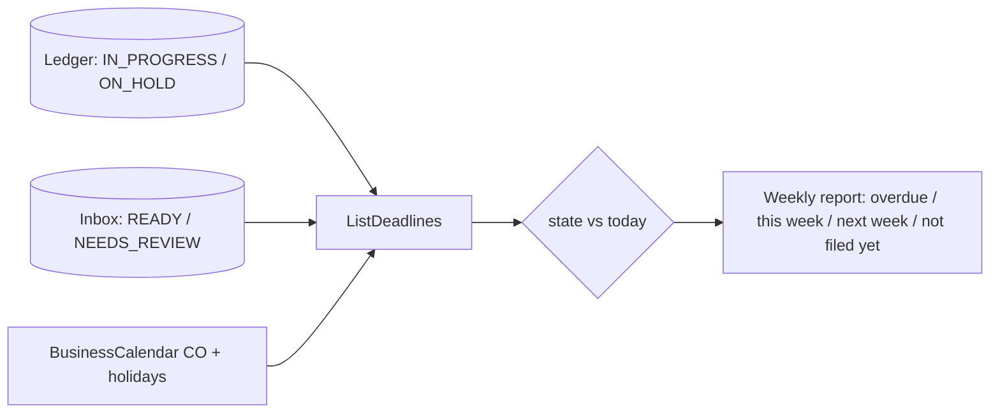

# Deadlines

## Purpose

Tells the coordinator **what is due and how close it is**: petitions, oversight notices and complaints with a legal term running, counted in Colombian business days. It replaces the Friday report Dra. Herrera builds by hand with Martha, and includes documents that have **not been filed yet**, because a legal term runs from reception, not from filing.

## Who uses it

- **Coordinator (COORDINATOR, Dra. Herrera)**: weekly report and deadline list; the `/deadlines` screen is her home (`ROLE_HOME`, see [session](session.md)) and replaces the Friday report (she can print it). Above the report she sees her own summary: invoices waiting for her phone verification and the clerk's backlog.
- **Clerk (CLERK, Martha)**: same read access and same screen, to prioritize urgent items.
- **AI assistant via MCP**: `deadlines_this_week`, `weekly_report`, `list_deadlines` ("what is due this week?", see [mcp](mcp.md)).

## How it works

1. **Due dates are computed in filing** with `BusinessCalendar` (`api/app/shared/domain/business_calendar.py`): counting starts on the business day after reception and skips Saturdays, Sundays and Colombian holidays (`holidays` library, country `CO`, plus `TAC_EXTRA_HOLIDAYS`). In the case period, **16-nov-2026** and **8-dec-2026** are holidays and push due dates (reason `HOLIDAY_IN_TERM`).
2. `ListDeadlines` (`deadlines/application/list_deadlines.py`) merges:
   - ledger entries with a due date in range whose status is `IN_PROGRESS` or `ON_HOLD` (`OPEN_STATUSES`: a row people closed in the shared Excel — "Respondido", "Cerrado"… → `CLOSED` — drops out after the next [ledger sync](ledger.md#two-way-sync-with-the-shared-excel)), and
   - inbox items still `READY` or `NEEDS_REVIEW` with a proposed due date in range (`filing_number = null`).
   Results are sorted by due date, urgent first.
3. Each deadline gets a `state` relative to "today" (`TAC_TODAY`, 2026-11-18 in the case; real date when empty) and `business_days_left` (counting the due date itself when it is a business day; negative when overdue).
4. `BuildWeeklyReport` takes the current week (Monday–Sunday) and the next one: `overdue`, `this_week` (`DUE_TODAY` + `DUE_THIS_WEEK`), `next_week`, and `not_filed_yet` (how many of them are still in the inbox).



Examples with the sample mailbox (today 2026-11-18, week 16–22 Nov): historical petition `TAC-2026-ER-04792` "Certificación laboral" due 19-nov → `DUE_THIS_WEEK`; oversight notice `11.eml` (5 business days) due **23-nov** and copies-only petition `12.eml` due **27-nov** → `DUE_NEXT_WEEK`; petition `10.eml` due 2-dec and complaint `14.eml` due 9-dec → `LATER`.

### The screen (`/deadlines`)

The coordinator lands here after signing in (her `ROLE_HOME`); the clerk reaches it from the "Vencimientos" tab. Both see the same report, and it has no actions other than printing; only the coordinator also sees the summary cards of step 3.

1. `app/(app)/deadlines/page.tsx` renders `DeadlinesTemplate` (Server Component) inside `<Suspense>` with `DeadlinesSkeleton` (`aria-busy`).
2. `fetchWeeklyReport` (`features/deadlines/api/deadline-queries.ts`) calls `GET /api/deadlines/weekly-report` on the server with the token from the httpOnly cookie; `toWeeklyReportView` maps it and marks entries with `filing_number = null` as not filed yet. When the session role is `COORDINATOR`, `fetchCoordinatorSummary` runs in parallel and calls `GET /api/verifications` and `GET /api/inbox/summary`.
3. **Coordinator summary** (`features/deadlines/components/organisms/CoordinatorSummary.tsx`, only for `COORDINATOR`), under the heading region "Lo que requiere su atención", two link cards:
   - **"N facturas por verificar"** (red left border) → `/verifications`: held invoices in `AWAITING_VERIFICATION`, with the hint "Posible fraude: confirme por teléfono antes de liberar." plus "N más aún en la bandeja de radicación." when some are still `PENDING_CLERK_APPROVAL`. See [verifications](verifications.md).
   - **"N documentos pendientes en radicación"** → `/inbox`: `READY` + `NEEDS_REVIEW` from the inbox summary, with "N requieren decisión de una persona." or "Nada atascado en revisión."
4. Header: eyebrow "Semana del 16 de nov de 2026 al 22 de nov de 2026", title "Vencimientos", a description saying terms are counted in business days and run from reception, and **"Imprimir reporte"** (`window.print()`; the button hides itself in print and each group avoids page breaks inside).
5. Counters: "Vencidos", "Esta semana", "Próxima semana" and "Urgentes" (across the three groups, with the hint "N aún sin radicar").
6. Groups: "Vencidos", "Vencen esta semana" and "Vencen la próxima semana", each with its count. Empty groups say "Nada vencido.", "Nada vence esta semana.", "Nada vence la próxima semana."
7. Each `DeadlineCard` shows a calendar tile (day and month), "Urgente" and "Aún sin radicar" badges, the business days left ("Vencido hace 2 días hábiles", "Vence hoy", "1 día hábil", "3 días hábiles"; in red when one day or less is left), the subject, and "type · sender → department · filing number". Urgent cards have a red left border. Cards linked to a document (`document_id`) open its [document review](document-review.md) — read only for the coordinator; historical ledger entries without a document are not links.

### On phones and offline

- Counters are 2×2 on phones and one row of four from `lg`; the groups are a single column until `xl`, where "next week" moves to a second column. Cards truncate long subjects to one line.
- **Offline**: `/deadlines` is one of the two read views the service worker keeps (network first, 4 s timeout, cache `docket-read-views`), so the coordinator can check the last report she opened without a connection. It is as fresh as that visit; opening a card's document needs the network. See [pwa](pwa.md).

## Business rules

| Rule | Source | Where in code |
|---|---|---|
| The coordinator needs, every week, the petitions and notices about to expire | Dra. Herrera: *"Yo necesito saber cada semana qué derechos de petición y qué oficios están por vencerse; hoy eso lo armo a mano con Martha los viernes."* | `BuildWeeklyReport` |
| Terms count from the business day after reception, without Saturdays, Sundays or holidays | Martha: *"Se cuentan desde el día hábil siguiente al que llegó, sin sábados, domingos ni festivos."* | `BusinessCalendar.add_business_days` |
| A missed petition ends in a tutela: urgent ones go first | Martha: *"Una vez se nos venció un derecho de petición y nos pusieron una tutela"* | sorting `(due_date, not urgent)`; `urgent` flag |
| Pending documents count too | Terms run from reception (Ley 1755 de 2015) | inbox items with `filing_number = null` |

## API endpoints / screens

| Method | Path | Role | Request | Success `code` |
|---|---|---|---|---|
| GET | `/api/deadlines` | any | optional `start`, `end` (ISO dates; default: everything) | `DEADLINES_LISTED` |
| GET | `/api/deadlines/weekly-report` | any | — | `WEEKLY_REPORT` |

Deadline keys: `filing_number` (null if not filed yet), `document_id`, `document_type`, `department`, `sender`, `subject`, `received_date`, `due_date`, `urgent`, `state`, `business_days_left`.
Weekly report keys: `today`, `week_start`, `week_end`, `overdue[]`, `this_week[]`, `next_week[]`, `not_filed_yet`. Errors: `401 UNAUTHORIZED`, `422 VALIDATION_ERROR` (bad date).

### Screen

| Route | Calls | Notes |
|---|---|---|
| `/deadlines` (`web/src/app/(app)/deadlines/page.tsx`, feature `web/src/features/deadlines/`) | `GET /api/deadlines/weekly-report`; for `COORDINATOR` also `GET /api/verifications` and `GET /api/inbox/summary` (`fetchCoordinatorSummary`) | Server Component; `GET /api/deadlines` is not used by the screen. `CoordinatorSummary` renders only for the coordinator |

## Codes

| Code | Meaning (EN) | Significado (ES) | Blocking? |
|---|---|---|---|
| `DEADLINES_LISTED` | Deadline list returned | Lista de vencimientos devuelta | — |
| `WEEKLY_REPORT` | Weekly report returned | Informe semanal devuelto | — |
| `OVERDUE` | Due date already passed | Ya se venció | — |
| `DUE_TODAY` | Due today | Vence hoy | — |
| `DUE_THIS_WEEK` | Due later this week (until Sunday) | Vence esta semana (hasta el domingo) | — |
| `DUE_NEXT_WEEK` | Due next week | Vence la próxima semana | — |
| `LATER` | Due after next week | Vence después de la próxima semana | — |
| `HOLIDAY_IN_TERM` | A holiday falls inside the term (reason from filing) | Hay un festivo dentro del plazo | No |

## Limitations

- "Today" is fixed to 2026-11-18 by default (`TAC_TODAY`) for the case; production must set it empty to use the real date.
- Only documents with a due date appear; oversight notices whose term was not found (`OVERSIGHT_TERM_NOT_FOUND`) are missing until the clerk sets a due date.
- `DELIVERED` and `CLOSED` ledger entries are excluded. A petition is closed only when someone writes it in the shared Excel ("Respondido", "Cerrado", "Tramitado"…); it leaves this report after the next sync (up to `TAC_LEDGER_SYNC_SECONDS`). Docket has no "answered" action of its own.
- No push notifications or e-mail digest; the report is pulled (API or MCP).
- Holiday data comes from the `holidays` package; local closures must be added via `TAC_EXTRA_HOLIDAYS`.
- Screen: only overdue, this week and next week are shown; `LATER` deadlines (e.g. `10.eml`, `14.eml`) are not visible in the UI. No "last updated" indicator when read offline. (An API failure now shows the app's `error.tsx` with "Reintentar" / "Ingresar de nuevo", see [session](session.md).)

## How it is tested

- `api/tests/features/deadlines/test_deadlines.py`: week bounds and states, weekly report includes documents not filed yet (04792 this week; `11.eml__0`, `12.eml__0` next week), filed deadlines keep urgency (`business_days_left == 3` for 23-nov).
- `api/tests/shared/test_business_calendar.py`: case holidays, term counts from the next business day, Friday reception skipping weekend and holiday, term crossing 8-dec, `holidays_in_term`, `business_days_between`, extra holidays.
- `api/tests/mcp/test_mcp_server.py` and `api/tests/api/test_api.py::test_full_flow_over_http` (`WEEKLY_REPORT`).

- Screen: `web/src/features/deadlines/__tests__/mappers.test.ts` (Spanish business-days labels, not-filed-yet entries keyed by `document_id`, calendar tile `dateParts`); `web/e2e/filing-flow.spec.ts` step "the coordinator sees this week's and next week's deadlines" (lands on "Vencimientos", sees "Certificación laboral" and "Notificación oficio CD-2026-3345"); `web/e2e/coordinator.spec.ts` (project `coordinator`, runs after `desktop`) checks her home shows the card "1 factura por verificar" and that it opens `/verifications`; `web/e2e/mobile.spec.ts` signs in as the coordinator on a Pixel 7.

```bash
./scripts/harness-verify.sh api/tests/features/deadlines/test_deadlines.py api/tests/shared/test_business_calendar.py
./scripts/harness-verify.sh web/src/features/deadlines/__tests__/mappers.test.ts
./scripts/harness-verify.sh web/e2e/filing-flow.spec.ts web/e2e/coordinator.spec.ts web/e2e/mobile.spec.ts
```

## Changelog

- 2026-11-24: added the `/deadlines` screen (weekly report, cards, print, phone and offline behavior).
- 2026-11-24: coordinator summary (`CoordinatorSummary`, `fetchCoordinatorSummary`): invoices waiting for her verification and the clerk's backlog, shown only to `COORDINATOR`; `/deadlines` is her role home; the "no `error.tsx`" limitation is fixed.
- 2026-11-24: rows closed by people in the shared Excel (`LedgerStatus.CLOSED`) leave the deadlines (`OPEN_STATUSES` = `IN_PROGRESS`, `ON_HOLD`); test `api/tests/features/ledger/test_excel_sync.py::test_legal_closes_a_petition_in_excel_and_it_leaves_the_deadlines`.
