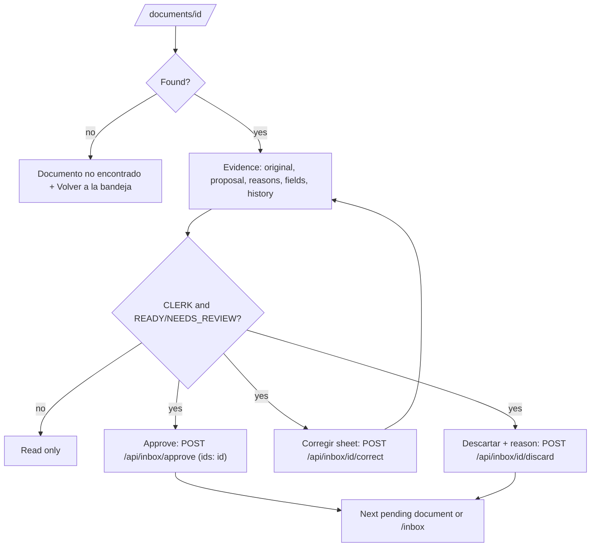

# Document review (screen)

## Purpose

The screen where a person decides about **one** document. `/documents/{id}` puts the original attachment next to the system's proposal, the reasons behind it, the extracted fields and the audit trail, so the clerk can approve, correct or discard with everything in view. It is where the "nothing irreversible without a human" rule becomes a button: documents that need review are approved only here, one by one.

## Who uses it

- **Clerk (CLERK, Martha)**: reads the evidence and approves, corrects or discards. After each action the screen moves her to the next pending document.
- **Coordinator (COORDINATOR, Dra. Herrera)**: opens any document (from the inbox or from a deadline card) and sees exactly the same evidence, reasons and history, including the original file. She **cannot** approve, correct or discard: the action bar is not rendered for her, and the API would answer `FORBIDDEN`. Once the clerk files a held invoice, the coordinator resolves it in [verifications](verifications.md), not here.

## How it works

1. `app/(app)/documents/[id]/page.tsx` renders `DocumentReviewTemplate` inside `<Suspense>` with `DocumentReviewSkeleton`.
2. The template loads in parallel the document (`fetchDocument` → `GET /api/inbox/{id}`), the session, and the id of the next pending document (`fetchNextPendingId` → `GET /api/inbox`, first `NEEDS_REVIEW` then `READY`, in reception order, excluding the current one).
3. `toDocumentDetailView` (`model/mappers.ts`) sorts reasons with blocking ones first, translates them with `describeReason`, keeps the original proposal (`proposal_decision`) next to the current decision, and picks the fields that matter for the document type (`fieldsFor`).
4. Actions are shown only when the document is open (`READY` or `NEEDS_REVIEW`) **and** the role is `CLERK`. They are Server Actions in `api/document-actions.ts` that call the API on the server and `refresh()` the route.
5. After approving or discarding, the client navigates to the next pending document, or back to `/inbox` when nothing is left. Correcting keeps the user on the same document, now marked as corrected, so she can approve it.



### Screens and states

- **Header**: back link "Bandeja", `DocumentStatusBadge` (same mapping as the inbox), "Urgente", "Extemporánea", "Corregido por una persona" when `was_corrected`, the filing number once approved, attachment name, subject, sender and reception time.
- **Action bar** (`ReviewActions`): the approve button's label depends on the proposed action — `FILE` "Aprobar y radicar", `REPLY_WITH_EXISTING_NUMBER` "Aprobar respuesta", `RETURN_TO_SENDER` "Aprobar devolución", `DO_NOT_FILE` "Confirmar: no radicar". A held invoice (`HOLD_FOR_VERIFICATION`) has **no approve button**: instead a red **"Alertar a la Dra. Herrera"** button (`EscalateHoldButton`) opens the dialog "¿Alertar posible fraude?" (the invoice is not approved or sent to payment; it is filed as held so the attempt is on record, and Dra. Herrera calls the supplier at the master's number, never the e-mail's) with "Cancelar" / "Enviar alerta"; success toast "Alerta enviada a la Dra. Herrera" with the filing number. Then "Corregir" and "Descartar". For `NEEDS_REVIEW` documents a note reads "Al aprobar usted confirma que revisó los motivos marcados." (for a held invoice: "Posible fraude: no se aprueba. Alerte a la coordinadora para que lo verifique por teléfono.")
- **Panels**:
  - "Propuesta del sistema" (or "Decisión (corregida)", with a collapsible "Ver la propuesta original"): Qué es, Va para, Acción (red when held), Radicado existente (duplicates), Vence.
  - "Por qué": every reason in Spanish with its code; blocking ones first, on an amber background, with an "Requiere decisión:" prefix for screen readers ("Regla aplicada:" for the rest).
  - "Datos extraídos": per type. Invoices: supplier, NIT, invoice number, purchase order ("Sin OC" in amber), subtotal, IVA, total, issue date, account on the invoice (red on `INVOICE_ACCOUNT_MISMATCH` / `EMAIL_ACCOUNT_MISMATCH`), account and e-mail in the supplier master (e-mail red on `SENDER_DOMAIN_MISMATCH`). Travel requests: TH-F-012 form, approver, boss signature (red when missing), departure date (amber when late), amount. Oversight notices: notice number and term ("No encontrado" in red). Quotations: supplier, NIT, number. Others: sender, identification and "Menciona tutela" in red.
  - "Historial": audit events ("El sistema hizo la propuesta", "Corregido", "Aprobado y radicado", "Descartado") with actor (Sistema, Radicación, Coordinación, Consola) and time.
- **Source viewer** (`SourceViewer`, tabs): "Original" (PDFs in an iframe plus "Abrir en otra pestaña"; other formats as a text preview; the e-mail body itself for body documents), "Texto leído" (extracted/OCR text) and "Correo" (the e-mail body, for attachments). It also shows the extraction method in Spanish ("PDF con texto", "PDF escaneado (OCR)", "Escaneado sin OCR disponible"…) and the OCR confidence.
- **Correction sheet** (`CorrectionSheet`, react-hook-form + zod): Qué es, Va para, Acción (selects with Spanish labels), Fecha de vencimiento (the design-system `DatePicker`, `shared/ui/molecules/DatePicker.tsx`: a button that opens the app's own calendar in Spanish, with "Hoy" = the case date and "Borrar"; no native date input; empty = not applicable), "Marcar como urgente", "Observaciones para el libro" (max. 500 characters). It says the original proposal is kept for the audit.
- **Discard dialog**: requires a reason; the "Descartar" button stays disabled while it is empty.
- **Loading**: `DocumentReviewSkeleton` (`aria-busy`). **Not found**: empty state "Documento no encontrado" with "Volver a la bandeja". **Busy**: spinner and disabled buttons while an action runs.
- **Feedback**: approve → "Radicado TAC-2026-ER-#####" (or "Aprobado" when no number is used) and "Quedó en el libro y en la bandeja de salida."; correction → "Corrección guardada. Revise y apruebe cuando esté conforme."; discard → "Documento descartado."; errors → Spanish label of the code.

### On phones and offline

- On phones the decision panels come **first** and the original document below (CSS `order`), because on a small screen the decision is what she reads first; from `lg` the original is on the left and the panels on the right.
- Actions stack full-width on phones and sit in a row from `sm`. The correction form is a side sheet that takes the full width on phones (`w-full`, `sm:max-w-md`) and scrolls inside.
- The PDF iframe and text previews are limited to 70 % of the viewport height and scroll internally.
- **Offline**: not available. Documents and originals are never cached (personal data); see [pwa](pwa.md).

### Accessibility

Approve, Corregir, Descartar, the back link, form selects, the date field and the urgent checkbox row are all 44 px (`h-11` / `min-h-11`); the discard dialog buttons too, on touch screens (`h-11 md:h-10`). Form errors use `role="alert"` and `aria-invalid`. Reasons are announced with their meaning, not only their color. The iframe has a title ("Documento original: …").

## Business rules

| Rule surfaced in the UI | Where in code |
|---|---|
| Only the clerk acts, and only on open documents | `canAct` in `DocumentReviewTemplate` |
| Documents that need review are approved one by one, by id, here (never in the batch) | `approveDocumentAction` → `POST /api/inbox/approve` with `ids: [id]` |
| A suspected fraud is **never approved**: the clerk alerts the coordinator ("Alertar a la Dra. Herrera" → "Enviar alerta"). The invoice gets a filing number for traceability, stays `ON_HOLD`, a `FRAUD_ALERT` goes to the coordinator and nothing goes to Accounts payable; from then on it appears in her `/verifications` queue as `AWAITING_VERIFICATION` (see [verifications](verifications.md)) | `EscalateHoldButton` → `escalateHoldAction` → `POST /api/inbox/{id}/escalate`; API `409 HOLD_REQUIRES_ESCALATION` if someone tries to approve it |
| The filing number is assigned **on approval** and shown in the toast and header | `approveDocumentAction`, header |
| Filing requires a real department: the form rejects `FILE` **or `HOLD_FOR_VERIFICATION`** with `NONE` ("Para radicar hay que elegir la dependencia."); if a document reaches approval without one (e.g. an unreadable scan), the API answers `DECISION_INCOMPLETE` and the toast says "Falta elegir la dependencia antes de radicar." | `documentCorrectionSchema`, `describeError` |
| A correction keeps the original proposal (shown under "Ver la propuesta original") and leaves an audit event | `proposal_decision`, `AuditTimeline` |
| Discarding needs a reason; it is recorded and nothing is filed or forwarded | discard dialog, `discardDocumentAction` |
| Duplicates show the existing filing number instead of a new one | "Radicado existente" in `DecisionSummary` |

## API endpoints / screens

Route: `/documents/[id]` (`web/src/app/(app)/documents/[id]/page.tsx`), feature `web/src/features/document-review/`. The token stays in the httpOnly cookie; every call goes through `shared/lib/api-client.ts` on the server.

| Called from | Method | Path | Used for |
|---|---|---|---|
| `fetchDocument` (Server Component) | GET | `/api/inbox/{id}` | detail with decision, proposal, reasons, evidence, text, e-mail body, audit |
| `fetchNextPendingId` (Server Component) | GET | `/api/inbox` | next document to go to after an action |
| `approveDocumentAction` (Server Action) | POST | `/api/inbox/approve` (`{"ids": [id]}`) | approve |
| `escalateHoldAction` (Server Action) | POST | `/api/inbox/{id}/escalate` | "Enviar alerta" on a held invoice (`HOLD_ESCALATED`) |
| `correctDocumentAction` (Server Action) | POST | `/api/inbox/{id}/correct` (`document_type`, `department`, `action`, `due_date`, `clear_due_date`, `urgent`, `notes`) | correct; the action validates again with zod and answers `VALIDATION_ERROR` before calling the API |
| `discardDocumentAction` (Server Action) | POST | `/api/inbox/{id}/discard` (`reason`) | discard |
| Route handler `app/files/documents/[id]/route.ts` | GET | `/api/inbox/{id}/source` | streams the original attachment to the iframe as `/files/documents/{id}`: `401` without session, `Content-Disposition: inline`, `Cache-Control: private, no-store`, `X-Content-Type-Options: nosniff` |

## Codes

| Code | Meaning (EN) | Spanish label shown | Blocking? |
|---|---|---|---|
| `DECISION_INCOMPLETE` | Would be filed without a real department | Falta elegir la dependencia antes de radicar. | Yes |
| `DOCUMENT_ALREADY_CLOSED` | Already approved or discarded (e.g. in another tab) | El documento ya fue aprobado o descartado. | Yes |
| `HOLD_REQUIRES_ESCALATION` | A suspected fraud cannot be approved | Una factura con posible fraude no se aprueba: use «Alertar a la Dra. Herrera». | Yes |
| `NOT_A_HOLD` | The document is not held for possible fraud | Este documento no está retenido por posible fraude. | Yes |
| `DOCUMENT_NOT_FOUND` | Unknown id (the page shows the "not found" state) | El documento no existe. / Documento no encontrado | Yes |
| `VALIDATION_ERROR` | Invalid correction or empty discard reason | Revise los datos ingresados. | Yes |
| `FORBIDDEN` | The role cannot do this | Su rol no permite esta acción. | Yes |
| `UNAUTHORIZED` | Token rejected | Su sesión expiró. Vuelva a ingresar. | Yes |
| `NETWORK_ERROR` | API unreachable from the Next.js server | No hay conexión con el servidor. | Yes |
| `FILE` / `HOLD_FOR_VERIFICATION` / `REPLY_WITH_EXISTING_NUMBER` / `RETURN_TO_SENDER` / `DO_NOT_FILE` | Actions | Radicar y reenviar / Alertar a la coordinadora (posible fraude) / Responder con radicado existente / Devolver al remitente / No radicar | — |
| `PDF_TEXT` / `OCR` / `OCR_UNAVAILABLE` / `EMAIL_BODY` | Extraction method | PDF con texto / PDF escaneado (OCR) / Escaneado sin OCR disponible / Cuerpo del correo | — |
| Reason codes (`INVOICE_ACCOUNT_MISMATCH`, `DOCUMENT_UNREADABLE`, …) | See [filing](filing.md) | Labels in `reasonLabel` (`shared/i18n/es.ts`); unknown codes are shown as the raw code | per reason |

## Limitations

- No undo: an approved document cannot be reverted (the API has no void operation).
- `fetchNextPendingId` downloads the whole inbox just to find the next id.
- Inline PDF display depends on the browser's PDF viewer; on some phones the iframe is limited, so "Abrir en otra pestaña" is the reliable path. Non-PDF originals (Word, Excel, HTML) are shown only as extracted text.
- The history labels every known event in Spanish, including `HOLD_ESCALATED` ("Alerta de posible fraude enviada a la coordinadora") and the coordinator's `HOLD_RELEASED` / `HOLD_REJECTED`; an unknown future event would show its raw code.

## How it is tested

- `web/src/features/document-review/__tests__/mappers.test.ts`: blocking reasons first; account mismatch field in red; total formatted in pesos (`7.497.000`); travel requests flag missing approval (red) and late departure (amber); the correction schema accepts a complete correction, rejects filing without a department and rejects malformed dates.
- `web/src/shared/ui/__tests__/StatusBadge.test.tsx`: badge mapping shared with the inbox.
- `web/src/shared/ui/__tests__/DatePicker.test.tsx`: the date shows in Spanish on a design-system button (no native date input); the calendar opens in Spanish and "Borrar" clears the value.
- `web/e2e/coordinator.spec.ts` (project `coordinator`): the clerk opens the account-change invoice, clicks "Alertar a la Dra. Herrera" and "Enviar alerta" and sees "Alerta enviada a la Dra. Herrera"; the coordinator then releases it in `/verifications`.
- `web/e2e/filing-flow.spec.ts`: the held invoice shows "no es la del maestro" and the strange sender domain; the unreadable scan `SE-77821` cannot be filed blindly ("Falta elegir la dependencia antes de radicar."), is corrected (type "Factura", department "Cuentas por pagar", notes), shows "Corregido por una persona" and is approved as **TAC-2026-ER-04818**.

```bash
./scripts/harness-verify.sh web/src/features/document-review/__tests__/mappers.test.ts
./scripts/harness-verify.sh web/e2e/filing-flow.spec.ts web/e2e/coordinator.spec.ts
```

## Changelog

- 2026-11-24: first version of the screen documentation.
- 2026-11-24: the correction form requires a department for `HOLD_FOR_VERIFICATION` as well as `FILE`; a filed held invoice continues in the coordinator's [verifications](verifications.md). Removed the fixed limitations (no `error.tsx`, `HOLD_FOR_VERIFICATION` without department, 36 px dialog buttons).
- 2026-11-24: a held invoice is never approved: `EscalateHoldButton` ("Alertar a la Dra. Herrera" → "¿Alertar posible fraude?" → "Enviar alerta", `escalateHoldAction` → `POST /api/inbox/{id}/escalate`) replaces "Radicar y pasar a la coordinadora"; new codes `HOLD_REQUIRES_ESCALATION` / `NOT_A_HOLD`; history label for `HOLD_ESCALATED`.
- 2026-11-24: the correction's due date uses the design-system `DatePicker` (no native date input); test `web/src/shared/ui/__tests__/DatePicker.test.tsx`.
- 2026-11-24: the "Why" panel shows only the explanation, never the internal code (`ReasonList`); unknown reasons, history events, actors and extraction methods fall back to neutral Spanish text instead of the code. Test `web/src/features/document-review/__tests__/ReasonList.test.tsx`.
