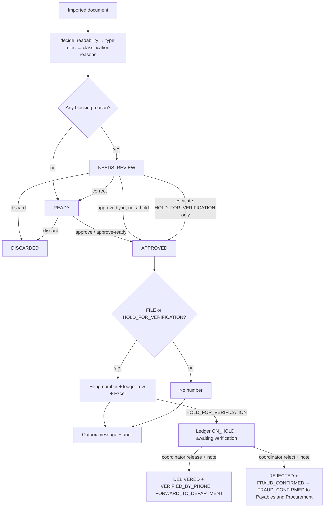

# Filing

## Purpose

The heart of Docket: applies the clerk's rules to every classified document, **proposes** department, action and due date with the reasons behind them, and lets the clerk **correct, discard or approve** each proposal. Only on approval does a document get its filing number `TAC-2026-ER-#####`, its row in the ledger and the (simulated) e-mail to the department. Nothing is forwarded without a person. An invoice held for possible fraud does not dead-end as "Retenida": the coordinator **verifies it by phone and releases or rejects it** (see [verifications](verifications.md)).

## Who uses it

- **Clerk (CLERK, Martha)**: reviews the inbox, corrects proposals, discards, approves one by one or approves everything that is `READY` in one go. Only CLERK can mutate the inbox.
- **Coordinator (COORDINATOR, Dra. Herrera)**: reads the inbox, the detail of each document (with its audit trail) and the outbox; receives the fraud alerts (`FRAUD_ALERT`) for invoices held for phone verification and, after calling the supplier, **releases or rejects** each held invoice (`POST /api/verifications/{id}/release|reject`, COORDINATOR only).
- **AI assistant via MCP**: read-only — `pending_review`, `inbox_summary` and `held_invoices` tools (see [mcp](mcp.md)).

## How it works

1. **Propose** (during import). `ProposeFiling` (`api/app/features/filing/application/propose_filing.py`) resolves every lookup — supplier by NIT and by sender domain, same invoice already in the ledger, same invoice waiting in the inbox, bank account or account change announced in the e-mail body — and hands the facts to the pure function `decide()` in `filing/domain/rules.py`.
2. `decide()` first checks readability (`DOCUMENT_UNREADABLE`, `LOW_OCR_CONFIDENCE`), then applies the rules of the document type, then prepends classification reasons. Each rule leaves a `Reason` (`code`, `params`, `blocking`). If any reason is blocking the item is `NEEDS_REVIEW`; otherwise `READY`. `confidence` is derived from the classification margin and halved when review is needed.
3. **Correct** (`POST /api/inbox/{id}/correct`). The clerk may change `document_type`, `department`, `action`, `due_date` (or `clear_due_date`), `urgent` and `notes`. The original proposal is kept untouched; blocking reasons become non-blocking (kept for traceability) and `REVIEWED_BY_HUMAN` is appended with the changed fields. The item becomes `READY`.
4. **Discard** (`POST /api/inbox/{id}/discard`, with a `reason`). The item becomes `DISCARDED`; no number is used.
5. **Approve** (`POST /api/inbox/approve` with ids, or `POST /api/inbox/approve-ready`). Under a process-wide lock, items are sorted by reception time and attachment position; each fileable one (`FILE`) gets `last_sequence + 1`, a ledger entry is appended, the item becomes `APPROVED`, outbox messages are composed and `DOCUMENT_APPROVED` is audited. Inside the lock the shared Excel is synced **before** numbering (rows typed by hand are imported, so the consecutive continues after them) and again after appending (see [ledger](ledger.md#two-way-sync-with-the-shared-excel)). **A suspected fraud is never approved**: `ApproveDocuments` rejects an item with action `HOLD_FOR_VERIFICATION` (`HoldRequiresEscalationError` → `409 HOLD_REQUIRES_ESCALATION`), and `approve-ready` skips held invoices even if a correction left them `READY`. (`escalate_holds=True` exists only for the CLI and the golden test, which process the whole mailbox in reception order.)
6. **Escalate a held invoice** (`POST /api/inbox/{id}/escalate`, CLERK). `EscalateHold` (`filing/application/approve_documents.py`) checks the item is a hold (`NotAHoldError` → `409 NOT_A_HOLD`) and runs the same numbering path: the invoice gets a filing number for traceability, the ledger row is `ON_HOLD` ("Retenida"), the `FRAUD_ALERT` goes to the coordinator and nothing goes to Accounts payable. The audit event is `HOLD_ESCALATED` (not `DOCUMENT_APPROVED`). The invoice is now *awaiting verification* (`InboxItem.is_awaiting_verification`: `APPROVED`, action `HOLD_FOR_VERIFICATION`, no `hold_resolution`).
7. **Verify a held invoice** (`POST /api/verifications/{id}/release` or `/reject`, COORDINATOR). `VerifyHold` (`filing/application/verify_hold.py`) requires a note of at least `MIN_NOTE_LENGTH` = 5 characters (who she spoke to, at which number) and a ledger row still `ON_HOLD`; otherwise `HoldNotPendingError`. **Release**: the row becomes `DELIVERED` to `release_department()` — the department Martha's purchase-order rule would have given (`ACCOUNTS_PAYABLE` with purchase order, `PROCUREMENT` without) — with flag `VERIFIED_BY_PHONE`, and a `FORWARD_TO_DEPARTMENT` message is composed. **Reject**: the row becomes `REJECTED` with flag `FRAUD_CONFIRMED`, and `FRAUD_CONFIRMED` messages warn Accounts payable and Procurement not to pay. In both cases the `HOLD_FOR_VERIFICATION` flag is removed, a `HoldResolution` (`outcome` `RELEASED`/`REJECTED`, `note`, `actor`, `at`) is stored on the `InboxItem`, the shared Excel is synced (`SyncLedger`) and `HOLD_RELEASED` / `HOLD_REJECTED` is audited. `ListHeldInvoices` (`filing/application/queries.py`) lists every non-discarded held invoice by reception time with its verification state: `PENDING_CLERK_APPROVAL` (still in the clerk's inbox), `AWAITING_VERIFICATION`, `RELEASED`, `REJECTED`.



### Decisions per document type

| Type | Rule | Department | Action |
|---|---|---|---|
| `INVOICE` | Supplier not in master | `PROCUREMENT` | `FILE` |
| `INVOICE` | Account ≠ master, account in body ≠ master, account change announced, or sender domain ≠ master | `ADMIN_COORDINATION` | `HOLD_FOR_VERIFICATION` |
| `INVOICE` | Same supplier + number already in ledger | `SENDER` | `REPLY_WITH_EXISTING_NUMBER` (no new number) |
| `INVOICE` | Registered, with purchase order | `ACCOUNTS_PAYABLE` | `FILE` |
| `INVOICE` | Registered, without purchase order | `PROCUREMENT` | `FILE` |
| `TRAVEL_EXPENSE_REQUEST` | No TH-F-012 form or no boss approval/signature | `SENDER` | `RETURN_TO_SENDER` |
| `TRAVEL_EXPENSE_REQUEST` | Complete; < 5 business days notice → `late=true` | `HUMAN_RESOURCES` | `FILE` |
| `PETITION` | 15 / 10 (copies only) / 30 (consultation) business days | `LEGAL` | `FILE` |
| `OVERSIGHT_NOTICE` | Always urgent; term from the notice | `LEGAL` | `FILE` |
| `COMPLAINT` | 15 business days | `CUSTOMER_SERVICE` | `FILE` |
| `QUOTATION` | — | `PROCUREMENT` | `FILE` |
| `ADVERTISING` | Not filed | `NONE` | `DO_NOT_FILE` |
| `OTHER` / unreadable | Needs a person | `NONE` | `FILE` (blocked until corrected) |

The fraud check runs **before** the duplicate check: a suspicious invoice is held even if it looks like a resend.

### Outbox (simulated e-mails)

Docket never sends e-mail. On approval, `compose()` (`filing/domain/outbox_composer.py`) stores messages in Spanish, listed by `GET /api/outbox`:

| Kind | When | To |
|---|---|---|
| `FORWARD_TO_DEPARTMENT` | `FILE` to a department in `dependencias.csv`; subject `[radicado]`, prefixed `URGENTE - ` when urgent, due date in the body | department e-mail |
| `FRAUD_ALERT` | `HOLD_FOR_VERIFICATION`: "Verificar por teléfono antes de pagar" | `coordinacion.administrativa@terminalesandinas.example` |
| `REPLY_EXISTING_NUMBER` | `REPLY_WITH_EXISTING_NUMBER`: tells the supplier the existing filing number | sender |
| `RETURN_TO_SENDER` | `RETURN_TO_SENDER`: must use TH-F-012 signed by the boss, 5 business days ahead | sender |

When the coordinator resolves a held invoice, `compose_hold_released()` / `compose_hold_rejected()` add:

| Kind | When | To |
|---|---|---|
| `FORWARD_TO_DEPARTMENT` | Released after the phone call; subject `[radicado] Factura verificada: <e-mail subject>`, body with the verification note and "pay only to the account in the supplier master" | e-mail of the `release_department()` |
| `FRAUD_CONFIRMED` | Rejected (fraud confirmed); subject `NO PAGAR [radicado] intento de fraude confirmado`, body with the sender and the note | Cuentas por pagar and Compras (one message each) |

### Filing numbers on the sample mailbox

The historical ledger ends at `TAC-2026-ER-04817`. Approving the whole sample mailbox as proposed assigns `04818` to `04831` in reception order (golden table `api/tests/golden/esperado-completo.csv`): `01.eml` → 04818, `10.eml` → 04819, `02.eml` → 04820, `03.eml` → 04821 … `14.eml` → 04831. Advertising (`15.eml`), the duplicate (`06.eml`, already `TAC-2026-ER-04790`) and the returned request (`08.eml`) get no number.

This sequence assumes `03.eml` (scanned invoice) is resolved before approving: with Tesseract it is read by OCR; without it, it stays `NEEDS_REVIEW` (`DOCUMENT_UNREADABLE`) and must be corrected by the clerk first. If it is approved later, it simply takes the next free number — numbers are never reused or reordered.

## Business rules

| Rule | Interview source | Code |
|---|---|---|
| Supplier must be in the master; if not, the invoice goes to Procurement to be linked | *"Si no está creado, la factura va a Compras para que lo vinculen; yo no la puedo mandar a pago."* | `_decide_invoice` → `SUPPLIER_NOT_REGISTERED` |
| With purchase order → Accounts payable; without → Procurement | *"Con OC va a Cuentas por pagar. Sin OC va a Compras"* | `INVOICE_WITH_PURCHASE_ORDER` / `INVOICE_WITHOUT_PURCHASE_ORDER` |
| A repeated invoice is not filed again; reply with the existing number | *"Si ya está, no la radico otra vez: le contesto al proveedor con el radicado que ya tiene."* | `INVOICE_DUPLICATE`, `INVOICE_DUPLICATE_IN_INBOX` |
| Account different from the master or strange sender → hold for Dra. Claudia to verify by phone | *"si la cuenta de la factura no es la que está en el maestro, o el correo llega de una dirección rara, no la mando a ningún lado: se la paso a la doctora Claudia"* | `INVOICE_ACCOUNT_MISMATCH`, `EMAIL_ACCOUNT_MISMATCH`, `ACCOUNT_CHANGE_ANNOUNCED`, `SENDER_DOMAIN_MISMATCH` → `HOLD_FOR_VERIFICATION` |
| Only the coordinator closes a held invoice, after calling the supplier: released invoices go where they would have gone, confirmed frauds are never paid; the call is recorded in a note | *"se la paso a la doctora Claudia para que verifiquen por teléfono con el proveedor"* | `VerifyHold`, `release_department()`, `MIN_NOTE_LENGTH`, `require_coordinator` |
| Travel request without boss approval or outside the form is returned | *"Si no tiene la aprobación del jefe, se lo devuelvo; no lo radico."* / *"Se lo devuelvo para que lo mande en el formato con la firma."* | `TRAVEL_REQUEST_NOT_APPROVED`, `TRAVEL_REQUEST_WITHOUT_FORM` |
| Late travel request (< 5 business days) is still filed but marked "extemporánea" | *"Si llega tarde igual lo paso a Talento humano, pero en observaciones le pongo 'extemporánea'"* | `TRAVEL_REQUEST_LATE` (ledger note "Extemporánea") |
| Petition terms: 15 general, 10 copies only, 30 consultation; copies + other things = 15; counted from the next business day without weekends or holidays | *"quince días hábiles en general; si solo piden copias o documentos, diez; si es una consulta … treinta. Si piden copias y además otras cosas, le pongo quince"* | `petition_scope`, `BusinessCalendar.add_business_days` |
| Oversight notices go to Legal, urgent, with the term of the notice | *"Esos van a Jurídica marcados como urgentes, y el plazo es el que diga el oficio, no el de la ley."* | `_decide_oversight_notice` |
| Tutela threat → urgent | *"si el ciudadano dice que va a poner una tutela: urgente"* | `TUTELA_THREAT` |
| Complaints → Customer service, 15 business days | *"Las quejas … van a Atención al usuario, con quince días hábiles."* | `_decide_complaint` |
| Quotations → Procurement; advertising is not filed | *"Cotizaciones, que van a Compras. Y la publicidad, que esa ni la radico."* | `QUOTATION_TO_PROCUREMENT`, `ADVERTISING_NOT_FILED` |
| Nothing is sent on its own; she must see what and why | *"No quiero que algo mande las cosas solo y yo no me entere"* | approval required; reasons + evidence; outbox simulated |

Holidays matter: 16-nov-2026 and 8-dec-2026 are Colombian holidays, so the petition received 10-nov is due **2026-12-02**, the copies-only petition (12.eml) **2026-11-27**, and the complaint received 17-nov **2026-12-09** (`HOLIDAY_IN_TERM`).

## API endpoints / screens

Envelope `{"code": ..., "data": ...}`; errors `{"code": ..., "detail": {...}}`.

| Method | Path | Role | Request | Success `code` | Errors |
|---|---|---|---|---|---|
| GET | `/api/inbox?status=` | any | optional `status` (`READY`, `NEEDS_REVIEW`, `APPROVED`, `DISCARDED`) | `INBOX_LISTED` | `422 VALIDATION_ERROR` |
| GET | `/api/inbox/summary` | any | — | `INBOX_SUMMARY` (`{"READY": n, "NEEDS_REVIEW": n, "APPROVED": n, "DISCARDED": n}`) | |
| GET | `/api/inbox/{id}` | any | — | `DOCUMENT_FOUND` (item + `document.text`, `document.email_body` (4,000 chars), `proposal_decision`, `audit`) | `404 DOCUMENT_NOT_FOUND` |
| GET | `/api/inbox/{id}/source` | any | — | raw file (PDF or `message/rfc822`), not an envelope | `404 SOURCE_FILE_NOT_FOUND` |
| POST | `/api/inbox/{id}/correct` | CLERK | `Correction`: `document_type`, `department`, `action`, `due_date`, `clear_due_date`, `urgent`, `notes` (all optional) | `DOCUMENT_CORRECTED` | `404 DOCUMENT_NOT_FOUND`, `409 DOCUMENT_ALREADY_CLOSED`, `422 VALIDATION_ERROR` |
| POST | `/api/inbox/{id}/discard` | CLERK | `{"reason": "..."}` | `DOCUMENT_DISCARDED` | `404 DOCUMENT_NOT_FOUND`, `409 DOCUMENT_ALREADY_CLOSED` |
| POST | `/api/inbox/approve` | CLERK | `{"ids": ["01.eml__0", ...]}` (may include `NEEDS_REVIEW` items, never held invoices) | `DOCUMENTS_APPROVED` | `404 DOCUMENT_NOT_FOUND`, `409 DECISION_INCOMPLETE`, `409 HOLD_REQUIRES_ESCALATION` |
| POST | `/api/inbox/approve-ready` | CLERK | — (all `READY` items except held invoices) | `DOCUMENTS_APPROVED` | `409 DOCUMENT_NEEDS_REVIEW`, `409 DECISION_INCOMPLETE` |
| POST | `/api/inbox/{id}/escalate` | CLERK | — | `HOLD_ESCALATED` (inbox item view, with `filing_number`) | `404 DOCUMENT_NOT_FOUND`, `409 NOT_A_HOLD`, `409 DECISION_INCOMPLETE` |
| GET | `/api/outbox` | any | — | `OUTBOX_LISTED` (`kind`, `document_id`, `to_address`, `subject`, `body`) | |
| GET | `/api/verifications` | any | — | `VERIFICATIONS_LISTED` (held invoices: inbox item view + `verification_state`, `release_department`, `hold_resolution`, `master_supplier`) | |
| POST | `/api/verifications/{id}/release` | COORDINATOR | `{"note": "..."}` (≥ 5 characters) | `HOLD_RELEASED` | `403 FORBIDDEN`, `404 DOCUMENT_NOT_FOUND`, `409 HOLD_NOT_PENDING`, `422 VERIFICATION_NOTE_REQUIRED` |
| POST | `/api/verifications/{id}/reject` | COORDINATOR | `{"note": "..."}` (≥ 5 characters) | `HOLD_REJECTED` | `403 FORBIDDEN`, `404 DOCUMENT_NOT_FOUND`, `409 HOLD_NOT_PENDING`, `422 VERIFICATION_NOTE_REQUIRED` |

Inbox item view keys: `id`, `status`, `filing_number`, `received_at`, `needs_review`, `was_corrected`, `notes`, `document` (`email_file`, `position`, `name`, `sender`, `sender_name`, `email_subject`, `extraction_method`, `ocr_confidence`), `data` (extracted fields), `decision` (`document_type`, `department`, `action`, `due_date`, `urgent`, `late`, `reasons[]`, `evidence[]`, `confidence`, `existing_filing_number`).

Verification view extra keys (`filing/api/verifications_router.py`): `verification_state`, `release_department`, `hold_resolution` (`outcome`, `note`, `actor`, `at`, or `null`), `master_supplier` (the master's row for the invoice NIT — `nit`, `name`, `billing_email`, `bank`, `account_type`, `account_number`, `status`, `category`, `is_active` — or `null`). The screen is documented in [verifications](verifications.md).

Common errors: `401 UNAUTHORIZED` (missing/unknown token), `403 FORBIDDEN` (`detail.required_role: "CLERK"`, or `"COORDINATOR"` on the verification actions).

## Codes

### Reason codes (`decision.reasons[].code`)

| Code | Meaning (EN) | Significado (ES) | Blocking? |
|---|---|---|---|
| `DOCUMENT_UNREADABLE` | No text could be read (OCR unavailable, unsupported format or empty) | No se pudo leer el texto (sin OCR, formato no soportado o vacío) | Yes |
| `LOW_OCR_CONFIDENCE` | OCR confidence below `TAC_MIN_OCR_CONFIDENCE` (70) | La confianza del OCR está por debajo del mínimo (70) | Yes |
| `UNKNOWN_DOCUMENT_TYPE` | The document type could not be identified | No se pudo identificar el tipo de documento | Yes |
| `AMBIGUOUS_CLASSIFICATION` | Two document types are too close | Dos tipos de documento quedaron muy parejos | Yes |
| `CLASSIFIED_BY_ASSISTANT` | Type suggested by the AI assistant; must be confirmed | Tipo sugerido por el asistente de IA; debe confirmarse | Yes |
| `INVOICE_MISSING_FIELDS` | NIT, invoice number or total could not be found | No se encontró el NIT, el número o el total de la factura | Yes |
| `INVOICE_TOTALS_MISMATCH` | Subtotal + VAT does not equal the total | Subtotal + IVA no coincide con el total | Yes |
| `SUPPLIER_NOT_REGISTERED` | Supplier NIT not in the supplier master; Procurement must link it | El NIT no está en el maestro de proveedores; Compras debe vincularlo | No |
| `NIT_CHECK_DIGIT_INVALID` | The NIT check digit is wrong (possible typo) | El dígito de verificación del NIT no es válido (posible error de digitación) | No |
| `SUPPLIER_INACTIVE` | Supplier is inactive in the master | El proveedor está inactivo en el maestro | Yes |
| `INVOICE_ACCOUNT_MISMATCH` | The invoice's bank account differs from the supplier master | La cuenta de la factura no coincide con la del maestro de proveedores | Yes |
| `EMAIL_ACCOUNT_MISMATCH` | The e-mail body announces an account different from the master | El cuerpo del correo menciona una cuenta distinta a la del maestro | Yes |
| `ACCOUNT_CHANGE_ANNOUNCED` | The e-mail announces a bank account change | El correo anuncia un cambio de cuenta bancaria | Yes |
| `SENDER_DOMAIN_MISMATCH` | Sender's e-mail domain differs from the master's billing e-mail | El dominio del remitente no coincide con el correo de facturación del maestro | Yes |
| `INVOICE_DUPLICATE_IN_INBOX` | The same invoice is already waiting in the inbox | La misma factura ya está pendiente en la bandeja | Yes |
| `INVOICE_DUPLICATE` | Same supplier + number already filed (`params.filing_number`) | Misma factura ya radicada (`params.filing_number`) | No |
| `INVOICE_WITH_PURCHASE_ORDER` | Has a purchase order → Accounts payable | Trae orden de compra → Cuentas por pagar | No |
| `INVOICE_WITHOUT_PURCHASE_ORDER` | No purchase order → Procurement must endorse | Sin orden de compra → Compras debe avalar | No |
| `TRAVEL_REQUEST_WITHOUT_FORM` | Not sent on form TH-F-012 | No viene en el formato TH-F-012 | No (returned) |
| `TRAVEL_REQUEST_NOT_APPROVED` | Missing the boss's approval/signature | Falta la aprobación o firma del jefe | No (returned) |
| `TRAVEL_REQUEST_MISSING_DEPARTURE` | Departure date not found | No se encontró la fecha de salida | Yes |
| `TRAVEL_REQUEST_DEPARTURE_PASSED` | Departure date is on or before reception | La fecha de salida ya pasó o es el mismo día de recibido | Yes |
| `TRAVEL_REQUEST_LATE` | Less than 5 business days' notice ("extemporánea") | Menos de 5 días hábiles de anticipación (extemporánea) | No |
| `TRAVEL_REQUEST_COMPLETE` | Complete and on time | Completa y a tiempo | No |
| `PETITION_GENERAL` | General petition: 15 business days | Petición general: 15 días hábiles | No |
| `PETITION_COPIES_ONLY` | Only asks for copies/documents: 10 business days | Solo pide copias o documentos: 10 días hábiles | No |
| `PETITION_CONSULTATION` | Consultation (asks for an opinion): 30 business days | Consulta (pide un concepto): 30 días hábiles | No |
| `PETITION_IMPLICIT` | Petition without the words "derecho de petición" | Petición sin las palabras "derecho de petición" | No |
| `TUTELA_THREAT` | Mentions a tutela → urgent | Menciona tutela → urgente | No |
| `HOLIDAY_IN_TERM` | A public holiday falls inside the term (`params.holidays`) | Hay un festivo dentro del plazo (`params.holidays`) | No |
| `OVERSIGHT_BODY_URGENT` | Control body or court → urgent, Legal | Ente de control o juzgado → urgente, Jurídica | No |
| `TERM_FROM_NOTICE` | Term taken from the notice (`days`, `kind`) | Plazo tomado del oficio (`days`, `kind`) | No |
| `OVERSIGHT_TERM_AMBIGUOUS` | Days found but not whether business or calendar | Se encontraron días pero no si son hábiles o calendario | Yes |
| `OVERSIGHT_TERM_NOT_FOUND` | No term found in the notice | No se encontró plazo en el oficio | Yes |
| `COMPLAINT_TERMINAL_USER` | Terminal user complaint: 15 business days | Queja de usuario del terminal: 15 días hábiles | No |
| `QUOTATION_TO_PROCUREMENT` | Quotation → Procurement | Cotización → Compras | No |
| `ADVERTISING_NOT_FILED` | Advertising is not filed | La publicidad no se radica | No |
| `REVIEWED_BY_HUMAN` | A person corrected the proposal (`params.fields`) | Una persona corrigió la propuesta (`params.fields`) | No |

### Status, department and action codes

| Code | Meaning (EN) | Significado (ES) |
|---|---|---|
| `READY` | Proposal is safe; the clerk only confirms | La propuesta es segura; la auxiliar solo confirma |
| `NEEDS_REVIEW` | The system is not sure; a person decides | El sistema no está seguro; decide una persona |
| `APPROVED` | Approved by the clerk | Aprobado por la auxiliar |
| `DISCARDED` | Discarded by the clerk | Descartado por la auxiliar |
| `ACCOUNTS_PAYABLE` / `PROCUREMENT` / `HUMAN_RESOURCES` / `LEGAL` / `CUSTOMER_SERVICE` | Cuentas por pagar / Compras / Talento humano / Jurídica / Atención al usuario | idem |
| `ADMIN_COORDINATION` | Administrative coordination (fraud verification) | Coordinación administrativa (verificación de fraude) |
| `SENDER` / `NONE` | Back to the sender / not filed | Devolver al remitente / no se radica |
| `FILE` / `RETURN_TO_SENDER` / `DO_NOT_FILE` / `REPLY_WITH_EXISTING_NUMBER` / `HOLD_FOR_VERIFICATION` | File / return / do not file / reply with existing number / hold for verification | Radicar / devolver / no radicar / responder con radicado existente / retener para verificación |

### Response, error and outbox codes

| Code | Meaning (EN) | Significado (ES) |
|---|---|---|
| `INBOX_LISTED`, `INBOX_SUMMARY`, `DOCUMENT_FOUND`, `DOCUMENT_CORRECTED`, `DOCUMENT_DISCARDED`, `DOCUMENTS_APPROVED`, `OUTBOX_LISTED` | Success responses | Respuestas exitosas |
| `VERIFICATIONS_LISTED` | Held invoices listed with their verification state | Facturas retenidas listadas con su estado de verificación |
| `HOLD_RELEASED` | The coordinator verified the invoice by phone and released it | La coordinadora verificó la factura por teléfono y la liberó |
| `HOLD_REJECTED` | The coordinator confirmed the fraud attempt; the invoice is not paid | La coordinadora confirmó el intento de fraude; la factura no se paga |
| `HOLD_NOT_PENDING` | Not an approved held invoice waiting for verification (already resolved, or not filed yet) | No es una factura retenida y radicada pendiente de verificar (ya se resolvió o aún no se radica) |
| `VERIFICATION_NOTE_REQUIRED` | The verification note is missing or shorter than 5 characters | Falta la nota de verificación o tiene menos de 5 caracteres |
| `FORBIDDEN` | The role cannot perform this action (e.g. the clerk releasing a held invoice) | El rol no puede hacer esta acción (p. ej. la auxiliar liberando una factura retenida) |
| `PENDING_CLERK_APPROVAL`, `AWAITING_VERIFICATION`, `RELEASED`, `REJECTED` | Verification states: still in the clerk's inbox / waiting for the coordinator's call / released / fraud confirmed | Estados de verificación: aún en la bandeja de radicación / espera la llamada de la coordinadora / liberada / fraude confirmado |
| `DOCUMENT_NOT_FOUND` | Unknown document id | El documento no existe |
| `SOURCE_FILE_NOT_FOUND` | Original file not stored | No se encontró el archivo original |
| `DOCUMENT_ALREADY_CLOSED` | Already approved (or discarded, for corrections) | Ya fue aprobado (o descartado, para correcciones) |
| `DECISION_INCOMPLETE` | Fileable but without a real department (e.g. unreadable): correct it first | Se radicaría sin dependencia real (p. ej. ilegible): corríjalo primero |
| `HOLD_ESCALATED` | The clerk alerted the coordinator about a suspected fraud: filed `ON_HOLD`, `FRAUD_ALERT` sent, nothing to payment (also the audit event) | La auxiliar alertó a la coordinadora de un posible fraude: radicada `ON_HOLD`, `FRAUD_ALERT` enviado, nada a pago (también es el evento de auditoría) |
| `HOLD_REQUIRES_ESCALATION` | A suspected fraud cannot be approved; use escalate (HTTP 409) | Una factura con posible fraude no se aprueba; se alerta a la coordinadora (HTTP 409) |
| `NOT_A_HOLD` | Escalate was called on a document that is not held (HTTP 409) | Se pidió alertar sobre un documento que no está retenido (HTTP 409) |
| `DOCUMENT_NEEDS_REVIEW` | Batch approval reached a document that needs review | La aprobación en lote encontró un documento que requiere revisión |
| `FORWARD_TO_DEPARTMENT`, `FRAUD_ALERT`, `REPLY_EXISTING_NUMBER`, `RETURN_TO_SENDER`, `FRAUD_CONFIRMED` | Outbox message kinds | Tipos de mensaje de la bandeja de salida |

## Limitations

- Roles, not people: the audit actor is `CLERK` / `COORDINATOR` (shared demo tokens `TAC_CLERK_TOKEN`, `TAC_COORDINATOR_TOKEN`); corporate SSO is pending.
- The sequence lock is an in-process `threading.Lock`; with several API workers the unique constraint on the ledger is the only guard (a collision would fail the request rather than reuse a number).
- No "void" of an approved document; a mistaken approval cannot be undone through the API.
- A discarded document can be discarded again (only `APPROVED` is rejected).
- Outbox messages are stored in the database only; they are not exported as `.eml` and nothing is really sent.
- Evidence is limited to a few fields; the text preview is truncated to 4,000 characters.
- A held-invoice resolution is final: there is no endpoint to reopen a released or rejected invoice.

## How it is tested

- `api/tests/features/filing/test_rules.py`: every rule above (accounts payable / procurement routing, unregistered supplier, duplicate, account mismatch, strange sender domain, fraud before duplicate, inactive supplier, totals, missing fields, travel requests on time/late/not approved/no form, petition scope and 15/10/30 terms, tutela, oversight term, complaint, quotation/advertising, unreadable, low OCR confidence, ambiguous, unknown).
- `api/tests/features/filing/test_approve_and_correct.py`: idempotent import, numbers on approval in reception order, batch approval only `READY`, `DOCUMENT_NEEDS_REVIEW`, unreadable document cannot be filed without department, correction keeps proposal and is audited, approved documents cannot be corrected, outbox messages, duplicate inside the same batch.
- `api/tests/features/filing/test_verify_hold.py`: `test_held_invoice_waits_for_the_coordinator`, `test_before_martha_approves_it_is_still_with_the_clerk`, `test_release_sends_it_where_the_rules_would_have`, `test_reject_marks_fraud_and_warns_payables_and_procurement`, `test_cannot_resolve_twice_or_without_a_note`, `test_resolution_is_audited_and_the_excel_row_is_updated`.
- `api/tests/api/test_api.py`: HTTP flow, roles (`FORBIDDEN`), `DOCUMENT_NOT_FOUND`, `VALIDATION_ERROR`, source file; `test_only_the_coordinator_resolves_held_invoices`; `test_approve_rejects_holds_and_escalate_alerts_the_coordinator`.
- `api/tests/features/filing/test_approve_and_correct.py::test_a_suspected_fraud_is_never_approved_only_escalated` and `::test_batch_approval_skips_holds_even_when_corrected_to_ready`.
- Golden: `api/tests/golden/test_golden.py` — `test_matches_the_clients_expected_results` (client's `esperado-parcial.csv`), `test_matches_the_full_expected_table` (`esperado-completo.csv`), `test_filing_numbers_continue_the_ledger` (04818..04831). Must stay at 100 %.

```bash
./scripts/harness-verify.sh api/tests/features/filing/test_rules.py api/tests/features/filing/test_approve_and_correct.py api/tests/golden/test_golden.py
./scripts/harness-verify.sh api/tests/features/filing/test_verify_hold.py api/tests/api/test_api.py
```

## Changelog

- 2026-11-24: coordinator verification of held invoices — `VerifyHold`, `ListHeldInvoices`, `/api/verifications` endpoints and codes, outbox kind `FRAUD_CONFIRMED`, ledger flags `VERIFIED_BY_PHONE` / `FRAUD_CONFIRMED`; `approve-ready` now answers `DECISION_INCOMPLETE` (limitation removed).
- 2026-11-24: a suspected fraud is never approved — `EscalateHold` and `POST /api/inbox/{id}/escalate` (`HOLD_ESCALATED`); approving a hold answers `409 HOLD_REQUIRES_ESCALATION`, `NOT_A_HOLD` for non-holds; `approve-ready` skips holds even when corrected to `READY`. Effect unchanged: filing number, ledger `ON_HOLD`, `FRAUD_ALERT`, nothing to Accounts payable.
