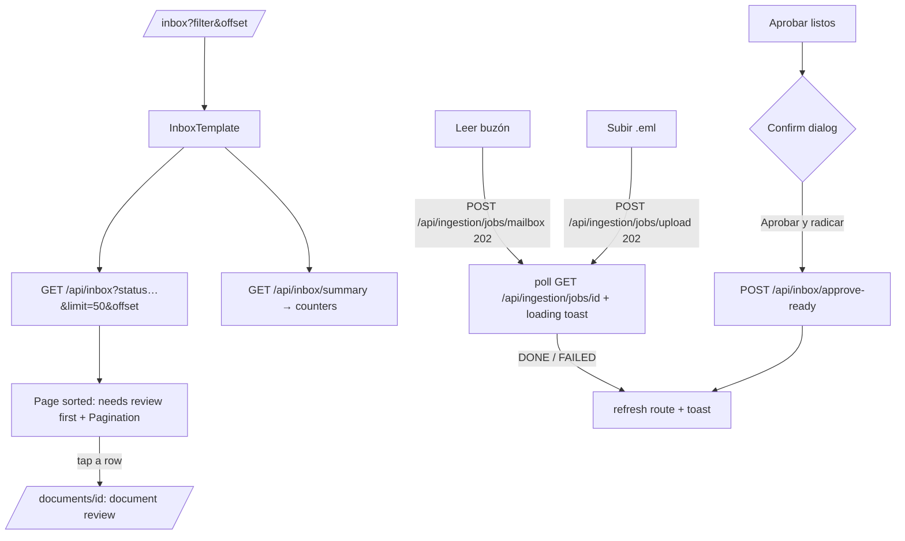

# Inbox (screen)

## Purpose

The clerk's work queue. `/inbox` shows every document Docket has read from the filing mailbox together with the system's proposal (what it is, where it goes, when it is due) and puts first what needs a person. From here the clerk brings new mail in (read the mailbox folder or upload `.eml` files) and approves, in one go, everything the system is sure about. It is the screen version of the [filing](filing.md) and [ingestion](ingestion.md) slices.

## Who uses it

- **Clerk (CLERK, Martha)**: imports mail, filters the queue, opens a document to review it, and approves every `READY` document in one batch.
- **Coordinator (COORDINATOR, Dra. Herrera)**: sees the same list, counters and filters, and can open any document, but the toolbar (**Leer buzón**, **Subir .eml**, **Aprobar listos**) is not rendered for her. Instead she sees a supervision note: "Vista de supervisión: puede revisar cada propuesta, pero radicar, corregir y aprobar le corresponde a Radicación." She cannot import, approve or discard; the API would answer `FORBIDDEN` anyway. "Bandeja" is the fourth of the five items of her menu (see [session](session.md)); her own work on held invoices happens in [verifications](verifications.md).

## How it works

1. `app/(app)/inbox/page.tsx` renders `InboxTemplate` (a Server Component) inside `<Suspense>` with `InboxSkeleton` as fallback.
2. The filter and the page come from the URL (`?filter=review|ready|approved|all&offset=N`; an unknown filter is `pending`, an invalid offset is 0). `FILTER_STATUSES` (`model/types.ts`) turns the filter into the statuses sent to the API: `pending` → `NEEDS_REVIEW` + `READY`, `review` → `NEEDS_REVIEW`, `ready` → `READY`, `approved` → `APPROVED` + `DISCARDED`, `all` → none.
3. `InboxTemplate` makes four calls in parallel on the server (`features/inbox/api/inbox-queries.ts`): `fetchInboxPage(filter, offset)` → `GET /api/inbox?status=…&status=…&limit=50&offset=N` (the API filters and pages in SQL, oldest first, and returns `{items, total, limit, offset}`); `fetchInboxSummary()` → `GET /api/inbox/summary` (count per status of the **whole** inbox, turned into the counters by `filterCounts`); `fetchHeldInInbox()` → `GET /api/verifications` (held invoices still `PENDING_CLERK_APPROVAL`); and the session. Each API item is mapped by `toInboxItemView` (`model/mappers.ts`): blocking reasons are translated to Spanish with `describeReason`, and the `EMAIL_BODY` pseudo-document is shown as "Cuerpo del correo". `sortForWork` puts `needs_review` items first **within the page**.
4. Toolbar actions are Server Actions in `api/inbox-actions.ts`. "Leer buzón" and "Subir .eml" **enqueue** an import (`enqueueMailboxImportAction`, `enqueueUploadImportAction`) and the toolbar then polls `getImportJobAction` every 700 ms (up to 600 times, about 7 minutes, enough for a month-end batch) while a loading toast says "En cola: leyendo correos…" and then "Procesando correos y preparando propuestas…". When the job is `DONE` or `FAILED`, `getImportJobAction` `refresh()`es the route. "Aprobar listos" calls the API and `refresh()`es. Results come back as `ActionResult` (`{ok, code, data}`) and are shown as toasts.



### Screens and states

- **Header**: eyebrow "Radicación", title "Bandeja" and, for CLERK only, the toolbar.
- **Supervision note** (COORDINATOR only): a dashed, read-only box with `role="note"` under the counters, saying the view is for supervision and that filing, correcting and approving belong to the clerk.
- **Counters** (`StatTile`, from `GET /api/inbox/summary`, so they count the whole inbox, not the page): "Por revisar" (`NEEDS_REVIEW`), "Listos" (`READY`), "Retenidas" (held invoices the clerk has not escalated yet, from `GET /api/verifications`) and "Cerrados" (`APPROVED` + `DISCARDED`).
- **Filters** (`InboxFilters`, links, `aria-current="page"` on the active one): Pendientes (default: `READY` + `NEEDS_REVIEW`), Por revisar, Listos, Cerrados, Todos, each with its count (`filterCounts`). Changing the filter goes back to the first page.
- **Pagination** (`shared/ui/molecules/Pagination.tsx`, under the list): "1–50 de 120" plus "Anterior" / "Siguiente" links (`rel="prev"` / `rel="next"`) that change `offset` in the URL, so a page can be shared or reloaded; disabled ends are shown dimmed with `aria-disabled`. Hidden when everything fits in one page. `<nav aria-label="Páginas de la bandeja">`.
- **Row** (`InboxRow`, one link to `/documents/{id}`): `DocumentStatusBadge`, "Urgente" and "Extemporánea" badges, subject (or file name), sender and attachment, the first blocking reason in Spanish, type and department, filing number if approved, reception date and due date (in red when urgent). Held invoices get a red left border; other review items an amber one.
- **Status badge mapping** (`shared/ui/molecules/DocumentStatusBadge.tsx`, the single place where status meets color): `APPROVED` → "Aprobado"; `DISCARDED` → "Descartado"; `HOLD_FOR_VERIFICATION` → "Retenida: posible fraude" (danger); `NEEDS_REVIEW` → "Requiere revisión" (warning); `REPLY_WITH_EXISTING_NUMBER` → "Duplicada"; `RETURN_TO_SENDER` → "Devolver"; `DO_NOT_FILE` → "No se radica"; otherwise "Listo" (success). Every badge carries an icon and a label, so color is never the only signal.
- **Loading**: `InboxSkeleton` (header, four tiles, six rows) with `aria-busy="true"`.
- **Empty**: "Nada por aquí — Lea el buzón o suba correos .eml para que el sistema prepare las propuestas."
- **Busy**: the pressed button shows a spinner and all toolbar buttons are disabled while the action runs.
- **Import in progress**: a loading toast follows the queued job ("En cola: leyendo correos…", then "Procesando correos y preparando propuestas…") and is replaced by the result.
- **Feedback**: import → "N documentos nuevos con su propuesta." (or "No hay correos nuevos en el buzón.", plus how many were already in the inbox); upload → "N documentos importados."; batch approval → "N documentos aprobados." with "N radicados nuevos en el libro."; errors → the Spanish label of the API code (see Codes).

### On phones and offline

- Below `lg` the row stacks its blocks vertically; from `lg` it becomes a four-column grid with a chevron. The filter bar scrolls horizontally inside the page gutter instead of wrapping; the page itself never scrolls sideways.
- Counters are a 2×2 grid on phones and a single row of four on desktop.
- Navigation is the bottom tab bar on phones and the sidebar on desktop (see [session](session.md) for the shell).
- **Offline**: the inbox is deliberately **not** cached by the service worker (it holds personal data and only makes sense live). Without a connection the navigation falls back to the offline page (see [pwa](pwa.md)).

### Accessibility

Rows are full-width links (well above 44 px), filter chips are 44 px (`min-h-11`), toolbar and dialog buttons are 44 px on touch screens (`h-11 md:h-10`), the filter is a `<nav aria-label="Filtrar bandeja">` with `aria-current`, the list has `aria-label="Documentos"`, icons are `aria-hidden`, and the hidden file input has its own label ("Subir correos .eml"). Motion (press scale, hover nudge) is cut to 1 ms under `prefers-reduced-motion`.

## Business rules

| Rule surfaced in the UI | Where in code |
|---|---|
| Nothing leaves without the clerk: the header says so and every approval is an explicit click plus a confirmation dialog | `InboxTemplate`, `InboxToolbar` |
| The coordinator supervises the queue but does not work it: no toolbar, a read-only supervision note | `InboxTemplate` (`isClerk`) |
| Batch approval takes **only `READY`** documents; the button shows the count and is disabled at 0 | `InboxToolbar` (`readyCount`), API `POST /api/inbox/approve-ready` |
| Held invoices (`HOLD_FOR_VERIFICATION`) are **never** approved, in batch or one by one: `approve-ready` skips them even if a correction left them `READY`, and the clerk alerts the coordinator from the document ("Alertar a la Dra. Herrera", see [document review](document-review.md)) | dialog text in `InboxToolbar`; `ApproveReadyDocuments`, `HOLD_REQUIRES_ESCALATION` in [filing](filing.md) |
| Filing numbers are assigned **on approval**, in order of arrival; the toast reports how many new numbers went into the ledger (some approvals, e.g. advertising, use none) | `approveReadyAction` counts items with `filing_number` |
| What needs a person comes first | `sortForWork` |
| A suspected fraud is shown as such ("Retenida: posible fraude"), not as a generic "needs review" | `documentPresentation` |
| Importing twice does not duplicate documents; the toast says how many were skipped | API idempotent import, `skipped` in the toast |
| A month-end batch does not freeze the screen: the import is queued and followed | `InboxToolbar` (`waitForJob`), [ingestion](ingestion.md) queue |
| Counters always describe the whole inbox, whatever page is open | `fetchInboxSummary` + `filterCounts` |

## API endpoints / screens

Route: `/inbox` (`web/src/app/(app)/inbox/page.tsx`), feature `web/src/features/inbox/`.

All calls run on the Next.js server through `shared/lib/api-client.ts`, which adds `Authorization: Bearer <token>` from the httpOnly `docket_token` cookie. The token never reaches the browser.

| Called from | Method | Path | Used for |
|---|---|---|---|
| `fetchInboxPage` (Server Component) | GET | `/api/inbox?status=…&limit=50&offset=N` | one page of the list (`{items, total, limit, offset}`) |
| `fetchInboxSummary` (Server Component) | GET | `/api/inbox/summary` | counters (count per status) |
| `fetchHeldInInbox` (Server Component) | GET | `/api/verifications` | "Retenidas" counter |
| `enqueueMailboxImportAction` (Server Action) | POST | `/api/ingestion/jobs/mailbox` | "Leer buzón" (202, a job) |
| `enqueueUploadImportAction` (Server Action) | POST | `/api/ingestion/jobs/upload` (multipart `files`) | "Subir .eml" (accepts `.eml`, `message/rfc822`, several at once) |
| `getImportJobAction` (Server Action) | GET | `/api/ingestion/jobs/{id}` | follow the queued import |
| `approveReadyAction` (Server Action) | POST | `/api/inbox/approve-ready` | "Aprobar listos" |

`GET /api/inbox` accepts `status` repeated (`?status=NEEDS_REVIEW&status=READY`), `limit` (default 50, clamped to 1–200) and `offset`; `INBOX_PAGE_SIZE` is 50. The synchronous `POST /api/ingestion/mailbox` and `/upload` still exist for the CLI and scripts but the screen no longer uses them.

## Codes

Error codes are shown with `describeError` (`shared/i18n/es.ts`); unknown codes show "Ocurrió un error inesperado."

| Code | Meaning (EN) | Spanish label shown | Blocking? |
|---|---|---|---|
| `MAILBOX_NOT_FOUND` | The configured mailbox folder does not exist | No se encontró la carpeta del buzón. | Yes |
| `IMPORT_FAILED` | The queued import failed (or did not finish while the screen was following it) | No se pudo procesar la importación. Intente de nuevo. | Yes |
| `IMPORT_JOB_NOT_FOUND` | The followed job does not exist | No se encontró la importación. | Yes |
| `EMAIL_TOO_LARGE` | An uploaded e-mail exceeds 25 MB | El correo supera el tamaño permitido. | Yes |
| `DOCUMENT_NEEDS_REVIEW` | Batch approval reached a document that needs review | Hay documentos que requieren revisión: apruébelos uno por uno. | Yes |
| `FORBIDDEN` | The role cannot do this | Su rol no permite esta acción. | Yes |
| `UNAUTHORIZED` | Token rejected | Su sesión expiró. Vuelva a ingresar. | Yes |
| `NETWORK_ERROR` | The Next.js server cannot reach the API | No hay conexión con el servidor. | Yes |
| `NEEDS_REVIEW` / `READY` / `APPROVED` / `DISCARDED` | Document status | Requiere revisión / Listo / Aprobado / Descartado | — |
| `IMPORT_QUEUED`, `IMPORT_JOB_FOUND`, `DOCUMENTS_APPROVED`, `INBOX_LISTED`, `INBOX_SUMMARY` | Success responses (not shown; the toast is built from the data) | — | — |

## Limitations

- No text search in the inbox.
- "Needs review first" applies within the page: the API orders by arrival, so in a long `pending` list a review item on page 2 comes after the ready items of page 1 (the "Por revisar" filter shows them all together).
- The screen follows a queued import for about 7 minutes; if the job is still running after that, the toast shows `IMPORT_FAILED` although the job finishes in the background (a reload shows the result).
- No multi-select: the only batch is "everything `READY`".
- No live updates: new mail appears only after an import or a reload.
- The correction form no longer lets a document be filed or held without a department (see [document review](document-review.md)), but the API itself does not validate it: a correction sent straight to the API without a real department makes `approve-ready` stop with `409 DECISION_INCOMPLETE` ("Falta elegir la dependencia antes de radicar."; see [filing](filing.md)).

## How it is tested

- `web/src/features/inbox/__tests__/mappers.test.ts`: API item → view with blocking reasons in Spanish, "Cuerpo del correo" label, filters (`pending`, `approved`) and needs-review-first ordering, unknown filters fall back to `pending`. It also exports the `inboxItem()` fixture reused by other tests.
- `web/src/shared/ui/__tests__/StatusBadge.test.tsx`: held invoice shows "Retenida: posible fraude"; status + action → tone table; reason label interpolation and fallback.
- `api/tests/api/test_api.py::test_inbox_and_ledger_are_paginated`: `limit` / `offset` pages without overlap (17 documents, pages of 5), repeated `status`, and `limit` clamped to 200.
- `api/tests/api/test_observability.py::test_queued_import_is_processed_by_the_worker`: the queued import the toolbar starts ends `DONE` with 17 documents.
- `web/e2e/filing-flow.spec.ts` (Playwright, project `desktop`, real API on a fresh data dir): protected route redirects to login; "Leer buzón" imports 17 documents; the suspicious invoice row shows "Retenida: posible fraude"; batch approval only takes what is ready and the held invoice stays under "Por revisar"; the coordinator does not see "Aprobar listos".
- `web/e2e/coordinator.spec.ts` (project `coordinator`, depends on `desktop`): the clerk reads the mailbox and alerts the coordinator about the held invoice ("Alertar a la Dra. Herrera" → "Enviar alerta"); her menu has no "Por verificar".
- `web/e2e/mobile.spec.ts` (project `phone`, Pixel 7): bottom tab bar and no horizontal scroll.

```bash
./scripts/harness-verify.sh web/src/features/inbox/__tests__/mappers.test.ts web/src/shared/ui/__tests__/StatusBadge.test.tsx
./scripts/harness-verify.sh web/e2e/filing-flow.spec.ts web/e2e/coordinator.spec.ts
```

## Changelog

- 2026-11-24: first version of the screen documentation.
- 2026-11-24: supervision note for the coordinator (read-only); 44 px filter chips and buttons on touch screens; the app-level `error.tsx` now covers load failures. Removed the fixed limitations (touch targets below 44 px, no `error.tsx`).
- 2026-11-24: pagination — `fetchInboxPage` with `FILTER_STATUSES` (filtering and paging in the API), counters from `GET /api/inbox/summary` (`filterCounts`), shared `Pagination` molecule with the offset in the URL; "Leer buzón" / "Subir .eml" enqueue the import and follow it with a loading toast (`getImportJobAction`). Removed the fixed limitation (no pagination, filtering over the full list).
