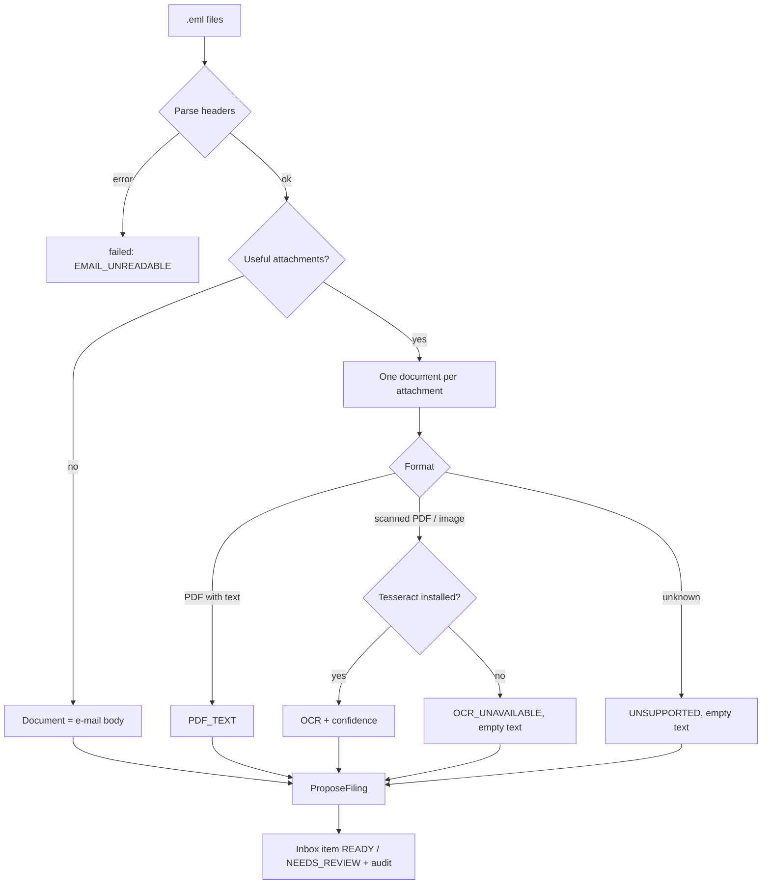
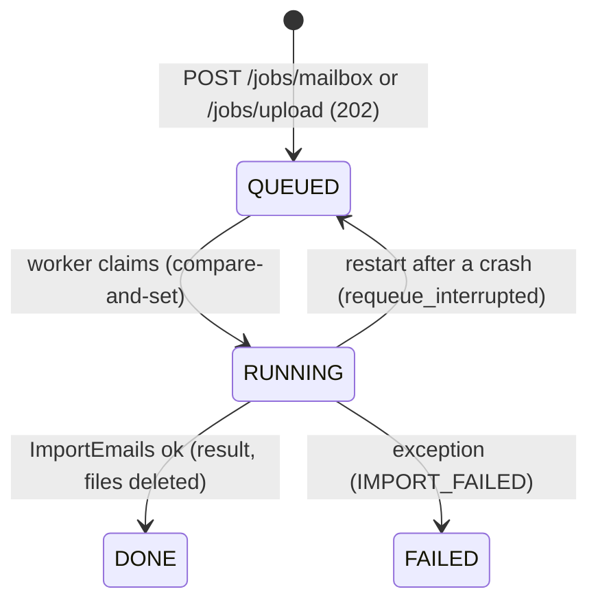

# Ingestion

## Purpose

Brings the e-mails of TAC's filing mailbox into Docket and turns each one into **fileable documents**, with the text already extracted. It replaces the first part of Martha's routine: opening each message, opening each PDF and working out what is inside. Every document it produces is handed straight to [classification](classification.md) and [filing](filing.md), so after an import the clerk sees a proposal for every document, never a raw e-mail. Imports from the screen go through a **persistent queue** processed by a background worker, so a month-end batch of hundreds of e-mails never blocks the clerk's screen or times out a request.

## Who uses it

- **Clerk (CLERK, Martha)**: imports the mailbox (or uploads `.eml` files) at the start of the day. Only the CLERK role can import or enqueue an import. The "Leer buzón" and "Subir .eml" buttons of the [inbox](inbox.md) enqueue a job and follow it.
- **Coordinator (COORDINATOR, Dra. Herrera)**: does not import; she sees the result through the inbox, ledger and deadlines. Both roles can read the state of the import jobs.
- **AI assistant via MCP**: no access. MCP tools are read-only and never import.
- **CLI**: `uv run python -m app.cli process --data-dir <dir>` imports the configured mailbox folder with actor `CLI` (demos and golden checks).

## How it works

1. The `.eml` files arrive through the queue (`POST /api/ingestion/jobs/upload` or `POST /api/ingestion/jobs/mailbox`, see [Import queue](#import-queue-month-end-peaks) below; this is what the screen uses) or synchronously through `POST /api/ingestion/upload` (multipart) or `POST /api/ingestion/mailbox` (reads every `*.eml` in `TAC_INBOX_DIR`, a stand-in for the real mailbox integration). Both paths end in the same `ImportEmails` use case.
2. `EmlReader` (`ingestion/infrastructure/eml_reader.py`) parses each message with the stdlib `email` package: sender, display name, subject, date (converted to `America/Bogota`), plain-text body (or HTML converted to text) and attachments. A message that cannot be parsed (for example, with no `Date` header) is not imported and is reported in `failed` with `EMAIL_UNREADABLE`.
3. E-mails are processed **in reception order** (`sent_at`).
4. `SplitDocuments` (`ingestion/application/split_documents.py`) turns the e-mail into documents:
   - Every useful attachment is its own document (`01.eml__0`, `16.eml__1`, ...). Signature images under 15 KB, GIFs, calendar invites and S/MIME signatures are ignored (`is_document` in `ingestion/domain/email_message.py`).
   - If there is no useful attachment, the e-mail body is the document (name `EMAIL_BODY`).
5. Each attachment goes to the first `TextExtractor` that supports it (`ingestion/infrastructure/text_extractors.py`):
   - Native PDF → `pdfplumber` (`PDF_TEXT`). If the PDF has fewer than 40 characters per page it is treated as scanned: pages are rendered with `pypdfium2` at 300 dpi and read with **local Tesseract OCR** (`spa`), which returns text plus an average confidence (`OCR`).
   - Images → OCR. DOCX → `DOCX`. XLSX → `XLSX`. HTML → `HTML`. Text/CSV → `PLAIN_TEXT`.
   - No extractor → method `UNSUPPORTED`, empty text. If Tesseract is not installed → `OCR_UNAVAILABLE`, empty text, confidence 0.
6. Documents already in the inbox (same id) are skipped, so re-importing the mailbox is idempotent.
7. For every new document, `ImportEmails` asks `ProposeFiling` for a proposal, stores the item with its original file (the attachment, or the whole `.eml` for body documents) and records a `DOCUMENT_PROPOSED` audit event (actor `SYSTEM`). At the end it records one `EMAILS_IMPORTED` event for the batch.



Unreadable text is **never guessed**: a document with `OCR_UNAVAILABLE`, `UNSUPPORTED` or empty text reaches filing, which marks it `DOCUMENT_UNREADABLE` and sends it to human review. In the sample mailbox this is what happens to the scanned invoice `03.eml` (`SCAN_20261112_0931.pdf`) on a machine without Tesseract.

### Import queue (month-end peaks)

At month-end the mailbox can bring hundreds of e-mails; reading them synchronously would keep the request (and the clerk's screen) waiting for minutes. The queue makes the request return at once with a job and lets a background worker do the import.

1. `EnqueueImport` (`ingestion/application/import_jobs.py`) creates an `ImportJob` (`ingestion/domain/import_job.py`) with state `QUEUED`, source `MAILBOX` (the folder is read when the job runs) or `UPLOAD` (the uploaded files travel with the job), the actor and `file_count`, and stores it through the `JobQueue` port. The endpoint answers **`202 IMPORT_QUEUED`** with the job.
2. The adapter `SqlJobQueue` (`ingestion/infrastructure/sql_job_queue.py`) keeps jobs in the table `import_jobs` and the uploaded files in `import_job_files` (`shared/infrastructure/db.py`), so a queued job survives a restart.
3. `ImportWorker` (`ingestion/infrastructure/worker.py`) is a daemon thread started in the app lifespan when `TAC_WORKER_ENABLED` is true (default). It calls `ProcessNextImport` and, when the queue is empty, waits `TAC_WORKER_POLL_SECONDS` (default `0.5`).
4. `ProcessNextImport` claims the **oldest** `QUEUED` job with a compare-and-set update (`QUEUED` → `RUNNING` only if it is still `QUEUED`), so two workers can never take the same job. It runs `ImportEmails` and marks the job `DONE` with its `result` (`imported`, `skipped`, `failed`) and deletes the stored files (the e-mails now live in the inbox), or `FAILED` with `error_code` `IMPORT_FAILED` if anything raised; a failed job never stops the worker. The duration goes to the metric `docket_import_job_seconds` (see [observability](observability.md)).
5. On startup, `Container.bootstrap()` calls `requeue_interrupted()`: a job left `RUNNING` by a crash goes back to `QUEUED`. Re-running it is safe because the import is idempotent.
6. The client polls `GET /api/ingestion/jobs/{id}` until the state is `DONE` or `FAILED`; `GET /api/ingestion/jobs` lists the latest jobs with the count per state.



## Business rules

| Rule | Source | Where in code |
|---|---|---|
| One filing number per document, even if several arrive in the same e-mail | Martha: *"Cada documento lleva su radicado, aunque lleguen varios en el mismo correo. Si me mandan dos facturas en un correo, son dos radicados."* (`16.eml` carries two invoices) | `SplitDocuments`, `is_document` |
| When there is no attachment, the e-mail itself is the document (complaints, requests written in the body) | Martha: requests "sin formato, en el correo" still have to be handled | `SplitDocuments` (`EMAIL_BODY`) |
| Scanned documents are read on TAC's premises; nothing leaves the infrastructure | Dra. Herrera: *"aquí entran datos de personas, de contratos y de pagos. La gente de sistemas va a querer saber dónde queda todo eso"* | `TesseractOcr` (local) |
| If the system cannot read a document, it asks instead of inventing | Martha: *"que cuando no esté seguro me pregunte, en vez de inventarse algo"* | empty text → `DOCUMENT_UNREADABLE` in filing |
| Documents are processed in reception order so filing numbers follow arrival | Interview: the consecutive is assigned as mail comes in | `ImportEmails` sorts by `sent_at` |
| Dates in Colombian time | Terms are counted from the Colombian reception date | `EmlReader` (`America/Bogota`) |
| Month-end peaks must not block the clerk; nothing queued is lost | Martha: *"Por semana son como doscientos documentos, más los lunes y a fin de mes."* | `EnqueueImport`, `SqlJobQueue` (persistent), `requeue_interrupted` |
| Jobs run one at a time, oldest first, each claimed by a single worker | Filing numbers follow arrival | `claim_next` (order by `created_at`, compare-and-set) |

## API endpoints / screens

All responses use the envelope `{"code": "UPPER_SNAKE", "data": ...}`; errors are `{"code": ..., "detail": {...}}`. Authentication: `Authorization: Bearer <token>` (`TAC_CLERK_TOKEN` / `TAC_COORDINATOR_TOKEN`).

| Method | Path | Role | Request | Success `code` | Errors |
|---|---|---|---|---|---|
| POST | `/api/ingestion/upload` | CLERK | multipart, field `files` (one or more `.eml`, max 25 MB each) | `EMAILS_IMPORTED` | `413 EMAIL_TOO_LARGE` (`detail.file`), `401 UNAUTHORIZED`, `403 FORBIDDEN`, `422 VALIDATION_ERROR` |
| POST | `/api/ingestion/mailbox` | CLERK | none | `EMAILS_IMPORTED` | `404 MAILBOX_NOT_FOUND`, `401`, `403` |
| POST | `/api/ingestion/jobs/mailbox` | CLERK | none | `202 IMPORT_QUEUED` (the job) | `404 MAILBOX_NOT_FOUND`, `401`, `403` |
| POST | `/api/ingestion/jobs/upload` | CLERK | multipart, field `files` (max 25 MB each) | `202 IMPORT_QUEUED` (the job) | `413 EMAIL_TOO_LARGE`, `401`, `403`, `422` |
| GET | `/api/ingestion/jobs` | any | query `limit` (default 20, 1–100) | `IMPORT_JOBS_LISTED` (`{jobs: [...], counts: {QUEUED, RUNNING, DONE, FAILED}}`) | `401` |
| GET | `/api/ingestion/jobs/{id}` | any | — | `IMPORT_JOB_FOUND` (the job) | `404 IMPORT_JOB_NOT_FOUND` (`detail.id`), `401` |

`data` of `EMAILS_IMPORTED`:

```json
{ "imported": ["01.eml__0", "16.eml__0", "16.eml__1"], "skipped": [], "failed": {"bad.eml": "EMAIL_UNREADABLE"} }
```

A job (`IMPORT_QUEUED`, `IMPORT_JOB_FOUND`, items of `IMPORT_JOBS_LISTED`):

```json
{ "id": "3f2a…", "state": "DONE", "source": "MAILBOX", "actor": "CLERK", "file_count": 0,
  "created_at": "…", "started_at": "…", "finished_at": "…",
  "result": { "imported": ["01.eml__0"], "skipped": [], "failed": {} }, "error_code": null }
```

## Codes

| Code | Meaning (EN) | Significado (ES) | Blocking? |
|---|---|---|---|
| `EMAILS_IMPORTED` | Import finished; lists imported, skipped and failed files | Importación terminada; lista importados, omitidos y fallidos | — (response) |
| `EMAIL_UNREADABLE` | The `.eml` could not be parsed (e.g. missing date); it was not imported | El `.eml` no se pudo leer (p. ej. sin fecha); no se importó | — (per-file result) |
| `EMAIL_TOO_LARGE` | An uploaded file exceeds 25 MB | Un archivo cargado supera 25 MB | — (HTTP 413) |
| `MAILBOX_NOT_FOUND` | The configured mailbox folder does not exist | La carpeta del buzón configurada no existe | — (HTTP 404) |
| `PDF_TEXT`, `OCR`, `DOCX`, `XLSX`, `HTML`, `PLAIN_TEXT`, `EMAIL_BODY` | Extraction method used (`document.extraction_method`) | Método de extracción usado | No |
| `OCR_UNAVAILABLE` | Scanned file but Tesseract is not installed; text is empty | Archivo escaneado pero Tesseract no está instalado; texto vacío | Yes, via `DOCUMENT_UNREADABLE` |
| `UNSUPPORTED` | No extractor for this format; text is empty | No hay extractor para este formato; texto vacío | Yes, via `DOCUMENT_UNREADABLE` |
| `DOCUMENT_PROPOSED` / `EMAILS_IMPORTED` (audit) | Audit events written by the import | Eventos de auditoría escritos por la importación | — |
| `IMPORT_QUEUED` | The import was queued (HTTP 202) | La importación quedó en cola (HTTP 202) | — (response) |
| `IMPORT_JOBS_LISTED` / `IMPORT_JOB_FOUND` | Job list / one job returned | Lista de importaciones / una importación devuelta | — (response) |
| `IMPORT_JOB_NOT_FOUND` | No job with that id | No existe una importación con ese id | — (HTTP 404) |
| `IMPORT_FAILED` | The job raised an error; recorded as `error_code`, the worker goes on | La importación falló; queda como `error_code` y el procesador sigue | Yes, for that job |
| `QUEUED`, `RUNNING`, `DONE`, `FAILED` | Job state (`JobState`) | Estado de la importación | — |
| `MAILBOX`, `UPLOAD` | Job source (`JobSource`) | Origen de la importación | — |

## Limitations

- No real mailbox connection yet: the "mailbox" is a folder of `.eml` files (`TAC_INBOX_DIR`) or a manual upload. Microsoft Graph / Gmail would be another `EmailReader` adapter.
- Idempotency is by document id (`<file name>__<position>`): the same e-mail uploaded under a different file name is imported again (duplicate invoices are still caught by filing rules).
- Reception order is applied **within one import call**; e-mails imported later are proposed later even if they were received earlier.
- Only parse errors (`ValueError`, `TypeError`) of the e-mail are mapped to `EMAIL_UNREADABLE`; a corrupt attachment that makes `pdfplumber`/`pypdfium2` raise is not mapped to a code and would fail the request.
- OCR quality depends on the Tesseract install (`tesseract-ocr-spa`); without it, every scan goes to review.
- The 15 KB threshold for signature images is a heuristic: a very small scanned image would be ignored.
- One worker thread per API process; jobs run one at a time. The compare-and-set claim makes several processes safe for the queue, but filing numbers are still protected only by an in-process lock plus a unique constraint (see [filing](filing.md)).
- A `FAILED` job is not retried automatically; the clerk imports again (the import is idempotent). Only jobs interrupted while `RUNNING` are requeued, on the next startup.
- Uploaded files wait in the database (`import_job_files`) until the job finishes; `DONE` and `FAILED` jobs are never purged from `import_jobs`.
- A `MAILBOX` job reads the folder when it runs, not when it was queued; if the folder disappears in between, the job finishes `DONE` with nothing imported.

## How it is tested

- `api/tests/features/ingestion/test_split_documents.py`: one document per attachment, body as document, small signature images ignored, unsupported formats flagged (not dropped), the real mailbox yields 17 documents from 16 e-mails (`16.eml` gives two), scanned PDF goes through OCR (or `OCR_UNAVAILABLE` when Tesseract is absent), dates in Bogotá time.
- `api/tests/features/filing/test_approve_and_correct.py::test_import_is_idempotent`.
- `api/tests/features/audit/test_audit.py::test_every_mutation_leaves_an_event` (17 `DOCUMENT_PROPOSED` + `EMAILS_IMPORTED`).
- `api/tests/api/test_api.py::test_full_flow_over_http` and `test_source_file_is_served`.
- Golden: `api/tests/golden/test_golden.py` (03.eml must be `DOCUMENT_UNREADABLE` → `NEEDS_REVIEW` without Tesseract).
- Queue: `api/tests/features/ingestion/test_import_queue.py` — `test_mailbox_job_runs_and_records_the_result`, `test_upload_jobs_run_in_order_and_are_idempotent`, `test_a_failing_job_is_recorded_and_the_queue_goes_on`, `test_jobs_interrupted_by_a_crash_go_back_to_the_queue`; over HTTP with the real worker thread: `api/tests/api/test_observability.py::test_queued_import_is_processed_by_the_worker` (`202 IMPORT_QUEUED` → `DONE` with 17 documents).

```bash
./scripts/harness-verify.sh api/tests/features/ingestion/test_split_documents.py api/tests/api/test_api.py
./scripts/harness-verify.sh api/tests/features/ingestion/test_import_queue.py api/tests/api/test_observability.py
```

## Changelog

- 2026-11-24: import queue for month-end peaks — `ImportJob` (`JobState`, `JobSource`), `JobQueue` port, `EnqueueImport` / `ProcessNextImport`, `SqlJobQueue` (tables `import_jobs` / `import_job_files`, compare-and-set claim, `requeue_interrupted` on startup), `ImportWorker` thread (`TAC_WORKER_ENABLED`, `TAC_WORKER_POLL_SECONDS`); endpoints `/api/ingestion/jobs*` and codes `IMPORT_QUEUED`, `IMPORT_JOBS_LISTED`, `IMPORT_JOB_FOUND`, `IMPORT_JOB_NOT_FOUND`, `IMPORT_FAILED`.
