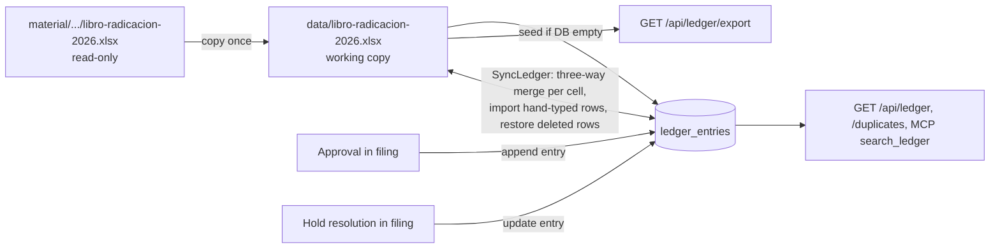

# Ledger

## Purpose

Keeps TAC's filing ledger ("libro de radicación"): the list of every filed document with its consecutive number `TAC-2026-ER-#####`. Docket continues the client's existing Excel (`libro-radicacion-2026.xlsx`) **without changing how it looks**, because Accounting and Legal already consult it. It also answers "is this invoice already filed?" for the duplicate rule and reports duplicates that already exist in the historical ledger.

## Who uses it

- **Clerk (CLERK, Martha)**: indirectly fills it by approving documents; searches it and downloads the Excel from the `/ledger` screen ("Libro").
- **Coordinator (COORDINATOR, Dra. Herrera)**: same screen and same powers as the clerk here — searches, downloads the Excel, reviews historical duplicates. The ledger has no write action in the UI for anyone; entries only appear through approvals in [document review](document-review.md) or the [inbox](inbox.md), and a held invoice's row only changes when she resolves it in [verifications](verifications.md).
- **AI assistant via MCP**: `search_ledger` tool (read-only, see [mcp](mcp.md)).
- **Filing slice**: uses `find_invoice` (duplicate check), `last_sequence` / `append` (numbering on approval) and `get` / `update` (`VerifyHold` rewrites a held invoice's row).

## How it works

1. **Seed on first boot** (`SeedLedger`, called by `Container.bootstrap()`): if the database ledger is empty, the client's workbook is read and every row whose number matches `TAC_FILING_PREFIX` (`TAC-2026-ER-`) is stored with its sequence. The sample ledger has 28 rows ending at **`TAC-2026-ER-04817`**.
2. **The client's Excel is never modified in `material/`.** `ExcelLedgerWorkbook` copies it once to `TAC_DATA_DIR/libro-radicacion-2026.xlsx` (the working copy, which would live in the shared folder) and works only on that copy.
3. **Database is the source of truth for Docket** (`SqlLedgerRepository`, table `ledger_entries`, unique `sequence`), and the working copy is the **shared book people also edit**: the two are kept in step by a two-way, cell-by-cell sync (see [Two-way sync with the shared Excel](#two-way-sync-with-the-shared-excel) below). New rows are **appended** after the last row with the same 12 columns and the same cell style as the last existing row; existing rows are changed only in the cells that changed on Docket's side (a held invoice released or rejected, a disposed record).
4. Values are written in the client's vocabulary (`api/app/shared/infrastructure/client_vocabulary.py`): `Factura`, `Derecho de petición`, `Oficio ente de control`…, department codes `CUENTAS_POR_PAGAR`, `JURIDICA`…, status `Entregado` / `En trámite` / `Retenida - verificar con proveedor` / `Rechazada - fraude confirmado` / `Cerrado`. The "Observaciones" column combines `URGENTE`, flag notes (e.g. "Extemporánea", "Sin OC", "Cuenta distinta al maestro", "Retenida: verificar por teléfono con el proveedor (Dra. Herrera)", "Verificada por teléfono con el proveedor (Dra. Herrera): se libera para pago", "Fraude confirmado por la coordinación: NO PAGAR") and the clerk's notes / purchase order.
5. **Ledger status** of a new entry: `ON_HOLD` for invoices held for verification, `IN_PROGRESS` when there is a due date, otherwise `DELIVERED`. When the coordinator resolves a held invoice (`VerifyHold`, see [filing](filing.md)), its row moves from `ON_HOLD` to `DELIVERED` (department from the purchase-order rule, flag `VERIFIED_BY_PHONE`) or to `REJECTED` (flag `FRAUD_CONFIRMED`), and the `HOLD_FOR_VERIFICATION` flag is dropped.
6. **Duplicates**: the key is normalized NIT + normalized document number (`invoice_key`). `find_invoice` returns the first filed invoice with that key; `historical_duplicates` groups ledger invoices that share it. The sample historical ledger already contains invoice **X-10504** filed twice (**TAC-2026-ER-04809** and **TAC-2026-ER-04813**), which `GET /api/ledger/duplicates` reports.



### Two-way sync with the shared Excel

People keep editing the shared Excel (Legal writes "Respondido", Accounting adds a note, Martha types a row by hand when Docket is down). `SyncLedger` (`ledger/application/sync_ledger.py`) keeps both sides without losing anyone's work. It runs before numbering and after appending in every approval, after `VerifyHold` and `DisposeRecord`, before every Excel download, on demand (`POST /api/ledger/sync`) and every `TAC_LEDGER_SYNC_SECONDS` (unset or `0` disables; the template sets 30) through `PeriodicTask` (`shared/infrastructure/scheduler.py`, started in the app lifespan).

1. **Read** the file as a table of normalized cells per filing number (`read_table`, `normalize_cell`), with its version (modification time + size).
2. **Rows typed by hand** (a number of this series not in the ledger) are imported (`parse_cells`, flag `MANUAL_ENTRY`, audit `LEDGER_MANUAL_ROW_IMPORTED`); since approvals sync before numbering, the next number continues after them.
3. **Three-way merge per cell** (`ledger/domain/sync.py`, `merge_row`): `base` = the row as last synced (table `ledger_sync_base`), `ours` = what Docket would write now, `theirs` = the file. Whoever changed a cell since `base` wins; if both changed it, **people win** and a conflict is recorded (`LEDGER_SYNC_CONFLICT`), except "Observaciones", where both texts are kept. On the first sync the file itself is the base.
4. **People's edits come into the ledger** (`absorb_cells`, audit `LEDGER_EDIT_MERGED`): due date, status and department become data — a status with words like "Respondido", "Cerrado", "Tramitado", "Archivado" becomes `CLOSED` ("Cerrado"), and [deadlines](deadlines.md) drop it; any other edited cell is kept in `LedgerEntry.manual_overrides`, so Docket shows and writes it exactly as typed.
5. **A deleted row is restored** (a filing number cannot disappear) and audited (`LEDGER_ROW_RESTORED`).
6. **Write back** only the rows that changed on Docket's side (`write_table`): never while Excel's lock file `~$libro-radicacion-2026.xlsx` exists (`WorkbookLockedError` → outcome `LOCKED`; the change stays in the ledger and is written on a later sync), and only if the file version is the one read (atomic replace through a temporary file; `WorkbookChangedError` → merge again, at most 3 attempts → `CHANGED_TOO_OFTEN`).
7. The last state (outcome, counts, conflicts) is stored in `ledger_sync_state` (`SqlSyncStore`).

Historical rows take part like any other row; on the sample ledger the first sync changes nothing. If the file is `LOCKED` when someone downloads it, `ExportLedger` renders a read-only copy from the ledger instead.

### The screen (`/ledger`)

1. `app/(app)/ledger/page.tsx` renders `LedgerTemplate` (Server Component) inside `<Suspense>` with `LedgerSkeleton` (`aria-busy`).
2. Filters live in the URL (`?q=&department=&type=`): `LedgerSearch` is a plain GET form (`role="search"`), so a search can be bookmarked or shared. The department and type filters are the design-system `FilterSelect` molecule (`shared/ui/molecules/FilterSelect.tsx`) — a Radix select positioned as a popper, whose hidden native field submits with the form; there is no native `<select>` left. Its first option "Todas las dependencias" / "Todos los tipos" carries the sentinel `ALL`, which `parseLedgerQuery` treats as no filter; `toQueryString` maps `type` to the API's `document_type`.
3. `LedgerTemplate` calls `fetchLedgerPage(query, offset)` (`GET /api/ledger?…&limit=50&offset=N`, `LEDGER_PAGE_SIZE` = 50) and `fetchLedgerDuplicates` (`GET /api/ledger/duplicates`) in parallel on the server; the page offset comes from the URL (`parseLedgerOffset`: anything invalid or negative is 0); `toLedgerEntryView` marks entries filed by Docket (`source_document_id` not null) as `isNew`.
4. The page shows: header "Libro" (eyebrow "Libro de radicación 2026") with **"Descargar Excel"**; an alert "Posibles facturas duplicadas en el libro histórico" listing each group ("TAC-2026-ER-04809 y TAC-2026-ER-04813: mismo proveedor y mismo número…") when there are any; the search form (text "Radicado, remitente, NIT, asunto o número", "Dependencia" select without `SENDER`, "Tipo documental" select, "Buscar"); a count of the matching entries ("N registros", the API's `total`, not just the page); the entries of the page; and the shared `Pagination` molecule ("1–50 de 120", "Anterior" / "Siguiente", `<nav aria-label="Páginas del libro">`), whose links come from `ledgerPageHref(query, offset)` so the search (`q`, `department`, `type`) is kept while paging; it is hidden when everything fits in one page.
   Above the search, `LedgerSyncStatus` (from `GET /api/ledger/sync`) says how the last merge with the shared Excel went: normally a line "Sincronizado con el Excel compartido · <time>. Las ediciones hechas en el Excel se traen automáticamente."; a banner "El Excel compartido está abierto en otro equipo" when the outcome is `LOCKED` ("Docket no lo sobrescribe mientras alguien lo tenga abierto…"); or "Cambios cruzados para revisar" listing each conflict as `filing number (column)`. All three have **"Sincronizar ahora"** (`syncLedgerAction` → `POST /api/ledger/sync`), with a toast of rows imported, edits brought in and rows written, or a warning when the file is open.
5. **Table (from `md`)**: Radicado, Recibido, Remitente, "Asunto y tipo" (subject with the Spanish document type as a second line), Valor (pesos, right-aligned), Dependencia, Vence (with "Urgente" badge), Estado. Dates are numeric `dd/mm/yyyy` (`formatDateNumeric`), sender and subject wrap instead of truncating, the notes appear as the subject cell's tooltip, and Docket's new entries have a tinted background. Status badges pair tone, icon and label: `DELIVERED` "Entregado" (check), `IN_PROGRESS` "En trámite" (clock), `ON_HOLD` "Retenida" (shield, danger), `REJECTED` "Rechazada: fraude" (ban, danger), `CLOSED` "Cerrado" (double check, success).
6. **Download**: "Descargar Excel" links to the route handler `/files/ledger`, which streams `GET /api/ledger/export` with the API's `Content-Disposition` (file `libro-radicacion-2026.xlsx`), `Cache-Control: private, no-store`, and `401` without a session. The token never reaches the browser.
7. **States**: loading skeleton; empty result "Sin resultados — Pruebe con otra búsqueda."; no duplicates → no alert.

### On phones and offline

- Below `md` the table becomes **cards**: filing number and status badge on top, subject, "sender · type → department", and "received · vence … · amount" (dates like "18 de nov de 2026"); Docket's entries have a colored left border. Nothing scrolls sideways. The search fields stack in one column and are 44 px high; from `sm` they sit in one row.
- **Offline**: `/ledger` is one of the two read views the service worker keeps (network first, 4 s timeout, cache `docket-read-views`). A ledger page already opened can be read again without a connection, as fresh as the last visit; search combinations not visited before, and the Excel download (`/files/ledger`), need the network. See [pwa](pwa.md).

### The 12 columns

`Radicado`, `Fecha recibido`, `Remitente`, `NIT / Documento`, `Tipo documental`, `Asunto`, `No. documento`, `Valor total`, `Dependencia`, `Fecha vencimiento`, `Estado`, `Observaciones`. For invoices the subject is `Factura <number>`; otherwise the e-mail subject.

## Business rules

| Rule | Source | Where in code |
|---|---|---|
| Filing number = `TAC-2026-ER` + 5-digit consecutive, one per document | Martha: *"El radicado es el consecutivo: TAC-2026-ER y el número, cinco dígitos."* | `ledger/domain/filing_number.py` |
| People keep using the shared Excel: what they type (a row by hand, "Respondido", a note) is not lost, and Docket never overwrites a file someone has open | Martha and Dra. Herrera: Accounting and Legal consult and work on the same book | `SyncLedger`, `merge_row`, `WorkbookLockedError`, `WorkbookChangedError` |
| Keep the ledger as it is: same file, same columns, same format | Martha: *"Que me deje el libro como lo tengo, porque Contabilidad y Jurídica lo consultan."* | `ExcelLedgerWorkbook.render` (appends new rows; rewrites only Docket's rows; historical rows untouched) |
| A held invoice is closed by the coordinator after calling the supplier: released or rejected, never paid if fraud | Martha: *"se la paso a la doctora Claudia para que verifiquen por teléfono con el proveedor"* | `LedgerRepository.get` / `update`, `LedgerStatus.REJECTED`, flags `VERIFIED_BY_PHONE` / `FRAUD_CONFIRMED` |
| Before filing an invoice, look in the ledger for the same number of the same supplier | Martha: *"antes de radicar, busco en el libro si ya está ese número de ese proveedor"* | `find_invoice`, `invoice_key` |
| Late travel requests are marked "extemporánea" in the observations | Martha: *"en observaciones le pongo 'extemporánea'"* | `FLAG_TO_CLIENT_NOTE` |
| Numbers are never reused | Guardrail ("Nothing irreversible without a human") | unique `sequence` / `filing_number`; no delete path |

## API endpoints / screens

| Method | Path | Role | Request | Success `code` |
|---|---|---|---|---|
| GET | `/api/ledger` | any | query `q` (text in number, sender, NIT, subject, document number), `department`, `document_type`, `limit` (default 50, clamped to 1–200), `offset` | `LEDGER_LISTED` (`{items, total, limit, offset}`, newest number first) |
| GET | `/api/ledger/export` | any | — | Excel file (`application/vnd.openxmlformats-officedocument.spreadsheetml.sheet`, `attachment; filename="libro-radicacion-2026.xlsx"`), not an envelope |
| GET | `/api/ledger/sync` | any | — | `LEDGER_SYNC_STATUS` (last `SyncState`: `outcome`, `at`, `imported_rows`, `restored_rows`, `merged_from_excel`, `written_to_excel`, `conflicts: [{filing_number, column}]`; `null` before the first sync) |
| POST | `/api/ledger/sync` | any | — | `LEDGER_SYNCED`, `LEDGER_SYNCED_WITH_CONFLICTS`, `LEDGER_LOCKED` or `LEDGER_CHANGED_TOO_OFTEN` (the new `SyncState`) |
| GET | `/api/ledger/duplicates` | any | — | `LEDGER_DUPLICATES` (`[["TAC-2026-ER-04809", "TAC-2026-ER-04813"], ...]`) |

Entry keys: `filing_number`, `received_date`, `sender`, `identification`, `document_type`, `subject`, `document_number`, `total_amount`, `department`, `due_date`, `status`, `notes`, `flags`, `urgent`, `source_document_id` (null for historical rows). Errors: `401 UNAUTHORIZED`.

### Screen

| Route / handler | Calls | Notes |
|---|---|---|
| `/ledger` (`web/src/app/(app)/ledger/page.tsx`, feature `web/src/features/ledger/`) | `GET /api/ledger` (`q`, `department`, `document_type`, `limit`, `offset`), `GET /api/ledger/duplicates` | Server Component; filters and page from the URL (`q`, `department`, `type`, `offset`) |
| `syncLedgerAction` (Server Action, "Sincronizar ahora") | `POST /api/ledger/sync` | refreshes the route |
| `/files/ledger` (`web/src/app/files/ledger/route.ts`) | `GET /api/ledger/export` | Excel download through the Next.js server |

If loading the page fails, the shared `app/(app)/error.tsx` boundary shows "No se pudo cargar esta vista" with "Reintentar" and "Ingresar de nuevo" (see [session](session.md)); a failed download returns the API's status code.

## Codes

| Code | Meaning (EN) | Significado (ES) | Blocking? |
|---|---|---|---|
| `LEDGER_LISTED` | Ledger entries returned | Registros del libro devueltos | — |
| `LEDGER_DUPLICATES` | Groups of filing numbers with the same supplier + invoice number | Grupos de radicados con el mismo proveedor y número de factura | — |
| `DELIVERED` | Forwarded to the department (Excel: "Entregado") | Entregado a la dependencia | — |
| `IN_PROGRESS` | A legal term is running (Excel: "En trámite") | Tiene un plazo corriendo ("En trámite") | — |
| `ON_HOLD` | Held for verification with the supplier (Excel: "Retenida - verificar con proveedor") | Retenida para verificar con el proveedor | — |
| `REJECTED` | The coordinator confirmed a fraud attempt; never paid (Excel: "Rechazada - fraude confirmado"; screen: "Rechazada: fraude") | La coordinadora confirmó un intento de fraude; no se paga | — |
| `CLOSED` | Closed by the department, typed by people in the shared Excel ("Respondido", "Cerrado", "Tramitado"…; Excel: "Cerrado" or their words); leaves the deadlines | Cerrado por la dependencia, escrito por las personas en el Excel compartido; sale de vencimientos | — |
| `MANUAL_ENTRY` (flag) | Row typed by hand in the shared Excel and imported by the sync | Fila escrita a mano en el Excel compartido e importada por la sincronización | — |
| `SYNCED` / `SYNCED_WITH_CONFLICTS` / `LOCKED` / `CHANGED_TOO_OFTEN` | Sync outcome (`SyncOutcome`; responses `LEDGER_<OUTCOME>`): merged / merged with conflicts / file open, written later / file kept changing (3 attempts) | Resultado de la sincronización: fusionado / fusionado con conflictos / archivo abierto, se escribe después / el archivo siguió cambiando (3 intentos) | — |
| `LEDGER_SYNC_STATUS` | Last sync state returned | Último estado de sincronización devuelto | — |
| `LEDGER_MANUAL_ROW_IMPORTED` / `LEDGER_EDIT_MERGED` / `LEDGER_SYNC_CONFLICT` / `LEDGER_ROW_RESTORED` (audit) | Hand-typed row imported / people's edit merged (`columns`) / same cell changed on both sides (`column`) / deleted row restored | Fila a mano importada / edición traída (`columns`) / misma celda cambiada en ambos lados (`column`) / fila borrada restaurada | — |
| `VERIFIED_BY_PHONE` (flag) | Ledger note: verified by phone with the supplier (Dra. Herrera), released for payment | Nota: verificada por teléfono con el proveedor (Dra. Herrera), se libera para pago | — |
| `FRAUD_CONFIRMED` (flag) | Ledger note: fraud confirmed by the coordination, DO NOT PAY | Nota: fraude confirmado por la coordinación, NO PAGAR | — |
| `DISPOSED` (flag) | Content destroyed under the retention schedule; the row stays as index (Excel note: "Eliminado según la Tabla de Retención Documental"; see [records](records.md)) | Contenido eliminado según la TRD; la fila queda como índice | — |
| `HOLD_FOR_VERIFICATION` (flag) | Ledger note: verify by phone with the supplier (Dra. Herrera) | Nota: verificar por teléfono con el proveedor (Dra. Herrera) | — |
| Flags `TRAVEL_REQUEST_LATE`, `SUPPLIER_NOT_REGISTERED`, `INVOICE_WITHOUT_PURCHASE_ORDER`, `INVOICE_ACCOUNT_MISMATCH`, `SENDER_DOMAIN_MISMATCH`, `ACCOUNT_CHANGE_ANNOUNCED`, `TUTELA_THREAT` | Reason codes copied to the entry and written as Spanish notes | Códigos de razón copiados al registro y escritos como notas en español | — |

## Limitations

- The next number is `max(sequence in the database) + 1`, after importing rows typed by hand; the numbering lock and the sync run in one process (no lock across several API processes).
- Historical rows that do not match the prefix are counted when seeding but not stored.
- Historical rows keep their original "Observaciones" in `notes`; they have no `flags`.
- No void/annul operation for a filed number yet.
- Text search is a simple case-insensitive substring match over all entries, and pagination slices the filtered list in memory (`PaginateLedger` → `Page.of`): the response is small, but every request still reads the whole ledger (fine for thousands of rows, not for millions).
- The shared Excel is a file in `TAC_DATA_DIR` (or a mounted shared folder); an adapter for SharePoint / Google Drive (with their own versioning and locks) is pending. Lock detection relies on Excel's `~$` file, which other editors (LibreOffice, online Excel) may not create.
- People's edits arrive with the next sync (at most `TAC_LEDGER_SYNC_SECONDS` later, or on "Sincronizar ahora"). A conflict keeps the person's value and is listed for review; Docket does not ask which side is right.
- Only status, due date and department typed in Excel become data; other edited cells are kept as typed (`manual_overrides`) but do not change Docket's logic.
- Screen: no column sorting, and entries do not link to their document.
- Screen: the offline copy is whatever was last loaded; there is no "last updated" indicator.

## How it is tested

- `api/tests/features/ledger/test_excel_sync.py` (8 scenarios): `test_first_sync_changes_nothing`, `test_a_row_typed_by_hand_is_imported_and_numbering_continues` (manual 04818 → next approval gets 04819), `test_legal_closes_a_petition_in_excel_and_it_leaves_the_deadlines` ("Respondido 17-nov" → `CLOSED`, words kept), `test_people_and_docket_edit_the_same_row_without_losing_either`, `test_same_cell_changed_on_both_sides_people_win_and_a_conflict_is_recorded`, `test_a_deleted_row_is_restored`, `test_an_open_excel_is_never_overwritten`, `test_a_save_in_the_middle_of_the_merge_is_merged_again`.
- `api/tests/features/ledger/test_excel_ledger.py`: number format/parse, seeding from the client Excel (28 rows, last 04817), duplicate lookup by supplier + number, historical duplicates 04809/04813, export keeps original rows and columns and appends 04818/04819 in the client's vocabulary (`Oficio ente de control`, `JURIDICA`, `URGENTE…`), the original in `material/` is never modified.
- `api/tests/api/test_api.py::test_full_flow_over_http` (search + export).
- `api/tests/golden/test_golden.py::test_filing_numbers_continue_the_ledger`.

- Screen: `web/e2e/filing-flow.spec.ts` step "the ledger continues the consecutive and exports the Excel" — `/ledger?q=CD-2026-3345` shows a `TAC-2026-ER-048…` cell and "Descargar Excel" downloads `libro-radicacion-2026.xlsx`; `web/e2e/mobile.spec.ts` (Pixel 7) opens "Libro" from the tab bar and checks there is no horizontal overflow. `web/e2e/coordinator.spec.ts` (project `coordinator`) checks that the released invoice `AIB-2026-1189` shows "Entregado" and that the "Dependencia" filter opens a design-system listbox and submits `department=LEGAL`.
- `web/src/features/ledger/__tests__/mappers.test.ts`: the `FilterSelect` option `ALL` means no filter; `ledgerPageHref` keeps the search and moves the offset (`/ledger?q=FE&department=LEGAL&offset=50`), and `parseLedgerOffset` turns a negative offset into 0.
- `api/tests/api/test_api.py::test_inbox_and_ledger_are_paginated`: 28 entries, page `limit=10&offset=20` returns 8, and `limit=10000` is clamped to 200. `web/src/shared/ui/__tests__/FilterSelect.test.tsx`: renders a combobox button with the current label, not a native select.
- Hold resolution rewriting the Docket row in the Excel: `api/tests/features/filing/test_verify_hold.py::test_resolution_is_audited_and_the_excel_row_is_updated`.

```bash
./scripts/harness-verify.sh api/tests/features/ledger/test_excel_ledger.py api/tests/features/ledger/test_excel_sync.py
./scripts/harness-verify.sh web/e2e/filing-flow.spec.ts web/e2e/mobile.spec.ts web/e2e/coordinator.spec.ts
./scripts/harness-verify.sh web/src/features/ledger/__tests__/mappers.test.ts web/src/shared/ui/__tests__/FilterSelect.test.tsx
```

## Changelog

- 2026-11-24: added the `/ledger` screen (search, duplicates alert, table/cards, Excel download, phone and offline behavior).
- 2026-11-24: status `REJECTED` and flags `VERIFIED_BY_PHONE` / `FRAUD_CONFIRMED` (coordinator verification); `LedgerRepository.get` / `update`; the Excel adapter rewrites Docket's rows and never touches historical ones; ledger filters use `FilterSelect`; the route error boundary limitation is removed.
- 2026-11-24: pagination — `GET /api/ledger` takes `limit` / `offset` and returns `{items, total, limit, offset}` (`PaginateLedger`, shared `Page` / `PageRequest`, `MAX_LIMIT` 200); the screen pages with the shared `Pagination` molecule (`ledgerPageHref`, `parseLedgerOffset`); new flag `DISPOSED` (retention). Removed the fixed limitation (no pagination on screen).
- 2026-11-24: two-way sync with the shared Excel — `SyncLedger` (three-way merge per cell, hand-typed rows imported with `MANUAL_ENTRY`, people's edits absorbed, new status `CLOSED`, deleted rows restored, never writes while the file is open, version check), tables `ledger_sync_base` / `ledger_sync_state`, `TAC_LEDGER_SYNC_SECONDS`, `GET` / `POST /api/ledger/sync`, `LedgerSyncStatus` on the screen. Removed the fixed limitations (hand-typed rows not read back, Excel as a one-way view).
