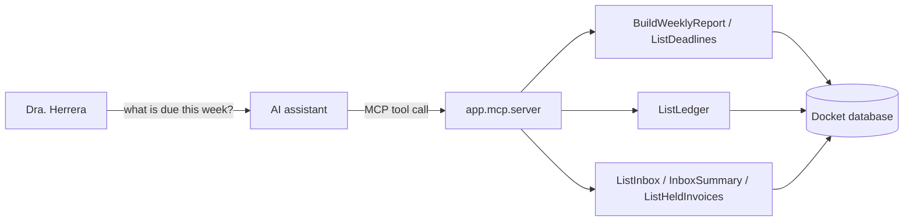

# MCP server

## Purpose

Exposes the filing ledger, the deadlines and the review queue to an **AI assistant** (Claude Desktop, Claude Code or any MCP client) through a **read-only** Model Context Protocol server. Dra. Herrera can ask her assistant *"what is due this week?"* instead of building the Friday report by hand. Nothing can be filed, corrected or sent through MCP.

## Who uses it

- **AI assistant via MCP**, on behalf of the coordinator (COORDINATOR) or the clerk (CLERK): asks questions about deadlines, the ledger and pending reviews.
- Humans do not call it directly; there is no role check inside the server (see Limitations).

## How it works

- Module: `api/app/mcp/server.py`, built on the MCP Python SDK 2.x (`MCPServer`, formerly FastMCP). It creates its own `Container` with the same settings (`TAC_*`), runs `bootstrap()` (seeds the ledger if needed) and **reuses the ledger, deadlines and filing use cases** — no separate logic.
- Every tool is annotated `read_only_hint=True`, `destructive_hint=False`, `idempotent_hint=True`.
- Transports: stdio (default) or streamable HTTP on port 8001 with `--http`.
- Same database as the API (`TAC_DATA_DIR` / `TAC_DATABASE_URL`), so answers reflect what Martha approved.

```bash
cd api
uv run python -m app.mcp.server          # stdio (Claude Desktop / Claude Code)
uv run python -m app.mcp.server --http   # streamable HTTP on :8001
```



### Tools and resource

| Name | Kind | Arguments | Returns |
|---|---|---|---|
| `deadlines_this_week` | tool | — | `today`, `week` [Monday, Sunday], `overdue[]`, `due_this_week[]` (urgent first) |
| `weekly_report` | tool | — | the full weekly report (`overdue`, `this_week`, `next_week`, `not_filed_yet`…) |
| `list_deadlines` | tool | `start`, `end` (ISO; default today → today + 30 days) | open deadlines, including documents not filed yet |
| `search_ledger` | tool | `query`, `department`, `document_type`, `limit` (1–100, default 20) | ledger entries |
| `pending_review` | tool | — | documents `NEEDS_REVIEW` with their **blocking** reason codes |
| `inbox_summary` | tool | — | counts per status |
| `held_invoices` | tool | — | invoices held for possible fraud, by reception time: `id`, `filing_number`, `supplier`, `invoice`, `total_amount`, `sender`, `verification_state` (`PENDING_CLERK_APPROVAL`, `AWAITING_VERIFICATION`, `RELEASED`, `REJECTED`), `reasons` (without `REVIEWED_BY_HUMAN`) |
| `docket://week` | resource | — | `"YYYY-MM-DD..YYYY-MM-DD"` current week |

The server's instructions tell the assistant that dates are ISO and codes are UPPER_SNAKE_CASE English identifiers, so it can translate them for the user.

## Business rules

| Rule | Source | Where in code |
|---|---|---|
| The coordinator needs the weekly list of petitions and notices about to expire | Dra. Herrera: *"Yo necesito saber cada semana qué derechos de petición y qué oficios están por vencerse"* | `deadlines_this_week`, `weekly_report` |
| No AI acts on its own; the assistant only reads | Martha: *"No quiero que algo mande las cosas solo y yo no me entere"*; IT has not approved AI tools | read-only tools; no mutating use case is exposed |
| What the system is not sure about is visible to a person | Martha: *"que cuando no esté seguro me pregunte"* | `pending_review` |
| The coordinator knows which held invoices wait for her phone call | Martha: *"se la paso a la doctora Claudia para que verifiquen por teléfono con el proveedor"* | `held_invoices` (read-only; releasing or rejecting is only done in the app, see [verifications](verifications.md)) |

## API endpoints / screens

No HTTP REST endpoints; MCP tools only (above). The MCP server is independent of the FastAPI app and does not use the `{"code", "data"}` envelope: tools return plain JSON objects/lists with the same keys as the REST API (`filing_number`, `due_date`, `state`, …).

## Codes

The tools return the codes of the slices they read:

| Code | Meaning (EN) | Significado (ES) | Blocking? |
|---|---|---|---|
| `OVERDUE`, `DUE_TODAY`, `DUE_THIS_WEEK`, `DUE_NEXT_WEEK`, `LATER` | Deadline states (see [deadlines](deadlines.md)) | Estados de vencimiento | — |
| `READY`, `NEEDS_REVIEW`, `APPROVED`, `DISCARDED` | Inbox statuses (`inbox_summary`) | Estados de la bandeja | — |
| `PENDING_CLERK_APPROVAL`, `AWAITING_VERIFICATION`, `RELEASED`, `REJECTED` | Verification states (`held_invoices`): still in the clerk's inbox / waiting for the coordinator's call / released / fraud confirmed | Estados de verificación: aún en la bandeja de radicación / espera la llamada de la coordinadora / liberada / fraude confirmado | — |
| e.g. `INVOICE_ACCOUNT_MISMATCH`, `DOCUMENT_UNREADABLE` | Blocking reasons in `pending_review` (see [filing](filing.md)) | Razones bloqueantes en `pending_review` | Yes |

## Limitations

- **No authentication or role check** in the server: whoever can start it (stdio) or reach port 8001 (HTTP) can read the ledger, including supplier names, NITs and amounts. The HTTP transport binds to `0.0.0.0`; restrict it at the network level before exposing it.
- Tool calls are not audited.
- `deadlines_this_week` does not include next week; use `weekly_report` for that.
- `list_deadlines` defaults to today → 30 days and therefore leaves out overdue items unless `start` is given.
- Invalid ISO dates raise an error from the tool (no code mapping).
- The container is created at import time; settings changes need a restart.

## How it is tested

- `api/tests/mcp/test_mcp_server.py`: what is due this week (today 2026-11-18, week 16–22 Nov, includes historical `TAC-2026-ER-04792`), a date range includes unfiled documents (`11.eml__0`, `12.eml__0`), `search_ledger("FE-1207")` → `TAC-2026-ER-04790`, `pending_review` shows `INVOICE_ACCOUNT_MISMATCH` for `05.eml__0`, tools do not change the ledger sequence; `test_held_invoices_tool`: before approval `05.eml__0` is listed as `PENDING_CLERK_APPROVAL` with `INVOICE_ACCOUNT_MISMATCH` among its reasons.

```bash
./scripts/harness-verify.sh api/tests/mcp/test_mcp_server.py
```

## Changelog

- 2026-11-24: new read-only tool `held_invoices` (held invoices and their verification state).
