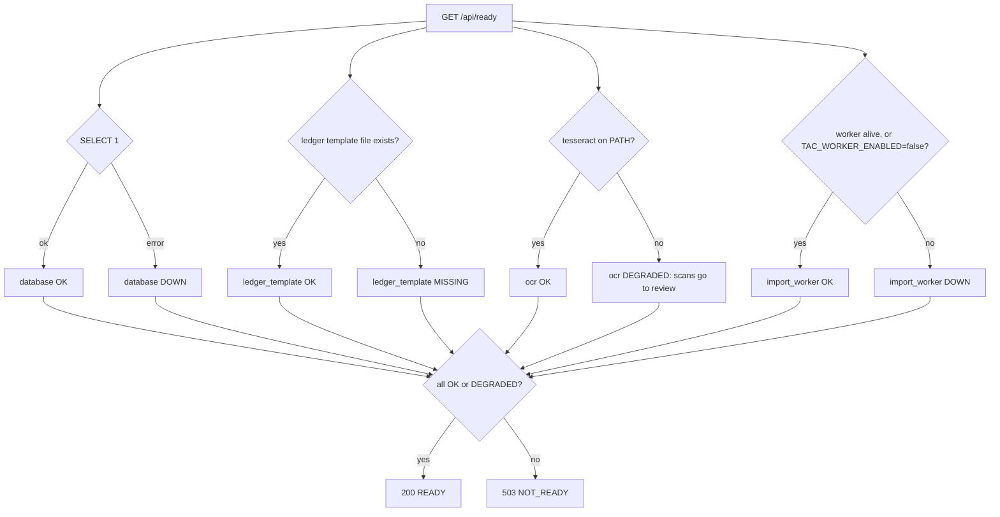

# Observability (monitoring, readiness and logs)

## Purpose

Lets TAC's IT know whether Docket is working and how it is being used without opening the app and without reading anyone's personal data. Three pieces: **Prometheus metrics** (technical and business counts), a **readiness check** that says whether the server can do its job (database, client ledger, OCR, import worker) and **structured JSON logs** where every line of a request carries the same `request_id`. It is cross-cutting infrastructure (`api/app/shared/infrastructure/observability.py`, wired in `main.py` and `container.py`), plus a read-only "Estado del sistema" section in [settings](settings.md).

## Who uses it

- **TAC IT / operations**: scrapes `GET /metrics` with Prometheus, points the load balancer or `docker compose` health check at `GET /api/ready`, and ships the JSON logs to its log store.
- **Clerk (CLERK, Martha)**: sees "Estado del sistema" in `/settings` (database, Excel ledger, OCR, queue processor, import queue counts).
- **Coordinator (COORDINATOR, Dra. Herrera)**: same section if she opens `/settings` (not in her menu).
- **AI assistant via MCP**: no access.

## How it works

### Request IDs and JSON logs

1. `configure_logging()` replaces the handlers of the `docket` logger with one that writes **one JSON object per line**: `at`, `level`, `logger`, `message`, `request_id`, any extra `fields` and, on errors, `exception`.
2. The HTTP middleware `observe_requests` (`main.py`) takes the incoming `X-Request-ID` header or generates one (16 hex characters), stores it in a context variable for the whole request and returns it in the `X-Request-ID` response header. A support ticket can quote it and IT finds every line of that request.
3. Each request is logged as `{"message": "request", "method", "route", "status", "ms"}`. `route` is the **route template** (e.g. `/api/inbox/{document_id}`), never the raw URL, so identifiers do not reach the logs. `/metrics` and `/api/health` are not logged (probe noise).

### Metrics (`GET /metrics`)

`Metrics` creates **one Prometheus registry per application instance** (the container owns it), so tests and several apps in one process do not share counters.

| Metric | Type | Labels | What it counts |
|---|---|---|---|
| `docket_http_requests_total` | Counter | `method`, `route`, `status` | HTTP requests (route template) |
| `docket_http_request_seconds` | Histogram | `route` | HTTP latency (buckets 10 ms … 10 s) |
| `docket_documents_proposed_total` | Counter | `status` | Proposals made (`READY`, `NEEDS_REVIEW`) |
| `docket_review_reasons_total` | Counter | `reason` | Reason codes on proposals (e.g. `INVOICE_ACCOUNT_MISMATCH`) |
| `docket_documents_approved_total` | Counter | `action`, `corrected` | Approvals, and whether a person corrected the proposal (`TRUE` / `FALSE`) |
| `docket_documents_corrected_total` | Counter | — | Corrections |
| `docket_holds_escalated_total` | Counter | — | Suspected frauds the clerk escalated to the coordinator (`HOLD_ESCALATED`) |
| `docket_holds_resolved_total` | Counter | `outcome` | Held invoices resolved by the coordinator (`RELEASED` / `REJECTED`) |
| `docket_import_job_seconds` | Histogram | — | Duration of each import job (buckets 0.5 s … 120 s) |
| `docket_import_jobs` | Gauge | `state` | Import jobs by state (`QUEUED`, `RUNNING`, `DONE`, `FAILED`), refreshed on every scrape |

**Business metrics come from the audit trail, not from the domain.** `MeteredAuditLog` decorates the `AuditLog` port: every `record(...)` is written to the audit as before and, for `DOCUMENT_PROPOSED`, `DOCUMENT_APPROVED`, `DOCUMENT_CORRECTED`, `HOLD_ESCALATED`, `HOLD_RELEASED` and `HOLD_REJECTED`, also increments a counter. No use case or domain class knows about monitoring. The import duration comes from the `on_done` hook of `ProcessNextImport` (see [ingestion](ingestion.md)).

**No personal data in metrics**: labels are only codes (status, reason, action, route template, state). No NIT, e-mail, name, filing number or token ever becomes a label.

### Readiness (`GET /api/ready`)



Missing OCR only **degrades**: Docket keeps working and scanned documents go to human review as `DOCUMENT_UNREADABLE`. `GET /api/health` (`HEALTHY`) stays as a simple liveness probe.

## Business rules

| Rule | Source | Where in code |
|---|---|---|
| IT must know where the data goes and who sees it: monitoring cannot become a new copy of personal data | Dra. Herrera: *"La gente de sistemas va a querer saber dónde queda todo eso y quién lo ve."* | label set of `Metrics`; route template in logs; `test_metrics_expose_business_counts_without_personal_data` |
| Monitoring does not change business code | Hexagonal rule (domain free of infrastructure) | `MeteredAuditLog` decorator over the `AuditLog` port, wired in `container.py` |
| A server without OCR still works, but says so | Scans without OCR go to review instead of being guessed | `checks["ocr"] = "DEGRADED"` |
| At month-end, IT can see the import queue grow and drain | Month-end peaks | `docket_import_jobs`, `docket_import_job_seconds` |
| Correction rate per approval is measurable | Executive summary: corrections are the accuracy measure | `docket_documents_approved_total{corrected=…}` |

## API endpoints / screens

| Method | Path | Role | Response |
|---|---|---|---|
| GET | `/metrics` | none (not in the OpenAPI schema) | Prometheus text format (`CONTENT_TYPE_LATEST`), not an envelope |
| GET | `/api/ready` | none | `200 {"code": "READY", "data": {"checks": {"database", "ledger_template", "ocr", "import_worker"}}}` or `503 {"code": "NOT_READY", …}` |
| GET | `/api/health` | none | `HEALTHY` with `llm_enabled` |
| any | any | — | response header `X-Request-ID` (echoes the request's or a new one) |

Settings: `TAC_WORKER_ENABLED` (default `true`) and `TAC_WORKER_POLL_SECONDS` (default `0.5`) decide whether `import_worker` is expected.

Screen: "Estado del sistema" in `/settings` (`fetchSystemStatus` → `GET /api/ready` and `GET /api/ingestion/jobs?limit=5`), see [settings](settings.md).

## Codes

| Code | Meaning (EN) | Significado (ES) | Blocking? |
|---|---|---|---|
| `READY` | Every check is `OK` or `DEGRADED` (HTTP 200) | Todas las verificaciones están `OK` o `DEGRADED` (HTTP 200) | — |
| `NOT_READY` | At least one check is `DOWN` or `MISSING` (HTTP 503) | Al menos una verificación está `DOWN` o `MISSING` (HTTP 503) | Yes, for the load balancer |
| `OK` | The check passed | La verificación pasó | — |
| `DEGRADED` | Works with reduced capability (OCR missing) | Funciona con capacidad reducida (falta OCR) | No |
| `DOWN` | Database unreachable or worker not running | Base de datos inaccesible o procesador detenido | Yes |
| `MISSING` | The client's ledger template file is not there | No está el archivo plantilla del libro del cliente | Yes |
| `HEALTHY` | Liveness answer | Respuesta de vida del servicio | — |

## Limitations

- `/metrics` and `/api/ready` have **no authentication**: they expose only counts and check states, but should be reachable only from TAC's internal network or the reverse proxy.
- Metrics live in memory per process: they reset on restart, and with several Uvicorn workers each process has its own registry (Prometheus must scrape each one or the deployment must use one process).
- No alert rules, dashboards or Prometheus configuration ship with Docket; IT defines them (e.g. `NOT_READY`, `docket_import_jobs{state="QUEUED"}` growing, rising `FAILED`).
- The log level is fixed at `INFO` and logs go to stdout only.
- Lines written by the import worker thread carry `request_id` `-` (the job runs outside the request).
- The readiness check only checks that the ledger template file exists, not that the working copy is writable.

## How it is tested

- `api/tests/api/test_observability.py`: `test_queued_import_is_processed_by_the_worker` (job `IMPORT_QUEUED` → `DONE` with 17 documents, counts in `GET /api/ingestion/jobs`); `test_metrics_expose_business_counts_without_personal_data` (`docket_documents_proposed_total{status="READY"}`, `docket_review_reasons_total{reason="INVOICE_ACCOUNT_MISMATCH"}`, `docket_documents_approved_total`, `docket_import_job_seconds_count 1.0`, and no NIT, supplier domain, `@` or token in the body); `test_request_id_and_readiness` (`X-Request-ID` echoed, `READY` with `database` and `import_worker` `OK`).

```bash
./scripts/harness-verify.sh api/tests/api/test_observability.py
```

## Changelog

- 2026-11-24: first version: JSON logs with `request_id` / `X-Request-ID`, Prometheus metrics per app instance at `/metrics` (HTTP, business counts from the audit via `MeteredAuditLog`, import queue), readiness `GET /api/ready`, "Estado del sistema" in settings.
