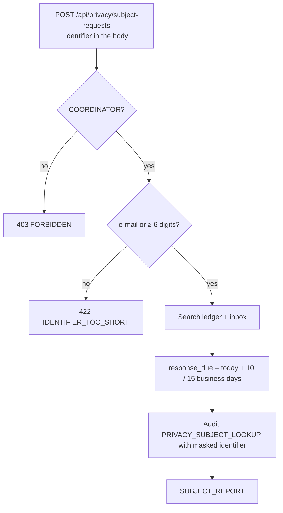

# Personal data protection (habeas data, Ley 1581 de 2012)

## Purpose

Docket reads e-mails full of personal data: national IDs and e-mails of citizens, employees' travel requests, suppliers' bank accounts. Ley 1581 de 2012 and Decreto 1377 de 2013 require TAC to know what personal data it holds, why, with what legal basis and who sees it, and to answer a data subject ("titular") who asks what TAC has about them (inquiry, art. 14) or asks for a correction or deletion (claim, art. 15) within the legal term. This slice gives Dra. Herrera both things: the **inventory** of personal data and a **subject request lookup** that says where a person's data is and by when TAC must answer. It also holds the shared masking used everywhere personal data could leave its purpose.

## Who uses it

- **Coordinator (COORDINATOR, Dra. Herrera)**: reads the inventory and safeguards; runs a data subject lookup when a person files an inquiry or claim. Only she can run the lookup.
- **Clerk (CLERK, Martha)**: can read the inventory (`GET` is open to both roles); she cannot run subject lookups (`403 FORBIDDEN`).
- **AI assistant via MCP**: no access.
- **Other slices**: use `mask_personal_data` (`shared/domain/privacy.py`): the optional Claude classifier before sending text, `DiscardDocument` before auditing a discard reason, `DisposeRecord` before auditing a disposal record reference.

## How it works

### Inventory

`privacy/domain/inventory.py` declares `INVENTORY`, a list of `PersonalDataItem` (`data`, `subjects`, `stored_in`, `purpose`, `legal_basis`, `access`, `retention`) with four entries: sender's name, ID and e-mail; content of petitions and complaints (may include sensitive data); travel request data; suppliers' bank account and NIT. `SAFEGUARDS` lists what protects them (local OCR and rules, AI off and masked, audit and metrics without personal data, subject lookups by request body, disposal by TRD). Both are returned as they are by `GET /api/privacy/inventory`.

### Data subject lookup

`FindDataSubject` (`privacy/application/subject_requests.py`):

1. Normalizes the identifier. An e-mail (contains `@`) is matched as a case-insensitive substring; anything else is reduced to digits (`digits_only`) and must have at least **6 digits** (`MIN_ID_DIGITS`), otherwise `IDENTIFIER_TOO_SHORT` — a short number would match half the ledger.
2. Searches the **ledger** (fields `identification`, `sender`) and the **inbox** (fields `sender`, `identification`, `document_text`, `email_body`). Each hit is a `SubjectMatch` with `where` (`LEDGER` / `INBOX`), `reference` (filing number or document id), the matching `fields`, `received_date` and `content_available` (false once the content was disposed of under the [retention schedule](records.md)).
3. Computes the legal answer date with the business calendar: `INQUIRY` → 10 business days (art. 14), `CLAIM` → 15 business days (art. 15).
4. Records the audit event `PRIVACY_SUBJECT_LOOKUP` with `kind`, the **masked** identifier (`mask_identifier`: only the last 4 characters, e.g. `***.456`) and the number of matches. The full identifier is never stored.
5. Returns a `SubjectReport` (`kind`, `identifier_masked`, `response_due`, `matches`).



### Masking (`shared/domain/privacy.py`)

- `mask_personal_data(text)` replaces e-mail addresses with `[EMAIL]`, dotted national IDs / NITs with `[ID]` and long digit runs (phones, accounts) with `[NUMBER]`.
- `mask_identifier(identifier)` keeps only the last 4 characters (`***` + last 4; `***` if shorter).

## Business rules

| Rule | Source | Where in code |
|---|---|---|
| Know which personal data is held, why, on what legal basis and who sees it | Ley 1581 de 2012; Decreto 1377 de 2013; Dra. Herrera: *"aquí entran datos de personas, de contratos y de pagos. La gente de sistemas va a querer saber dónde queda todo eso y quién lo ve"* | `INVENTORY`, `SAFEGUARDS` |
| An inquiry is answered within 10 business days | Ley 1581 de 2012 art. 14 | `TERMS[INQUIRY]`, `BusinessCalendar.add_business_days` |
| A claim (correction, update or deletion) is answered within 15 business days | Ley 1581 de 2012 art. 15 | `TERMS[CLAIM]` |
| The identifier travels in the request body, never in the URL (it would land in access logs) | Privacy by design | `SubjectRequest` body; `subjectRequestAction` in the web |
| The audit proves the lookup happened without storing whom it was about | Project guardrail (audit without personal data) | `mask_identifier`, `PRIVACY_SUBJECT_LOOKUP` |
| Free text written by a person is masked before it is audited | Project guardrail | `mask_personal_data` in `DiscardDocument` and `DisposeRecord` |
| Personal data never reaches the AI provider unmasked | Dra. Herrera: *"les pido cuidado con la información"* | `ClaudeClassifier` → `mask_personal_data` |
| Only the coordinator runs subject lookups | She answers for the administrative area | `CoordinatorRole` on the endpoint |

## API endpoints / screens

| Method | Path | Role | Request | Success `code` | Errors |
|---|---|---|---|---|---|
| GET | `/api/privacy/inventory` | any | — | `PRIVACY_INVENTORY` (`{items: [PersonalDataItem], safeguards: [str]}`) | `401` |
| POST | `/api/privacy/subject-requests` | COORDINATOR | `{"identifier": "80.123.456", "kind": "INQUIRY" \| "CLAIM"}` (`kind` defaults to `INQUIRY`) | `SUBJECT_REPORT` (`{kind, identifier_masked, response_due, matches: [{where, reference, fields, received_date, content_available}]}`) | `422 IDENTIFIER_TOO_SHORT`, `403 FORBIDDEN`, `401` |

Screen: `/compliance` ("Cumplimiento"), section "Datos personales", see [compliance](compliance.md).

## Codes

| Code | Meaning (EN) | Significado (ES) | Blocking? |
|---|---|---|---|
| `INQUIRY` | Inquiry: what data TAC holds (10 business days) | Consulta: qué datos tiene TAC (10 días hábiles) | — |
| `CLAIM` | Claim: correction, update or deletion (15 business days) | Reclamo: corrección, actualización o supresión (15 días hábiles) | — |
| `LEDGER` / `INBOX` | Where a match was found | Dónde se encontró la coincidencia | — |
| `PRIVACY_INVENTORY` / `SUBJECT_REPORT` | Success responses | Respuestas exitosas | — |
| `PRIVACY_SUBJECT_LOOKUP` | Audit event of a subject lookup (masked identifier) | Evento de auditoría de una consulta de titular (identificador enmascarado) | — |
| `IDENTIFIER_TOO_SHORT` | Not an e-mail and fewer than 6 digits | No es un correo y tiene menos de 6 dígitos | Yes (422) |
| `[EMAIL]`, `[ID]`, `[NUMBER]` | Placeholders left by masking | Marcadores que deja el enmascaramiento | — |

## Limitations

- Docket **locates** the data and computes the term; it does not register the request, track its answer or apply the correction or deletion. A claim is resolved by a person (correct in the review screen while the document is open, or dispose of under the [retention schedule](records.md) when due).
- Matching is by identifier only: it does not find a person by name. A 6-digit ID can also match inside a longer number (false positives are shown, never hidden).
- Not searched: the supplier master, the outbox and the audit details.
- Masking is pattern-based: it does not remove personal **names**.
- The inventory is a list in code reviewed with TAC; changes need a code change.
- The privacy notice ("aviso de privacidad") and data subjects' authorizations are outside Docket.

## How it is tested

- `api/tests/features/privacy/test_subject_requests.py`: an employee is found by national ID in the inbox and the ledger, with an answer date of 2026-12-02 (10 business days); a citizen is found by e-mail and a claim gets 2026-12-10 (15 business days, 8-Dec holiday); the audit stores `***.456` and never `80.123.456`; identifiers that are too short are rejected; discard reasons are masked in the audit (`[EMAIL]`); only the coordinator runs subject lookups (the clerk gets `403`) and the inventory is open to both roles.
- `api/tests/features/classification/test_assisted_classifier.py::test_personal_data_is_masked_before_leaving_tac` (masking before the AI).
- Screen: `web/e2e/coordinator.spec.ts` ("compliance: retention schedule and a data subject request"), see [compliance](compliance.md).

```bash
./scripts/harness-verify.sh api/tests/features/privacy/test_subject_requests.py
```

## Changelog

- 2026-11-24: new `privacy` slice: personal data inventory and safeguards, data subject lookup with legal answer date (art. 14 / art. 15) and masked audit; masking moved to `shared/domain/privacy.py` and now also applied to discard reasons and disposal records in the audit.
