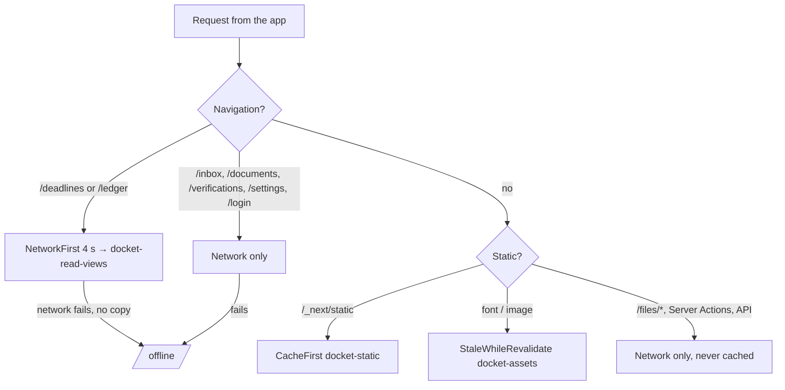

# PWA (installable app and offline)

## Purpose

Docket is a web app, not a native one, but it can be **installed** on a phone, tablet or desktop and opens like an app (own icon, no browser bar). The service worker keeps the two **read-only** views the coordinator checks on the move, deadlines and the ledger, readable on a bad connection or none at all. Everything that holds personal data or changes something (inbox, documents, original files, approvals, corrections) stays online only, because the data must stay on TAC's server and nothing should be done half-way.

## Who uses it

- **Coordinator (COORDINATOR, Dra. Herrera)**: installs it on her phone and checks "Vencimientos" and "Libro" between meetings, even with a weak signal. Offline she can only read what she already opened. Releasing or rejecting a held invoice in "Por verificar" (`/verifications`) always needs a connection: that screen is never cached.
- **Clerk (CLERK, Martha)**: mostly works on desktop; can install it there or on a tablet. Filing, correcting and approving always need a connection.

## How it works

1. **Manifest** (`web/src/app/manifest.ts`, served at `/manifest.webmanifest`): name "Docket · Radicación TAC", short name "Docket", `lang: es-CO`, `start_url: /inbox`, `scope: /`, `display: standalone`, `orientation: any`, background `#fff9f3`, theme color `#0f6b63`, categories business/productivity, and two shortcuts (long-press on the icon): "Bandeja" (`/inbox`) and "Vencimientos" (`/deadlines`).
2. **Icons** (`web/public/icons/`): `icon-192.png`, `icon-512.png`, `icon-maskable-512.png` (`purpose: maskable`, for Android adaptive icons) and `apple-touch-icon.png` (iOS home screen). The root layout also sets `appleWebApp` (capable, title "Docket"), the browser theme color for light (`#fff9f3`) and dark (`#0e0c09`) schemes, and `viewport-fit=cover` so the app uses the full screen with safe-area padding.
3. **Registration** (`shared/ui/organisms/ServiceWorkerProvider.tsx`): `SerwistProvider` registers `/sw.js` **only in production builds**; in development no service worker runs, so code is always fresh. It does not reload the page when the connection comes back.
4. **Service worker** (`web/src/app/sw.ts`, Serwist):

| What | Strategy | Cache name | Notes |
|---|---|---|---|
| Build assets in the precache manifest | precache | Serwist precache | `globIgnores: ["**/files/**"]` in `serwist.config.mjs`: nothing under `/files` is ever precached |
| Navigations to `/deadlines` and `/ledger` (same origin, `mode: navigate`) | **NetworkFirst**, 4 s network timeout | `docket-read-views` | fresh when online; last copy when offline or slow |
| `/_next/static/*` (hashed JS/CSS) | CacheFirst | `docket-static` | immutable files |
| Fonts and images (same origin) | StaleWhileRevalidate, max 64 entries, 30 days | `docket-assets` | |
| Any other document request that fails | fallback to `/offline` | — | page "Sin conexión" |

   It also enables navigation preload and activates new versions immediately (`skipWaiting`, `clientsClaim`).
5. **Offline page** (`web/src/app/offline/page.tsx`): "Sin conexión — Puede consultar los vencimientos y el libro que ya abrió. Para radicar, corregir o aprobar se necesita conexión: nada se guarda a medias." The route guard (`proxy.ts`) lets `/offline`, `sw.js`, the manifest and icons through without a session.
6. **Build**: `pnpm build` runs `next build && serwist build serwist.config.mjs`. The second step compiles `src/app/sw.ts` (with the precache manifest injected) to `public/sw.js`; it is a separate step because Next.js builds with Turbopack.



### Why the inbox and documents are not cached

- They contain personal and financial data: supplier bank accounts, NITs and ID numbers, citizens' petitions and complaints, original attachments. A cache on a phone is a copy outside TAC's servers, which is exactly what the client's IT asked to avoid (the same reason AI is off by default).
- The inbox only makes sense live: an old copy could lead someone to act on a document that was already approved or corrected.
- Approvals, corrections and discards are Server Actions (POST) and are never cached or queued for later: an approval assigns a filing number, which is irreversible, so it must happen online, with a person watching the result.
- Original files and the Excel go through `/files/*`, which answers `Cache-Control: private, no-store` and is excluded from the precache.

### Installing

- **Android (Chrome)**: menu ⋮ → "Instalar aplicación" (or the install banner). The maskable icon fills the adaptive shape.
- **iOS / iPadOS (Safari)**: Share → "Agregar a inicio". Uses `apple-touch-icon.png` and opens full screen.
- **Desktop (Chrome / Edge)**: the install icon in the address bar, or menu → "Instalar Docket".
- Requires a production build over HTTPS (or `localhost`). The installed app opens on `/inbox`; without a session the guard sends it to `/login`.

### Phones and devices

- Layout is mobile first: bottom tab bar below `lg`, sidebar from `lg`; a header that names the signed-in user at every size; safe-area insets; 44 px targets on navigation and primary actions; no horizontal page scroll (see [session](session.md)).
- Respects `prefers-reduced-motion`, `prefers-reduced-transparency` (translucent bars become opaque) and `prefers-contrast: more`; colors meet WCAG AA in light and dark.

| Device | Width | Automated check |
|---|---|---|
| Phone | Pixel 7 (412 px) | `web/e2e/mobile.spec.ts`, project `phone` |
| Phone (small) | 375 px | manual only |
| Tablet | 768 px | manual only |
| Desktop | Desktop Chrome (1280 px) | `web/e2e/filing-flow.spec.ts`, project `desktop` |

Browsers in automated tests: Chromium only (Playwright). **Lighthouse**: not measured yet; no scores recorded.

## Business rules

| Rule | Where in code |
|---|---|
| Only read views (`/deadlines`, `/ledger`) are available offline | `READ_VIEWS` in `sw.ts` |
| Personal data (inbox, documents, original files) is never cached | no runtime rule for them; `globIgnores: ["**/files/**"]`; `Cache-Control: private, no-store` in `/files/*` |
| Nothing irreversible offline: approvals, corrections and discards are never queued | no background sync; Server Actions go to the network |
| The offline page explains what still works | `app/offline/page.tsx` |
| Signing out removes the offline copies from that device | `LogoutButton` deletes every cache whose name starts with `docket-read-views` before `logoutAction` (see [session](session.md)) |

## API endpoints / screens

- `/manifest.webmanifest` (from `app/manifest.ts`), `/sw.js` (generated), `/offline` (`app/offline/page.tsx`), `/icons/*`.
- The service worker never calls the Docket API directly: the browser only talks to the Next.js server, which holds the token.

## Codes

| Code | Meaning (EN) | Significado (ES) | Blocking? |
|---|---|---|---|
| `NETWORK_ERROR` | The Next.js server cannot reach the API (an online problem, not the device being offline) | No hay conexión con el servidor. | Yes |
| `docket-read-views`, `docket-static`, `docket-assets` | Cache names (not API codes) | Nombres de las cachés | — |

## Limitations

- The offline copies are cleared only when the person signs out with "Cerrar sesión"; if the session simply expires or the browser is closed, `docket-read-views` keeps the last `/ledger` and `/deadlines` pages on that device.
- No update prompt: new versions activate immediately (`skipWaiting` + `clientsClaim`), which can swap the code under an open page.
- No "last updated" indicator on views read from the cache.
- Only the exact pages already opened are available offline; a ledger search not done before falls back to `/offline`.
- No offline test (Playwright `context.setOffline`) and no Lighthouse run yet; 375 px and 768 px are checked by hand.
- The service worker is not active in development (`pnpm dev`), so offline behavior can only be checked with `pnpm build && pnpm start`.

## How it is tested

- `web/e2e/mobile.spec.ts` (project `phone`, Pixel 7): bottom tab bar visible and working, no horizontal overflow, and `/manifest.webmanifest` returns `display: "standalone"`.
- `web/playwright.config.ts`: projects `desktop` (Desktop Chrome), `coordinator` (Desktop Chrome, `coordinator.spec.ts`, depends on `desktop`) and `phone` (Pixel 7), `locale: es-CO`, `timezoneId: America/Bogota`, `workers: 1`; the web server runs `next start` on a production build, so the real service worker is served.
- Build check: `cd web && pnpm build` (fails if `sw.ts` does not compile).

```bash
./scripts/harness-verify.sh web/e2e/mobile.spec.ts
cd web && pnpm build
```

## Changelog

- 2026-11-24: first version of the documentation.
- 2026-11-24: "Cerrar sesión" clears the `docket-read-views` cache (`LogoutButton`); removed the "cached read views survive logout" limitation. `/verifications` is network only.
