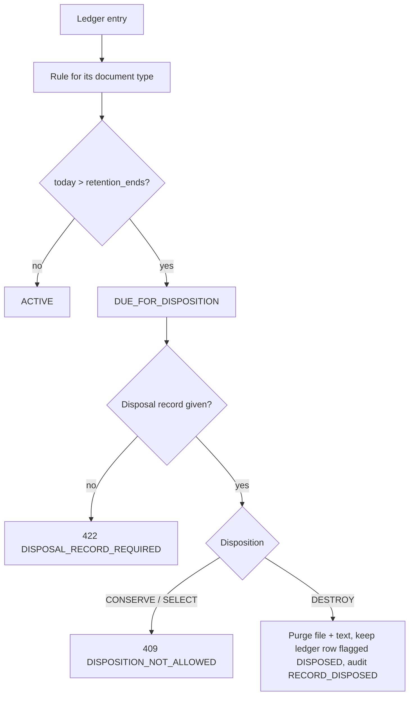

# Records retention (Ley 594 de 2000)

## Purpose

Applies TAC's document retention schedule (Tabla de Retención Documental, TRD) to what Docket files. Ley 594 de 2000 (Ley General de Archivos) requires every filed document to be kept for a defined time and then conserved, selected or destroyed with a record approved by the archive committee. Without this, Docket would either keep personal data forever (against Ley 1581 de 2012) or let someone delete it without control. The slice answers three questions: how long is each document type kept, what has reached the end of its term, and how a record is disposed of without losing the index the law requires.

## Who uses it

- **Coordinator (COORDINATOR, Dra. Herrera)**: reviews the schedule, checks what is due (today or at a future date) and disposes of a due record by entering the disposal record ("acta de eliminación") approved by the Comité Interno de Archivo. Only she can dispose.
- **Clerk (CLERK, Martha)**: can read the schedule and the list (`GET` endpoints are open to both roles); the `/compliance` screen is not in her menu and shows no disposal button to her.
- **AI assistant via MCP**: no access.

## How it works

1. **The schedule** (`records/domain/retention.py`, `DEFAULT_SCHEDULE`) has one `RetentionRule` per `DocumentType`: years in the office archive (`office_years`, archivo de gestión), years in the central archive (`central_years`), the final `Disposition` and the legal `basis`. `total_years = office_years + central_years`. Unknown types fall back to the `OTHER` rule.
2. **The term counts from the end of the year the record was received** (archival practice): `retention_ends = 31 December of the reception year + total_years`. An invoice received on 2026-11-10 is kept until **2036-12-31**.
3. **Status** (`retention_status`): `DISPOSED` if the ledger entry has the `DISPOSED` flag; `DUE_FOR_DISPOSITION` when today is after `retention_ends`; otherwise `ACTIVE`.
4. **Listing** (`ListRetention`): every ledger entry — historical rows from the client's Excel included — becomes a `RetentionView` (`filing_number`, `document_type`, `received_date`, `retention_ends`, `disposition`, `status`), optionally filtered by status, sorted by `retention_ends` and paginated (`Page.of`). The `on` date lets the coordinator preview what will be due on a future day.
5. **Disposal**: the endpoint first rejects a request without the disposal record (`DISPOSAL_RECORD_REQUIRED`, fewer than 3 characters). `DisposeRecord` then only goes ahead when the record is `DUE_FOR_DISPOSITION` **and** its disposition is `DESTROY`. Then:
   - `InboxRepository.purge_content` empties the extracted text and e-mail body of the source document and deletes its original file (`source_file`). The decision and the filing number stay.
   - The ledger entry keeps its row (the index of what existed), gets the flag `DISPOSED` and the note "Eliminado YYYY-MM-DD según TRD; acta …"; the shared Excel is synced (`SyncLedger`), where the flag reads "Eliminado según la Tabla de Retención Documental".
   - The audit records `RECORD_DISPOSED` with `filing_number` and the disposal record reference masked with `mask_personal_data`.



### The proposed schedule

The values are a **starting proposal that TAC's Comité Interno de Archivo must approve**; they are not a legal opinion.

| Document type | Office | Central | Disposition | Basis |
|---|---|---|---|---|
| `INVOICE` | 2 | 8 | `DESTROY` | Accounting support: 10 years (Código de Comercio art. 60; Ley 962 de 2005 art. 28) |
| `TRAVEL_EXPENSE_REQUEST` | 2 | 8 | `DESTROY` | Accounting support for advances: 10 years |
| `PETITION` | 2 | 8 | `SELECT` | Petitions (Ley 1755 de 2015): legal value; the archive committee selects |
| `OVERSIGHT_NOTICE` | 2 | 18 | `CONSERVE` | Oversight bodies' requests: total conservation |
| `COMPLAINT` | 2 | 3 | `DESTROY` | Terminal users' complaints: administrative value |
| `QUOTATION` | 1 | 1 | `DESTROY` | Quotations not awarded: administrative value |
| `OTHER` | 2 | 3 | `SELECT` | Unclassified: the archive committee decides |

## Business rules

| Rule | Source | Where in code |
|---|---|---|
| Each document type has a retention time and a final disposition (TRD) | Ley 594 de 2000 | `DEFAULT_SCHEDULE`, `RetentionRule` |
| Accounting support is kept 10 years | Código de Comercio art. 60; Ley 962 de 2005 art. 28 | `INVOICE`, `TRAVEL_EXPENSE_REQUEST` rules |
| Terms count from the end of the year of production | Archival practice | `retention_ends` |
| Nothing is destroyed before its term | Ley 594 de 2000 | `DisposeRecord` → `RetentionNotExpiredError` |
| What must be conserved (or selected by the committee) is never destroyed by Docket | TRD dispositions | `DisposeRecord` → `DispositionNotAllowedError` |
| A disposal needs the committee's approved record | Ley 594 de 2000 (acta de eliminación) | `DisposeRequest.record_reference` (≥ 3 characters), `DISPOSAL_RECORD_REQUIRED` |
| Disposal removes the personal content but keeps the index of what existed and when it was destroyed | Ley 594 de 2000 (inventory) and Ley 1581 de 2012 (data kept only while needed) | `purge_content`, `DISPOSED` flag, ledger note |
| Only the coordinator disposes | Dra. Herrera answers for the administrative area | `CoordinatorRole` on the endpoint |
| Every disposal is audited without personal data | Project guardrail | `RECORD_DISPOSED`, `mask_personal_data` |

## API endpoints / screens

| Method | Path | Role | Request | Success `code` | Errors |
|---|---|---|---|---|---|
| GET | `/api/retention/schedule` | any | — | `RETENTION_SCHEDULE` (list of rules with `total_years`) | `401` |
| GET | `/api/retention` | any | query `status` (`ACTIVE` / `DUE_FOR_DISPOSITION` / `DISPOSED`), `on` (`YYYY-MM-DD`, default today), `limit` (default 50, max 200), `offset` | `RETENTION_LISTED` (`{items, total, limit, offset}`) | `401`, `422 VALIDATION_ERROR` |
| POST | `/api/retention/{filing_number}/dispose` | COORDINATOR | `{"record_reference": "Acta 07 de 2037"}` | `RECORD_DISPOSED` (the updated `RetentionView`) | `404 RECORD_NOT_FOUND`, `409 RETENTION_NOT_EXPIRED`, `409 DISPOSITION_NOT_ALLOWED`, `422 DISPOSAL_RECORD_REQUIRED`, `403 FORBIDDEN` |

Screen: `/compliance` ("Cumplimiento"), see [compliance](compliance.md).

## Codes

| Code | Meaning (EN) | Significado (ES) | Blocking? |
|---|---|---|---|
| `CONSERVE` | Total conservation: never destroyed | Conservación total: nunca se elimina | — |
| `DESTROY` | Destroyed once the term ends, with an approved record | Eliminación al cumplir el tiempo, con acta aprobada | — |
| `SELECT` | Selection: the archive committee decides what is kept | Selección: el comité de archivo decide qué se conserva | — |
| `ACTIVE` | Retention term still running | Tiempo de retención vigente | — |
| `DUE_FOR_DISPOSITION` | Term ended; the final disposition can be applied | Cumplió su retención; se puede aplicar la disposición final | — |
| `DISPOSED` | Content destroyed; the ledger row remains as index (also a ledger flag) | Contenido eliminado; la fila del libro queda como índice (también es marca del libro) | — |
| `RETENTION_SCHEDULE` / `RETENTION_LISTED` / `RECORD_DISPOSED` | Success responses (`RECORD_DISPOSED` is also the audit event) | Respuestas exitosas (`RECORD_DISPOSED` también es el evento de auditoría) | — |
| `RECORD_NOT_FOUND` | The filing number is not in the ledger | El radicado no está en el libro | Yes (404) |
| `RETENTION_NOT_EXPIRED` | The retention term has not ended | Aún no se cumple el tiempo de retención | Yes (409) |
| `DISPOSITION_NOT_ALLOWED` | The schedule says conserve or select, not destroy | La tabla exige conservar o seleccionar, no eliminar | Yes (409) |
| `DISPOSAL_RECORD_REQUIRED` | The approved disposal record is missing | Falta el acta de eliminación aprobada | Yes (422) |

## Limitations

- The schedule is a **proposal in code** (`DEFAULT_SCHEDULE`) pending approval by TAC's Comité Interno de Archivo; changing it means a code change, not a setting.
- `SELECT` records cannot be processed in Docket: the committee's selection happens outside the system.
- Disposal of a **historical** row (filed before Docket, `source_document_id` null) flags the entry and the note reaches the shared Excel through the [ledger sync](ledger.md#two-way-sync-with-the-shared-excel), but Docket has no original file for those rows to purge (paper or other archives are outside Docket).
- Transfer from the office archive to the central archive is not modeled: only the total term matters.
- Disposal purges what Docket holds; copies forwarded to departments by e-mail are outside its reach.
- There is no bulk disposal: records are disposed of one by one.

## How it is tested

- `api/tests/features/records/test_retention.py`: an invoice received in 2026 is kept until 2036-12-31; nothing is due on 2026-11-18; on 2037-01-02 `TAC-2026-ER-04818` is due, its disposal empties the text and the original file, keeps the filing number, writes "Eliminado según la Tabla de Retención Documental" in the Excel and audits `RECORD_DISPOSED`; never before the term (`RetentionNotExpiredError`) and never an oversight notice (`DispositionNotAllowedError`); historical rows are covered (31 = 28 historical + 3 filed).
- Screen: `web/src/features/compliance/__tests__/labels.test.ts` and `web/e2e/coordinator.spec.ts` ("compliance: …"), see [compliance](compliance.md).

```bash
./scripts/harness-verify.sh api/tests/features/records/test_retention.py
```

## Changelog

- 2026-11-24: new `records` slice: TRD proposal per document type, retention status, paginated listing with preview date, controlled disposal (content purged, index kept, `RECORD_DISPOSED`).
