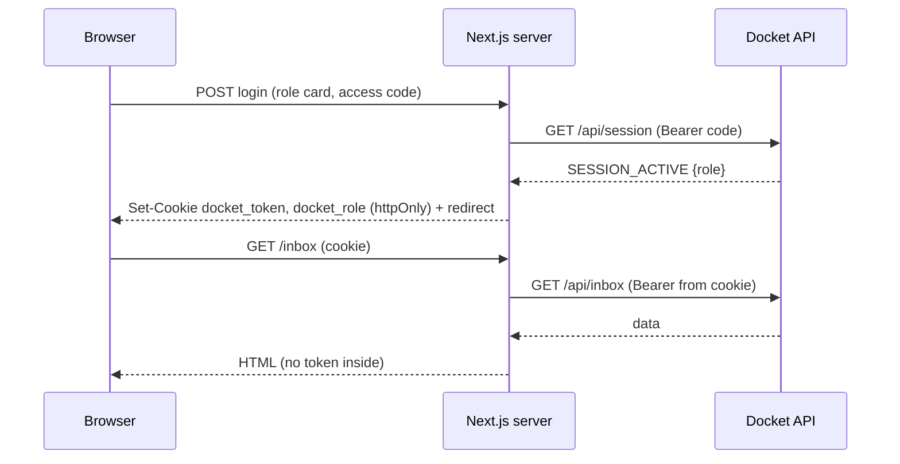

# Session and app shell

## Purpose

Signs people in, keeps their API token **out of the browser**, guards every route, and draws the frame every screen lives in (a header on every screen that says who is signed in, plus a sidebar on desktop and a bottom tab bar on phones). It is what gives the clerk and the coordinator **each their own workspace** (their own menu and home screen, not just different permissions), and what makes the rest of the frontend safe to build with Server Components and Server Actions.

## Who uses it

- **Clerk (CLERK, Martha)**: signs in with "Radicación"; lands on the inbox.
- **Coordinator (COORDINATOR, Dra. Herrera)**: signs in with "Coordinación"; lands on deadlines, with "Por verificar" second in her menu.

Navigation by role (`ROLE_NAV` and `ROLE_HOME` in `shared/ui/organisms/AppNav.tsx`; the same order in the sidebar and the tab bar):

| Role | Menu (in order) | Home after login |
|---|---|---|
| `CLERK` | Bandeja, Vencimientos, Libro, Ajustes | `/inbox` |
| `COORDINATOR` | Vencimientos, Por verificar, Libro, Bandeja, Cumplimiento | `/deadlines` |

What each role sees in the UI (the API enforces the same rules and answers `FORBIDDEN` otherwise):

| Screen | CLERK | COORDINATOR |
|---|---|---|
| [Inbox](inbox.md) | list + Leer buzón, Subir .eml, Aprobar listos | list only, with a "Vista de supervisión" note |
| [Document review](document-review.md) | Approve, Corregir, Descartar on open documents | read only (evidence, reasons, history, original) |
| [Ledger](ledger.md) | search + Excel download | same |
| [Deadlines](deadlines.md) | weekly report | same + her summary (invoices to verify, clerk's backlog) |
| [Verifications](verifications.md) | not in her menu; if opened by URL, read only | release or confirm fraud on held invoices (note required) |
| [Settings](settings.md) | read + replace supplier master | read only |
| [Compliance](compliance.md) | not in her menu; if opened by URL, read only (no disposal, no data subject lookup) | retention schedule, dispose of due records with the committee's record, personal data inventory, data subject requests |

## How it works

1. **Login** (`/login`, `features/session`): `LoginForm` asks "¿Quién ingresa?" with two cards — "Radicación · Martha Rojas · radica, corrige y aprueba" and "Coordinación · Dra. Claudia Herrera · consulta y vencimientos" — and an "Código de acceso" (password field). In the demo, a hint under the field fills the code (`martha-demo` / `herrera-demo`).
2. `loginAction` (Server Action, `api/session-actions.ts`) calls `GET /api/session` with the typed code as bearer token. The API answers `SESSION_ACTIVE` with the real `role`. The action then sets two cookies, `docket_token` and `docket_role`, both `httpOnly`, `SameSite=Lax`, `path=/`, `Secure` in production, 12 hours. It redirects to `ROLE_HOME[data.role]` — the home of the role **the API returned**, not of the card picked: `/inbox` for CLERK, `/deadlines` for COORDINATOR.
3. **Route guard** (`web/src/proxy.ts`, Next.js proxy): without `docket_token`, every route except `/login` redirects to `/login`; with it, `/login` redirects to `/inbox`. Static files, icons, `manifest.webmanifest`, `sw.js` and `/offline` are excluded so the PWA works signed out. `/` redirects to `/inbox`.
4. **Calling the API**: `shared/lib/api-client.ts` (`server-only`) reads the cookie through `shared/lib/session.ts` and adds `Authorization: Bearer <token>`. It unwraps the `{code, data}` envelope and throws `ApiError(code)` on errors; a connection failure becomes `NETWORK_ERROR`. Server Actions turn errors into `{ok: false, code}` and client components show `describeError(code)`.
5. **Files** go through route handlers too, so the browser never needs the token: `/files/documents/{id}` (original attachment, inline) and `/files/ledger` (Excel download). Both answer `401` without a session and send `Cache-Control: private, no-store`.
6. **Logout**: `LogoutButton` (`shared/ui/organisms/LogoutButton.tsx`, client) first deletes the browser caches whose name starts with `docket-read-views` (the offline copies of the ledger and deadlines, which hold NITs and amounts), then submits `logoutAction`, which deletes both cookies and redirects to `/login`.
7. **Error boundary** (`app/(app)/error.tsx`): when a signed-in page fails to load (API down, session expired), it shows "No se pudo cargar esta vista" (`role="alert"`) with two ways out: **"Reintentar"** (`reset()`) and **"Ingresar de nuevo"** (a form that submits `logoutAction`).



### App shell (`shared/ui/organisms/AppShell.tsx`)

- **Header, at every size**: a sticky translucent bar that always says who is signed in. `SessionSummary` shows an avatar with initials, the person's name (from `roleUser` in `shared/i18n/es.ts`: CLERK = Martha Rojas, COORDINATOR = Claudia Herrera) and, from `md`, the role and the case date (e.g. "Radicación · 18 de nov de 2026"); on phones only the name and the avatar. It is labeled for screen readers ("Sesión de Martha Rojas, Radicación"). Next to it: the theme toggle and "Cerrar sesión". On phones the header also carries the logo; on desktop it shows "Radicación de correspondencia".
- **Desktop (`lg` and up)**: sticky sidebar with logo, "Docket / Terminales Andinas de Carga" and the navigation of the signed-in role (`SessionNav` reads the session and passes `ROLE_NAV[role]` to `AppNav`; table above). The workspace to its right uses the full width (no max-width container), which suits the ledger table.
- **Phones and tablets (below `lg`)**: a fixed bottom **tab bar** with the same destinations of the role (four for the clerk, five for the coordinator), icon + label, 56 px high (`min-h-14`), respecting the safe areas (`env(safe-area-inset-*)`, `viewport-fit=cover`). Content has bottom padding so the tab bar never covers it.
- The active item is highlighted with `aria-current="page"`; `/documents/*` highlights "Bandeja". The highlight is computed in a small client component (`ActiveAppNav`) so the rest of the shell stays a Server Component.
- Toasts (`sonner`) appear at the top center; light/dark theme comes from `next-themes`.

### Screens and states

- Login error: the message replaces the hint under the field, with `role="alert"` and `aria-invalid` on the input. While signing in the button shows a spinner and is disabled.
- The footer of the login reads "Nada se reenvía sin su aprobación. Los datos se quedan en los servidores de TAC."
- While the session info streams in (it reads cookies inside its own `<Suspense>`), the header shows `SessionSummarySkeleton`, so the layout does not jump.

### Accessibility

- "Saltar al contenido" skip link to `#main`; navigation landmarks labeled "Principal"; `lang="es-CO"`.
- 44 px targets: sidebar items (`min-h-11`), tab bar items (56 px), login button and field (`h-11`), role cards (64 px). Every `Button` is 44 px on touch screens and 40 px from `md` (`h-11 md:h-10`; icon buttons `size-11 md:size-10`, including the theme toggle and "Cerrar sesión").
- Interactive controls show the pointer cursor (`globals.css`: buttons, `role="button"`, tabs, options, `label[for]`…; disabled ones show `not-allowed`), because Tailwind v4 resets buttons to the default cursor.
- `prefers-reduced-motion`: animations and transitions cut to 1 ms. `prefers-reduced-transparency`: the translucent header and tab bar become opaque. `prefers-contrast: more`: stronger borders and secondary text.
- Text and UI colors meet WCAG AA (4.5:1 text, 3:1 large text and UI) in both light and dark themes (`shared/theme/tokens.css`, `theme-web` skill).

## Business rules

| Rule | Where in code |
|---|---|
| The API token never reaches the browser: it lives in an httpOnly cookie and is only used on the server | `session-actions.ts`, `api-client.ts` (`server-only`), file route handlers |
| Two roles, CLERK and COORDINATOR; each has its own menu and home. The coordinator does not file, correct or approve; she only resolves held invoices | `ROLE_NAV` / `ROLE_HOME` (`AppNav.tsx`), `SessionNav`; role cookie read by each template; API roles (`require_coordinator`) |
| After login, the landing page follows the role the API returns | `loginAction` → `ROLE_HOME[data.role]` |
| Signing out removes the offline copies with client data | `LogoutButton` (cache `docket-read-views`) |
| Nothing is reachable without a session | `proxy.ts`, plus `401` in the file route handlers |
| The case's "today" is 2026-11-18 | `SessionSummary` (`fetchCaseToday()` → the API's `today`, from `TAC_TODAY`) |

## API endpoints / screens

Routes: `/login` (`app/login/page.tsx`), `/` (redirects to `/inbox`), layout `app/(app)/layout.tsx` and error boundary `app/(app)/error.tsx` for every signed-in route; `web/src/proxy.ts`; route handlers `app/files/documents/[id]/route.ts`, `app/files/ledger/route.ts`.

| Called from | Method | Path | Used for |
|---|---|---|---|
| `loginAction` (Server Action) | GET | `/api/session` | validate the access code and learn the role (`role`, `today`) |
| `/files/documents/{id}` | GET | `/api/inbox/{id}/source` | original attachment |
| `/files/ledger` | GET | `/api/ledger/export` | Excel ledger |

Environment: `DOCKET_API_URL` (required, no default: unset → every call fails with `API_NOT_CONFIGURED`). The case date is not configured in the web: `shared/lib/case-date.ts` reads it from `GET /api/session`, once per request.

## Codes

| Code | Meaning (EN) | Spanish label shown | Blocking? |
|---|---|---|---|
| `INVALID_CREDENTIALS` | Empty or wrong access code (API `UNAUTHORIZED` at login is shown as this) | Código de acceso incorrecto. | Yes |
| `UNAUTHORIZED` | Token rejected later (e.g. during an action) | Su sesión expiró. Vuelva a ingresar. | Yes |
| `NETWORK_ERROR` | The Next.js server cannot reach the API | No hay conexión con el servidor. | Yes |
| `SESSION_ACTIVE` | Login accepted | — | — |
| `CLERK` / `COORDINATOR` | Roles | Radicación / Coordinación | — |

## Limitations

- Shared demo tokens per role (`TAC_CLERK_TOKEN`, `TAC_COORDINATOR_TOKEN`), not personal accounts; corporate SSO is pending. The audit records the role, not the person, and the name in the header is the one assigned to the role (`roleUser`), not an authenticated identity.
- The guard only checks that the cookie exists. An expired or revoked token is detected on the first API call: actions show "Su sesión expiró. Vuelva a ingresar."; a page that fails while loading shows `error.tsx`, where the person chooses "Ingresar de nuevo" (no automatic redirect).
- With an open session, `/` and `/login` send each role to its own home (`proxy.ts` reads the role cookie): Martha to `/inbox`, the coordinator to `/deadlines`. (Fixed 2026-11-24; covered by `web/e2e/coordinator.spec.ts`.)

## How it is tested

- `web/e2e/filing-flow.spec.ts`: `/inbox` without a session redirects to `/login`; the clerk signs in and lands on `/inbox`; "Cerrar sesión" returns to `/login`; the coordinator signs in, lands on "Vencimientos" and does not see "Aprobar listos".
- `web/e2e/coordinator.spec.ts` (project `coordinator`, depends on `desktop` so it runs after the clerk's flow): the clerk's menu has no "Por verificar"; after "Cerrar sesión" the coordinator signs in and her sidebar reads exactly "Vencimientos", "Por verificar", "Libro", "Bandeja".
- `web/e2e/helpers.ts`: `login(page, role)` picks the role card, fills the code, asserts the "Ingresar" button has `cursor: pointer`, the landing route (`/inbox` or `/deadlines`) and that the header (`banner`) names the user ("Sesión de Martha Rojas" / "Sesión de Claudia Herrera").
- `web/e2e/mobile.spec.ts` (Pixel 7): the bottom "Principal" tab bar is visible and navigates to "Libro"; no horizontal overflow.
- No Jest tests for the session feature yet.

```bash
./scripts/harness-verify.sh web/e2e/filing-flow.spec.ts web/e2e/coordinator.spec.ts web/e2e/mobile.spec.ts
```

Playwright projects (`web/playwright.config.ts`): `desktop` (`filing-flow.spec.ts`), `coordinator` (`coordinator.spec.ts`, `dependencies: ["desktop"]`) and `phone` (`mobile.spec.ts`, Pixel 7).

## Changelog

- 2026-11-24: first version of the documentation.
- 2026-11-24: role-based navigation (`ROLE_NAV`, `ROLE_HOME`, `SessionNav`); login redirects to the home of the role the API returns; `LogoutButton` clears the offline cache `docket-read-views`; `app/(app)/error.tsx` with "Reintentar" / "Ingresar de nuevo"; pointer cursor and 44 px buttons on touch. Removed the fixed limitations (landing by picked card, generic error page, 36 px header buttons).
- 2026-11-24: the coordinator's menu has a fifth item, "Cumplimiento" (`/compliance`, icon `Landmark`; `ROLE_NAV.COORDINATOR` = deadlines, verifications, ledger, inbox, compliance).
- 2026-11-24: the login hint shows demo access codes only when `DOCKET_DEMO_CLERK_CODE` / `DOCKET_DEMO_COORDINATOR_CODE` are set (read at request time); no codes live in the code.
