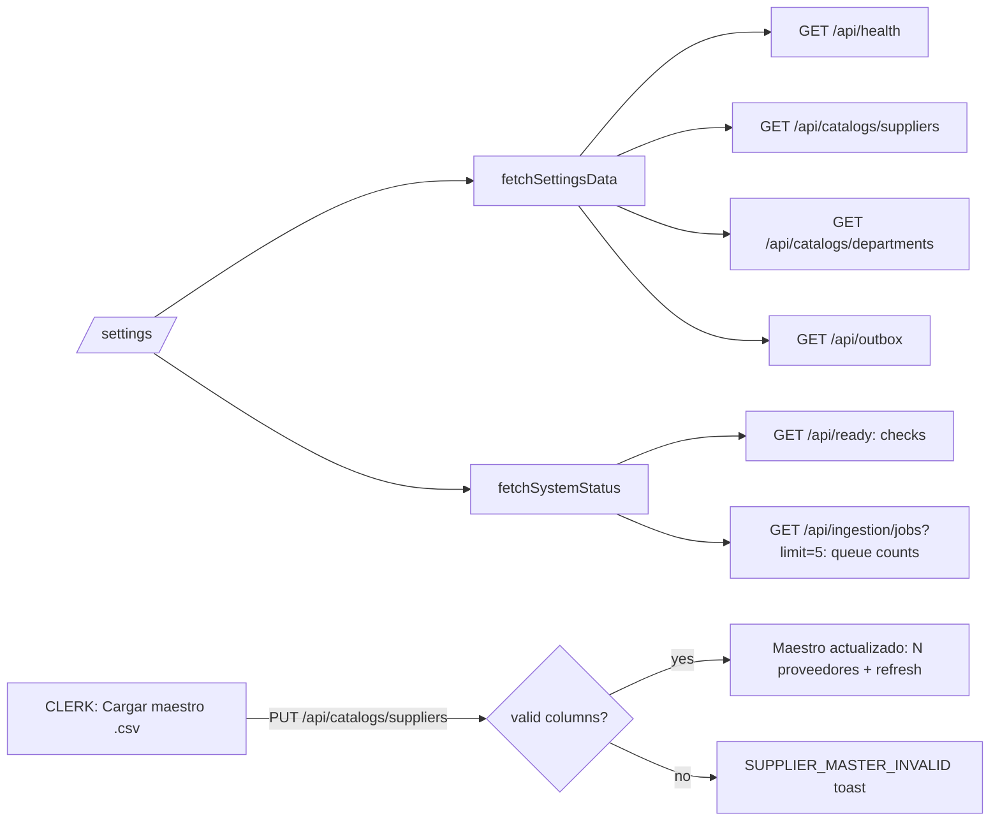

# Settings (screen)

## Purpose

`/settings` ("Ajustes") gathers what the rules depend on and what the system produced, in one read-mostly page: whether the system is healthy (database, Excel ledger, OCR, import queue), whether the AI assistant is on, the supplier master used to validate invoices, the departments documents are forwarded to, and the simulated outbox (the e-mails Docket *would* send on approval). It lets Martha load a fresh supplier master exported from the ERP without asking IT, and lets anyone check what was "sent" for each approved document. Backend side: [catalogs](catalogs.md), the outbox part of [filing](filing.md) and the readiness check of [observability](observability.md).

## Who uses it

- **Clerk (CLERK, Martha)**: replaces the supplier master with the CSV that Procurement exports from the ERP; checks departments and outbox messages.
- **Coordinator (COORDINATOR, Dra. Herrera)**: reads everything — AI status, supplier master, departments and outbox, including the `FRAUD_ALERT` messages addressed to her. She **cannot** replace the supplier master: the upload button is not rendered for her, and the API would answer `FORBIDDEN`.

## How it works

1. `app/(app)/settings/page.tsx` renders `SettingsTemplate` inside `<Suspense>` with `SettingsSkeleton`.
2. `fetchSettingsData` (`features/settings/api/settings-queries.ts`) makes four API calls in parallel on the server; `fetchSystemStatus` adds two more (`GET /api/ready`, read with `apiFetch` so a `503 NOT_READY` body is still shown instead of failing the page, and `GET /api/ingestion/jobs?limit=5`); the template reads the session to decide whether to show the upload button.
3. The page has five sections:
   - **Estado del sistema** ("Lo mismo que vigila el monitoreo (métricas en /metrics, verificación en /api/ready)."): one row per readiness check — "Base de datos" (`database`), "Libro de radicación (Excel)" (`ledger_template`), "OCR para escaneados" (`ocr`), "Procesador de la cola" (`import_worker`) — with a badge "Funciona" (`OK`, green), "Degradado" (`DEGRADED`, amber), "Caído" (`DOWN`) or "Falta" (`MISSING`) (red); and a "Cola de importación" card: "N en cola · N procesando · N terminadas · N fallidas" plus "Última: <date and time> · N documentos nuevos".
   - **Asistente de IA**: "Apagado" (green shield) — "Todo se decide con reglas y OCR locales: ningún documento sale de TAC. Sistemas puede activarlo cuando lo apruebe." — or "Activo" (amber) — consulted only on ambiguous text, with personal data masked, and its suggestion always goes to review. It mirrors `TAC_LLM_ENABLED` (off by default); it is not a switch.
   - **Maestro de proveedores**: table with supplier, NIT, billing e-mail, bank · account and "Activo"/"Inactivo". For CLERK, "Cargar maestro del ERP (.csv)".
   - **Dependencias**: one card per department with its Spanish name, e-mail and what it receives.
   - **Bandeja de salida (simulada)**: one expandable card per message with its kind, subject and recipient; expanding shows the Spanish body. Kinds: "Reenvío a la dependencia", "Devolución al remitente", "Respuesta con radicado existente", "Alerta a la coordinadora".
4. Uploading the master is a Server Action (`replaceSupplierMasterAction`) that sends the file as multipart to the API, then `refresh()`es the route so the table shows the new master.



### Screens and states

- **Loading**: `SettingsSkeleton` (`aria-busy`).
- **Empty outbox**: "Aún no hay correos generados."
- **Upload busy**: spinner on the button, button disabled. **Success**: "Maestro actualizado: N proveedores." **Error**: Spanish label of the code.

### On phones and offline

- The supplier table keeps its columns and scrolls horizontally inside its own rounded container; the page does not scroll sideways. Department cards are one column on phones and two from `md`. Outbox cards wrap their header (badge, subject, recipient).
- **Offline**: not cached by the service worker; the offline page is shown instead (see [pwa](pwa.md)).

### Accessibility

The upload button is 44 px (`h-11`) and the hidden file input has a label ("Maestro de proveedores CSV"). Status badges always pair color with icon and text. Outbox messages use native `<details>/<summary>`, so they open with the keyboard.

## Business rules

| Rule surfaced in the UI | Where in code |
|---|---|
| Anyone can see whether the system can do its job (and that missing OCR only degrades it) without IT tools | "Estado del sistema", `GET /api/ready`, `CHECK_LABEL` / `CHECK_VALUE` |
| AI is off unless IT approves it; when on, it only suggests and always goes to review | "Asistente de IA" section, `llm_enabled` from `GET /api/health` |
| Only the clerk replaces the supplier master; the file must be the ERP CSV with the expected columns, otherwise nothing changes | `SupplierMasterUpload` shown only to CLERK; API `SUPPLIER_MASTER_INVALID`; replacement and rejection are audited (`SUPPLIER_MASTER_REPLACED` / `SUPPLIER_MASTER_REJECTED`) |
| Inactive suppliers are visible as such (their invoices raise `SUPPLIER_INACTIVE` in filing) | "Inactivo" badge |
| Docket never sends e-mail: the outbox is labeled "simulada" and says nothing is really sent | section description |
| A held invoice produces an alert to the coordinator | "Alerta a la coordinadora" (`FRAUD_ALERT`, danger tone) |

## API endpoints / screens

Route: `/settings` (`web/src/app/(app)/settings/page.tsx`), feature `web/src/features/settings/`. All calls run on the Next.js server with the token from the httpOnly cookie.

| Called from | Method | Path | Used for |
|---|---|---|---|
| `fetchSettingsData` | GET | `/api/health` | `llm_enabled` |
| `fetchSettingsData` | GET | `/api/catalogs/suppliers` | supplier master table (`name`, `nit`, `billing_email`, `bank`, `account_number`, `is_active`) |
| `fetchSettingsData` | GET | `/api/catalogs/departments` | department cards (`code`, `email`, `receives`) |
| `fetchSettingsData` | GET | `/api/outbox` | outbox messages (`kind`, `subject`, `to_address`, `body`, `document_id`) |
| `fetchSystemStatus` | GET | `/api/ready` | readiness checks (`READY` 200 or `NOT_READY` 503, body read either way) |
| `fetchSystemStatus` | GET | `/api/ingestion/jobs?limit=5` | import queue counts and the latest job |
| `replaceSupplierMasterAction` (Server Action) | PUT | `/api/catalogs/suppliers` (multipart `file`) | replace the master; returns `{suppliers: N}` |

## Codes

| Code | Meaning (EN) | Spanish label shown | Blocking? |
|---|---|---|---|
| `READY` / `NOT_READY` | Readiness of the server | — (shown through the checks) | — |
| `OK` / `DEGRADED` / `DOWN` / `MISSING` | State of one check | Funciona / Degradado / Caído / Falta | — |
| `SUPPLIER_MASTER_INVALID` | The CSV lacks the expected columns | El archivo del maestro no tiene las columnas esperadas. | Yes |
| `FORBIDDEN` | The role cannot replace the master | Su rol no permite esta acción. | Yes |
| `UNAUTHORIZED` | Token rejected | Su sesión expiró. Vuelva a ingresar. | Yes |
| `NETWORK_ERROR` | API unreachable | No hay conexión con el servidor. | Yes |
| `FORWARD_TO_DEPARTMENT` / `RETURN_TO_SENDER` / `REPLY_EXISTING_NUMBER` / `FRAUD_ALERT` | Outbox message kinds | Reenvío a la dependencia / Devolución al remitente / Respuesta con radicado existente / Alerta a la coordinadora | — |
| `ACCOUNTS_PAYABLE`, `PROCUREMENT`, `HUMAN_RESOURCES`, `LEGAL`, `CUSTOMER_SERVICE`, `ADMIN_COORDINATION` | Departments | Cuentas por pagar, Compras, Talento humano, Jurídica, Atención al usuario, Coordinación administrativa | — |
| `SUPPLIER_MASTER_REPLACED` | Success response | — (toast built from `suppliers`) | — |

## Limitations

- Choosing a file replaces the master **immediately**: there is no preview or confirmation step, and no way to undo other than uploading the previous CSV again.
- Departments cannot be edited from the UI (they come from `dependencias.csv` on the server); the AI assistant cannot be turned on from the UI (it is `TAC_LLM_ENABLED`, an IT decision).
- The six reads run together: if any of them fails (other than a `503` from `/api/ready`, which is shown), the whole page falls into the shared `app/(app)/error.tsx` ("Reintentar" / "Ingresar de nuevo").
- "Estado del sistema" is a snapshot taken when the page loads; it does not refresh by itself.
- The outbox is not paginated or filtered, and messages are not linked to their document.
- No automated tests cover this screen yet (no Jest test for `settings`, no E2E step).

## How it is tested

- No dedicated tests yet. Indirect coverage: the status badges used here are covered by `web/src/shared/ui/__tests__/StatusBadge.test.tsx`; supplier master validation, departments and outbox composition are covered on the backend (see [catalogs](catalogs.md) and [filing](filing.md)).
- The readiness and queue data behind "Estado del sistema" are covered on the backend by `api/tests/api/test_observability.py::test_request_id_and_readiness` and `::test_queued_import_is_processed_by_the_worker` (see [observability](observability.md)).
- Pending: a Jest + RTL test for `SupplierMasterUpload` (success and `SUPPLIER_MASTER_INVALID` toasts) and an E2E step checking that the coordinator does not see "Cargar maestro del ERP (.csv)".

```bash
./scripts/harness-verify.sh web/src/shared/ui/__tests__/StatusBadge.test.tsx
```

## Changelog

- 2026-11-24: first version of the screen documentation.
- 2026-11-24: "Estado del sistema" section (`fetchSystemStatus`: readiness checks from `GET /api/ready` and import queue counts from `GET /api/ingestion/jobs`).
