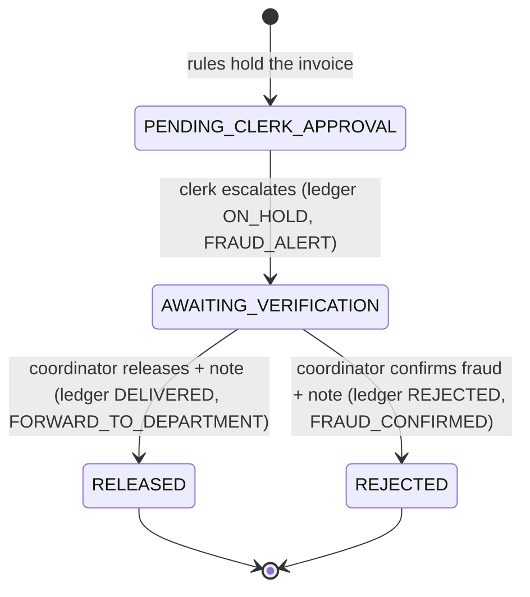

# Verifications (held invoices)

## Purpose

Closes the loop on invoices held for possible fraud. The filing rules hold an invoice (`HOLD_FOR_VERIFICATION`) when its bank account differs from the supplier master, the e-mail asks to pay into another account, it announces an account change, or it comes from an unexpected sender domain. Before this feature the clerk filed it and it ended as "Retenida" in the ledger with no way to resolve it. Martha's practice, from the interview: *"si la cuenta de la factura no es la que está en el maestro, o el correo llega de una dirección rara, no la mando a ningún lado: se la paso a la doctora Claudia para que verifiquen por teléfono con el proveedor"*.

`/verifications` ("Por verificar") is Dra. Herrera's workspace for that phone call: it puts what arrived next to what the master says, tells her whom to call (the master's contact, never the e-mail's), and records the outcome. A released invoice continues to the department it would have gone to; a confirmed fraud is marked "Rechazada" in the ledger and Accounts Payable and Procurement are told not to pay. The backend lives in the [filing](filing.md) slice; this doc covers both sides.

## Who uses it

- **Coordinator (COORDINATOR, Dra. Herrera)**: the only role that can release or reject a held invoice, always with a note of the call. The "Por verificar" menu item is hers, and the coordinator summary on [deadlines](deadlines.md#the-screen-deadlines) links here.
- **Clerk (CLERK, Martha)**: never approves a held invoice: she alerts the coordinator ("Alertar a la Dra. Herrera" → "Enviar alerta" in [document review](document-review.md)). The page is not in her menu; if she opens the URL she sees the same list read-only (no action buttons); the API answers `FORBIDDEN` to her anyway.
- **AI assistant (MCP)**: the read-only `held_invoices` tool lists the same invoices and their state (see [MCP server](mcp.md)).

## How it works

1. The rules hold the invoice (`HOLD_FOR_VERIFICATION`, department `ADMIN_COORDINATION`, `NEEDS_REVIEW`). It sits in the clerk's inbox: verification state `PENDING_CLERK_APPROVAL`.
2. The clerk escalates it (`POST /api/inbox/{id}/escalate`, `EscalateHold`, audit `HOLD_ESCALATED`; approving it is refused with `409 HOLD_REQUIRES_ESCALATION`): it gets a filing number for traceability, the ledger row is `ON_HOLD` with flag `HOLD_FOR_VERIFICATION`, the `FRAUD_ALERT` message goes to the coordination and nothing goes to Accounts payable. State: `AWAITING_VERIFICATION` (`InboxItem.is_awaiting_verification`: approved, held, no `hold_resolution`).
3. The coordinator opens `/verifications`, compares account and sender e-mail with the master and calls the supplier at the master's contact.
4. She clicks **Verificada: liberar** or **Es fraude**, writes the note (at least 5 characters) and confirms. `POST /api/verifications/{id}/release` or `/reject` runs `VerifyHold`:
   - **Release** (`HoldOutcome.RELEASED`): ledger row → `DELIVERED`, department from `release_department()` (with purchase order → `ACCOUNTS_PAYABLE`, without → `PROCUREMENT`, Martha's invoice rule), flag `HOLD_FOR_VERIFICATION` replaced by `VERIFIED_BY_PHONE`; outbox `FORWARD_TO_DEPARTMENT` ("[TAC-…] Factura verificada: …", pay only to the master's account).
   - **Reject** (`HoldOutcome.REJECTED`): ledger row → `REJECTED`, flag `FRAUD_CONFIRMED`; outbox `FRAUD_CONFIRMED` ("NO PAGAR [TAC-…] intento de fraude confirmado") to Accounts Payable and Procurement.
   - In both: `InboxItem.hold_resolution = HoldResolution(outcome, note, actor, at)`, the shared Excel is synced (`SyncLedger`: only the cells Docket changed are written, people's edits in the same row are kept; see [ledger](ledger.md#two-way-sync-with-the-shared-excel)), audit event `HOLD_RELEASED` / `HOLD_REJECTED`.
5. The card moves to "Resueltas" with the outcome, date and note.



### The screen (`/verifications`)

- **Header**: eyebrow "Coordinación", title "Por verificar", and the instruction to verify by phone before releasing.
- **Tiles** (`StatTile`): "Por verificar" (`AWAITING_VERIFICATION`), "En bandeja de radicación" (`PENDING_CLERK_APPROVAL`), "Liberadas" (`RELEASED`), "Fraudes confirmados" (`REJECTED`).
- **Groups**: "Esperan su verificación", "Aún en la bandeja de radicación", "Resueltas" (empty groups are not rendered). Order: reception order (from the API).
- **Card** (`HeldInvoiceCard`): state badge, filing number, supplier and invoice number, amount, purchase order (or "Sin OC"), reception time, link "Ver documento", the fraud reasons in Spanish, the comparison table, the master contact ("Llame al contacto del maestro, no al del correo"), the resolution if any, and — for the coordinator and only while awaiting — "Si la libera, sigue hacia <department>" plus the actions. Cards still with the clerk say that Radicación must approve first.
- **Comparison** (`ComparisonTable`): rows "Cuenta bancaria" and "Correo del remitente", columns "Llegó en el correo" / "Maestro de proveedores". A mismatch gets a red cross icon, red bold text and a screen-reader "no coincide"; a match a green check. Account comparison ignores punctuation (digits only); e-mail comparison is by domain. Unregistered suppliers show "Proveedor no registrado en el maestro" and no table.
- **Actions** (`VerifyActions`): two dialogs ("Liberar para pago" / "Confirmar intento de fraude") with a required note "Nota de la verificación" (placeholder "Con quién habló, a qué número y qué confirmó"); the confirm button stays disabled until the note has 5 characters. Toasts: "<filing number> liberada hacia <department>." / "<filing number> rechazada: se avisó para que no se pague."
- **Loading**: `VerificationsSkeleton`. **Empty**: "No hay facturas retenidas".

### On phones and offline

- Tiles are 2×2 on phones and one row of four from `lg`; the comparison table stacks each row on phones (column headers hidden) and becomes a three-column grid from `sm`; action buttons stack on phones and are ≥ 44 px.
- **Offline**: not cached by the service worker (only `/deadlines` and `/ledger` are); it is a decision screen and needs live data.

## Business rules

| Rule | Source | Where in code |
|---|---|---|
| A held invoice is not sent anywhere until the coordinator verifies it by phone with the supplier | Interview: "se la paso a la doctora Claudia para que verifiquen por teléfono con el proveedor" | `VerifyHold`, `api/app/features/filing/application/verify_hold.py` |
| Only the coordinator resolves; the clerk and the AI assistant only read | Roles of the case (Martha files, Dra. Herrera verifies) | `CoordinatorRole` / `require_coordinator` in `api/app/shared/infrastructure/http.py`; `canResolve` in `VerificationsTemplate` |
| Every resolution carries a note of the call (≥ 5 characters) | Traceability: who verified and how | `MIN_NOTE_LENGTH`, `VerificationNoteRequiredError`; `resolveHoldAction` checks it too |
| Only an escalated (status `APPROVED`), held, unresolved invoice whose ledger row is `ON_HOLD` can be resolved — once | Avoid double payment / double alerts | `HoldNotPendingError`, `InboxItem.is_awaiting_verification` |
| A released invoice goes where Martha's invoice rule sends it: with purchase order → Cuentas por pagar; without → Compras | Interview (invoice rule) | `release_department()` |
| A confirmed fraud is never paid: ledger `REJECTED` ("Rechazada - fraude confirmado"), Accounts Payable and Procurement warned | Fraud-control intent of the hold | `compose_hold_rejected`, `LedgerStatus.REJECTED`, `client_vocabulary.py` |
| Call the master's contact, not the one in the e-mail | Fraud practice: the e-mail may be the attacker's | `masterContact` in `model/mappers.ts`, card text |
| The client's Excel reflects the outcome; historical rows are untouched | Ledger stays the client's single source | `ExcelLedgerWorkbook.render` (rewrites rows with `source_document_id`) |

## API endpoints / screens

Router `api/app/features/filing/api/verifications_router.py` (prefix `/api/verifications`). Use case `VerifyHold` and query `ListHeldInvoices` (`filing/application/queries.py`).

| Method | Path | Role | Request | Response `data` |
|---|---|---|---|---|
| GET | `/api/verifications` | any | — | list of inbox items (same keys as `/api/inbox`) plus `verification_state`, `release_department`, `hold_resolution` (`{outcome, note, actor, at}` or `null`), `master_supplier` (supplier master row with `is_active`, or `null`) |
| POST | `/api/verifications/{id}/release` | COORDINATOR | `{"note": "..."}` | the same item view, `verification_state` = `RELEASED` |
| POST | `/api/verifications/{id}/reject` | COORDINATOR | `{"note": "..."}` | the same item view, `verification_state` = `REJECTED` |

Frontend: route `/verifications` (`web/src/app/(app)/verifications/page.tsx`), feature `web/src/features/verifications/`:

| Piece | Role |
|---|---|
| `api/verification-queries.ts` → `fetchHeldInvoices()` | `GET /api/verifications`, mapped with `toHeldInvoiceView` |
| `api/verification-actions.ts` → `resolveHoldAction(id, "release" \| "reject", note)` | Server Action: `POST …/release` or `…/reject`, then `refresh()` |
| `model/mappers.ts` → `toHeldInvoiceView`, `splitByState` | comparison rows, fraud reasons in Spanish, grouping |
| `components/templates/VerificationsTemplate.tsx`, `VerificationsSkeleton.tsx` | page, tiles and groups |
| `components/organisms/HeldInvoiceCard.tsx`, `VerifyActions.tsx` | card and dialogs |
| `components/molecules/ComparisonTable.tsx` | arrived vs master |

Navigation: "Por verificar" is in the coordinator's menu only (`ROLE_NAV` in `shared/ui/organisms/AppNav.tsx`, see [session](session.md)).

## Codes

| Code | Meaning (EN) | Significado (ES) | Blocking? |
|---|---|---|---|
| `VERIFICATIONS_LISTED` | Held invoices listed | Facturas retenidas listadas | No |
| `HOLD_RELEASED` | Invoice verified by phone and released (also an audit event) | Factura verificada por teléfono y liberada (también evento de auditoría) | No |
| `HOLD_REJECTED` | Fraud confirmed; invoice rejected (also an audit event) | Fraude confirmado; factura rechazada (también evento de auditoría) | No |
| `FORBIDDEN` (403) | Only the coordinator can resolve | Solo la coordinadora puede resolver | Yes |
| `VERIFICATION_NOTE_REQUIRED` (422) | The note is missing or shorter than 5 characters | Falta la nota o tiene menos de 5 caracteres | Yes |
| `HOLD_NOT_PENDING` (409) | Already resolved, not yet filed, or not a held invoice | Ya fue verificada, aún no se ha radicado o no está retenida | Yes |
| `DOCUMENT_NOT_FOUND` (404) | Unknown document id | No existe el documento | Yes |
| `PENDING_CLERK_APPROVAL` / `AWAITING_VERIFICATION` / `RELEASED` / `REJECTED` | Verification state | Aún en la bandeja de radicación / Por verificar / Liberada para pago / Fraude confirmado | — |
| `VERIFIED_BY_PHONE` | Ledger flag after release | Verificada por teléfono con el proveedor (Dra. Herrera): se libera para pago | No |
| `FRAUD_CONFIRMED` | Ledger flag and outbox kind after rejection | Fraude confirmado por la coordinación: NO PAGAR | No |

## Limitations

- The phone call itself happens outside Docket; the note is the only evidence and is free text.
- A resolution cannot be undone from the UI or API (a wrong release must be handled outside Docket and noted in the ledger).
- Only account and sender e-mail are compared; other master fields (NIT check digit, inactive supplier) appear as reasons, not as comparison rows.
- The release department follows the invoice rule only (purchase order or not); the coordinator cannot pick another department.
- No notification to the coordinator other than the simulated `FRAUD_ALERT` outbox message and the summary card on her home.
- Not available offline.

## How it is tested

- `api/tests/features/filing/test_verify_hold.py`: `test_held_invoice_waits_for_the_coordinator`, `test_before_martha_approves_it_is_still_with_the_clerk`, `test_release_sends_it_where_the_rules_would_have`, `test_reject_marks_fraud_and_warns_payables_and_procurement`, `test_cannot_resolve_twice_or_without_a_note`, `test_resolution_is_audited_and_the_excel_row_is_updated`.
- `api/tests/api/test_api.py::test_only_the_coordinator_resolves_held_invoices`: list as coordinator with `master_supplier`; clerk gets `FORBIDDEN`; short note → `VERIFICATION_NOTE_REQUIRED`; release → `HOLD_RELEASED`; second resolution → 409 `HOLD_NOT_PENDING`.
- `api/tests/mcp/test_mcp_server.py::test_held_invoices_tool`.
- `web/src/features/verifications/__tests__/mappers.test.ts`: arrived vs master with both mismatches flagged, unregistered supplier, grouping by who has to act.
- `web/e2e/coordinator.spec.ts` (Playwright project `coordinator`, runs after `desktop`): the clerk alerts the coordinator about the suspicious invoice ("Alertar a la Dra. Herrera" → "Enviar alerta"); the coordinator's menu is "Vencimientos, Por verificar, Libro, Bandeja, Cumplimiento"; she follows "1 factura por verificar", sees the master account, releases with a note ("liberada hacia Cuentas por pagar"), and the ledger shows the row "Entregado".

```bash
./scripts/harness-verify.sh api/tests/features/filing/test_verify_hold.py api/tests/api/test_api.py api/tests/mcp/test_mcp_server.py
./scripts/harness-verify.sh web/src/features/verifications/__tests__/mappers.test.ts
./scripts/harness-verify.sh web/e2e/coordinator.spec.ts
```

## Changelog

- 2026-11-24: first version — coordinator verification of held invoices (release / confirm fraud), `/verifications` screen, `held_invoices` MCP tool.
- 2026-11-24: the clerk no longer approves a held invoice; she escalates it (`HOLD_ESCALATED`, `POST /api/inbox/{id}/escalate`). The effect on this queue is unchanged.
