# Docket — resumen ejecutivo

*Terminales Andinas de Carga S.A. (TAC) · radicación asistida del buzón · fecha del caso: 18-nov-2026*

Docket hace el trabajo de radicación de Martha sobre el buzón: lee cada correo y sus adjuntos, decide qué es cada documento, extrae los datos que importan, aplica las reglas que ella contó, propone dependencia, acción y vencimiento, y —solo cuando ella aprueba— continúa su libro en Excel con el consecutivo `TAC-2026-ER-#####`. Cuando no está seguro, no adivina: deja el documento para una persona con el motivo a la vista. Cada rol tiene su propio espacio: Martha entra a la bandeja; la Dra. Herrera entra a vencimientos y a una cola "Por verificar" donde resuelve las facturas retenidas por posible fraude después de llamar al proveedor: las libera hacia la dependencia o confirma el fraude, así que una factura retenida ya no queda atascada como "Retenida". En "Cumplimiento" tiene además la Tabla de Retención Documental (TRD, Ley 594 de 2000) con eliminación controlada, y las solicitudes de titulares de habeas data (Ley 1581 de 2012). También puede preguntarle a un asistente de IA por MCP (solo lectura).

Detalle: [arquitectura](01-arquitectura.md) · [funcionalidades](02-features.md) · [solución y trazabilidad](03-solucion.md) · [modelo de dominio](04-modelo-dominio.md) · [atributos de calidad](05-atributos-calidad.md).

## a) Componentes, flujo de datos y dónde interviene la IA

```mermaid
flowchart LR
    MB[("Buzón de radicación<br/>.eml")] --> ING["1 Ingesta<br/>separa correo en documentos"]
    ING --> TXT["2 Extracción de texto<br/>PDF nativo · cuerpo · DOCX"]
    ING --> OCR["2b OCR local Tesseract<br/>PDF escaneado"]
    TXT --> CLS["3 Clasificación por reglas<br/>tipo + margen"]
    OCR --> CLS
    CLS -- "margen bajo y IA habilitada" --> LLM["IA opcional (Claude)<br/>APAGADA por defecto<br/>texto enmascarado<br/>solo sugiere el tipo"]
    LLM -- "sugerencia marcada<br/>CLASSIFIED_BY_ASSISTANT" --> RUL
    CLS --> RUL["4 Reglas de Martha<br/>maestro · OC · duplicados · fraude<br/>plazos en días hábiles"]
    CAT[("Maestro de proveedores<br/>dependencias")] --> RUL
    LED[("Libro de radicación<br/>BD + Excel del cliente")] --> RUL
    RUL --> INB["5 Bandeja<br/>LISTO / REVISIÓN + motivos y evidencia"]
    INB --> HUM{{"Martha revisa,<br/>corrige y aprueba"}}
    HUM --> NUM["6 Consecutivo al aprobar"]
    NUM --> LED
    NUM --> OUT["Bandeja de salida<br/>(reenvío simulado)"]
    LED -- "factura retenida" --> VER{{"La Dra. Herrera verifica por teléfono<br/>libera o confirma fraude"}}
    VER --> LED
    VER --> OUT
    HUM --> AUD[("Auditoría<br/>solo agregar")]
    LED --> DL["Vencimientos<br/>informe semanal"]
    DL --> WEB["App web / PWA<br/>Martha y Dra. Herrera"]
    INB --> WEB
    LED --> MCP["Servidor MCP<br/>solo lectura, localhost"]
    MCP --> AI2["Asistente IA de la Dra. Herrera<br/>'¿qué vence esta semana?'"]

    classDef ai fill:#fde68a,stroke:#b45309,stroke-width:2px,stroke-dasharray:5 3,color:#000
    classDef rules fill:#dcfce7,stroke:#15803d,color:#000
    classDef human fill:#dbeafe,stroke:#1d4ed8,color:#000
    class LLM,AI2 ai
    class ING,TXT,OCR,CLS,RUL,NUM,DL rules
    class HUM,VER human
```

*Verde: determinista y auditable. Amarillo punteado: IA (opcional / solo lectura). Azul: decisión humana.*

**Componentes.** API en Python (FastAPI), organizada por funcionalidad (ingesta con cola de importación en segundo plano, clasificación, radicación, libro, vencimientos, catálogos, auditoría, retención documental, privacidad); métricas Prometheus, logs JSON y verificación de disponibilidad; app web Next.js instalable (PWA, responsive); base de datos (SQLite on-prem, Postgres opcional); el Excel del cliente se conserva: las filas históricas nunca se tocan, Docket solo agrega y actualiza las suyas; servidor MCP de solo lectura. Todo corre con `docker compose` en un servidor de TAC.

**Dónde NO interviene la IA:** enrutamiento a dependencias, vencimientos, consecutivo, duplicados, control de fraude y aprobación. Son reglas deterministas, cada una deja un código de motivo y evidencia. El OCR es Tesseract local, no un modelo de lenguaje.

**Dónde puede intervenir:** solo, si Sistemas lo habilita, para sugerir el *tipo* de un texto libre ambiguo cuando las reglas no tienen margen suficiente. Recibe texto con datos personales enmascarados; su sugerencia pasa por las mismas reglas y queda marcada `CLASSIFIED_BY_ASSISTANT`, que obliga a revisión humana.

**Por qué:** Sistemas no ha aprobado ninguna herramienta de IA; los errores son caros (pago doble, fraude, tutela por petición vencida); las reglas se le pueden explicar a Martha y auditar para Contabilidad y Jurídica; el costo marginal es ≈ 0; y funciona sin salir a la nube.

## b) Cómo sé que acierta y qué pasa cuando se equivoca

- **Resultados esperados del cliente:** 8/8 coinciden (tipo, dependencia, acción y vencimiento).
- **Tabla completa (16 correos, 17 documentos):** 17/17 con OCR disponible, incluida la factura escaneada SE-77821 (→ Cuentas por pagar, `TAC-2026-ER-04821`) y los radicados 04818…04831 en orden de llegada. Sin Tesseract en el equipo, ese escaneo va a revisión como `DOCUMENT_UNREADABLE`: 16/17 automáticos y 1 enviado correctamente a una persona, nunca adivinado.
- **Confianza:** todos los márgenes del clasificador ≥ 2. En la muestra, 1 de 17 documentos requiere revisión (la factura con posible fraude); 2 sin OCR.
- **Set ciego (documentos que las reglas nunca vieron):** 60 correos / 65 documentos escritos por un agente que nunca leyó el código, solo a partir de la entrevista y los archivos del cliente, con 26 decisiones de criterio documentadas (`api/tests/blind/`). Resultado: **45/65 correctos, 14 enviados a una persona, 6 errados**. Los 6 errores: 4 solicitudes de viáticos válidas devueltas al remitente porque no se reconoce la aprobación en formatos con otra distribución; 1 factura escaneada cuya orden de compra no leyó el OCR (→ Compras en lugar de Cuentas por pagar); 1 consulta tomada como queja (dependencia equivocada y 15 días en lugar de 30). Se detectaron las 5 retenciones por fraude y los 3 duplicados. Las reglas **no** se ajustaron a este set: `test_blind_baseline.py` es un piso (≥ 45 correctos, ≤ 6 errados, los casos de seguridad del dinero nunca errados en silencio); subirlo exige un set ciego nuevo. Ver [evaluación](../features/evaluation.md).
- **Pruebas automáticas:** 138 funciones de prueba de backend, más casos al parametrizarse (reglas, calendario, libro y sincronización del Excel, cola de importación, verificación, retención, habeas data, observabilidad, API, MCP, tabla de oro, línea base ciega), 26 pruebas de frontend en 9 archivos (Jest + RTL) y 5 pruebas E2E con Playwright en 3 specs (radicación en escritorio, coordinación con cumplimiento, teléfono). Ver [03-solucion](03-solucion.md).

**Cuando se equivoca:** nada se reenvía ni se radica sin la aprobación de Martha, y ninguna factura retenida se libera sin la llamada de la coordinadora y su nota escrita; cada propuesta muestra motivos y evidencia; una corrección conserva la propuesta original (auditoría) y se vuelve la medida de exactitud por tipo; las correcciones repetidas se convierten en reglas y casos de la tabla de oro. El sesgo es deliberado hacia REVISIÓN en temas de dinero y legales. Los radicados nunca se reutilizan.

## c) Cuánto cuesta procesar un documento

Ruta de reglas: CPU del servidor de TAC, costo marginal ≈ 0 (medido en la imagen Docker: mediana 20 ms por PDF nativo o cuerpo de correo, máx. 50 ms; PDF escaneado con OCR 1,9 s; buzón completo 2,2 s; aprobar todo 0,2 s).

IA opcional: ≈ 500 tokens de entrada + ≈ 5 de salida por llamada. Con 200 documentos/semana ≈ 870/mes:

| Escenario | Claude Haiku 5.5 | Claude Sonnet 5.5 |
|---|---|---|
| Solo reglas (configuración por defecto) | US$ 0 | US$ 0 |
| IA solo para ambiguos (≈ 20 %) | ≈ US$ 0,01/mes | ≈ US$ 0,18/mes |
| IA para todos los documentos | ≈ US$ 0,05/mes (US$ 0,0000525/doc) | ≈ US$ 0,91/mes (US$ 0,00105/doc) |

Precios de lista de Anthropic (Haiku US$ 0,10 / 0,50 y Sonnet US$ 2 / 10 por millón de tokens de entrada/salida; tabla del 6-oct-2026): verificar en la página de precios antes de cotizar. Infraestructura on-prem: un servidor existente de TAC (marginal ≈ 0). La demo en la nube (Render + Vercel): de pocos a decenas de dólares al mes.

## d) Cuánto tiempo le ahorra a Martha

**Línea base (entrevista):** ~3 h diarias para ~40 documentos (200/semana ÷ 5) ≈ 4,5 min/documento. Sus estimaciones por tipo sobre la muestra dan ≈ 4,2 min/documento: consistente.

**Con Docket:** documento LISTO ≈ 0,5 min (leer la propuesta y confirmar, a menudo en lote); en REVISIÓN ≈ 2 min. Suponiendo 20 % en revisión en producción (conservador frente al 6–12 % de la muestra): 0,8 min/documento → ahorro ≈ 3,7 min/documento.

| % en revisión | Min/doc con Docket | Ahorro diario | Ahorro semanal | Ahorro mensual |
|---|---|---|---|---|
| 10 % | 0,65 | ≈ 2,6 h | ≈ 12,8 h | ≈ 55 h |
| **20 %** | **0,8** | **≈ 2,5 h** | **≈ 12,3 h** | **≈ 53 h** |
| 40 % | 1,1 | ≈ 2,3 h | ≈ 11,3 h | ≈ 49 h |

El mayor valor no está cuantificado: el riesgo evitado (pago doble, fraude por cambio de cuenta, petición vencida → tutela). **Cómo validarlo:** una sesión cronometrada de Martha con los 16 correos de muestra, y en producción la auditoría (`DOCUMENT_PROPOSED` → `DOCUMENT_APPROVED`) más la tasa de correcciones por tipo.

## e) Deuda técnica asumida y qué falta para usarla en serio

- **Integraciones:** leer el buzón real (Microsoft Graph / Gmail API) y enviar de verdad la bandeja de salida; maestro de proveedores sincronizado con el ERP en lugar de cargar CSV.
- **Identidad:** SSO corporativo en lugar de tokens de demo; hoy la auditoría registra el rol, no la persona.
- **Datos:** Postgres con copias de seguridad y cifrado en reposo; numeración segura con varios procesos (hoy: candado en proceso + restricción única); el Excel compartido vive en una carpeta local o montada: falta un adaptador para SharePoint / Google Drive, y la sincronización corre en un solo proceso.
- **Auditoría y privacidad:** auditar aprobaciones rechazadas; los valores de la Tabla de Retención Documental (TRD) son una propuesta que debe aprobar el Comité Interno de Archivo de TAC.
- **Calidad:** el set ciego es sintético (escrito a partir de la entrevista, no es correo real): falta medir sobre una muestra de correo real de TAC y la tasa de corrección por tipo en producción; siguen abiertos los 6 errores del set ciego (aprobación de viáticos en otros formatos, orden de compra en escaneos malos, consulta frente a queja); OCR con escaneos peores; calendario de festivos validado para años futuros.
- **IA y MCP:** la IA requiere aprobación de Sistemas (DPA, región de datos) antes de encenderla; el MCP no tiene autenticación (solo localhost).
- **Operación:** configuraciones de despliegue escritas pero aún no desplegadas; existen métricas y verificación de disponibilidad, pero no se entregan reglas de alerta ni tableros; un solo hilo procesador por proceso de la API.

**Ya implementado (era deuda):** paginación de la bandeja y del libro ([bandeja](../features/inbox.md), [libro](../features/ledger.md)); cola de importación en segundo plano para los picos de fin de mes ([ingesta](../features/ingestion.md)); monitoreo: métricas Prometheus en `/metrics`, `/api/ready`, logs JSON con `X-Request-ID` ([observability](../features/observability.md)); retención documental según la Ley 594 de 2000 con eliminación controlada ([records](../features/records.md)); habeas data según la Ley 1581 de 2012: inventario y solicitudes de titulares ([privacy](../features/privacy.md)); enmascaramiento de los motivos de descarte en texto libre en la auditoría ([auditoría](../features/audit.md)); un set de evaluación ciego más grande ([evaluación](../features/evaluation.md)); sincronización en ambos sentidos con el Excel compartido, que fusiona las ediciones de las personas y las filas escritas a mano ([libro](../features/ledger.md)).
