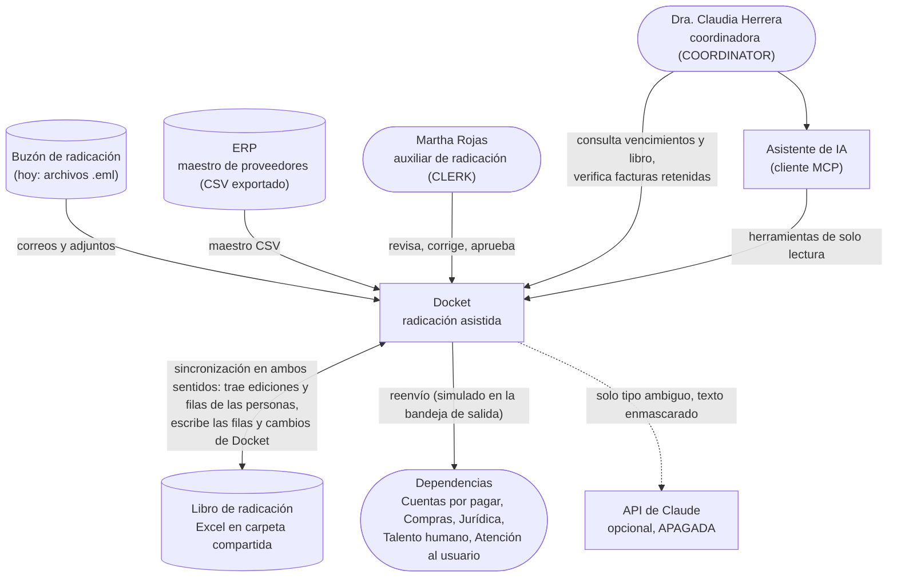
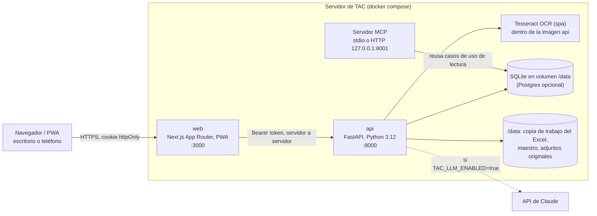
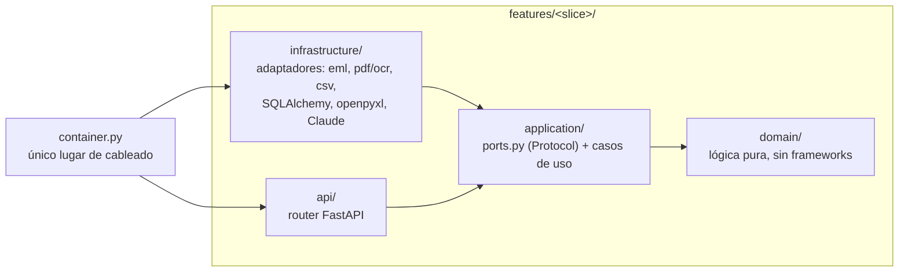

# 01 — Arquitectura

Cómo está construido Docket, cómo fluyen los datos, cómo se despliega y —la pregunta de Sistemas— dónde queda cada dato y quién lo ve. Resumen: [00-resumen-ejecutivo](00-resumen-ejecutivo.md). Detalle por funcionalidad: [../features/](../README.md).

## 1. Contexto (C4 nivel 1)



## 2. Contenedores (C4 nivel 2)



| Contenedor | Tecnología | Responsabilidad |
|---|---|---|
| `web` | Next.js, Tailwind v4, shadcn/ui, Serwist | Interfaz en español; guarda el token en cookie httpOnly y llama a la API desde el servidor |
| `api` | FastAPI, SQLAlchemy 2, pdfplumber, pytesseract, openpyxl, `holidays`, `prometheus_client` | Ingesta (con un hilo procesador de importaciones en segundo plano, `ImportWorker`), clasificación, reglas, libro, vencimientos, auditoría, retención, habeas data; `/metrics` y `/api/ready` |
| `mcp` | MCP Python SDK | Herramientas de solo lectura para un asistente de IA |
| BD | SQLite (on-prem) / Postgres | Documentos, propuestas, libro, auditoría, bandeja de salida, cola de importación (`import_jobs`, `import_job_files`) |

## 3. Backend: vertical slices + hexagonal

Cada funcionalidad es una carpeta en `api/app/features/<slice>/` con cuatro capas:



**Regla de dependencias:** `domain <- application <- infrastructure / api`. El dominio no importa FastAPI, SQLAlchemy, openpyxl, pdfplumber ni el SDK de Anthropic. Un slice usa a otro solo a través de sus casos de uso o puertos, nunca de su infraestructura.

| Slice | Qué hace | Documento |
|---|---|---|
| `ingestion` | Lee `.eml`, separa adjuntos y cuerpo, extrae texto, OCR; cola de importación para los picos de fin de mes (`EnqueueImport`, `ProcessNextImport`, puerto `JobQueue` → `SqlJobQueue`, hilo `ImportWorker` que arranca con la aplicación cuando `TAC_WORKER_ENABLED`) | [ingestion](../features/ingestion.md) |
| `classification` | Tipo de documento por reglas con margen; extracción de campos; adaptador Claude opcional | [classification](../features/classification.md) |
| `filing` | Reglas de Martha (`domain/rules.py`), bandeja, corrección, aprobación, bandeja de salida; verificación de facturas retenidas por la coordinadora (`application/verify_hold.py`, `api/verifications_router.py` → `/api/verifications`) | [filing](../features/filing.md) |
| `ledger` | Consecutivo, duplicados, Excel del cliente con sincronización en ambos sentidos (`SyncLedger`, fusión a tres bandas por celda en `domain/sync.py`, `SqlSyncStore`; `PeriodicTask` periódico, `TAC_LEDGER_SYNC_SECONDS`) | [ledger](../features/ledger.md) |
| `deadlines` | Estados de vencimiento, informe semanal | [deadlines](../features/deadlines.md) |
| `catalogs` | Maestro de proveedores y dependencias | [catalogs](../features/catalogs.md) |
| `audit` | Registro de solo agregar | [audit](../features/audit.md) |
| `records` | Retención documental según la Ley 594 de 2000: Tabla de Retención Documental (TRD) por tipo documental, lo que cumplió su tiempo, eliminación controlada (se borra el contenido y la fila del libro queda como índice) | [records](../features/records.md) |
| `privacy` | Habeas data según la Ley 1581 de 2012: inventario de datos personales y salvaguardas, búsqueda de un titular con el plazo legal para responder | [privacy](../features/privacy.md) |
| `mcp/server.py` | Herramientas de solo lectura | [mcp](../features/mcp.md) |

Compartido: `shared/domain/models.py` (enums y modelos), `business_calendar.py` (días hábiles colombianos), `identifiers.py` (NIT, cuentas), `pagination.py` (`Page[T]`, `PageRequest`, 50 por defecto, máximo 200), `privacy.py` (`mask_personal_data`, `mask_identifier`, que usan el adaptador de Claude y la auditoría); `shared/infrastructure/client_vocabulary.py` traduce los códigos en inglés a los valores en español del Excel; `shared/infrastructure/observability.py` reúne las métricas Prometheus, el formato JSON de los logs con `request_id` y `MeteredAuditLog`, un decorador sobre el puerto `AuditLog` que convierte los eventos de negocio auditados en métricas sin tocar el dominio.

## 4. Frontend: screaming architecture + atomic design

```
web/src/
  app/(app)/inbox | documents/[id] | ledger | deadlines | verifications | compliance | settings   rutas; cada page.tsx compone una plantilla
  app/(app)/error.tsx                                                límite de error: reintentar o ingresar de nuevo
  app/login, app/offline, app/manifest.ts, app/sw.ts                 sesión y PWA
  features/inbox | document-review | ledger | deadlines | verifications | compliance | settings | session
     components/ (molecules, organisms, templates)  api/  hooks/  model/ (tipos + mappers)  __tests__/
  shared/ui/ primitives -> atoms -> molecules -> organisms -> templates
  shared/i18n/es.ts   shared/lib/api-client.ts (servidor)   shared/theme/tokens.css
```

Ninguna feature importa otra; lo común sube a `shared/`. La navegación depende del rol (`shared/ui/organisms/AppNav.tsx`: `ROLE_NAV`, `ROLE_HOME`): Radicación ve Bandeja, Vencimientos, Libro, Ajustes y entra por `/inbox`; Coordinación ve Vencimientos, Por verificar, Libro, Bandeja, Cumplimiento y entra por `/deadlines`. Las páginas de la bandeja y del libro viven en la URL (`?offset=`, molécula compartida `Pagination`). Al ingresar, la app redirige al inicio del rol que devuelve la API. Los códigos `UPPER_SNAKE_CASE` de la API se traducen a español solo en `shared/i18n/es.ts`.

## 5. Flujo de datos de punta a punta

```mermaid
sequenceDiagram
    actor M as Martha (CLERK)
    actor H as Dra. Herrera (COORDINATOR)
    participant W as web
    participant API as api
    participant ING as ingestion
    participant CLS as classification
    participant FIL as filing (reglas)
    participant LED as ledger
    participant DB as BD
    participant AUD as auditoría

    M->>W: "Leer buzón"
    W->>API: POST /api/ingestion/jobs/mailbox
    API-->>W: 202 IMPORT_QUEUED (id del trabajo)
    loop hasta DONE / FAILED
        W->>API: GET /api/ingestion/jobs/{id}
    end
    API->>ING: ImportWorker toma el trabajo, importa .eml (idempotente)
    ING->>ING: separar en documentos, texto / OCR local
    ING->>CLS: texto + asunto
    CLS-->>FIL: tipo + margen (+ sugerencia IA si está habilitada)
    FIL->>LED: ¿duplicado? (NIT + número)
    FIL->>FIL: maestro, OC, fraude, plazos en días hábiles
    FIL->>DB: propuesta inmutable + estado READY / NEEDS_REVIEW
    FIL->>AUD: EMAILS_IMPORTED, DOCUMENT_PROPOSED
    M->>W: abre un documento, ve motivos y evidencia
    opt la propuesta no es correcta
        M->>W: Corregir
        W->>API: POST /api/inbox/{id}/correct
        API->>AUD: DOCUMENT_CORRECTED (campos cambiados)
    end
    M->>W: "Aprobar y radicar" (uno o "Aprobar listos")
    W->>API: POST /api/inbox/approve | /approve-ready
    API->>LED: siguiente consecutivo (candado + restricción única)
    LED->>DB: fila del libro TAC-2026-ER-#####
    API->>DB: mensaje en bandeja de salida (simulado)
    API->>AUD: DOCUMENT_APPROVED / DOCUMENTS_APPROVED
    opt factura retenida por posible fraude (HOLD_FOR_VERIFICATION): nunca se aprueba (409 HOLD_REQUIRES_ESCALATION)
        M->>W: "Alertar a la Dra. Herrera" → "Enviar alerta"
        W->>API: POST /api/inbox/{id}/escalate
        API->>LED: radicado, libro ON_HOLD
        API->>DB: salida FRAUD_ALERT (nada a pago)
        API->>AUD: HOLD_ESCALATED
        H->>W: "Por verificar": lo que llegó vs. el maestro, llamada al proveedor
        W->>API: POST /api/verifications/{id}/release | /reject + nota
        API->>LED: ON_HOLD → DELIVERED (VERIFIED_BY_PHONE) o REJECTED (FRAUD_CONFIRMED)
        API->>DB: salida FORWARD_TO_DEPARTMENT o FRAUD_CONFIRMED
        API->>AUD: HOLD_RELEASED / HOLD_REJECTED
    end
    M->>W: Exportar Excel
    W->>API: GET /api/ledger/export (sincroniza primero; el libro compartido, o una copia si está abierto)
```

## 6. Despliegue

| Entorno | Cómo | Estado |
|---|---|---|
| **On-prem (recomendado)** | `docker compose up --build` en un servidor de TAC: `web` :3000, `api` :8000, volumen `docket-data` en `/data` con SQLite | Configuración lista (`docker-compose.yml`) |
| **Demo en la nube** | API en Render (servicio web Docker, plan `starter`, disco de 1 GB en `/data`, tokens generados) vía `render.yaml`; web en Vercel. Solo datos ficticios | Configuraciones preparadas, **aún no desplegado** |

El MCP corre junto a la API, por stdio (el asistente lo lanza localmente) o HTTP ligado a `127.0.0.1:8001`.

Operación: cada instancia de la API expone métricas Prometheus en `GET /metrics` (conteo y latencia HTTP por plantilla de ruta, propuestas, motivos de revisión, aprobaciones, correcciones, retenciones resueltas, duración de las importaciones y tamaño de la cola; solo conteos, sin datos personales) y la disponibilidad en `GET /api/ready` (base de datos, plantilla del libro, OCR —`DEGRADED` si falta Tesseract—, procesador de importaciones; `READY` 200 / `NOT_READY` 503). Los logs son líneas JSON con un `request_id` que se toma del encabezado `X-Request-ID` o se devuelve en él. Al arrancar, los trabajos que una caída dejó en `RUNNING` vuelven a la cola. Todavía no se entregan reglas de alerta ni tableros. Ver [observability](../features/observability.md).

## 7. Seguridad y datos: dónde queda todo y quién lo ve

| Dato | Dónde vive | Quién lo ve | Control |
|---|---|---|---|
| Correos y adjuntos originales | BD (`DocumentRow.source_file`) en el servidor de TAC | CLERK y COORDINATOR autenticados | Servido solo por la API con token |
| Texto extraído / OCR | BD; el OCR es Tesseract **local** | Igual | Nada sale de TAC |
| Propuestas y decisiones | BD (propuesta inmutable + decisión actual) | Igual; solo CLERK modifica; solo COORDINATOR resuelve facturas retenidas | Rol verificado en cada endpoint (`require_clerk`, `require_coordinator`) |
| Libro de radicación | BD + el Excel compartido del cliente, sincronizado en ambos sentidos (bases en `ledger_sync_base`, último estado en `ledger_sync_state`) | Contabilidad y Jurídica (como hoy, y lo siguen editando), usuarios de Docket | Columnas y formatos intactos; Docket solo escribe las celdas que cambió, en un conflicto gana la persona, nunca se escribe con el archivo abierto, las filas borradas se restauran, cada fusión queda auditada |
| Maestro de proveedores (cuentas bancarias) | Volumen `/data` | Usuarios de Docket; reemplazo solo CLERK, auditado | Carga inválida se rechaza y conserva el anterior |
| Auditoría | BD, tabla de solo agregar | Usuarios de Docket (`GET /api/audit`) | No hay endpoint de edición ni borrado; los motivos de descarte en texto libre y la referencia del acta de eliminación se enmascaran (`mask_personal_data`) |
| Consultas de titulares (habeas data) | Se responden en el momento desde el libro y la bandeja; solo se guarda el evento de auditoría `PRIVACY_SUBJECT_LOOKUP` | Solo COORDINATOR | El identificador va en el cuerpo de la solicitud, nunca en la URL ni en los logs de acceso; la auditoría lo guarda enmascarado (`***` + últimos 4) |
| Documentos que cumplieron su retención | Se borran el archivo original y el texto extraído; la fila del libro queda como índice (marca `DISPOSED`) | Elimina solo COORDINATOR, con el acta del comité | Solo `DUE_FOR_DISPOSITION` + `DESTROY`; queda auditado como `RECORD_DISPOSED` |
| Métricas y logs | `/metrics` por instancia de la API; logs JSON en la salida estándar | Quien opere el servidor | Solo conteos y plantillas de ruta (nunca ids, identificadores ni texto) |
| Token de sesión | Cookie **httpOnly**, `SameSite=Lax`, `Secure` en producción, 12 h | Nadie en JavaScript del navegador | La API se llama desde el servidor de Next |
| Texto enviado a la IA | Solo si `TAC_LLM_ENABLED=true` (por defecto `false`) | Proveedor del modelo | Enmascarado de correos, cédulas/NIT y números largos; máx. 6.000 caracteres |
| Consultas del asistente (MCP) | Lectura de BD | Quien opere el asistente en el equipo | Solo lectura (anotaciones `readOnlyHint`), ligado a localhost, sin autenticación (brecha) |
| `material/` del cliente | Disco, **solo lectura** | — | Pruebas y CLI trabajan sobre copias |

Roles: `CLERK` (Martha: importar, corregir, descartar, aprobar, alertar un posible fraude con `POST /api/inbox/{id}/escalate`, reemplazar el maestro) y `COORDINATOR` (Dra. Herrera: consulta todo y resuelve las facturas retenidas con `POST /api/verifications/{id}/release` o `/reject`; un intento de aprobar devuelve `FORBIDDEN`, ver `api/tests/api/test_api.py::test_coordinator_cannot_approve`, y lo mismo le pasa a Radicación si intenta resolver una retención, ver `test_only_the_coordinator_resolves_held_invoices`). `GET /api/verifications` está abierto a ambos roles. Eliminar un registro (`POST /api/retention/{filing_number}/dispose`) y atender solicitudes de titulares (`POST /api/privacy/subject-requests`) también exigen `COORDINATOR`; la TRD, la lista de retención y el inventario de datos personales los pueden leer ambos roles. Brechas conocidas en [05-atributos-calidad](05-atributos-calidad.md).
