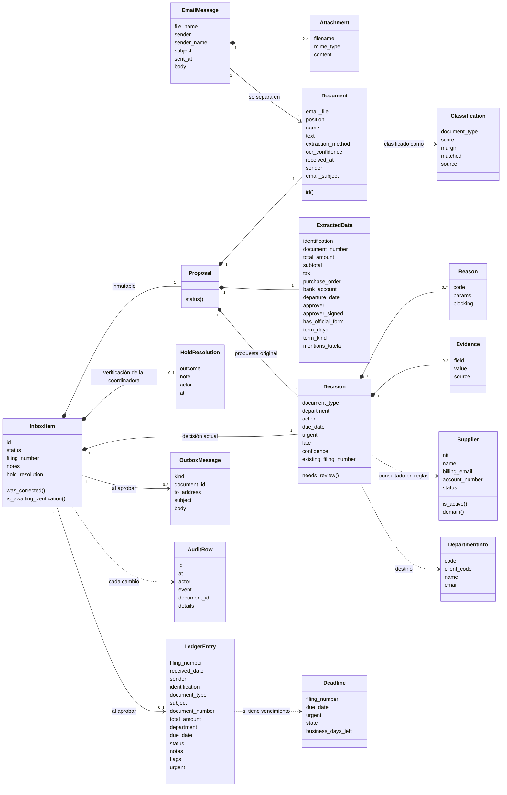
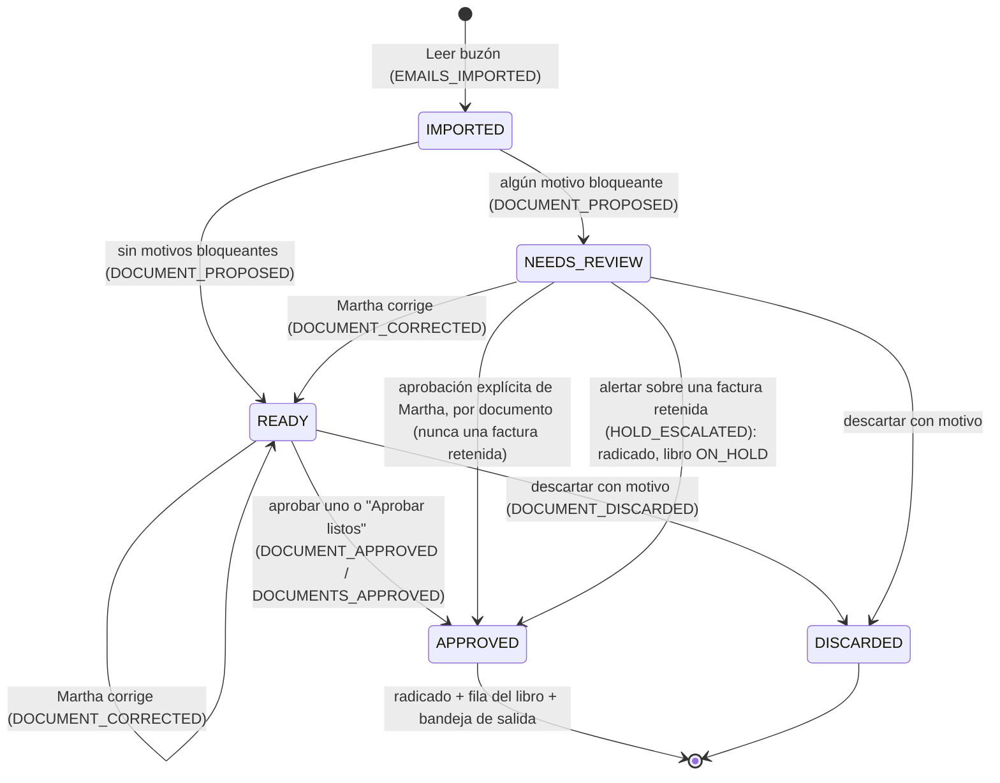
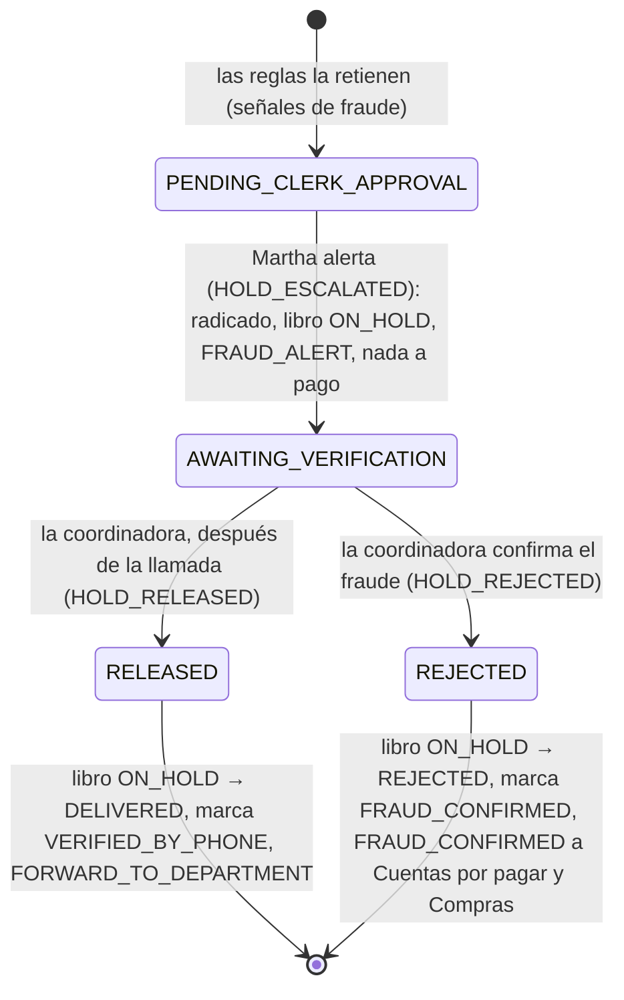

# 04 — Modelo de dominio

Entidades, enumeraciones y ciclo de vida de un documento. Los nombres son los del código (en inglés); la interfaz y el Excel los traducen al español. Fuente principal: `api/app/shared/domain/models.py`.

## 1. Diagrama de clases

| Entidad | Dónde | Nota |
|---|---|---|
| `EmailMessage`, `Attachment` | `features/ingestion/domain/email_message.py` | El `.eml` leído |
| `Document` | `shared/domain/models.py` | Unidad radicable: un adjunto o el cuerpo. `id = "<correo>__<posición>"` |
| `Classification` | `features/classification/domain/classifier.py` | Tipo, puntaje y margen frente al segundo candidato; `source` dice si vino de reglas o de la IA |
| `ExtractedData` | `shared/domain/models.py` | Campos que importan según el tipo |
| `Decision`, `Reason`, `Evidence` | `shared/domain/models.py` | Qué propone, por qué (códigos estables) y con qué fragmentos |
| `Proposal` | `shared/domain/models.py` | Documento + datos + decisión; su `status` sale de si hay motivos bloqueantes |
| `InboxItem` | `features/filing/domain/inbox_item.py` | Propuesta inmutable + decisión actual (tras correcciones) + radicado; `is_awaiting_verification` = alertada (estado `APPROVED`), retenida y aún sin resolver |
| `HoldResolution` | `features/filing/domain/inbox_item.py` | La verificación de la coordinadora sobre una factura retenida: `outcome` (`HoldOutcome`), `note` (≥ 5 caracteres), `actor`, `at` |
| `LedgerEntry` | `shared/domain/models.py` | Una fila del libro con las 12 columnas del Excel del cliente |
| `Supplier`, `DepartmentInfo` | `features/catalogs/domain/catalogs.py` | Maestro de proveedores y dependencias |
| `Deadline` | `features/deadlines/domain/deadline.py` | Vencimiento con estado y días hábiles restantes; incluye documentos aún sin radicar |
| `OutboxMessage` | `features/filing/domain/outbox_message.py` | Lo que se enviaría (simulado) |
| `AuditRow` | `shared/infrastructure/db.py` | Evento de auditoría, solo agregar |

## 2. Enumeraciones

| Enum | Valores | Significado |
|---|---|---|
| `DocumentType` | `INVOICE`, `TRAVEL_EXPENSE_REQUEST`, `PETITION`, `OVERSIGHT_NOTICE`, `COMPLAINT`, `QUOTATION`, `ADVERTISING`, `OTHER` | Factura, solicitud de viáticos, derecho de petición, oficio de ente de control o juzgado, queja, cotización, publicidad, otro |
| `Department` | `ACCOUNTS_PAYABLE`, `PROCUREMENT`, `HUMAN_RESOURCES`, `LEGAL`, `CUSTOMER_SERVICE`, `ADMIN_COORDINATION`, `SENDER`, `NONE` | Cuentas por pagar, Compras, Talento humano, Jurídica, Atención al usuario, Coordinación (verificación de fraude), el remitente, ninguna |
| `Action` | `FILE`, `RETURN_TO_SENDER`, `DO_NOT_FILE`, `REPLY_WITH_EXISTING_NUMBER`, `HOLD_FOR_VERIFICATION` | Radicar, devolver, no radicar, responder con el radicado existente, retener para verificar |
| `DocumentStatus` | `READY`, `NEEDS_REVIEW`, `APPROVED`, `DISCARDED` | Listo, requiere revisión, aprobado, descartado |
| `LedgerStatus` | `DELIVERED`, `IN_PROGRESS`, `ON_HOLD`, `REJECTED` | Entregado a la dependencia, en trámite (plazo corriendo), en espera (verificación con el proveedor), rechazado (fraude confirmado por la coordinadora; en el Excel: "Rechazada - fraude confirmado") |
| `HoldOutcome` | `RELEASED`, `REJECTED` | Verificada por teléfono con el proveedor y liberada para pago; fraude confirmado, nunca se paga (`features/filing/domain/inbox_item.py`) |
| `VerificationState` | `PENDING_CLERK_APPROVAL`, `AWAITING_VERIFICATION`, `RELEASED`, `REJECTED` | En qué va una factura retenida: aún en la bandeja de Martha, radicada y esperando la llamada de la coordinadora, liberada, fraude confirmado (constantes de texto en `features/filing/application/queries.py`) |
| `DeadlineState` | `OVERDUE`, `DUE_TODAY`, `DUE_THIS_WEEK`, `DUE_NEXT_WEEK`, `LATER` | Vencido, vence hoy, esta semana, la próxima, después |
| `OutboxKind` | `FORWARD_TO_DEPARTMENT`, `RETURN_TO_SENDER`, `REPLY_EXISTING_NUMBER`, `FRAUD_ALERT`, `FRAUD_CONFIRMED` | Tipo de mensaje simulado (`FRAUD_CONFIRMED`: aviso de "no pagar" a Cuentas por pagar y a Compras) |

Los códigos de motivo (`Reason.code`) están listados en [filing](../features/filing.md).

## 3. Ciclo de vida de un documento

- `IMPORTED` es transitorio: en la misma importación el documento se clasifica, se le aplican las reglas y se guarda como `READY` o `NEEDS_REVIEW`. En el código solo existen los cuatro estados de `DocumentStatus`.
- La corrección guarda la decisión nueva, conserva la propuesta original (`InboxItem.was_corrected`), deja los motivos como no bloqueantes (siguen visibles), agrega `REVIEWED_BY_HUMAN` y pasa el documento a `READY`: una persona ya lo revisó.
- "Aprobar listos" nunca toma documentos en `NEEDS_REVIEW`; esos se aprueban seleccionándolos explícitamente, después de que Martha los revisa. La API se niega a radicar (`FILE` o `HOLD_FOR_VERIFICATION`) un documento sin dependencia. Un documento `HOLD_FOR_VERIFICATION` nunca se aprueba (`HOLD_REQUIRES_ESCALATION`), ni siquiera si una corrección lo dejó `READY`: se alerta a la coordinadora.
- Al aprobar (o al alertar, en las retenidas): las acciones `FILE` y `HOLD_FOR_VERIFICATION` reciben radicado y fila en el libro; `RETURN_TO_SENDER`, `REPLY_WITH_EXISTING_NUMBER` y `DO_NOT_FILE` no reciben radicado. Todas generan, si aplica, su mensaje en la bandeja de salida.
- `APPROVED` y `DISCARDED` son finales: no se corrigen ni se descartan de nuevo (`DOCUMENT_ALREADY_CLOSED`). El único cambio posterior es la resolución de la coordinadora sobre una factura retenida, que llena `hold_resolution` y actualiza la fila del libro, no el `DocumentStatus`.

### Factura retenida (`HOLD_FOR_VERIFICATION`) después de alertar

- Los estados son `VerificationState` y los calcula `verification_state()`: si hay `hold_resolution`, vale su resultado; si no, `APPROVED` es `AWAITING_VERIFICATION` y cualquier otro estado es `PENDING_CLERK_APPROVAL`. Los documentos retenidos que se descartan no se listan.
- `VerifyHold` solo actúa si `is_awaiting_verification` es verdadero y la fila del libro está `ON_HOLD` (si no, `HOLD_NOT_PENDING`); a la fila se le quita la marca `HOLD_FOR_VERIFICATION`. Al liberar, la dependencia es `release_department()`: `ACCOUNTS_PAYABLE` si la factura trae orden de compra; si no, `PROCUREMENT`.
