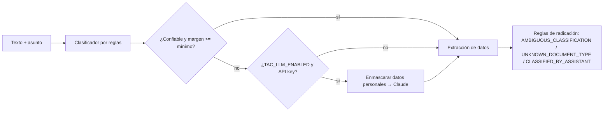

# Clasificación

## Propósito

Decide **qué es cada documento** y **extrae los datos que importan** según el tipo (NIT, número de factura, orden de compra, cuenta bancaria, totales, fechas de viaje, quién aprueba, plazo escrito en un oficio, mención de tutela). Es el paso de "lo abro, miro qué es" de la rutina de Martha y la base de todas las reglas de radicación.

El núcleo es determinístico (frases en español con pesos + expresiones regulares). Existe una segunda opinión con IA, pero viene **apagada por defecto** porque Sistemas de TAC no ha aprobado ninguna herramienta de IA.

## Quién lo usa

- **Auxiliar de radicación (CLERK)**: de forma indirecta. Ve el `document_type` resultante, los datos extraídos (`data`) y, cuando el sistema no está seguro, las razones `AMBIGUOUS_CLASSIFICATION` / `UNKNOWN_DOCUMENT_TYPE`. Puede cambiar el tipo con una corrección (ver [radicación](filing.md)).
- **Coordinadora (COORDINATOR)**: consulta el resultado; decide con Sistemas si se habilita la segunda opinión con IA.
- **Asistente de IA vía MCP**: no accede a la clasificación; solo lee sus resultados en el libro y en `pending_review`.

Este módulo no tiene router HTTP: se ejecuta dentro de la importación, invocado por `ProposeFiling`.

## Cómo funciona

1. `classify(text, subject)` (`classification/domain/classifier.py`) normaliza asunto + texto (minúsculas, sin tildes) y le da puntaje a cada tipo según las señales de `SIGNALS`, por ejemplo `factura electronica` (3), `cufe` (3) para `INVOICE`; `th-f-012` (4) para `TRAVEL_EXPENSE_REQUEST`; `derecho de peticion` (4), `solicito` (1,5), `les pido` (1,5) para `PETITION`; `contraloria`, `procuraduria`, `personeria`, `juzgado` (3) para `OVERSIGHT_NOTICE`; `queja` (3), `placa`, `bascula`, `transportador` para `COMPLAINT`; `cotizacion` para `QUOTATION`; `webinar`, `no deseas recibir` para `ADVERTISING`.
2. Gana el tipo con mejor puntaje si llega al menos a `MIN_SCORE = 3`; si no, el tipo es `OTHER`. El resultado trae el **margen** frente al segundo y los patrones que coincidieron.
3. `ClassifyDocument` (`classification/application/classify_document.py`) marca el resultado como **ambiguo** cuando no es confiable o el margen es menor que `TAC_MIN_CLASSIFICATION_MARGIN` (2,0 por defecto).
4. Solo si es ambiguo **y** el clasificador asistido está habilitado **y** hay texto, se le pregunta el tipo al LLM. Su respuesta reemplaza el tipo con `source="LLM"`; radicación agrega entonces la razón bloqueante `CLASSIFIED_BY_ASSISTANT`, de modo que una persona siempre lo confirma.
5. `extract_for(type, text, company_nit)` (`classification/domain/field_extractor.py`) extrae los datos del tipo elegido:
   - `INVOICE` / `QUOTATION`: NIT del proveedor (el primer NIT que **no** sea el de TAC, `900.100.200-3`), número del documento, orden de compra `OC-AAAA-NNNN`, banco y cuenta, subtotal, IVA, total, fecha de expedición.
   - `TRAVEL_EXPENSE_REQUEST`: nombre, cédula, si trae el `TH-F-012`, fecha de salida, quién aprueba, "Firma del jefe (firmado)", valor solicitado.
   - `PETITION` / `OVERSIGHT_NOTICE` / `COMPLAINT`: número de oficio, cédula, plazo escrito en el oficio (`cinco (5) días hábiles` → `5`, `BUSINESS_DAYS`; también `calendario`), si menciona tutela.



### Segunda opinión con IA (opcional)

- Conexión (`app/container.py`): `ClaudeClassifier` solo se crea cuando `TAC_LLM_ENABLED=true` **y** hay `TAC_ANTHROPIC_API_KEY`; si no, se usa `DisabledClassifier` (nunca sugiere nada). Modelo: `TAC_LLM_MODEL`.
- Antes de enviar, `mask_personal_data` (`shared/domain/privacy.py`, compartido con la auditoría y el módulo de [protección de datos](privacy.md)) reemplaza correos por `[EMAIL]`, cédulas/NIT con puntos por `[ID]` y secuencias largas de dígitos (cuentas, teléfonos) por `[NUMBER]`; el texto se corta en 6.000 caracteres.
- El modelo debe responder exactamente un código de `DocumentType`; cualquier otra cosa, o un `APIError`, se ignora y queda el resultado de las reglas (que de todos modos va a revisión por ser ambiguo).
- `GET /api/health` informa `data.llm_enabled`.

## Reglas de negocio

| Regla | Fuente | Dónde está en el código |
|---|---|---|
| Un derecho de petición no necesita decir "derecho de petición": "solicito", "les pido que me informen"… también cuentan, salvo que sea una queja de un usuario del terminal | Martha: *"a veces no dice 'derecho de petición' en ningún lado: la gente escribe 'solicito', 'les pido que me informen', y si no es una queja de un usuario del terminal, eso también es una petición."* | `SIGNALS[PETITION]`, señales de queja (`placa`, `bascula`, `transportador`) |
| Lo que escribe la Contraloría, la Procuraduría, la Personería o un juzgado es un oficio de ente de control (urgente, con su propio plazo) | Martha: *"Cuando escribe un ente de control —Contraloría, Procuraduría, Personería— o un juzgado"* | `SIGNALS[OVERSIGHT_NOTICE]` |
| El plazo del oficio es el que trae el oficio, no el de la ley | Martha: *"el plazo es el que diga el oficio, no el de la ley"* | `extract_term` |
| La amenaza de tutela vuelve urgente la solicitud | Martha: *"También si el ciudadano dice que va a poner una tutela: urgente."* | `TUTELA_RE` → `mentions_tutela` |
| Los viáticos se piden en el formato TH-F-012 firmado por el jefe | Martha: *"mandan el formato TH-F-012 con la firma del jefe"* | `extract_travel_request` |
| Ante la duda, preguntar en vez de adivinar | Martha: *"que cuando no esté seguro me pregunte, en vez de inventarse algo"* | margen de ambigüedad, `OTHER` por debajo de `MIN_SCORE` |
| La IA es opcional y está apagada; se protegen los datos personales | Dra. Herrera: *"Sistemas todavía no ha aprobado ninguna herramienta de IA"*; *"les pido cuidado con la información"* | `DisabledClassifier`, `mask_personal_data`, `TAC_LLM_ENABLED=false` |

## Endpoints / pantallas

No tiene endpoints propios. Su resultado aparece en el ítem de bandeja que devuelve `GET /api/inbox/{id}` (`decision.document_type`, `data`, razones), y en `GET /api/health` → `HEALTHY` con `{"llm_enabled": false}`.

## Códigos

Tipos de documento (`DocumentType`):

| Código | Meaning (EN) | Significado (ES) | ¿Bloquea? |
|---|---|---|---|
| `INVOICE` | Supplier invoice or "cuenta de cobro" | Factura o cuenta de cobro | No |
| `TRAVEL_EXPENSE_REQUEST` | Travel expense request (form TH-F-012) | Solicitud de viáticos (formato TH-F-012) | No |
| `PETITION` | Right-of-petition request (explicit or implicit) | Derecho de petición (explícito o implícito) | No |
| `OVERSIGHT_NOTICE` | Notice from a control body or court | Oficio de ente de control o juzgado | No |
| `COMPLAINT` | Complaint from a terminal user | Queja de usuario del terminal (transportador, cliente) | No |
| `QUOTATION` | Supplier quotation | Cotización | No |
| `ADVERTISING` | Advertising / newsletters | Publicidad | No |
| `OTHER` | Could not be identified | No se pudo identificar | Sí, vía `UNKNOWN_DOCUMENT_TYPE` |

Razones que salen del resultado de la clasificación (las emiten las reglas de radicación):

| Código | Meaning (EN) | Significado (ES) | ¿Bloquea? |
|---|---|---|---|
| `UNKNOWN_DOCUMENT_TYPE` | No type reached the minimum score | Ningún tipo alcanzó el puntaje mínimo | Sí |
| `AMBIGUOUS_CLASSIFICATION` | Two types are too close (`params.candidates`) | Dos tipos quedaron muy parejos (`params.candidates`) | Sí |
| `CLASSIFIED_BY_ASSISTANT` | Type suggested by the AI assistant; must be confirmed | El tipo lo sugirió el asistente de IA y debe confirmarse | Sí |

## Limitaciones

- Las reglas por palabras clave se escribieron a partir del buzón de muestra. En el set ciego (60 correos a los que nadie ajustó las reglas) 4 solicitudes de viáticos con otra disposición no se reconocieron como aprobadas y 1 consulta se tomó como queja; ver [evaluación](evaluation.md). Documentos con otro estilo pueden necesitar nuevas señales en `SIGNALS`, validadas con un set ciego nuevo.
- La extracción es por expresiones regulares: formatos poco comunes (NIT sin la palabra "NIT", números de factura fuera del patrón `No. XX-NNNN`) dejan campos vacíos, que radicación convierte en `INVOICE_MISSING_FIELDS` (revisión), no en un valor equivocado.
- El enmascaramiento no quita **nombres** de personas. `mask_personal_data` lo cubren `test_assisted_classifier.py::test_personal_data_is_masked_before_leaving_tac` y la prueba de motivos de descarte enmascarados de [protección de datos](privacy.md); las pruebas no hacen la llamada real a Claude.
- El LLM solo clasifica: nunca extrae datos ni toma decisiones.

## Cómo se prueba

- `api/tests/features/classification/test_classifier.py`: cada documento del buzón recibe el tipo esperado, petición implícita sin las palabras "derecho de petición", texto vacío es `OTHER`.
- `api/tests/features/classification/test_field_extractor.py`: datos de factura, factura sin orden de compra, datos de viáticos, plazo en letras y números, cambio de cuenta anunciado en el cuerpo.
- `api/tests/features/filing/test_rules.py`: `test_ambiguous_classification_needs_review`, `test_unknown_type_needs_review`.
- Golden: `api/tests/golden/test_golden.py` contra `material/4-para-medirte/esperado-parcial.csv` y `api/tests/golden/esperado-completo.csv`. Las pruebas siempre corren con `llm_enabled=False` (`tests/conftest.py`).

```bash
./scripts/harness-verify.sh api/tests/features/classification/test_classifier.py api/tests/features/classification/test_field_extractor.py
```

## Historial de cambios

- 2026-11-24: `mask_personal_data` pasó del adaptador de clasificación a `shared/domain/privacy.py` (también lo usa la auditoría); las limitaciones ahora remiten a la evaluación ciega.
