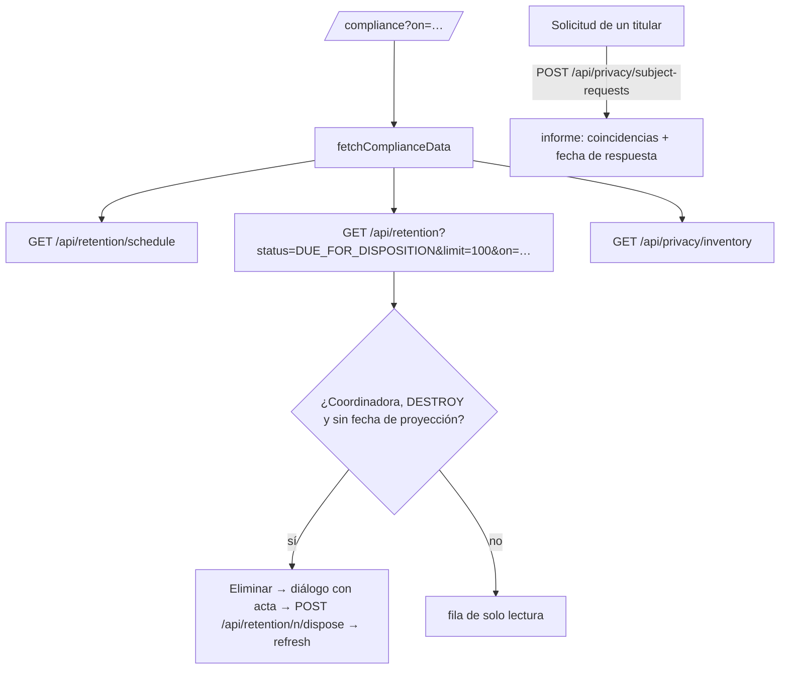

# Cumplimiento (pantalla)

## Propósito

`/compliance` ("Cumplimiento") es la página de la coordinadora para las dos obligaciones legales que traen los datos de Docket: la **retención documental** (Ley 594 de 2000) y la **protección de datos personales** (Ley 1581 de 2012). En un solo lugar la Dra. Herrera ve la tabla de retención documental (TRD) propuesta, los registros que ya cumplieron su tiempo (hoy o en una fecha futura) y los elimina con el acta del comité, consulta el inventario de datos personales y sus salvaguardas, y atiende la consulta o el reclamo de un titular con el plazo legal. Lado del backend: [retención documental](records.md) y [protección de datos](privacy.md).

## Quién lo usa

- **Coordinadora (COORDINATOR, Dra. Herrera)**: "Cumplimiento" es la quinta opción de su menú (ver [sesión](session.md)). Ve todo y es la única que tiene el botón "Eliminar" y el formulario "Solicitud de un titular".
- **Auxiliar de radicación (CLERK, Martha)**: la página no está en su menú. Si la abre por URL, ve la tabla, la lista de vencidos y el inventario en solo lectura: sin botón de eliminar ni formulario de titulares (de todas formas la API respondería `FORBIDDEN`).
- **Asistente de IA vía MCP**: sin acceso.

## Cómo funciona

1. `app/(app)/compliance/page.tsx` pinta `ComplianceTemplate` (Server Component) dentro de `<Suspense>`, con `ComplianceSkeleton` (`aria-busy`, "Cargando cumplimiento") mientras carga.
2. La fecha de proyección viene en la URL (`?on=AAAA-MM-DD`); `parsePreviewDate` (`model/labels.ts`) solo acepta fechas ISO; cualquier otra cosa equivale a hoy.
3. `fetchComplianceData` (`api/compliance-queries.ts`) hace tres llamadas en paralelo desde el servidor: la tabla, los registros `DUE_FOR_DISPOSITION` (los primeros 100, con `on` cuando se proyecta) y el inventario. La plantilla también lee la sesión para decidir qué puede hacer el rol.
4. **Eliminar** es una Server Action (`disposeRecordAction`) que envía el acta y luego hace `refresh()` de la ruta, así el registro sale de la lista de vencidos.
5. **Solicitud de un titular** es una Server Action (`subjectRequestAction`) que envía el identificador **en el cuerpo** y le devuelve el informe al componente de cliente, que lo muestra sin recargar.



### Pantallas y estados

- **Encabezado**: antetítulo "Coordinación", título "Cumplimiento", descripción "Retención documental (Ley 594 de 2000) y protección de datos personales (Ley 1581 de 2012)."
- **"Tabla de retención documental"**: aclara que es una propuesta inicial que debe aprobar el Comité Interno de Archivo y que los años se cuentan desde el cierre del año de recibido; tabla con Tipo documental, Gestión, Central (p. ej. "2 años"), Disposición final ("Conservación total", "Eliminación", "Selección (comité)") y Fundamento.
- **"Documentos que cumplieron su retención"**: "Nada se elimina antes de tiempo ni sin acta." Un formulario GET "Ver a la fecha" (el `DatePicker` del sistema de diseño: el calendario propio de la aplicación en español, "Hoy" = la fecha del caso, "Borrar"; su campo oculto envía `on`) + "Consultar" recarga la página con `?on=`. Estado vacío: "Ningún documento ha cumplido su tiempo de retención" (más "al <fecha>" cuando se proyecta). Cada registro vencido muestra radicado · tipo · "retención hasta <fecha>" · disposición y, para la coordinadora, cuando la disposición es "Eliminación" y no está proyectando, un botón **"Eliminar"**.
- **Diálogo de eliminación**: "Eliminar TAC-2026-ER-#####"; explica que se borran el archivo original y el texto con datos personales y que la fila del libro se conserva como índice, con la fecha y el acta; campo "Acta de eliminación del comité de archivo" (ejemplo "Ej.: Acta 03 de 2037"); "Cancelar" / "Eliminar contenido" (deshabilitado hasta tener 3 caracteres; indicador de carga mientras corre). Aviso de éxito: "TAC-2026-ER-#####: contenido eliminado; el índice queda en el libro."
- **"Datos personales"**: tabla del inventario (Dato, Titulares, "Finalidad y base legal", "Quién lo ve") y las salvaguardas como tarjetas verdes con ícono de escudo.
- **"Solicitud de un titular"** (solo la coordinadora): "Cédula o correo del titular", "Tipo de solicitud" ("Consulta (art. 14)" — "Responder en 10 días hábiles"; "Reclamo (art. 15)" — "Corrección o supresión: 15 días hábiles") y "Buscar" (deshabilitado con menos de 3 caracteres). El resultado dice "Titular ***.456: N registro(s). Responder a más tardar el <fecha>.", lista cada coincidencia (referencia; "Libro" o "Bandeja"; campos que coinciden como "Identificación", "Remitente", "Texto del documento", "Cuerpo del correo"; fecha; "contenido eliminado" si ya se eliminó) y cierra con "La búsqueda queda auditada con el identificador enmascarado." (`aria-live="polite"`).
- **Errores**: avisos con la etiqueta en español del código (ver Códigos).

### En el celular y sin conexión

- Las tablas se desplazan horizontalmente dentro de su propio contenedor redondeado; las celdas de texto largo se parten en varias líneas. El formulario del titular va en una columna en el celular y en una fila de tres columnas desde `md`. Los campos miden 44 px (`h-11`).
- **Sin conexión**: el service worker no la guarda (tiene datos personales); se muestra la página "Sin conexión" (ver [pwa](pwa.md)).

## Reglas de negocio

| Regla visible en la pantalla | Dónde está en el código |
|---|---|
| Nada se elimina antes de tiempo ni sin el acta del comité: solo los registros vencidos con `DESTROY` tienen botón, y el diálogo exige el acta | `ComplianceTemplate` (`v.disposition === "DESTROY"`, `!previewDate`), `DisposeButton` (`reference.trim().length < 3`) |
| La fecha de proyección sirve solo para planear: no se elimina desde una vista futura | condición `!previewDate` |
| La eliminación conserva el índice: el diálogo y el aviso dicen que la fila del libro queda | textos de `DisposeButton` |
| Solo la coordinadora elimina y hace búsquedas por titular | `isCoordinator` en `ComplianceTemplate`; `CoordinatorRole` en la API |
| El identificador del titular nunca va en la URL | `subjectRequestAction` lo envía en el cuerpo |
| El plazo de respuesta se muestra con el artículo de la ley | descripciones del selector y resultado de `SubjectRequestForm` |
| La búsqueda queda auditada sin el identificador | texto al pie del resultado; `PRIVACY_SUBJECT_LOOKUP` en la API |

## Endpoints / pantallas

Ruta: `/compliance` (`web/src/app/(app)/compliance/page.tsx`), módulo `web/src/features/compliance/`. Todas las llamadas se hacen en el servidor de Next.js con el token de la cookie httpOnly.

| Desde | Método | Ruta | Para qué |
|---|---|---|---|
| `fetchComplianceData` | GET | `/api/retention/schedule` | tabla de retención |
| `fetchComplianceData` | GET | `/api/retention?status=DUE_FOR_DISPOSITION&limit=100[&on=…]` | lista de vencidos |
| `fetchComplianceData` | GET | `/api/privacy/inventory` | inventario y salvaguardas |
| `disposeRecordAction` (Server Action) | POST | `/api/retention/{filing_number}/dispose` (`record_reference`) | "Eliminar contenido" |
| `subjectRequestAction` (Server Action) | POST | `/api/privacy/subject-requests` (`identifier`, `kind`) | "Buscar" |

Componentes principales: `ComplianceTemplate`, `ComplianceSkeleton`, `DisposeButton`, `SubjectRequestForm`; etiquetas en `model/labels.ts` (`dispositionLabel`, `retentionStatusLabel`, `matchFieldLabel`, `parsePreviewDate`).

## Códigos

Los errores se muestran con `describeError` (`shared/i18n/es.ts`).

| Código | Meaning (EN) | Etiqueta que se muestra | ¿Bloquea? |
|---|---|---|---|
| `RETENTION_NOT_EXPIRED` | The term has not ended | Aún no se cumple el tiempo de retención: no se puede eliminar. | Sí |
| `DISPOSITION_NOT_ALLOWED` | The schedule says conserve or select | La tabla de retención exige conservar este documento. | Sí |
| `DISPOSAL_RECORD_REQUIRED` | The disposal record is missing | Indique el acta de eliminación aprobada por el comité de archivo. | Sí |
| `RECORD_NOT_FOUND` | Unknown filing number | No se encontró el radicado. | Sí |
| `IDENTIFIER_TOO_SHORT` | Not an e-mail and fewer than 6 digits | Escriba la cédula completa o el correo del titular. | Sí |
| `FORBIDDEN` / `UNAUTHORIZED` / `NETWORK_ERROR` | Role, session or connection problem | Su rol no permite esta acción. / Su sesión expiró. Vuelva a ingresar. / No hay conexión con el servidor. | Sí |
| `CONSERVE` / `DESTROY` / `SELECT` | Final disposition | Conservación total / Eliminación / Selección (comité) | — |
| `ACTIVE` / `DUE_FOR_DISPOSITION` / `DISPOSED` | Retention status | Vigente / Cumplió retención / Eliminado | — |

## Limitaciones

- La lista de vencidos muestra los primeros 100 registros y no tiene paginación en pantalla (la API pagina; la pantalla pide una sola página).
- Los registros con `SELECT` aparecen en la lista de vencidos sin acción: la selección del comité se hace por fuera de Docket.
- El resultado de la búsqueda por titular no se guarda: al recargar la página desaparece; la respuesta al titular se redacta por fuera de Docket.
- No hay prueba de Jest dedicada para `DisposeButton` ni para `SubjectRequestForm`; el diálogo de eliminación no lo cubre una prueba E2E (en la fecha del caso nada está vencido).

## Cómo se prueba

- `web/src/features/compliance/__tests__/labels.test.ts`: la fecha de proyección solo acepta fechas ISO; toda disposición tiene etiqueta en español.
- `web/src/shared/ui/__tests__/DatePicker.test.tsx`: el campo de fecha de proyección es el calendario del sistema de diseño, no un campo nativo.
- `web/e2e/coordinator.spec.ts`, "compliance: retention schedule and a data subject request" (proyecto `coordinator`): la coordinadora abre `/compliance`, ve "Tabla de retención documental" y "Ningún documento ha cumplido su tiempo de retención", busca `80.123.456` y obtiene "Titular ***.456" y "Responder a más tardar el".
- Backend: ver [retención documental](records.md) y [protección de datos](privacy.md).

```bash
./scripts/harness-verify.sh web/src/features/compliance/__tests__/labels.test.ts
./scripts/harness-verify.sh web/e2e/coordinator.spec.ts
```

## Historial de cambios

- 2026-11-24: nueva pantalla `/compliance` para la coordinadora: tabla de retención, registros vencidos con fecha de proyección y eliminación controlada, inventario de datos personales y salvaguardas, formulario de solicitud de un titular.
- 2026-11-24: la fecha de proyección usa el `DatePicker` del sistema de diseño; prueba `web/src/shared/ui/__tests__/DatePicker.test.tsx`.
