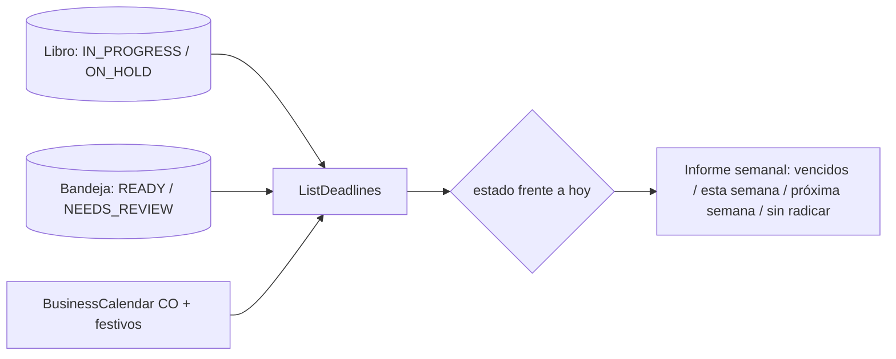

# Vencimientos

## Propósito

Le dice a la coordinadora **qué se vence y qué tan cerca está**: derechos de petición, oficios y quejas con un plazo legal corriendo, contado en días hábiles colombianos. Reemplaza el informe de los viernes que hoy arma a mano la Dra. Herrera con Martha, e incluye documentos que **todavía no se han radicado**, porque el plazo corre desde que se recibe, no desde que se radica.

## Quién lo usa

- **Coordinadora (COORDINATOR, Dra. Herrera)**: informe semanal y lista de vencimientos; la pantalla `/deadlines` es su inicio (`ROLE_HOME`, ver [session](session.md)) y reemplaza el informe de los viernes (lo puede imprimir). Encima del informe ve su propio resumen: las facturas que esperan su verificación telefónica y lo pendiente en radicación.
- **Auxiliar de radicación (CLERK, Martha)**: el mismo acceso de lectura y la misma pantalla, para priorizar lo urgente.
- **Asistente de IA vía MCP**: `deadlines_this_week`, `weekly_report`, `list_deadlines` ("¿qué se vence esta semana?", ver [mcp](mcp.md)).

## Cómo funciona

1. **Las fechas de vencimiento se calculan en radicación** con `BusinessCalendar` (`api/app/shared/domain/business_calendar.py`): se empieza a contar el día hábil siguiente al recibido y se saltan sábados, domingos y festivos de Colombia (librería `holidays`, país `CO`, más `TAC_EXTRA_HOLIDAYS`). En el periodo del caso, el **16 de noviembre** y el **8 de diciembre de 2026** son festivos y corren los vencimientos (razón `HOLIDAY_IN_TERM`).
2. `ListDeadlines` (`deadlines/application/list_deadlines.py`) une:
   - los registros del libro con vencimiento en el rango y estado `IN_PROGRESS` u `ON_HOLD` (`OPEN_STATUSES`: una fila que las personas cerraron en el Excel compartido — "Respondido", "Cerrado"… → `CLOSED` — sale después de la siguiente [sincronización del libro](ledger.md#sincronización-en-ambos-sentidos-con-el-excel-compartido)), y
   - los ítems de la bandeja todavía `READY` o `NEEDS_REVIEW` con fecha de vencimiento propuesta en el rango (`filing_number = null`).
   Se ordenan por fecha de vencimiento, primero los urgentes.
3. Cada vencimiento recibe un `state` frente a "hoy" (`TAC_TODAY`, 2026-11-18 en el caso; la fecha real si está vacío) y `business_days_left` (cuenta el día del vencimiento si es hábil; negativo si ya se venció).
4. `BuildWeeklyReport` toma la semana actual (lunes a domingo) y la siguiente: `overdue`, `this_week` (`DUE_TODAY` + `DUE_THIS_WEEK`), `next_week`, y `not_filed_yet` (cuántos siguen en la bandeja).



Ejemplos con el buzón de muestra (hoy 2026-11-18, semana del 16 al 22 de noviembre): petición histórica `TAC-2026-ER-04792` "Certificación laboral", vence el 19-nov → `DUE_THIS_WEEK`; oficio de `11.eml` (5 días hábiles) vence el **23-nov** y la petición de solo copias de `12.eml` el **27-nov** → `DUE_NEXT_WEEK`; la petición de `10.eml` vence el 2-dic y la queja de `14.eml` el 9-dic → `LATER`.

### La pantalla (`/deadlines`)

La coordinadora llega aquí al ingresar (es su `ROLE_HOME`); la auxiliar entra por la pestaña "Vencimientos". Las dos ven el mismo informe, que no tiene más acción que imprimir; solo la coordinadora ve además las tarjetas de resumen del paso 3.

1. `app/(app)/deadlines/page.tsx` pinta `DeadlinesTemplate` (Server Component) dentro de `<Suspense>`, con `DeadlinesSkeleton` (`aria-busy`) mientras carga.
2. `fetchWeeklyReport` (`features/deadlines/api/deadline-queries.ts`) llama a `GET /api/deadlines/weekly-report` desde el servidor con el token de la cookie httpOnly; `toWeeklyReportView` lo convierte y marca como aún sin radicar los que tienen `filing_number = null`. Si el rol de la sesión es `COORDINATOR`, en paralelo corre `fetchCoordinatorSummary`, que llama a `GET /api/verifications` y `GET /api/inbox/summary`.
3. **Resumen de la coordinadora** (`features/deadlines/components/organisms/CoordinatorSummary.tsx`, solo para `COORDINATOR`), en la región "Lo que requiere su atención", dos tarjetas enlazadas:
   - **"N facturas por verificar"** (borde izquierdo rojo) → `/verifications`: facturas retenidas en `AWAITING_VERIFICATION`, con la nota "Posible fraude: confirme por teléfono antes de liberar." y "N más aún en la bandeja de radicación." cuando alguna sigue en `PENDING_CLERK_APPROVAL`. Ver [verifications](verifications.md).
   - **"N documentos pendientes en radicación"** → `/inbox`: `READY` + `NEEDS_REVIEW` del resumen de la bandeja, con "N requieren decisión de una persona." o "Nada atascado en revisión."
4. Encabezado: antetítulo "Semana del 16 de nov de 2026 al 22 de nov de 2026", título "Vencimientos", una descripción que aclara que los plazos se cuentan en días hábiles y corren desde que llega el documento, y **"Imprimir reporte"** (`window.print()`; el botón no sale en la impresión y cada grupo evita cortarse entre páginas).
5. Contadores: "Vencidos", "Esta semana", "Próxima semana" y "Urgentes" (sobre los tres grupos, con la nota "N aún sin radicar").
6. Grupos: "Vencidos", "Vencen esta semana" y "Vencen la próxima semana", cada uno con su cantidad. Los grupos vacíos dicen "Nada vencido.", "Nada vence esta semana.", "Nada vence la próxima semana."
7. Cada `DeadlineCard` muestra una hojita de calendario (día y mes), las etiquetas "Urgente" y "Aún sin radicar", los días hábiles que quedan ("Vencido hace 2 días hábiles", "Vence hoy", "1 día hábil", "3 días hábiles"; en rojo cuando queda un día o menos), el asunto y "tipo · remitente → dependencia · radicado". Las tarjetas urgentes llevan borde izquierdo rojo. Las que tienen documento (`document_id`) abren su [revisión de documento](document-review.md) — en solo lectura para la coordinadora; los registros históricos del libro sin documento no son enlaces.

### En el celular y sin conexión

- Los contadores van en 2×2 en el celular y en una fila de cuatro desde `lg`; los grupos van en una sola columna hasta `xl`, donde "próxima semana" pasa a una segunda columna. Los asuntos largos se cortan a una línea.
- **Sin conexión**: `/deadlines` es una de las dos vistas de consulta que guarda el service worker (primero la red, espera de 4 s, caché `docket-read-views`), así que la coordinadora puede revisar sin conexión el último informe que abrió. Está tan actualizado como esa visita; abrir el documento de una tarjeta necesita red. Ver [pwa](pwa.md).

## Reglas de negocio

| Regla | Fuente | Dónde está en el código |
|---|---|---|
| La coordinadora necesita cada semana los derechos de petición y oficios por vencerse | Dra. Herrera: *"Yo necesito saber cada semana qué derechos de petición y qué oficios están por vencerse; hoy eso lo armo a mano con Martha los viernes."* | `BuildWeeklyReport` |
| Los plazos se cuentan desde el día hábil siguiente al recibido, sin sábados, domingos ni festivos | Martha: *"Se cuentan desde el día hábil siguiente al que llegó, sin sábados, domingos ni festivos."* | `BusinessCalendar.add_business_days` |
| Un derecho de petición vencido termina en tutela: lo urgente va primero | Martha: *"Una vez se nos venció un derecho de petición y nos pusieron una tutela"* | orden `(due_date, not urgent)`; marca `urgent` |
| Lo pendiente también cuenta | Los plazos corren desde el recibido (Ley 1755 de 2015) | ítems de bandeja con `filing_number = null` |

## Endpoints / pantallas

| Método | Ruta | Rol | Solicitud | `code` de éxito |
|---|---|---|---|---|
| GET | `/api/deadlines` | cualquiera | `start`, `end` opcionales (fechas ISO; por defecto, todo) | `DEADLINES_LISTED` |
| GET | `/api/deadlines/weekly-report` | cualquiera | — | `WEEKLY_REPORT` |

Campos del vencimiento: `filing_number` (nulo si aún no se ha radicado), `document_id`, `document_type`, `department`, `sender`, `subject`, `received_date`, `due_date`, `urgent`, `state`, `business_days_left`.
Campos del informe semanal: `today`, `week_start`, `week_end`, `overdue[]`, `this_week[]`, `next_week[]`, `not_filed_yet`. Errores: `401 UNAUTHORIZED`, `422 VALIDATION_ERROR` (fecha inválida).

### Pantalla

| Ruta | Llama a | Notas |
|---|---|---|
| `/deadlines` (`web/src/app/(app)/deadlines/page.tsx`, módulo `web/src/features/deadlines/`) | `GET /api/deadlines/weekly-report`; para `COORDINATOR` también `GET /api/verifications` y `GET /api/inbox/summary` (`fetchCoordinatorSummary`) | Server Component; la pantalla no usa `GET /api/deadlines`. `CoordinatorSummary` solo se pinta para la coordinadora |

## Códigos

| Código | Meaning (EN) | Significado (ES) | ¿Bloquea? |
|---|---|---|---|
| `DEADLINES_LISTED` | Deadline list returned | Lista de vencimientos devuelta | — |
| `WEEKLY_REPORT` | Weekly report returned | Informe semanal devuelto | — |
| `OVERDUE` | Due date already passed | Ya se venció | — |
| `DUE_TODAY` | Due today | Vence hoy | — |
| `DUE_THIS_WEEK` | Due later this week (until Sunday) | Vence esta semana (hasta el domingo) | — |
| `DUE_NEXT_WEEK` | Due next week | Vence la próxima semana | — |
| `LATER` | Due after next week | Vence después de la próxima semana | — |
| `HOLIDAY_IN_TERM` | A holiday falls inside the term (reason from filing) | Hay un festivo dentro del plazo | No |

## Limitaciones

- "Hoy" está fijo en 2026-11-18 por defecto (`TAC_TODAY`) para el caso; en producción debe dejarse vacío para usar la fecha real.
- Solo aparecen documentos con fecha de vencimiento; los oficios a los que no se les encontró plazo (`OVERSIGHT_TERM_NOT_FOUND`) no salen hasta que la auxiliar les ponga una fecha.
- Los registros `DELIVERED` y `CLOSED` se excluyen. Una petición solo se cierra cuando alguien lo escribe en el Excel compartido ("Respondido", "Cerrado", "Tramitado"…); sale de este informe después de la siguiente sincronización (hasta `TAC_LEDGER_SYNC_SECONDS`). Docket no tiene una acción propia de "respondido".
- No hay notificaciones ni resumen por correo; el informe se consulta (API o MCP).
- Los festivos vienen del paquete `holidays`; los cierres locales deben agregarse con `TAC_EXTRA_HOLIDAYS`.
- Pantalla: solo se muestran vencidos, esta semana y la próxima; los vencimientos `LATER` (p. ej. `10.eml`, `14.eml`) no se ven en la pantalla. Sin conexión no hay indicador de "actualizado a las…". (Una falla de la API ahora muestra el `error.tsx` de la aplicación con "Reintentar" / "Ingresar de nuevo", ver [session](session.md).)

## Cómo se prueba

- `api/tests/features/deadlines/test_deadlines.py`: límites de la semana y estados, el informe semanal incluye documentos sin radicar (04792 esta semana; `11.eml__0`, `12.eml__0` la próxima), los vencimientos radicados conservan la urgencia (`business_days_left == 3` para el 23-nov).
- `api/tests/shared/test_business_calendar.py`: festivos del caso, el plazo arranca el día hábil siguiente, recibido un viernes salta fin de semana y festivo, plazo que cruza el 8-dic, `holidays_in_term`, `business_days_between`, festivos adicionales.
- `api/tests/mcp/test_mcp_server.py` y `api/tests/api/test_api.py::test_full_flow_over_http` (`WEEKLY_REPORT`).

- Pantalla: `web/src/features/deadlines/__tests__/mappers.test.ts` (etiquetas de días hábiles en español, registros aún sin radicar identificados por `document_id`, hojita de calendario `dateParts`); `web/e2e/filing-flow.spec.ts`, paso "the coordinator sees this week's and next week's deadlines" (llega a "Vencimientos", ve "Certificación laboral" y "Notificación oficio CD-2026-3345"); `web/e2e/coordinator.spec.ts` (proyecto `coordinator`, corre después de `desktop`) comprueba que su inicio muestra la tarjeta "1 factura por verificar" y que esta abre `/verifications`; `web/e2e/mobile.spec.ts` ingresa como coordinadora en un Pixel 7.

```bash
./scripts/harness-verify.sh api/tests/features/deadlines/test_deadlines.py api/tests/shared/test_business_calendar.py
./scripts/harness-verify.sh web/src/features/deadlines/__tests__/mappers.test.ts
./scripts/harness-verify.sh web/e2e/filing-flow.spec.ts web/e2e/coordinator.spec.ts web/e2e/mobile.spec.ts
```

## Historial de cambios

- 2026-11-24: se agregó la pantalla `/deadlines` (informe semanal, tarjetas, impresión, comportamiento en el celular y sin conexión).
- 2026-11-24: resumen de la coordinadora (`CoordinatorSummary`, `fetchCoordinatorSummary`): facturas que esperan su verificación y lo pendiente en radicación, visible solo para `COORDINATOR`; `/deadlines` es el inicio de su rol; se corrigió la limitación de "no hay `error.tsx`".
- 2026-11-24: las filas que las personas cerraron en el Excel compartido (`LedgerStatus.CLOSED`) salen de vencimientos (`OPEN_STATUSES` = `IN_PROGRESS`, `ON_HOLD`); prueba `api/tests/features/ledger/test_excel_sync.py::test_legal_closes_a_petition_in_excel_and_it_leaves_the_deadlines`.
