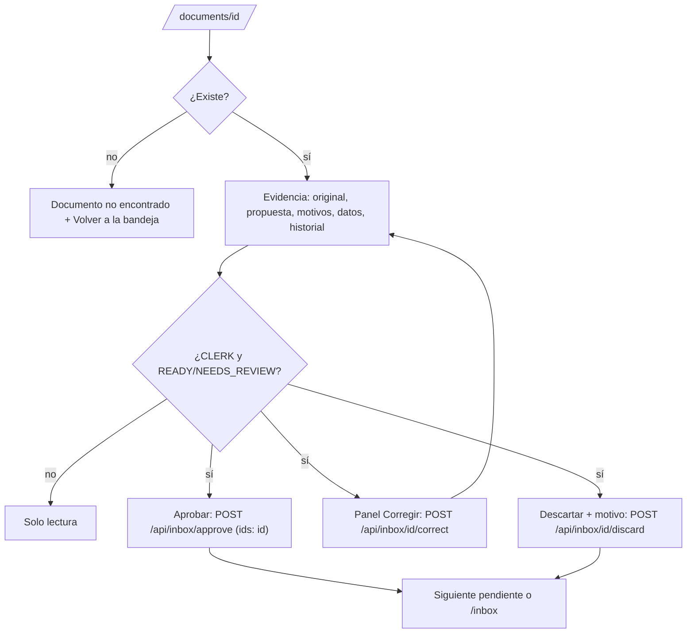

# Revisión de documento (pantalla)

## Propósito

Es la pantalla donde una persona decide sobre **un** documento. `/documents/{id}` pone el adjunto original junto a la propuesta del sistema, los motivos, los datos extraídos y el historial de auditoría, para que la auxiliar apruebe, corrija o descarte con todo a la vista. Aquí la regla de "nada irreversible sin una persona" se vuelve un botón: lo que requiere revisión solo se aprueba en esta pantalla, uno por uno.

## Quién lo usa

- **Auxiliar de radicación (CLERK, Martha)**: lee la evidencia y aprueba, corrige o descarta. Después de cada acción la pantalla la lleva al siguiente documento pendiente.
- **Coordinadora (COORDINATOR, Dra. Herrera)**: abre cualquier documento (desde la bandeja o desde una tarjeta de vencimientos) y ve exactamente la misma evidencia, motivos e historial, incluido el archivo original. **No puede** aprobar, corregir ni descartar: la barra de acciones no se le muestra y la API le respondería `FORBIDDEN`. Cuando la auxiliar radica una factura retenida, la coordinadora la resuelve en [verificaciones](verifications.md), no aquí.

## Cómo funciona

1. `app/(app)/documents/[id]/page.tsx` pinta `DocumentReviewTemplate` dentro de `<Suspense>`, con `DocumentReviewSkeleton` mientras carga.
2. La plantilla carga en paralelo el documento (`fetchDocument` → `GET /api/inbox/{id}`), la sesión y el id del siguiente pendiente (`fetchNextPendingId` → `GET /api/inbox`: primero `NEEDS_REVIEW`, luego `READY`, en orden de llegada, sin contar el actual).
3. `toDocumentDetailView` (`model/mappers.ts`) ordena los motivos con los bloqueantes primero, los traduce con `describeReason`, conserva la propuesta original (`proposal_decision`) junto a la decisión vigente y escoge los datos que importan según el tipo de documento (`fieldsFor`).
4. Las acciones solo aparecen si el documento está abierto (`READY` o `NEEDS_REVIEW`) **y** el rol es `CLERK`. Son Server Actions de `api/document-actions.ts` que llaman a la API desde el servidor y hacen `refresh()` de la ruta.
5. Al aprobar o descartar, el navegador pasa al siguiente documento pendiente, o vuelve a `/inbox` si ya no queda nada. Al corregir se queda en el mismo documento, ahora marcado como corregido, para que lo apruebe.



### Pantallas y estados

- **Encabezado**: enlace "Bandeja" para volver, `DocumentStatusBadge` (la misma correspondencia de la bandeja), "Urgente", "Extemporánea", "Corregido por una persona" cuando `was_corrected`, el radicado una vez aprobado, nombre del adjunto, asunto, remitente y hora de recibido.
- **Barra de acciones** (`ReviewActions`): el texto del botón de aprobar depende de la acción propuesta — `FILE` "Aprobar y radicar", `REPLY_WITH_EXISTING_NUMBER` "Aprobar respuesta", `RETURN_TO_SENDER` "Aprobar devolución", `DO_NOT_FILE` "Confirmar: no radicar". Una factura retenida (`HOLD_FOR_VERIFICATION`) **no tiene botón de aprobar**: en su lugar, un botón rojo **"Alertar a la Dra. Herrera"** (`EscalateHoldButton`) abre el diálogo "¿Alertar posible fraude?" (la factura no se aprueba ni se envía a pago; queda radicada como retenida para dejar constancia del intento, y la Dra. Herrera llama al proveedor al número del maestro, nunca al del correo) con "Cancelar" / "Enviar alerta"; el aviso de éxito dice "Alerta enviada a la Dra. Herrera" con el radicado. Luego "Corregir" y "Descartar". En documentos `NEEDS_REVIEW` aparece la nota "Al aprobar usted confirma que revisó los motivos marcados." (en una factura retenida: "Posible fraude: no se aprueba. Alerte a la coordinadora para que lo verifique por teléfono.")
- **Paneles**:
  - "Propuesta del sistema" (o "Decisión (corregida)", con un desplegable "Ver la propuesta original"): Qué es, Va para, Acción (en rojo si es retenida), Radicado existente (duplicadas), Vence.
  - "Por qué": cada motivo en español con su código; primero los bloqueantes, sobre fondo ámbar, con el prefijo "Requiere decisión:" para lectores de pantalla ("Regla aplicada:" para los demás).
  - "Datos extraídos": según el tipo. Facturas: proveedor, NIT, número de factura, orden de compra ("Sin OC" en ámbar), subtotal, IVA, total, fecha de expedición, cuenta en la factura (en rojo con `INVOICE_ACCOUNT_MISMATCH` / `EMAIL_ACCOUNT_MISMATCH`), cuenta y correo del maestro de proveedores (el correo en rojo con `SENDER_DOMAIN_MISMATCH`). Viáticos: formato TH-F-012, quién aprueba, firma del jefe (en rojo si falta), fecha de salida (en ámbar si es extemporánea), valor. Oficios: número y plazo ("No encontrado" en rojo). Cotizaciones: proveedor, NIT, número. Otros: remitente, identificación y "Menciona tutela" en rojo.
  - "Historial": eventos de auditoría ("El sistema hizo la propuesta", "Corregido", "Aprobado y radicado", "Descartado") con actor (Sistema, Radicación, Coordinación, Consola) y hora.
- **Visor del original** (`SourceViewer`, pestañas): "Original" (los PDF en un iframe con "Abrir en otra pestaña"; otros formatos como vista previa de texto; para documentos que son el cuerpo del correo, el cuerpo mismo), "Texto leído" (texto extraído u OCR) y "Correo" (el cuerpo del correo, para adjuntos). Muestra además el método de extracción en español ("PDF con texto", "PDF escaneado (OCR)", "Escaneado sin OCR disponible"…) y la confianza del OCR.
- **Panel de corrección** (`CorrectionSheet`, react-hook-form + zod): Qué es, Va para, Acción (listas con etiquetas en español), Fecha de vencimiento (el `DatePicker` del sistema de diseño, `shared/ui/molecules/DatePicker.tsx`: un botón que abre el calendario propio de la aplicación en español, con "Hoy" = la fecha del caso y "Borrar"; sin campo de fecha nativo; vacía = no aplica), "Marcar como urgente" y "Observaciones para el libro" (máximo 500 caracteres). Avisa que la propuesta original se conserva para la auditoría.
- **Diálogo de descarte**: exige un motivo; el botón "Descartar" sigue deshabilitado mientras esté vacío.
- **Cargando**: `DocumentReviewSkeleton` (`aria-busy`). **No existe**: estado vacío "Documento no encontrado" con "Volver a la bandeja". **Procesando**: indicador de carga y botones deshabilitados mientras corre la acción.
- **Respuesta**: aprobar → "Radicado TAC-2026-ER-#####" (o "Aprobado" si no consume número) y "Quedó en el libro y en la bandeja de salida."; corregir → "Corrección guardada. Revise y apruebe cuando esté conforme."; descartar → "Documento descartado."; errores → la etiqueta en español del código.

### En el celular y sin conexión

- En el celular los paneles de la decisión van **primero** y el documento original debajo (con `order` de CSS), porque en pantalla pequeña lo primero que se lee es la decisión; desde `lg` el original queda a la izquierda y los paneles a la derecha.
- Las acciones se apilan a todo lo ancho en el celular y quedan en fila desde `sm`. El formulario de corrección es un panel lateral que ocupa todo el ancho en el celular (`w-full`, `sm:max-w-md`) y se desplaza por dentro.
- El iframe del PDF y las vistas de texto llegan hasta el 70 % del alto de la pantalla y se desplazan por dentro.
- **Sin conexión**: no está disponible. Los documentos y sus originales nunca se guardan en caché (datos personales); ver [pwa](pwa.md).

### Accesibilidad

Aprobar, Corregir, Descartar, el enlace de volver, las listas del formulario, el campo de fecha y la fila de "urgente" miden 44 px (`h-11` / `min-h-11`); los botones del diálogo de descarte también, en pantallas táctiles (`h-11 md:h-10`). Los errores del formulario usan `role="alert"` y `aria-invalid`. Los motivos se anuncian con su significado, no solo con su color. El iframe tiene título ("Documento original: …").

## Reglas de negocio

| Regla visible en la pantalla | Dónde está en el código |
|---|---|
| Solo la auxiliar actúa, y solo sobre documentos abiertos | `canAct` en `DocumentReviewTemplate` |
| Lo que requiere revisión se aprueba uno por uno, por id, aquí (nunca en el lote) | `approveDocumentAction` → `POST /api/inbox/approve` con `ids: [id]` |
| Un posible fraude **nunca se aprueba**: la auxiliar alerta a la coordinadora ("Alertar a la Dra. Herrera" → "Enviar alerta"). La factura recibe radicado para que quede trazabilidad, queda `ON_HOLD`, se envía un `FRAUD_ALERT` a la coordinadora y nada va a Cuentas por pagar; desde ese momento aparece en su cola `/verifications` como `AWAITING_VERIFICATION` (ver [verificaciones](verifications.md)) | `EscalateHoldButton` → `escalateHoldAction` → `POST /api/inbox/{id}/escalate`; la API responde `409 HOLD_REQUIRES_ESCALATION` si alguien intenta aprobarla |
| El radicado se asigna **al aprobar** y se ve en el aviso y en el encabezado | `approveDocumentAction`, encabezado |
| Para radicar hace falta una dependencia real: el formulario rechaza `FILE` **o `HOLD_FOR_VERIFICATION`** con `NONE` ("Para radicar hay que elegir la dependencia."); si un documento llega a la aprobación sin dependencia (p. ej. un escaneado ilegible), la API responde `DECISION_INCOMPLETE` y el aviso dice "Falta elegir la dependencia antes de radicar." | `documentCorrectionSchema`, `describeError` |
| Una corrección conserva la propuesta original (en "Ver la propuesta original") y deja evento de auditoría | `proposal_decision`, `AuditTimeline` |
| Descartar exige un motivo; queda registrado y no se radica ni se reenvía nada | diálogo de descarte, `discardDocumentAction` |
| Las duplicadas muestran el radicado existente en lugar de uno nuevo | "Radicado existente" en `DecisionSummary` |

## Endpoints / pantallas

Ruta: `/documents/[id]` (`web/src/app/(app)/documents/[id]/page.tsx`), módulo `web/src/features/document-review/`. El token se queda en la cookie httpOnly; toda llamada pasa por `shared/lib/api-client.ts` en el servidor.

| Desde | Método | Ruta | Para qué |
|---|---|---|---|
| `fetchDocument` (Server Component) | GET | `/api/inbox/{id}` | detalle con decisión, propuesta, motivos, evidencia, texto, cuerpo del correo, auditoría |
| `fetchNextPendingId` (Server Component) | GET | `/api/inbox` | a qué documento pasar después de una acción |
| `approveDocumentAction` (Server Action) | POST | `/api/inbox/approve` (`{"ids": [id]}`) | aprobar |
| `escalateHoldAction` (Server Action) | POST | `/api/inbox/{id}/escalate` | "Enviar alerta" en una factura retenida (`HOLD_ESCALATED`) |
| `correctDocumentAction` (Server Action) | POST | `/api/inbox/{id}/correct` (`document_type`, `department`, `action`, `due_date`, `clear_due_date`, `urgent`, `notes`) | corregir; la acción vuelve a validar con zod y responde `VALIDATION_ERROR` antes de llamar a la API |
| `discardDocumentAction` (Server Action) | POST | `/api/inbox/{id}/discard` (`reason`) | descartar |
| Route handler `app/files/documents/[id]/route.ts` | GET | `/api/inbox/{id}/source` | entrega el adjunto original al iframe como `/files/documents/{id}`: `401` sin sesión, `Content-Disposition: inline`, `Cache-Control: private, no-store`, `X-Content-Type-Options: nosniff` |

## Códigos

| Código | Meaning (EN) | Etiqueta que se muestra | ¿Bloquea? |
|---|---|---|---|
| `DECISION_INCOMPLETE` | Would be filed without a real department | Falta elegir la dependencia antes de radicar. | Sí |
| `DOCUMENT_ALREADY_CLOSED` | Already approved or discarded (e.g. in another tab) | El documento ya fue aprobado o descartado. | Sí |
| `HOLD_REQUIRES_ESCALATION` | A suspected fraud cannot be approved | Una factura con posible fraude no se aprueba: use «Alertar a la Dra. Herrera». | Sí |
| `NOT_A_HOLD` | The document is not held for possible fraud | Este documento no está retenido por posible fraude. | Sí |
| `DOCUMENT_NOT_FOUND` | Unknown id (the page shows the "not found" state) | El documento no existe. / Documento no encontrado | Sí |
| `VALIDATION_ERROR` | Invalid correction or empty discard reason | Revise los datos ingresados. | Sí |
| `FORBIDDEN` | The role cannot do this | Su rol no permite esta acción. | Sí |
| `UNAUTHORIZED` | Token rejected | Su sesión expiró. Vuelva a ingresar. | Sí |
| `NETWORK_ERROR` | API unreachable from the Next.js server | No hay conexión con el servidor. | Sí |
| `FILE` / `HOLD_FOR_VERIFICATION` / `REPLY_WITH_EXISTING_NUMBER` / `RETURN_TO_SENDER` / `DO_NOT_FILE` | Actions | Radicar y reenviar / Alertar a la coordinadora (posible fraude) / Responder con radicado existente / Devolver al remitente / No radicar | — |
| `PDF_TEXT` / `OCR` / `OCR_UNAVAILABLE` / `EMAIL_BODY` | Extraction method | PDF con texto / PDF escaneado (OCR) / Escaneado sin OCR disponible / Cuerpo del correo | — |
| Códigos de motivo (`INVOICE_ACCOUNT_MISMATCH`, `DOCUMENT_UNREADABLE`, …) | See [filing](filing.md) | Etiquetas en `reasonLabel` (`shared/i18n/es.ts`); un código desconocido se muestra tal cual | según el motivo |

## Limitaciones

- No se puede deshacer: un documento aprobado no se revierte (la API no tiene anulación).
- `fetchNextPendingId` descarga toda la bandeja solo para encontrar el siguiente id.
- La vista del PDF dentro de la página depende del visor del navegador; en algunos celulares el iframe es limitado y lo seguro es "Abrir en otra pestaña". Los originales que no son PDF (Word, Excel, HTML) solo se ven como texto extraído.
- El historial nombra en español todos los eventos conocidos, incluidos `HOLD_ESCALATED` ("Alerta de posible fraude enviada a la coordinadora") y `HOLD_RELEASED` / `HOLD_REJECTED` de la coordinadora; un evento futuro desconocido se mostraría con su código.

## Cómo se prueba

- `web/src/features/document-review/__tests__/mappers.test.ts`: motivos bloqueantes primero; el campo de la cuenta en rojo cuando no coincide; total formateado en pesos (`7.497.000`); en viáticos se marca la falta de aprobación (rojo) y la salida extemporánea (ámbar); el esquema de corrección acepta una corrección completa, rechaza radicar sin dependencia y rechaza fechas mal escritas.
- `web/src/shared/ui/__tests__/StatusBadge.test.tsx`: la correspondencia de etiquetas que comparte con la bandeja.
- `web/src/shared/ui/__tests__/DatePicker.test.tsx`: la fecha se muestra en español en un botón del sistema de diseño (sin campo de fecha nativo); el calendario abre en español y "Borrar" limpia el valor.
- `web/e2e/coordinator.spec.ts` (proyecto `coordinator`): la auxiliar abre la factura del cambio de cuenta, pulsa "Alertar a la Dra. Herrera" y "Enviar alerta" y ve "Alerta enviada a la Dra. Herrera"; luego la coordinadora la libera en `/verifications`.
- `web/e2e/filing-flow.spec.ts`: la factura retenida muestra "no es la del maestro" y el dominio extraño del remitente; el escaneado ilegible `SE-77821` no se puede radicar a ciegas ("Falta elegir la dependencia antes de radicar."), se corrige (tipo "Factura", dependencia "Cuentas por pagar", observaciones), muestra "Corregido por una persona" y se aprueba como **TAC-2026-ER-04818**.

```bash
./scripts/harness-verify.sh web/src/features/document-review/__tests__/mappers.test.ts
./scripts/harness-verify.sh web/e2e/filing-flow.spec.ts web/e2e/coordinator.spec.ts
```

## Historial de cambios

- 2026-11-24: primera versión de la documentación de la pantalla.
- 2026-11-24: el formulario de corrección exige dependencia también para `HOLD_FOR_VERIFICATION`, no solo para `FILE`; una factura retenida ya radicada sigue en [verificaciones](verifications.md) de la coordinadora. Se quitaron las limitaciones resueltas (sin `error.tsx`, `HOLD_FOR_VERIFICATION` sin dependencia, botones de 36 px en el diálogo).
- 2026-11-24: una factura retenida nunca se aprueba: `EscalateHoldButton` ("Alertar a la Dra. Herrera" → "¿Alertar posible fraude?" → "Enviar alerta", `escalateHoldAction` → `POST /api/inbox/{id}/escalate`) reemplaza a "Radicar y pasar a la coordinadora"; códigos nuevos `HOLD_REQUIRES_ESCALATION` / `NOT_A_HOLD`; etiqueta del historial para `HOLD_ESCALATED`.
- 2026-11-24: la fecha de vencimiento de la corrección usa el `DatePicker` del sistema de diseño (no un campo de fecha nativo); prueba `web/src/shared/ui/__tests__/DatePicker.test.tsx`.
- 2026-11-24: el panel "Por qué" muestra solo la explicación, nunca el código interno (`ReasonList`); motivos, eventos del historial, actores y métodos de extracción desconocidos muestran un texto neutro en español en vez del código. Prueba `web/src/features/document-review/__tests__/ReasonList.test.tsx`.
