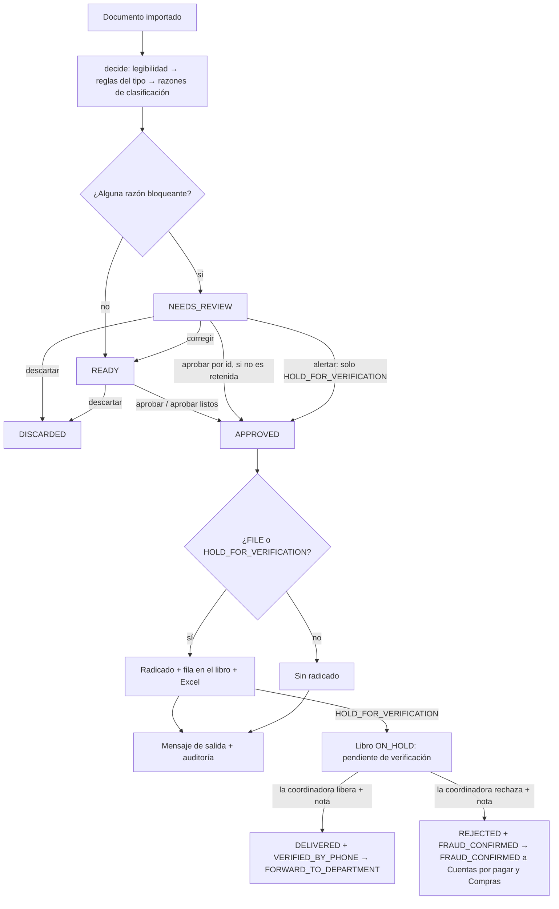

# Radicación

## Propósito

Es el corazón de Docket: aplica las reglas de la auxiliar a cada documento clasificado, **propone** dependencia, acción y fecha de vencimiento con sus razones, y le permite a la auxiliar **corregir, descartar o aprobar** cada propuesta. Solo al aprobar el documento recibe su radicado `TAC-2026-ER-#####`, su fila en el libro y el correo (simulado) a la dependencia. Nada se reenvía sin que una persona lo apruebe. Una factura retenida por posible fraude ya no se queda en "Retenida": la coordinadora **la verifica por teléfono y la libera o la rechaza** (ver [verificaciones](verifications.md)).

## Quién lo usa

- **Auxiliar de radicación (CLERK, Martha)**: revisa la bandeja, corrige propuestas, descarta, aprueba uno por uno o aprueba de una vez todo lo que está `READY`. Solo CLERK puede modificar la bandeja.
- **Coordinadora (COORDINATOR, Dra. Herrera)**: consulta la bandeja, el detalle de cada documento (con su auditoría) y la bandeja de salida; recibe las alertas de fraude (`FRAUD_ALERT`) de las facturas retenidas para verificar por teléfono y, después de llamar al proveedor, **libera o rechaza** cada factura retenida (`POST /api/verifications/{id}/release|reject`, solo COORDINATOR).
- **Asistente de IA vía MCP**: solo lectura — herramientas `pending_review`, `inbox_summary` y `held_invoices` (ver [mcp](mcp.md)).

## Cómo funciona

1. **Proponer** (durante la importación). `ProposeFiling` (`api/app/features/filing/application/propose_filing.py`) resuelve todas las consultas — proveedor por NIT y por dominio del remitente, misma factura ya en el libro, misma factura pendiente en la bandeja, cuenta bancaria o cambio de cuenta anunciado en el cuerpo del correo — y le pasa los hechos a la función pura `decide()` de `filing/domain/rules.py`.
2. `decide()` revisa primero si el documento se pudo leer (`DOCUMENT_UNREADABLE`, `LOW_OCR_CONFIDENCE`), después aplica las reglas del tipo de documento y por último antepone las razones de clasificación. Cada regla deja una `Reason` (`code`, `params`, `blocking`). Si alguna razón es bloqueante, el ítem queda `NEEDS_REVIEW`; si no, `READY`. La `confidence` sale del margen de clasificación y se reduce a la mitad cuando requiere revisión.
3. **Corregir** (`POST /api/inbox/{id}/correct`). La auxiliar puede cambiar `document_type`, `department`, `action`, `due_date` (o `clear_due_date`), `urgent` y `notes`. La propuesta original se conserva intacta; las razones bloqueantes pasan a no bloqueantes (quedan para trazabilidad) y se agrega `REVIEWED_BY_HUMAN` con los campos cambiados. El ítem queda `READY`.
4. **Descartar** (`POST /api/inbox/{id}/discard`, con un `reason`). El ítem queda `DISCARDED`; no consume radicado.
5. **Aprobar** (`POST /api/inbox/approve` con los ids, o `POST /api/inbox/approve-ready`). Bajo un bloqueo del proceso, los ítems se ordenan por hora de recibido y posición del adjunto; cada uno radicable (`FILE`) recibe `last_sequence + 1`, se agrega la fila al libro, el ítem queda `APPROVED`, se arman los mensajes de salida y se audita `DOCUMENT_APPROVED`. Dentro del bloqueo se sincroniza el Excel compartido **antes** de numerar (se importan las filas escritas a mano, así el consecutivo continúa después de ellas) y otra vez después de agregar (ver [libro](ledger.md#sincronización-en-ambos-sentidos-con-el-excel-compartido)). **Un posible fraude nunca se aprueba**: `ApproveDocuments` rechaza un ítem con acción `HOLD_FOR_VERIFICATION` (`HoldRequiresEscalationError` → `409 HOLD_REQUIRES_ESCALATION`), y `approve-ready` se salta las facturas retenidas aunque una corrección las haya dejado `READY`. (`escalate_holds=True` existe solo para la CLI y la prueba dorada, que procesan todo el buzón en orden de llegada.)
6. **Alertar sobre una factura retenida** (`POST /api/inbox/{id}/escalate`, CLERK). `EscalateHold` (`filing/application/approve_documents.py`) verifica que el ítem esté retenido (`NotAHoldError` → `409 NOT_A_HOLD`) y usa el mismo camino de numeración: la factura recibe radicado para que quede trazabilidad, la fila del libro queda `ON_HOLD` ("Retenida"), el `FRAUD_ALERT` va a la coordinadora y nada va a Cuentas por pagar. El evento de auditoría es `HOLD_ESCALATED` (no `DOCUMENT_APPROVED`). La factura queda *pendiente de verificación* (`InboxItem.is_awaiting_verification`: `APPROVED`, acción `HOLD_FOR_VERIFICATION`, sin `hold_resolution`).
7. **Verificar una factura retenida** (`POST /api/verifications/{id}/release` o `/reject`, COORDINATOR). `VerifyHold` (`filing/application/verify_hold.py`) exige una nota de mínimo `MIN_NOTE_LENGTH` = 5 caracteres (con quién habló y a qué número) y que la fila del libro siga en `ON_HOLD`; si no, `HoldNotPendingError`. **Liberar**: la fila pasa a `DELIVERED` hacia `release_department()` — la dependencia que habría dado la regla de orden de compra de Martha (`ACCOUNTS_PAYABLE` con orden de compra, `PROCUREMENT` sin ella) — con la marca `VERIFIED_BY_PHONE`, y se arma un mensaje `FORWARD_TO_DEPARTMENT`. **Rechazar**: la fila pasa a `REJECTED` con la marca `FRAUD_CONFIRMED`, y mensajes `FRAUD_CONFIRMED` avisan a Cuentas por pagar y a Compras que no se pague. En ambos casos se quita la marca `HOLD_FOR_VERIFICATION`, se guarda una `HoldResolution` (`outcome` `RELEASED`/`REJECTED`, `note`, `actor`, `at`) en el `InboxItem`, se sincroniza el Excel compartido (`SyncLedger`) y se audita `HOLD_RELEASED` / `HOLD_REJECTED`. `ListHeldInvoices` (`filing/application/queries.py`) lista todas las facturas retenidas no descartadas, por hora de llegada, con su estado de verificación: `PENDING_CLERK_APPROVAL` (aún en la bandeja de la auxiliar), `AWAITING_VERIFICATION`, `RELEASED`, `REJECTED`.



### Decisiones por tipo de documento

| Tipo | Regla | Dependencia | Acción |
|---|---|---|---|
| `INVOICE` | Proveedor no está en el maestro | `PROCUREMENT` | `FILE` |
| `INVOICE` | Cuenta ≠ maestro, cuenta del cuerpo ≠ maestro, anuncia cambio de cuenta, o dominio del remitente ≠ maestro | `ADMIN_COORDINATION` | `HOLD_FOR_VERIFICATION` |
| `INVOICE` | Mismo proveedor + número ya en el libro | `SENDER` | `REPLY_WITH_EXISTING_NUMBER` (sin radicado nuevo) |
| `INVOICE` | Registrado, con orden de compra | `ACCOUNTS_PAYABLE` | `FILE` |
| `INVOICE` | Registrado, sin orden de compra | `PROCUREMENT` | `FILE` |
| `TRAVEL_EXPENSE_REQUEST` | Sin formato TH-F-012 o sin aprobación/firma del jefe | `SENDER` | `RETURN_TO_SENDER` |
| `TRAVEL_EXPENSE_REQUEST` | Completa; menos de 5 días hábiles de anticipación → `late=true` | `HUMAN_RESOURCES` | `FILE` |
| `PETITION` | 15 / 10 (solo copias) / 30 (consulta) días hábiles | `LEGAL` | `FILE` |
| `OVERSIGHT_NOTICE` | Siempre urgente; plazo del oficio | `LEGAL` | `FILE` |
| `COMPLAINT` | 15 días hábiles | `CUSTOMER_SERVICE` | `FILE` |
| `QUOTATION` | — | `PROCUREMENT` | `FILE` |
| `ADVERTISING` | No se radica | `NONE` | `DO_NOT_FILE` |
| `OTHER` / ilegible | Necesita una persona | `NONE` | `FILE` (bloqueado hasta corregir) |

La verificación de fraude va **antes** que la de duplicado: una factura sospechosa se retiene aunque parezca un reenvío.

### Bandeja de salida (correos simulados)

Docket nunca envía correos. Al aprobar, `compose()` (`filing/domain/outbox_composer.py`) guarda mensajes en español, que se consultan con `GET /api/outbox`:

| Tipo | Cuándo | Para |
|---|---|---|
| `FORWARD_TO_DEPARTMENT` | `FILE` a una dependencia de `dependencias.csv`; asunto con `[radicado]`, antecedido de `URGENTE - ` si es urgente, vencimiento en el cuerpo | correo de la dependencia |
| `FRAUD_ALERT` | `HOLD_FOR_VERIFICATION`: "Verificar por teléfono antes de pagar" | `coordinacion.administrativa@terminalesandinas.example` |
| `REPLY_EXISTING_NUMBER` | `REPLY_WITH_EXISTING_NUMBER`: le informa al proveedor el radicado que ya tiene | remitente |
| `RETURN_TO_SENDER` | `RETURN_TO_SENDER`: debe usar el TH-F-012 firmado por el jefe, cinco días hábiles antes | remitente |

Cuando la coordinadora resuelve una factura retenida, `compose_hold_released()` / `compose_hold_rejected()` agregan:

| Tipo | Cuándo | Para |
|---|---|---|
| `FORWARD_TO_DEPARTMENT` | Liberada después de la llamada; asunto `[radicado] Factura verificada: <asunto del correo>`, cuerpo con la nota de verificación y "pague únicamente a la cuenta registrada en el maestro de proveedores" | correo de la dependencia de `release_department()` |
| `FRAUD_CONFIRMED` | Rechazada (fraude confirmado); asunto `NO PAGAR [radicado] intento de fraude confirmado`, cuerpo con el remitente y la nota | Cuentas por pagar y Compras (un mensaje a cada una) |

### Radicados del buzón de muestra

El libro histórico termina en `TAC-2026-ER-04817`. Al aprobar todo el buzón de muestra tal como se propone, se asignan del `04818` al `04831` en orden de llegada (tabla golden `api/tests/golden/esperado-completo.csv`): `01.eml` → 04818, `10.eml` → 04819, `02.eml` → 04820, `03.eml` → 04821 … `14.eml` → 04831. La publicidad (`15.eml`), la factura repetida (`06.eml`, ya radicada como `TAC-2026-ER-04790`) y la solicitud devuelta (`08.eml`) no reciben radicado.

Esa secuencia supone que `03.eml` (factura escaneada) se resuelve antes de aprobar: con Tesseract se lee por OCR; sin él, queda `NEEDS_REVIEW` (`DOCUMENT_UNREADABLE`) y la auxiliar tiene que corregirla primero. Si se aprueba después, simplemente toma el siguiente número libre: los radicados nunca se reutilizan ni se reordenan.

## Reglas de negocio

| Regla | Fuente en la entrevista | Código |
|---|---|---|
| El proveedor debe estar en el maestro; si no, la factura va a Compras para que lo vinculen | *"Si no está creado, la factura va a Compras para que lo vinculen; yo no la puedo mandar a pago."* | `_decide_invoice` → `SUPPLIER_NOT_REGISTERED` |
| Con OC → Cuentas por pagar; sin OC → Compras | *"Con OC va a Cuentas por pagar. Sin OC va a Compras"* | `INVOICE_WITH_PURCHASE_ORDER` / `INVOICE_WITHOUT_PURCHASE_ORDER` |
| Una factura repetida no se radica otra vez; se responde con el radicado existente | *"Si ya está, no la radico otra vez: le contesto al proveedor con el radicado que ya tiene."* | `INVOICE_DUPLICATE`, `INVOICE_DUPLICATE_IN_INBOX` |
| Cuenta distinta al maestro o remitente raro → se retiene para que la Dra. Claudia verifique por teléfono | *"si la cuenta de la factura no es la que está en el maestro, o el correo llega de una dirección rara, no la mando a ningún lado: se la paso a la doctora Claudia"* | `INVOICE_ACCOUNT_MISMATCH`, `EMAIL_ACCOUNT_MISMATCH`, `ACCOUNT_CHANGE_ANNOUNCED`, `SENDER_DOMAIN_MISMATCH` → `HOLD_FOR_VERIFICATION` |
| Solo la coordinadora cierra una factura retenida, después de llamar al proveedor: la liberada sigue hacia donde habría ido y el fraude confirmado nunca se paga; la llamada queda en una nota | *"se la paso a la doctora Claudia para que verifiquen por teléfono con el proveedor"* | `VerifyHold`, `release_department()`, `MIN_NOTE_LENGTH`, `require_coordinator` |
| Viáticos sin aprobación del jefe o por fuera del formato se devuelven | *"Si no tiene la aprobación del jefe, se lo devuelvo; no lo radico."* / *"Se lo devuelvo para que lo mande en el formato con la firma."* | `TRAVEL_REQUEST_NOT_APPROVED`, `TRAVEL_REQUEST_WITHOUT_FORM` |
| Viáticos tardíos (menos de 5 días hábiles) se radican igual, marcados "extemporánea" | *"Si llega tarde igual lo paso a Talento humano, pero en observaciones le pongo 'extemporánea'"* | `TRAVEL_REQUEST_LATE` (nota "Extemporánea" en el libro) |
| Plazos de petición: 15 en general, 10 solo copias, 30 consulta; copias + otras cosas = 15; desde el día hábil siguiente, sin fines de semana ni festivos | *"quince días hábiles en general; si solo piden copias o documentos, diez; si es una consulta … treinta. Si piden copias y además otras cosas, le pongo quince"* | `petition_scope`, `BusinessCalendar.add_business_days` |
| Los oficios van a Jurídica, urgentes, con el plazo del oficio | *"Esos van a Jurídica marcados como urgentes, y el plazo es el que diga el oficio, no el de la ley."* | `_decide_oversight_notice` |
| Amenaza de tutela → urgente | *"si el ciudadano dice que va a poner una tutela: urgente"* | `TUTELA_THREAT` |
| Quejas → Atención al usuario, 15 días hábiles | *"Las quejas … van a Atención al usuario, con quince días hábiles."* | `_decide_complaint` |
| Cotizaciones → Compras; la publicidad no se radica | *"Cotizaciones, que van a Compras. Y la publicidad, que esa ni la radico."* | `QUOTATION_TO_PROCUREMENT`, `ADVERTISING_NOT_FILED` |
| Nada se envía solo; ella debe ver qué se hizo y por qué | *"No quiero que algo mande las cosas solo y yo no me entere"* | aprobación obligatoria; razones + evidencia; salida simulada |

Los festivos cuentan: el 16 de noviembre y el 8 de diciembre de 2026 son festivos en Colombia, así que la petición recibida el 10-nov vence el **2026-12-02**, la de solo copias (12.eml) el **2026-11-27** y la queja recibida el 17-nov el **2026-12-09** (`HOLIDAY_IN_TERM`).

## Endpoints / pantallas

Sobre `{"code": ..., "data": ...}`; errores `{"code": ..., "detail": {...}}`.

| Método | Ruta | Rol | Solicitud | `code` de éxito | Errores |
|---|---|---|---|---|---|
| GET | `/api/inbox?status=` | cualquiera | `status` opcional (`READY`, `NEEDS_REVIEW`, `APPROVED`, `DISCARDED`) | `INBOX_LISTED` | `422 VALIDATION_ERROR` |
| GET | `/api/inbox/summary` | cualquiera | — | `INBOX_SUMMARY` (`{"READY": n, "NEEDS_REVIEW": n, "APPROVED": n, "DISCARDED": n}`) | |
| GET | `/api/inbox/{id}` | cualquiera | — | `DOCUMENT_FOUND` (ítem + `document.text`, `document.email_body` (4.000 caracteres), `proposal_decision`, `audit`) | `404 DOCUMENT_NOT_FOUND` |
| GET | `/api/inbox/{id}/source` | cualquiera | — | archivo original (PDF o `message/rfc822`), sin sobre | `404 SOURCE_FILE_NOT_FOUND` |
| POST | `/api/inbox/{id}/correct` | CLERK | `Correction`: `document_type`, `department`, `action`, `due_date`, `clear_due_date`, `urgent`, `notes` (todos opcionales) | `DOCUMENT_CORRECTED` | `404 DOCUMENT_NOT_FOUND`, `409 DOCUMENT_ALREADY_CLOSED`, `422 VALIDATION_ERROR` |
| POST | `/api/inbox/{id}/discard` | CLERK | `{"reason": "..."}` | `DOCUMENT_DISCARDED` | `404 DOCUMENT_NOT_FOUND`, `409 DOCUMENT_ALREADY_CLOSED` |
| POST | `/api/inbox/approve` | CLERK | `{"ids": ["01.eml__0", ...]}` (puede incluir ítems `NEEDS_REVIEW`, nunca facturas retenidas) | `DOCUMENTS_APPROVED` | `404 DOCUMENT_NOT_FOUND`, `409 DECISION_INCOMPLETE`, `409 HOLD_REQUIRES_ESCALATION` |
| POST | `/api/inbox/approve-ready` | CLERK | — (todos los `READY` menos las facturas retenidas) | `DOCUMENTS_APPROVED` | `409 DOCUMENT_NEEDS_REVIEW`, `409 DECISION_INCOMPLETE` |
| POST | `/api/inbox/{id}/escalate` | CLERK | — | `HOLD_ESCALATED` (vista del ítem, con `filing_number`) | `404 DOCUMENT_NOT_FOUND`, `409 NOT_A_HOLD`, `409 DECISION_INCOMPLETE` |
| GET | `/api/outbox` | cualquiera | — | `OUTBOX_LISTED` (`kind`, `document_id`, `to_address`, `subject`, `body`) | |
| GET | `/api/verifications` | cualquiera | — | `VERIFICATIONS_LISTED` (facturas retenidas: vista del ítem + `verification_state`, `release_department`, `hold_resolution`, `master_supplier`) | |
| POST | `/api/verifications/{id}/release` | COORDINATOR | `{"note": "..."}` (≥ 5 caracteres) | `HOLD_RELEASED` | `403 FORBIDDEN`, `404 DOCUMENT_NOT_FOUND`, `409 HOLD_NOT_PENDING`, `422 VERIFICATION_NOTE_REQUIRED` |
| POST | `/api/verifications/{id}/reject` | COORDINATOR | `{"note": "..."}` (≥ 5 caracteres) | `HOLD_REJECTED` | `403 FORBIDDEN`, `404 DOCUMENT_NOT_FOUND`, `409 HOLD_NOT_PENDING`, `422 VERIFICATION_NOTE_REQUIRED` |

Campos del ítem de bandeja: `id`, `status`, `filing_number`, `received_at`, `needs_review`, `was_corrected`, `notes`, `document` (`email_file`, `position`, `name`, `sender`, `sender_name`, `email_subject`, `extraction_method`, `ocr_confidence`), `data` (datos extraídos), `decision` (`document_type`, `department`, `action`, `due_date`, `urgent`, `late`, `reasons[]`, `evidence[]`, `confidence`, `existing_filing_number`).

Campos adicionales de la vista de verificación (`filing/api/verifications_router.py`): `verification_state`, `release_department`, `hold_resolution` (`outcome`, `note`, `actor`, `at`, o `null`), `master_supplier` (la fila del maestro para el NIT de la factura — `nit`, `name`, `billing_email`, `bank`, `account_type`, `account_number`, `status`, `category`, `is_active` — o `null`). La pantalla se documenta en [verificaciones](verifications.md).

Errores comunes: `401 UNAUTHORIZED` (token ausente o desconocido), `403 FORBIDDEN` (`detail.required_role: "CLERK"`, o `"COORDINATOR"` en las acciones de verificación).

## Códigos

### Códigos de razón (`decision.reasons[].code`)

| Código | Meaning (EN) | Significado (ES) | ¿Bloquea? |
|---|---|---|---|
| `DOCUMENT_UNREADABLE` | No text could be read (OCR unavailable, unsupported format or empty) | No se pudo leer el texto (sin OCR, formato no soportado o vacío) | Sí |
| `LOW_OCR_CONFIDENCE` | OCR confidence below `TAC_MIN_OCR_CONFIDENCE` (70) | La confianza del OCR está por debajo del mínimo (70) | Sí |
| `UNKNOWN_DOCUMENT_TYPE` | The document type could not be identified | No se pudo identificar el tipo de documento | Sí |
| `AMBIGUOUS_CLASSIFICATION` | Two document types are too close | Dos tipos de documento quedaron muy parejos | Sí |
| `CLASSIFIED_BY_ASSISTANT` | Type suggested by the AI assistant; must be confirmed | Tipo sugerido por el asistente de IA; debe confirmarse | Sí |
| `INVOICE_MISSING_FIELDS` | NIT, invoice number or total could not be found | No se encontró el NIT, el número o el total de la factura | Sí |
| `INVOICE_TOTALS_MISMATCH` | Subtotal + VAT does not equal the total | Subtotal + IVA no coincide con el total | Sí |
| `SUPPLIER_NOT_REGISTERED` | Supplier NIT not in the supplier master; Procurement must link it | El NIT no está en el maestro de proveedores; Compras debe vincularlo | No |
| `NIT_CHECK_DIGIT_INVALID` | The NIT check digit is wrong (possible typo) | El dígito de verificación del NIT no es válido (posible error de digitación) | No |
| `SUPPLIER_INACTIVE` | Supplier is inactive in the master | El proveedor está inactivo en el maestro | Sí |
| `INVOICE_ACCOUNT_MISMATCH` | The invoice's bank account differs from the supplier master | La cuenta de la factura no coincide con la del maestro de proveedores | Sí |
| `EMAIL_ACCOUNT_MISMATCH` | The e-mail body announces an account different from the master | El cuerpo del correo menciona una cuenta distinta a la del maestro | Sí |
| `ACCOUNT_CHANGE_ANNOUNCED` | The e-mail announces a bank account change | El correo anuncia un cambio de cuenta bancaria | Sí |
| `SENDER_DOMAIN_MISMATCH` | Sender's e-mail domain differs from the master's billing e-mail | El dominio del remitente no coincide con el correo de facturación del maestro | Sí |
| `INVOICE_DUPLICATE_IN_INBOX` | The same invoice is already waiting in the inbox | La misma factura ya está pendiente en la bandeja | Sí |
| `INVOICE_DUPLICATE` | Same supplier + number already filed (`params.filing_number`) | La factura ya está radicada (`params.filing_number`) | No |
| `INVOICE_WITH_PURCHASE_ORDER` | Has a purchase order → Accounts payable | Trae orden de compra → Cuentas por pagar | No |
| `INVOICE_WITHOUT_PURCHASE_ORDER` | No purchase order → Procurement must endorse | Sin orden de compra → Compras debe avalar | No |
| `TRAVEL_REQUEST_WITHOUT_FORM` | Not sent on form TH-F-012 | No viene en el formato TH-F-012 | No (se devuelve) |
| `TRAVEL_REQUEST_NOT_APPROVED` | Missing the boss's approval/signature | Falta la aprobación o la firma del jefe | No (se devuelve) |
| `TRAVEL_REQUEST_MISSING_DEPARTURE` | Departure date not found | No se encontró la fecha de salida | Sí |
| `TRAVEL_REQUEST_DEPARTURE_PASSED` | Departure date is on or before reception | La fecha de salida ya pasó o es el mismo día de recibido | Sí |
| `TRAVEL_REQUEST_LATE` | Less than 5 business days' notice | Menos de 5 días hábiles de anticipación (extemporánea) | No |
| `TRAVEL_REQUEST_COMPLETE` | Complete and on time | Completa y a tiempo | No |
| `PETITION_GENERAL` | General petition: 15 business days | Petición general: 15 días hábiles | No |
| `PETITION_COPIES_ONLY` | Only asks for copies/documents: 10 business days | Solo pide copias o documentos: 10 días hábiles | No |
| `PETITION_CONSULTATION` | Consultation: 30 business days | Consulta (pide un concepto): 30 días hábiles | No |
| `PETITION_IMPLICIT` | Petition without the words "derecho de petición" | Petición sin las palabras "derecho de petición" | No |
| `TUTELA_THREAT` | Mentions a tutela → urgent | Menciona tutela → urgente | No |
| `HOLIDAY_IN_TERM` | A public holiday falls inside the term (`params.holidays`) | Hay un festivo dentro del plazo (`params.holidays`) | No |
| `OVERSIGHT_BODY_URGENT` | Control body or court → urgent, Legal | Ente de control o juzgado → urgente, Jurídica | No |
| `TERM_FROM_NOTICE` | Term taken from the notice (`days`, `kind`) | Plazo tomado del oficio (`days`, `kind`) | No |
| `OVERSIGHT_TERM_AMBIGUOUS` | Days found but not whether business or calendar | Se encontraron los días pero no si son hábiles o calendario | Sí |
| `OVERSIGHT_TERM_NOT_FOUND` | No term found in the notice | No se encontró plazo en el oficio | Sí |
| `COMPLAINT_TERMINAL_USER` | Terminal user complaint: 15 business days | Queja de usuario del terminal: 15 días hábiles | No |
| `QUOTATION_TO_PROCUREMENT` | Quotation → Procurement | Cotización → Compras | No |
| `ADVERTISING_NOT_FILED` | Advertising is not filed | La publicidad no se radica | No |
| `REVIEWED_BY_HUMAN` | A person corrected the proposal (`params.fields`) | Una persona corrigió la propuesta (`params.fields`) | No |

### Códigos de estado, dependencia y acción

| Código | Meaning (EN) | Significado (ES) |
|---|---|---|
| `READY` | Proposal is safe; the clerk only confirms | La propuesta es segura; la auxiliar solo confirma |
| `NEEDS_REVIEW` | The system is not sure; a person decides | El sistema no está seguro; decide una persona |
| `APPROVED` | Approved by the clerk | Aprobado por la auxiliar |
| `DISCARDED` | Discarded by the clerk | Descartado por la auxiliar |
| `ACCOUNTS_PAYABLE` / `PROCUREMENT` / `HUMAN_RESOURCES` / `LEGAL` / `CUSTOMER_SERVICE` | Accounts payable / Procurement / Human resources / Legal / Customer service | Cuentas por pagar / Compras / Talento humano / Jurídica / Atención al usuario |
| `ADMIN_COORDINATION` | Administrative coordination (fraud verification) | Coordinación administrativa (verificación de fraude) |
| `SENDER` / `NONE` | Back to the sender / not filed | Devolver al remitente / no se radica |
| `FILE` / `RETURN_TO_SENDER` / `DO_NOT_FILE` / `REPLY_WITH_EXISTING_NUMBER` / `HOLD_FOR_VERIFICATION` | File / return / do not file / reply with existing number / hold for verification | Radicar / devolver / no radicar / responder con el radicado existente / retener para verificación |

### Códigos de respuesta, error y salida

| Código | Meaning (EN) | Significado (ES) |
|---|---|---|
| `INBOX_LISTED`, `INBOX_SUMMARY`, `DOCUMENT_FOUND`, `DOCUMENT_CORRECTED`, `DOCUMENT_DISCARDED`, `DOCUMENTS_APPROVED`, `OUTBOX_LISTED` | Success responses | Respuestas exitosas |
| `VERIFICATIONS_LISTED` | Held invoices listed with their verification state | Facturas retenidas listadas con su estado de verificación |
| `HOLD_RELEASED` | The coordinator verified the invoice by phone and released it | La coordinadora verificó la factura por teléfono y la liberó |
| `HOLD_REJECTED` | The coordinator confirmed the fraud attempt; the invoice is not paid | La coordinadora confirmó el intento de fraude; la factura no se paga |
| `HOLD_NOT_PENDING` | Not an approved held invoice waiting for verification (already resolved, or not filed yet) | No es una factura retenida y radicada pendiente de verificar (ya se resolvió o aún no se radica) |
| `VERIFICATION_NOTE_REQUIRED` | The verification note is missing or shorter than 5 characters | Falta la nota de verificación o tiene menos de 5 caracteres |
| `FORBIDDEN` | The role cannot perform this action (e.g. the clerk releasing a held invoice) | El rol no puede hacer esta acción (p. ej. la auxiliar liberando una factura retenida) |
| `PENDING_CLERK_APPROVAL`, `AWAITING_VERIFICATION`, `RELEASED`, `REJECTED` | Verification states: still in the clerk's inbox / waiting for the coordinator's call / released / fraud confirmed | Estados de verificación: aún en la bandeja de radicación / espera la llamada de la coordinadora / liberada / fraude confirmado |
| `DOCUMENT_NOT_FOUND` | Unknown document id | El documento no existe |
| `SOURCE_FILE_NOT_FOUND` | Original file not stored | No se encontró el archivo original |
| `DOCUMENT_ALREADY_CLOSED` | Already approved (or discarded, for corrections) | Ya fue aprobado (o descartado, en el caso de correcciones) |
| `DECISION_INCOMPLETE` | Fileable but without a real department: correct it first | Se radicaría sin dependencia real (p. ej. ilegible): corríjalo primero |
| `HOLD_ESCALATED` | The clerk alerted the coordinator about a suspected fraud: filed `ON_HOLD`, `FRAUD_ALERT` sent, nothing to payment (also the audit event) | La auxiliar alertó a la coordinadora de un posible fraude: radicada `ON_HOLD`, `FRAUD_ALERT` enviado, nada a pago (también es el evento de auditoría) |
| `HOLD_REQUIRES_ESCALATION` | A suspected fraud cannot be approved; use escalate (HTTP 409) | Una factura con posible fraude no se aprueba; se alerta a la coordinadora (HTTP 409) |
| `NOT_A_HOLD` | Escalate was called on a document that is not held (HTTP 409) | Se pidió alertar sobre un documento que no está retenido (HTTP 409) |
| `DOCUMENT_NEEDS_REVIEW` | Batch approval reached a document that needs review | La aprobación en lote encontró un documento que requiere revisión |
| `FORWARD_TO_DEPARTMENT`, `FRAUD_ALERT`, `REPLY_EXISTING_NUMBER`, `RETURN_TO_SENDER`, `FRAUD_CONFIRMED` | Outbox message kinds | Tipos de mensaje de la bandeja de salida |

## Limitaciones

- Roles, no personas: el actor en la auditoría es `CLERK` / `COORDINATOR` (tokens de demostración compartidos `TAC_CLERK_TOKEN`, `TAC_COORDINATOR_TOKEN`); falta el inicio de sesión corporativo (SSO).
- El bloqueo del consecutivo es un `threading.Lock` del proceso; con varios workers de la API, la restricción de unicidad del libro es la única protección (una colisión haría fallar la solicitud, nunca reutilizaría un número).
- No existe la anulación de un documento aprobado; una aprobación equivocada no se puede deshacer por la API.
- Un documento descartado se puede volver a descartar (solo se rechaza `APPROVED`).
- Los mensajes de salida solo quedan en la base de datos; no se exportan como `.eml` y nada se envía de verdad.
- La evidencia se limita a unos pocos campos; la vista previa del texto se corta en 4.000 caracteres.
- La resolución de una factura retenida es definitiva: no hay endpoint para reabrir una factura liberada o rechazada.

## Cómo se prueba

- `api/tests/features/filing/test_rules.py`: todas las reglas de arriba (enrutamiento a Cuentas por pagar / Compras, proveedor no registrado, duplicado, cuenta distinta, dominio raro, fraude antes que duplicado, proveedor inactivo, totales, campos faltantes, viáticos a tiempo / tardíos / sin aprobación / sin formato, alcance y plazos 15/10/30 de peticiones, tutela, plazo del oficio, quejas, cotización/publicidad, ilegible, OCR con baja confianza, ambiguo, desconocido).
- `api/tests/features/filing/test_approve_and_correct.py`: importación idempotente, radicados al aprobar en orden de llegada, aprobación en lote solo de `READY`, `DOCUMENT_NEEDS_REVIEW`, un ilegible no se radica sin dependencia, la corrección conserva la propuesta y queda auditada, lo aprobado no se corrige, mensajes de salida, duplicado dentro del mismo lote.
- `api/tests/features/filing/test_verify_hold.py`: `test_held_invoice_waits_for_the_coordinator`, `test_before_martha_approves_it_is_still_with_the_clerk`, `test_release_sends_it_where_the_rules_would_have`, `test_reject_marks_fraud_and_warns_payables_and_procurement`, `test_cannot_resolve_twice_or_without_a_note`, `test_resolution_is_audited_and_the_excel_row_is_updated`.
- `api/tests/api/test_api.py`: flujo por HTTP, roles (`FORBIDDEN`), `DOCUMENT_NOT_FOUND`, `VALIDATION_ERROR`, archivo original; `test_only_the_coordinator_resolves_held_invoices`; `test_approve_rejects_holds_and_escalate_alerts_the_coordinator`.
- `api/tests/features/filing/test_approve_and_correct.py::test_a_suspected_fraud_is_never_approved_only_escalated` y `::test_batch_approval_skips_holds_even_when_corrected_to_ready`.
- Golden: `api/tests/golden/test_golden.py` — `test_matches_the_clients_expected_results` (`esperado-parcial.csv` del cliente), `test_matches_the_full_expected_table` (`esperado-completo.csv`), `test_filing_numbers_continue_the_ledger` (04818..04831). Debe mantenerse en 100 %.

```bash
./scripts/harness-verify.sh api/tests/features/filing/test_rules.py api/tests/features/filing/test_approve_and_correct.py api/tests/golden/test_golden.py
./scripts/harness-verify.sh api/tests/features/filing/test_verify_hold.py api/tests/api/test_api.py
```

## Historial de cambios

- 2026-11-24: verificación de facturas retenidas por la coordinadora — `VerifyHold`, `ListHeldInvoices`, endpoints y códigos de `/api/verifications`, tipo de salida `FRAUD_CONFIRMED`, marcas del libro `VERIFIED_BY_PHONE` / `FRAUD_CONFIRMED`; `approve-ready` ahora responde `DECISION_INCOMPLETE` (se retira esa limitación).
- 2026-11-24: un posible fraude nunca se aprueba — `EscalateHold` y `POST /api/inbox/{id}/escalate` (`HOLD_ESCALATED`); aprobar una retenida responde `409 HOLD_REQUIRES_ESCALATION`, y `NOT_A_HOLD` si no está retenida; `approve-ready` se salta las retenidas aunque se hayan corregido a `READY`. El efecto no cambia: radicado, libro `ON_HOLD`, `FRAUD_ALERT`, nada a Cuentas por pagar.
