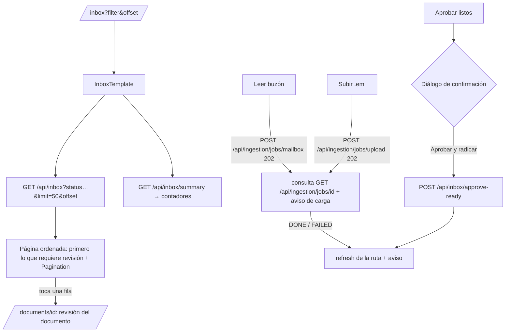

# Bandeja (pantalla)

## Propósito

Es la cola de trabajo de la auxiliar. `/inbox` muestra todos los documentos que Docket leyó del buzón de radicación con la propuesta del sistema (qué es, para dónde va, cuándo vence) y pone de primeras lo que necesita a una persona. Desde aquí la auxiliar trae el correo nuevo (lee la carpeta del buzón o sube archivos `.eml`) y aprueba de una sola vez todo lo que el sistema tiene claro. Es la cara en pantalla de los módulos de [radicación](filing.md) e [ingesta](ingestion.md).

## Quién lo usa

- **Auxiliar de radicación (CLERK, Martha)**: importa el correo, filtra la cola, abre cada documento para revisarlo y aprueba en lote todo lo que está `READY`.
- **Coordinadora (COORDINATOR, Dra. Herrera)**: ve la misma lista, los contadores y los filtros, y puede abrir cualquier documento, pero a ella no se le muestra la barra de acciones (**Leer buzón**, **Subir .eml**, **Aprobar listos**). En su lugar ve una nota de supervisión: "Vista de supervisión: puede revisar cada propuesta, pero radicar, corregir y aprobar le corresponde a Radicación." No puede importar, aprobar ni descartar; de todas formas la API le respondería `FORBIDDEN`. "Bandeja" es la cuarta de las cinco opciones de su menú (ver [sesión](session.md)); su propio trabajo con las facturas retenidas se hace en [verificaciones](verifications.md).

## Cómo funciona

1. `app/(app)/inbox/page.tsx` pinta `InboxTemplate` (un Server Component) dentro de `<Suspense>`, con `InboxSkeleton` mientras carga.
2. El filtro y la página vienen en la URL (`?filter=review|ready|approved|all&offset=N`; un filtro desconocido equivale a `pending` y un offset inválido, a 0). `FILTER_STATUSES` (`model/types.ts`) convierte el filtro en los estados que se envían a la API: `pending` → `NEEDS_REVIEW` + `READY`, `review` → `NEEDS_REVIEW`, `ready` → `READY`, `approved` → `APPROVED` + `DISCARDED`, `all` → ninguno.
3. `InboxTemplate` hace cuatro llamadas en paralelo desde el servidor (`features/inbox/api/inbox-queries.ts`): `fetchInboxPage(filter, offset)` → `GET /api/inbox?status=…&status=…&limit=50&offset=N` (la API filtra y pagina en SQL, del más antiguo al más reciente, y devuelve `{items, total, limit, offset}`); `fetchInboxSummary()` → `GET /api/inbox/summary` (cantidad por estado de **toda** la bandeja, que `filterCounts` convierte en los contadores); `fetchHeldInInbox()` → `GET /api/verifications` (facturas retenidas aún en `PENDING_CLERK_APPROVAL`); y la sesión. Cada registro de la API pasa por `toInboxItemView` (`model/mappers.ts`): los motivos bloqueantes se traducen al español con `describeReason` y el pseudo-documento `EMAIL_BODY` se muestra como "Cuerpo del correo". `sortForWork` pone primero lo que tiene `needs_review` **dentro de la página**.
4. Las acciones de la barra son Server Actions de `api/inbox-actions.ts`. "Leer buzón" y "Subir .eml" **ponen en cola** una importación (`enqueueMailboxImportAction`, `enqueueUploadImportAction`) y luego la barra consulta `getImportJobAction` cada 700 ms (hasta 600 veces, unos 7 minutos, suficiente para un lote de fin de mes) mientras un aviso de carga dice "En cola: leyendo correos…" y después "Procesando correos y preparando propuestas…". Cuando la importación queda `DONE` o `FAILED`, `getImportJobAction` hace `refresh()` de la ruta. "Aprobar listos" llama a la API y hace `refresh()`. El resultado vuelve como `ActionResult` (`{ok, code, data}`) y se muestra en un aviso (toast).



### Pantallas y estados

- **Encabezado**: antetítulo "Radicación", título "Bandeja" y, solo para CLERK, la barra de acciones.
- **Nota de supervisión** (solo COORDINATOR): un recuadro punteado de solo lectura, con `role="note"`, debajo de los contadores, que aclara que es una vista de supervisión y que radicar, corregir y aprobar le corresponde a la auxiliar.
- **Contadores** (`StatTile`, de `GET /api/inbox/summary`, así que cuentan toda la bandeja y no solo la página): "Por revisar" (`NEEDS_REVIEW`), "Listos" (`READY`), "Retenidas" (facturas retenidas sobre las que la auxiliar aún no ha alertado, de `GET /api/verifications`) y "Cerrados" (`APPROVED` + `DISCARDED`).
- **Filtros** (`InboxFilters`, enlaces con `aria-current="page"` en el activo): Pendientes (por defecto: `READY` + `NEEDS_REVIEW`), Por revisar, Listos, Cerrados y Todos, cada uno con su cantidad (`filterCounts`). Cambiar de filtro vuelve a la primera página.
- **Paginación** (`shared/ui/molecules/Pagination.tsx`, debajo de la lista): "1–50 de 120" más los enlaces "Anterior" / "Siguiente" (`rel="prev"` / `rel="next"`) que cambian el `offset` en la URL, así una página se puede compartir o recargar; los extremos sin destino se ven atenuados con `aria-disabled`. No aparece cuando todo cabe en una página. `<nav aria-label="Páginas de la bandeja">`.
- **Fila** (`InboxRow`, un solo enlace a `/documents/{id}`): `DocumentStatusBadge`, etiquetas "Urgente" y "Extemporánea", asunto (o nombre del archivo), remitente y adjunto, el primer motivo bloqueante en español, tipo y dependencia, radicado si ya se aprobó, fecha de recibido y de vencimiento (en rojo si es urgente). Las facturas retenidas llevan borde izquierdo rojo; lo demás que requiere revisión, borde ámbar.
- **Etiqueta de estado** (`shared/ui/molecules/DocumentStatusBadge.tsx`, el único lugar donde el estado se cruza con el color): `APPROVED` → "Aprobado"; `DISCARDED` → "Descartado"; `HOLD_FOR_VERIFICATION` → "Retenida: posible fraude" (peligro); `NEEDS_REVIEW` → "Requiere revisión" (advertencia); `REPLY_WITH_EXISTING_NUMBER` → "Duplicada"; `RETURN_TO_SENDER` → "Devolver"; `DO_NOT_FILE` → "No se radica"; en otro caso "Listo" (éxito). Toda etiqueta lleva ícono y texto: el color nunca es la única señal.
- **Cargando**: `InboxSkeleton` (encabezado, cuatro contadores, seis filas) con `aria-busy="true"`.
- **Vacía**: "Nada por aquí — Lea el buzón o suba correos .eml para que el sistema prepare las propuestas."
- **Procesando**: el botón presionado muestra un indicador de carga y toda la barra queda deshabilitada mientras corre la acción.
- **Importación en curso**: un aviso de carga sigue la importación en cola ("En cola: leyendo correos…" y luego "Procesando correos y preparando propuestas…") y se reemplaza por el resultado.
- **Respuesta**: importar → "N documentos nuevos con su propuesta." (o "No hay correos nuevos en el buzón.", más cuántos ya estaban en la bandeja); subir → "N documentos importados."; aprobar en lote → "N documentos aprobados." con "N radicados nuevos en el libro."; errores → la etiqueta en español del código de la API (ver Códigos).

### En el celular y sin conexión

- Por debajo de `lg` la fila apila sus bloques; desde `lg` pasa a una cuadrícula de cuatro columnas con una flecha. La barra de filtros se desplaza horizontalmente dentro del margen de la página en lugar de partirse; la página como tal nunca se desplaza hacia los lados.
- Los contadores quedan en una cuadrícula de 2×2 en el celular y en una fila de cuatro en escritorio.
- La navegación es la barra inferior de pestañas en el celular y la barra lateral en escritorio (el marco de la aplicación se describe en [sesión](session.md)).
- **Sin conexión**: el service worker a propósito **no** guarda la bandeja (tiene datos personales y solo tiene sentido en vivo). Sin conexión, la navegación cae en la página "Sin conexión" (ver [pwa](pwa.md)).

### Accesibilidad

Las filas son enlaces de ancho completo (muy por encima de 44 px), los filtros miden 44 px (`min-h-11`) y los botones de la barra y del diálogo miden 44 px en pantallas táctiles (`h-11 md:h-10`); el filtro es un `<nav aria-label="Filtrar bandeja">` con `aria-current`, la lista tiene `aria-label="Documentos"`, los íconos son `aria-hidden` y el campo de archivo oculto tiene su propia etiqueta ("Subir correos .eml"). Las animaciones (escala al presionar, desplazamiento al pasar el cursor) se reducen a 1 ms con `prefers-reduced-motion`.

## Reglas de negocio

| Regla visible en la pantalla | Dónde está en el código |
|---|---|
| Nada sale sin la auxiliar: el encabezado lo dice y cada aprobación es un clic explícito más un diálogo de confirmación | `InboxTemplate`, `InboxToolbar` |
| La coordinadora supervisa la cola pero no la trabaja: sin barra de acciones y con una nota de supervisión de solo lectura | `InboxTemplate` (`isClerk`) |
| La aprobación en lote toma **solo** documentos `READY`; el botón muestra cuántos son y se deshabilita en 0 | `InboxToolbar` (`readyCount`), API `POST /api/inbox/approve-ready` |
| Las facturas retenidas (`HOLD_FOR_VERIFICATION`) **nunca** se aprueban, ni en lote ni una por una: `approve-ready` se las salta aunque una corrección las haya dejado `READY`, y la auxiliar alerta a la coordinadora desde el documento ("Alertar a la Dra. Herrera", ver [revisión del documento](document-review.md)) | texto del diálogo en `InboxToolbar`; `ApproveReadyDocuments`, `HOLD_REQUIRES_ESCALATION` en [radicación](filing.md) |
| Los radicados se asignan **al aprobar**, en orden de llegada; el aviso dice cuántos radicados nuevos quedaron en el libro (algunas aprobaciones, como la publicidad, no consumen número) | `approveReadyAction` cuenta los que traen `filing_number` |
| Lo que necesita a una persona va primero | `sortForWork` |
| Una sospecha de fraude se muestra como tal ("Retenida: posible fraude"), no como un simple "requiere revisión" | `documentPresentation` |
| Importar dos veces no duplica documentos; el aviso dice cuántos se omitieron | importación idempotente en la API, `skipped` en el aviso |
| Un lote de fin de mes no congela la pantalla: la importación se pone en cola y se le hace seguimiento | `InboxToolbar` (`waitForJob`), cola de [ingesta](ingestion.md) |
| Los contadores siempre describen toda la bandeja, sin importar la página abierta | `fetchInboxSummary` + `filterCounts` |

## Endpoints / pantallas

Ruta: `/inbox` (`web/src/app/(app)/inbox/page.tsx`), módulo `web/src/features/inbox/`.

Todas las llamadas se hacen en el servidor de Next.js mediante `shared/lib/api-client.ts`, que agrega `Authorization: Bearer <token>` tomado de la cookie httpOnly `docket_token`. El token nunca llega al navegador.

| Desde | Método | Ruta | Para qué |
|---|---|---|---|
| `fetchInboxPage` (Server Component) | GET | `/api/inbox?status=…&limit=50&offset=N` | una página de la lista (`{items, total, limit, offset}`) |
| `fetchInboxSummary` (Server Component) | GET | `/api/inbox/summary` | contadores (cantidad por estado) |
| `fetchHeldInInbox` (Server Component) | GET | `/api/verifications` | contador "Retenidas" |
| `enqueueMailboxImportAction` (Server Action) | POST | `/api/ingestion/jobs/mailbox` | "Leer buzón" (202, una importación) |
| `enqueueUploadImportAction` (Server Action) | POST | `/api/ingestion/jobs/upload` (multipart `files`) | "Subir .eml" (acepta `.eml` y `message/rfc822`, varios a la vez) |
| `getImportJobAction` (Server Action) | GET | `/api/ingestion/jobs/{id}` | seguir la importación en cola |
| `approveReadyAction` (Server Action) | POST | `/api/inbox/approve-ready` | "Aprobar listos" |

`GET /api/inbox` acepta `status` repetido (`?status=NEEDS_REVIEW&status=READY`), `limit` (50 por defecto, acotado entre 1 y 200) y `offset`; `INBOX_PAGE_SIZE` es 50. Los `POST /api/ingestion/mailbox` y `/upload` sincrónicos siguen existiendo para la CLI y los scripts, pero la pantalla ya no los usa.

## Códigos

Los códigos de error se muestran con `describeError` (`shared/i18n/es.ts`); un código desconocido muestra "Ocurrió un error inesperado."

| Código | Meaning (EN) | Etiqueta que se muestra | ¿Bloquea? |
|---|---|---|---|
| `MAILBOX_NOT_FOUND` | The configured mailbox folder does not exist | No se encontró la carpeta del buzón. | Sí |
| `IMPORT_FAILED` | The queued import failed (or did not finish while the screen was following it) | No se pudo procesar la importación. Intente de nuevo. | Sí |
| `IMPORT_JOB_NOT_FOUND` | The followed job does not exist | No se encontró la importación. | Sí |
| `EMAIL_TOO_LARGE` | An uploaded e-mail exceeds 25 MB | El correo supera el tamaño permitido. | Sí |
| `DOCUMENT_NEEDS_REVIEW` | Batch approval reached a document that needs review | Hay documentos que requieren revisión: apruébelos uno por uno. | Sí |
| `FORBIDDEN` | The role cannot do this | Su rol no permite esta acción. | Sí |
| `UNAUTHORIZED` | Token rejected | Su sesión expiró. Vuelva a ingresar. | Sí |
| `NETWORK_ERROR` | The Next.js server cannot reach the API | No hay conexión con el servidor. | Sí |
| `NEEDS_REVIEW` / `READY` / `APPROVED` / `DISCARDED` | Document status | Requiere revisión / Listo / Aprobado / Descartado | — |
| `IMPORT_QUEUED`, `IMPORT_JOB_FOUND`, `DOCUMENTS_APPROVED`, `INBOX_LISTED`, `INBOX_SUMMARY` | Success responses (not shown; the toast is built from the data) | — (el aviso se arma con los datos) | — |

## Limitaciones

- La bandeja no tiene búsqueda de texto.
- "Primero lo que requiere revisión" aplica dentro de la página: la API ordena por llegada, así que en una lista larga de `pending` un documento por revisar de la página 2 queda después de los listos de la página 1 (el filtro "Por revisar" los muestra todos juntos).
- La pantalla sigue una importación en cola durante unos 7 minutos; si después de eso sigue corriendo, el aviso muestra `IMPORT_FAILED` aunque la importación termine en segundo plano (al recargar se ve el resultado).
- No hay selección múltiple: el único lote es "todo lo que está `READY`".
- No se actualiza en vivo: el correo nuevo aparece solo después de importar o recargar.
- El formulario de corrección ya no deja radicar ni retener un documento sin dependencia (ver [revisión de documento](document-review.md)), pero la API como tal no lo valida: una corrección enviada directo a la API sin una dependencia real hace que `approve-ready` se detenga con `409 DECISION_INCOMPLETE` ("Falta elegir la dependencia antes de radicar."; ver [radicación](filing.md)).

## Cómo se prueba

- `web/src/features/inbox/__tests__/mappers.test.ts`: registro de la API → vista con motivos bloqueantes en español, etiqueta "Cuerpo del correo", filtros (`pending`, `approved`) y orden con lo que requiere revisión primero, filtros desconocidos → `pending`. También exporta el fixture `inboxItem()` que reutilizan otras pruebas.
- `web/src/shared/ui/__tests__/StatusBadge.test.tsx`: la factura retenida muestra "Retenida: posible fraude"; tabla estado + acción → tono; interpolación de motivos y respaldo con el código.
- `api/tests/api/test_api.py::test_inbox_and_ledger_are_paginated`: `limit` / `offset` paginan sin traslapes (17 documentos, páginas de 5), `status` repetido y `limit` acotado a 200.
- `api/tests/api/test_observability.py::test_queued_import_is_processed_by_the_worker`: la importación en cola que inicia la barra termina `DONE` con 17 documentos.
- `web/e2e/filing-flow.spec.ts` (Playwright, proyecto `desktop`, API real sobre un directorio de datos nuevo): una ruta protegida redirige al ingreso; "Leer buzón" importa 17 documentos; la fila de la factura sospechosa muestra "Retenida: posible fraude"; la aprobación en lote solo toma lo listo y la retenida sigue en "Por revisar"; la coordinadora no ve "Aprobar listos".
- `web/e2e/coordinator.spec.ts` (proyecto `coordinator`, depende de `desktop`): la auxiliar lee el buzón y alerta a la coordinadora sobre la factura retenida ("Alertar a la Dra. Herrera" → "Enviar alerta"); su menú no tiene "Por verificar".
- `web/e2e/mobile.spec.ts` (proyecto `phone`, Pixel 7): barra inferior de pestañas y sin desplazamiento horizontal.

```bash
./scripts/harness-verify.sh web/src/features/inbox/__tests__/mappers.test.ts web/src/shared/ui/__tests__/StatusBadge.test.tsx
./scripts/harness-verify.sh web/e2e/filing-flow.spec.ts web/e2e/coordinator.spec.ts
```

## Historial de cambios

- 2026-11-24: primera versión de la documentación de la pantalla.
- 2026-11-24: nota de supervisión para la coordinadora (solo lectura); filtros y botones de 44 px en pantallas táctiles; el `error.tsx` de la aplicación cubre las fallas al cargar. Se quitaron las limitaciones resueltas (áreas táctiles por debajo de 44 px, sin `error.tsx`).
- 2026-11-24: paginación — `fetchInboxPage` con `FILTER_STATUSES` (la API filtra y pagina), contadores desde `GET /api/inbox/summary` (`filterCounts`), molécula compartida `Pagination` con el offset en la URL; "Leer buzón" / "Subir .eml" ponen la importación en cola y la siguen con un aviso de carga (`getImportJobAction`). Se quitó la limitación resuelta (sin paginación, filtro sobre la lista completa).
