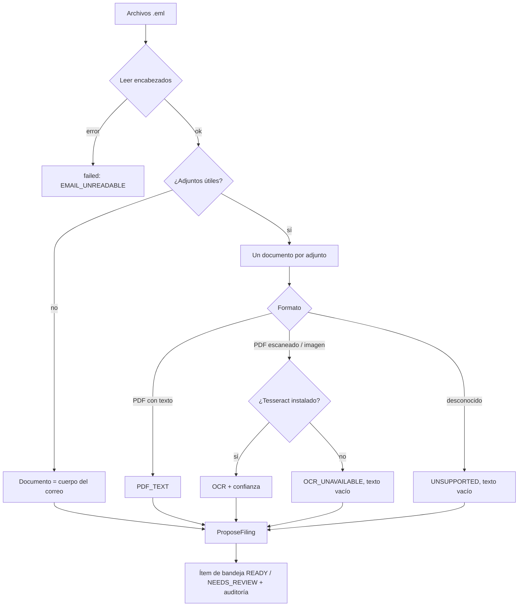
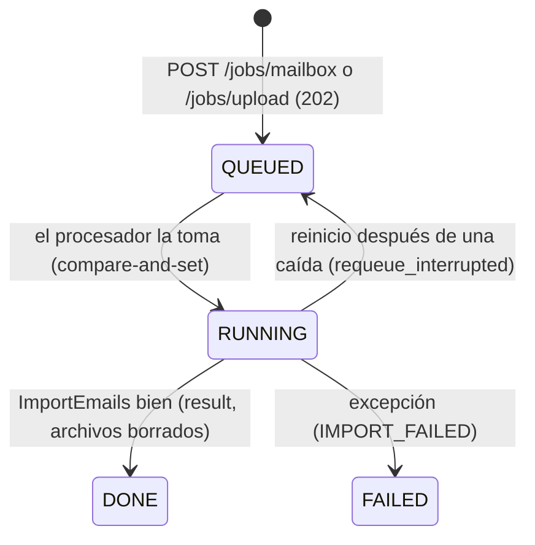

# Ingesta

## Propósito

Trae a Docket los correos del buzón de radicación de TAC y convierte cada uno en **documentos radicables**, con el texto ya extraído. Reemplaza la primera parte de la rutina de Martha: abrir cada correo, abrir cada PDF y mirar qué trae. Cada documento pasa de inmediato a [clasificación](classification.md) y a [radicación](filing.md), de modo que después de importar la auxiliar ve una propuesta por documento, nunca un correo sin procesar. Las importaciones desde la pantalla pasan por una **cola persistente** que atiende un procesador en segundo plano, así un lote de cierre de mes con cientos de correos nunca bloquea la pantalla de la auxiliar ni deja una solicitud esperando hasta vencerse.

## Quién lo usa

- **Auxiliar de radicación (CLERK, Martha)**: importa el buzón (o carga archivos `.eml`) al empezar el día. Solo el rol CLERK puede importar o poner una importación en cola. Los botones "Leer buzón" y "Subir .eml" de la [bandeja](inbox.md) ponen una importación en cola y le hacen seguimiento.
- **Coordinadora (COORDINATOR, Dra. Herrera)**: no importa; ve el resultado en la bandeja, el libro y los vencimientos. Los dos roles pueden consultar el estado de las importaciones.
- **Asistente de IA vía MCP**: sin acceso. Las herramientas MCP son de solo lectura y nunca importan.
- **CLI**: `uv run python -m app.cli process --data-dir <dir>` importa la carpeta del buzón configurada con actor `CLI` (demostraciones y verificación contra el resultado esperado).

## Cómo funciona

1. Los `.eml` llegan por la cola (`POST /api/ingestion/jobs/upload` o `POST /api/ingestion/jobs/mailbox`, ver [Cola de importación](#cola-de-importación-picos-de-fin-de-mes) más abajo; es lo que usa la pantalla) o de forma sincrónica por `POST /api/ingestion/upload` (multipart) o `POST /api/ingestion/mailbox` (lee todos los `*.eml` de `TAC_INBOX_DIR`, que hace las veces de la integración real con el buzón). Los dos caminos terminan en el mismo caso de uso `ImportEmails`.
2. `EmlReader` (`ingestion/infrastructure/eml_reader.py`) lee cada mensaje con el paquete `email` de Python: remitente, nombre, asunto, fecha (convertida a hora de Bogotá, `America/Bogota`), cuerpo en texto plano (o HTML convertido a texto) y adjuntos. Si un correo no se puede leer (por ejemplo, no trae encabezado `Date`), no se importa y queda en `failed` con `EMAIL_UNREADABLE`.
3. Los correos se procesan **en orden de llegada** (`sent_at`).
4. `SplitDocuments` (`ingestion/application/split_documents.py`) separa el correo en documentos:
   - Cada adjunto útil es un documento aparte (`01.eml__0`, `16.eml__1`, …). Se ignoran imágenes de firma de menos de 15 KB, GIF, invitaciones de calendario y firmas S/MIME (`is_document` en `ingestion/domain/email_message.py`).
   - Si no hay adjuntos útiles, el documento es el cuerpo del correo (nombre `EMAIL_BODY`).
5. Cada adjunto pasa al primer `TextExtractor` que lo soporte (`ingestion/infrastructure/text_extractors.py`):
   - PDF nativo → `pdfplumber` (`PDF_TEXT`). Si el PDF tiene menos de 40 caracteres por página se trata como escaneado: las páginas se renderizan con `pypdfium2` a 300 dpi y se leen con **OCR local Tesseract** (`spa`), que devuelve el texto y una confianza promedio (`OCR`).
   - Imágenes → OCR. DOCX → `DOCX`. XLSX → `XLSX`. HTML → `HTML`. Texto/CSV → `PLAIN_TEXT`.
   - Sin extractor → método `UNSUPPORTED`, texto vacío. Si Tesseract no está instalado → `OCR_UNAVAILABLE`, texto vacío, confianza 0.
6. Los documentos que ya están en la bandeja (mismo id) se omiten: volver a importar el buzón no duplica nada.
7. Por cada documento nuevo, `ImportEmails` le pide la propuesta a `ProposeFiling`, guarda el ítem con su archivo original (el adjunto, o el `.eml` completo cuando el documento es el cuerpo) y registra el evento de auditoría `DOCUMENT_PROPOSED` (actor `SYSTEM`). Al final registra un evento `EMAILS_IMPORTED` por el lote.



Lo que no se puede leer **nunca se adivina**: un documento con `OCR_UNAVAILABLE`, `UNSUPPORTED` o texto vacío llega a radicación, que lo marca `DOCUMENT_UNREADABLE` y lo manda a revisión humana. En el buzón de muestra eso es lo que pasa con la factura escaneada de `03.eml` (`SCAN_20261112_0931.pdf`) en un equipo sin Tesseract.

### Cola de importación (picos de fin de mes)

A fin de mes el buzón puede traer cientos de correos; leerlos de forma sincrónica dejaría la solicitud (y la pantalla de la auxiliar) esperando varios minutos. Con la cola, la solicitud responde de inmediato con una importación y un procesador en segundo plano hace el trabajo.

1. `EnqueueImport` (`ingestion/application/import_jobs.py`) crea un `ImportJob` (`ingestion/domain/import_job.py`) en estado `QUEUED`, con origen `MAILBOX` (la carpeta se lee cuando corre la importación) o `UPLOAD` (los archivos cargados viajan con la importación), el actor y `file_count`, y lo guarda mediante el puerto `JobQueue`. El endpoint responde **`202 IMPORT_QUEUED`** con la importación.
2. El adaptador `SqlJobQueue` (`ingestion/infrastructure/sql_job_queue.py`) guarda las importaciones en la tabla `import_jobs` y los archivos cargados en `import_job_files` (`shared/infrastructure/db.py`), así una importación en cola sobrevive a un reinicio.
3. `ImportWorker` (`ingestion/infrastructure/worker.py`) es un hilo en segundo plano que arranca con la aplicación (lifespan) cuando `TAC_WORKER_ENABLED` está activo (por defecto). Llama a `ProcessNextImport` y, cuando la cola está vacía, espera `TAC_WORKER_POLL_SECONDS` (por defecto `0.5`).
4. `ProcessNextImport` toma la importación `QUEUED` **más antigua** con una actualización condicional (compare-and-set: `QUEUED` → `RUNNING` solo si sigue en `QUEUED`), así dos procesadores nunca toman la misma. Corre `ImportEmails` y marca la importación `DONE` con su `result` (`imported`, `skipped`, `failed`) y borra los archivos guardados (los correos ya viven en la bandeja), o `FAILED` con `error_code` `IMPORT_FAILED` si algo falló; una importación fallida nunca detiene al procesador. La duración va a la métrica `docket_import_job_seconds` (ver [observabilidad](observability.md)).
5. Al arrancar, `Container.bootstrap()` llama a `requeue_interrupted()`: una importación que quedó en `RUNNING` por una caída vuelve a `QUEUED`. Volver a correrla no hace daño porque la importación es idempotente.
6. El cliente consulta `GET /api/ingestion/jobs/{id}` hasta que el estado sea `DONE` o `FAILED`; `GET /api/ingestion/jobs` lista las últimas importaciones con la cantidad por estado.



## Reglas de negocio

| Regla | Fuente | Dónde está en el código |
|---|---|---|
| Un radicado por documento, aunque lleguen varios en el mismo correo | Martha: *"Cada documento lleva su radicado, aunque lleguen varios en el mismo correo. Si me mandan dos facturas en un correo, son dos radicados."* (`16.eml` trae dos facturas) | `SplitDocuments`, `is_document` |
| Si no hay adjunto, el documento es el correo mismo (quejas, solicitudes escritas en el cuerpo) | Martha: hay solicitudes que llegan "sin formato, en el correo" y también hay que atenderlas | `SplitDocuments` (`EMAIL_BODY`) |
| Los documentos escaneados se leen dentro de TAC; nada sale de la infraestructura | Dra. Herrera: *"aquí entran datos de personas, de contratos y de pagos. La gente de sistemas va a querer saber dónde queda todo eso"* | `TesseractOcr` (local) |
| Si el sistema no puede leer un documento, pregunta en vez de inventar | Martha: *"que cuando no esté seguro me pregunte, en vez de inventarse algo"* | texto vacío → `DOCUMENT_UNREADABLE` en radicación |
| Se procesa en orden de llegada para que el consecutivo siga el orden de recibido | Entrevista: el radicado es un consecutivo que se asigna a medida que llega el correo | `ImportEmails` ordena por `sent_at` |
| Fechas en hora colombiana | Los plazos se cuentan desde la fecha de recibido en Colombia | `EmlReader` (`America/Bogota`) |
| Los picos de fin de mes no pueden bloquear a la auxiliar; nada de lo que entra a la cola se pierde | Martha: *"Por semana son como doscientos documentos, más los lunes y a fin de mes."* | `EnqueueImport`, `SqlJobQueue` (persistente), `requeue_interrupted` |
| Las importaciones corren de a una, la más antigua primero, y cada una la toma un solo procesador | El radicado sigue el orden de llegada | `claim_next` (orden por `created_at`, compare-and-set) |

## Endpoints / pantallas

Todas las respuestas usan el sobre `{"code": "UPPER_SNAKE", "data": ...}`; los errores, `{"code": ..., "detail": {...}}`. Autenticación: `Authorization: Bearer <token>` (`TAC_CLERK_TOKEN` / `TAC_COORDINATOR_TOKEN`).

| Método | Ruta | Rol | Solicitud | `code` de éxito | Errores |
|---|---|---|---|---|---|
| POST | `/api/ingestion/upload` | CLERK | multipart, campo `files` (uno o varios `.eml`, máx. 25 MB cada uno) | `EMAILS_IMPORTED` | `413 EMAIL_TOO_LARGE` (`detail.file`), `401 UNAUTHORIZED`, `403 FORBIDDEN`, `422 VALIDATION_ERROR` |
| POST | `/api/ingestion/mailbox` | CLERK | ninguna | `EMAILS_IMPORTED` | `404 MAILBOX_NOT_FOUND`, `401`, `403` |
| POST | `/api/ingestion/jobs/mailbox` | CLERK | ninguna | `202 IMPORT_QUEUED` (la importación) | `404 MAILBOX_NOT_FOUND`, `401`, `403` |
| POST | `/api/ingestion/jobs/upload` | CLERK | multipart, campo `files` (máx. 25 MB cada uno) | `202 IMPORT_QUEUED` (la importación) | `413 EMAIL_TOO_LARGE`, `401`, `403`, `422` |
| GET | `/api/ingestion/jobs` | cualquiera | query `limit` (20 por defecto, de 1 a 100) | `IMPORT_JOBS_LISTED` (`{jobs: [...], counts: {QUEUED, RUNNING, DONE, FAILED}}`) | `401` |
| GET | `/api/ingestion/jobs/{id}` | cualquiera | — | `IMPORT_JOB_FOUND` (la importación) | `404 IMPORT_JOB_NOT_FOUND` (`detail.id`), `401` |

`data` de `EMAILS_IMPORTED`:

```json
{ "imported": ["01.eml__0", "16.eml__0", "16.eml__1"], "skipped": [], "failed": {"bad.eml": "EMAIL_UNREADABLE"} }
```

Una importación (`IMPORT_QUEUED`, `IMPORT_JOB_FOUND`, elementos de `IMPORT_JOBS_LISTED`):

```json
{ "id": "3f2a…", "state": "DONE", "source": "MAILBOX", "actor": "CLERK", "file_count": 0,
  "created_at": "…", "started_at": "…", "finished_at": "…",
  "result": { "imported": ["01.eml__0"], "skipped": [], "failed": {} }, "error_code": null }
```

## Códigos

| Código | Meaning (EN) | Significado (ES) | ¿Bloquea? |
|---|---|---|---|
| `EMAILS_IMPORTED` | Import finished; lists imported, skipped and failed files | Importación terminada; lista importados, omitidos y fallidos | — (respuesta) |
| `EMAIL_UNREADABLE` | The `.eml` could not be parsed (e.g. missing date); it was not imported | El `.eml` no se pudo leer (p. ej. sin fecha); no se importó | — (resultado por archivo) |
| `EMAIL_TOO_LARGE` | An uploaded file exceeds 25 MB | Un archivo cargado supera 25 MB | — (HTTP 413) |
| `MAILBOX_NOT_FOUND` | The configured mailbox folder does not exist | La carpeta del buzón configurada no existe | — (HTTP 404) |
| `PDF_TEXT`, `OCR`, `DOCX`, `XLSX`, `HTML`, `PLAIN_TEXT`, `EMAIL_BODY` | Extraction method used (`document.extraction_method`) | Método de extracción usado | No |
| `OCR_UNAVAILABLE` | Scanned file but Tesseract is not installed; text is empty | Archivo escaneado pero Tesseract no está instalado; texto vacío | Sí, vía `DOCUMENT_UNREADABLE` |
| `UNSUPPORTED` | No extractor for this format; text is empty | No hay extractor para este formato; texto vacío | Sí, vía `DOCUMENT_UNREADABLE` |
| `DOCUMENT_PROPOSED` / `EMAILS_IMPORTED` (auditoría) | Audit events written by the import | Eventos de auditoría que deja la importación | — |
| `IMPORT_QUEUED` | The import was queued (HTTP 202) | La importación quedó en cola (HTTP 202) | — (respuesta) |
| `IMPORT_JOBS_LISTED` / `IMPORT_JOB_FOUND` | Job list / one job returned | Lista de importaciones / una importación devuelta | — (respuesta) |
| `IMPORT_JOB_NOT_FOUND` | No job with that id | No existe una importación con ese id | — (HTTP 404) |
| `IMPORT_FAILED` | The job raised an error; recorded as `error_code`, the worker goes on | La importación falló; queda como `error_code` y el procesador sigue | Sí, para esa importación |
| `QUEUED`, `RUNNING`, `DONE`, `FAILED` | Job state (`JobState`) | Estado de la importación | — |
| `MAILBOX`, `UPLOAD` | Job source (`JobSource`) | Origen de la importación | — |

## Limitaciones

- Todavía no hay conexión con un buzón real: el "buzón" es una carpeta de `.eml` (`TAC_INBOX_DIR`) o una carga manual. Microsoft Graph o Gmail serían otro adaptador de `EmailReader`.
- La idempotencia es por id de documento (`<nombre de archivo>__<posición>`): el mismo correo cargado con otro nombre de archivo se importa otra vez (las facturas repetidas las siguen atrapando las reglas de radicación).
- El orden de llegada se aplica **dentro de una misma importación**; un correo importado después se propone después, aunque haya llegado antes.
- Solo los errores de lectura del correo (`ValueError`, `TypeError`) se convierten en `EMAIL_UNREADABLE`; un adjunto dañado que haga fallar a `pdfplumber`/`pypdfium2` no tiene código y haría fallar la solicitud.
- La calidad del OCR depende de la instalación de Tesseract (`tesseract-ocr-spa`); sin él, todo escaneado va a revisión.
- El umbral de 15 KB para imágenes de firma es una heurística: una imagen escaneada muy pequeña se ignoraría.
- Un solo hilo procesador por proceso de la API; las importaciones corren de a una. La toma con compare-and-set hace segura la cola con varios procesos, pero los radicados siguen protegidos solo por un bloqueo dentro del proceso más una restricción de unicidad (ver [radicación](filing.md)).
- Una importación `FAILED` no se reintenta sola; la auxiliar vuelve a importar (la importación es idempotente). Solo se devuelven a la cola, en el siguiente arranque, las que quedaron interrumpidas en `RUNNING`.
- Los archivos cargados esperan en la base de datos (`import_job_files`) hasta que termina la importación; las importaciones `DONE` y `FAILED` nunca se depuran de `import_jobs`.
- Una importación `MAILBOX` lee la carpeta cuando corre, no cuando se puso en cola; si la carpeta desaparece en el intermedio, termina `DONE` sin nada importado.

## Cómo se prueba

- `api/tests/features/ingestion/test_split_documents.py`: un documento por adjunto, el cuerpo como documento, imágenes de firma ignoradas, formatos no soportados marcados (no descartados), el buzón real da 17 documentos a partir de 16 correos (`16.eml` da dos), el PDF escaneado pasa por OCR (o `OCR_UNAVAILABLE` sin Tesseract), fechas en hora de Bogotá.
- `api/tests/features/filing/test_approve_and_correct.py::test_import_is_idempotent`.
- `api/tests/features/audit/test_audit.py::test_every_mutation_leaves_an_event` (17 `DOCUMENT_PROPOSED` + `EMAILS_IMPORTED`).
- `api/tests/api/test_api.py::test_full_flow_over_http` y `test_source_file_is_served`.
- Golden: `api/tests/golden/test_golden.py` (sin Tesseract, 03.eml debe quedar `DOCUMENT_UNREADABLE` → `NEEDS_REVIEW`).
- Cola: `api/tests/features/ingestion/test_import_queue.py` — `test_mailbox_job_runs_and_records_the_result`, `test_upload_jobs_run_in_order_and_are_idempotent`, `test_a_failing_job_is_recorded_and_the_queue_goes_on`, `test_jobs_interrupted_by_a_crash_go_back_to_the_queue`; por HTTP con el hilo procesador real: `api/tests/api/test_observability.py::test_queued_import_is_processed_by_the_worker` (`202 IMPORT_QUEUED` → `DONE` con 17 documentos).

```bash
./scripts/harness-verify.sh api/tests/features/ingestion/test_split_documents.py api/tests/api/test_api.py
./scripts/harness-verify.sh api/tests/features/ingestion/test_import_queue.py api/tests/api/test_observability.py
```

## Historial de cambios

- 2026-11-24: cola de importación para los picos de fin de mes — `ImportJob` (`JobState`, `JobSource`), puerto `JobQueue`, `EnqueueImport` / `ProcessNextImport`, `SqlJobQueue` (tablas `import_jobs` / `import_job_files`, toma con compare-and-set, `requeue_interrupted` al arrancar), hilo `ImportWorker` (`TAC_WORKER_ENABLED`, `TAC_WORKER_POLL_SECONDS`); endpoints `/api/ingestion/jobs*` y códigos `IMPORT_QUEUED`, `IMPORT_JOBS_LISTED`, `IMPORT_JOB_FOUND`, `IMPORT_JOB_NOT_FOUND`, `IMPORT_FAILED`.
