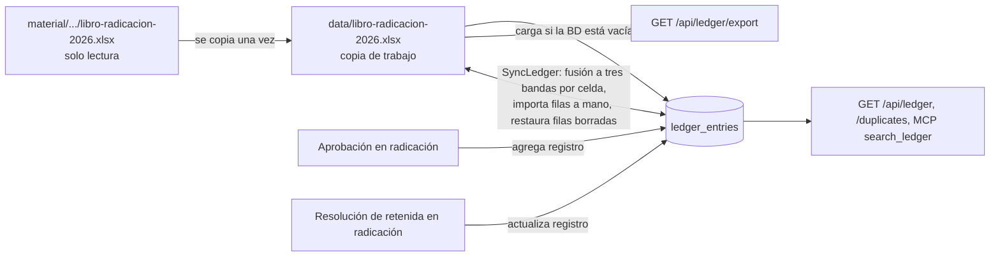

# Libro de radicación

## Propósito

Lleva el libro de radicación de TAC: la lista de todo lo radicado con su consecutivo `TAC-2026-ER-#####`. Docket continúa el Excel que ya usa el cliente (`libro-radicacion-2026.xlsx`) **sin cambiarle la forma**, porque Contabilidad y Jurídica lo consultan. También responde "¿esta factura ya está radicada?" para la regla de duplicados y reporta los duplicados que ya existen en el libro histórico.

## Quién lo usa

- **Auxiliar de radicación (CLERK, Martha)**: lo alimenta indirectamente al aprobar; lo consulta y descarga el Excel desde la pantalla `/ledger` ("Libro").
- **Coordinadora (COORDINATOR, Dra. Herrera)**: aquí tiene la misma pantalla y los mismos permisos que la auxiliar — consulta, descarga el Excel, revisa los duplicados históricos. En la pantalla nadie escribe en el libro; los registros solo aparecen al aprobar en la [revisión de documento](document-review.md) o en la [bandeja](inbox.md), y la fila de una factura retenida solo cambia cuando ella la resuelve en [verificaciones](verifications.md).
- **Asistente de IA vía MCP**: herramienta `search_ledger` (solo lectura, ver [mcp](mcp.md)).
- **Módulo de radicación**: usa `find_invoice` (control de duplicados), `last_sequence` / `append` (numeración al aprobar) y `get` / `update` (`VerifyHold` reescribe la fila de una factura retenida).

## Cómo funciona

1. **Carga inicial en el primer arranque** (`SeedLedger`, invocado por `Container.bootstrap()`): si el libro en la base de datos está vacío, se lee el Excel del cliente y se guarda cada fila cuyo número coincida con `TAC_FILING_PREFIX` (`TAC-2026-ER-`), con su consecutivo. El libro de muestra tiene 28 filas y termina en **`TAC-2026-ER-04817`**.
2. **El Excel del cliente nunca se modifica en `material/`.** `ExcelLedgerWorkbook` lo copia una sola vez a `TAC_DATA_DIR/libro-radicacion-2026.xlsx` (la copia de trabajo, que viviría en la carpeta compartida) y solo trabaja sobre esa copia.
3. **La base de datos es la fuente de verdad para Docket** (`SqlLedgerRepository`, tabla `ledger_entries`, `sequence` único), y la copia de trabajo es el **libro compartido que también editan las personas**: los dos se mantienen al día con una sincronización en ambos sentidos, celda por celda (ver [Sincronización en ambos sentidos con el Excel compartido](#sincronización-en-ambos-sentidos-con-el-excel-compartido) más abajo). Las filas nuevas se **agregan** después de la última, con las mismas 12 columnas y el mismo estilo de celda de la última fila existente; las filas existentes solo cambian en las celdas que cambiaron del lado de Docket (una retenida que se libera o se rechaza, un registro eliminado).
4. Los valores se escriben en el vocabulario del cliente (`api/app/shared/infrastructure/client_vocabulary.py`): `Factura`, `Derecho de petición`, `Oficio ente de control`…, códigos de dependencia `CUENTAS_POR_PAGAR`, `JURIDICA`…, estado `Entregado` / `En trámite` / `Retenida - verificar con proveedor` / `Rechazada - fraude confirmado` / `Cerrado`. La columna "Observaciones" junta `URGENTE`, las notas de las marcas (p. ej. "Extemporánea", "Sin OC", "Cuenta distinta al maestro", "Retenida: verificar por teléfono con el proveedor (Dra. Herrera)", "Verificada por teléfono con el proveedor (Dra. Herrera): se libera para pago", "Fraude confirmado por la coordinación: NO PAGAR") y las notas de la auxiliar / orden de compra.
5. **Estado en el libro** de un registro nuevo: `ON_HOLD` para facturas retenidas por verificación, `IN_PROGRESS` cuando tiene fecha de vencimiento, y si no, `DELIVERED`. Cuando la coordinadora resuelve una factura retenida (`VerifyHold`, ver [radicación](filing.md)), su fila pasa de `ON_HOLD` a `DELIVERED` (dependencia según la regla de orden de compra, marca `VERIFIED_BY_PHONE`) o a `REJECTED` (marca `FRAUD_CONFIRMED`), y se quita la marca `HOLD_FOR_VERIFICATION`.
6. **Duplicados**: la llave es NIT normalizado + número de documento normalizado (`invoice_key`). `find_invoice` devuelve la primera factura radicada con esa llave; `historical_duplicates` agrupa las facturas del libro que la comparten. El libro histórico de muestra ya trae la factura **X-10504** radicada dos veces (**TAC-2026-ER-04809** y **TAC-2026-ER-04813**), y `GET /api/ledger/duplicates` lo reporta.



### Sincronización en ambos sentidos con el Excel compartido

La gente sigue editando el Excel compartido (Jurídica escribe "Respondido", Contabilidad agrega una nota, Martha escribe una fila a mano cuando Docket no está disponible). `SyncLedger` (`ledger/application/sync_ledger.py`) mantiene los dos lados sin perder el trabajo de nadie. Corre antes de numerar y después de agregar en cada aprobación, después de `VerifyHold` y de `DisposeRecord`, antes de cada descarga del Excel, cuando alguien lo pide (`POST /api/ledger/sync`) y cada `TAC_LEDGER_SYNC_SECONDS` (30 por defecto, `0` lo apaga) mediante `PeriodicTask` (`shared/infrastructure/scheduler.py`, que arranca con la aplicación).

1. **Lee** el archivo como una tabla de celdas normalizadas por radicado (`read_table`, `normalize_cell`), con su versión (fecha de modificación + tamaño).
2. **Filas escritas a mano** (un número de esta serie que no está en el libro) se importan (`parse_cells`, marca `MANUAL_ENTRY`, auditoría `LEDGER_MANUAL_ROW_IMPORTED`); como las aprobaciones sincronizan antes de numerar, el siguiente radicado continúa después de ellas.
3. **Fusión a tres bandas por celda** (`ledger/domain/sync.py`, `merge_row`): `base` = la fila como quedó en la última sincronización (tabla `ledger_sync_base`), `ours` = lo que Docket escribiría ahora, `theirs` = el archivo. Gana quien haya cambiado la celda desde `base`; si ambos la cambiaron, **gana la persona** y se registra un conflicto (`LEDGER_SYNC_CONFLICT`), salvo en "Observaciones", donde se conservan los dos textos. En la primera sincronización la base es el archivo mismo.
4. **Las ediciones de las personas entran al libro** (`absorb_cells`, auditoría `LEDGER_EDIT_MERGED`): fecha de vencimiento, estado y dependencia se vuelven datos — un estado con palabras como "Respondido", "Cerrado", "Tramitado", "Archivado" queda `CLOSED` ("Cerrado") y sale de [vencimientos](deadlines.md); cualquier otra celda editada se guarda en `LedgerEntry.manual_overrides`, así Docket la muestra y la escribe tal como la dejaron.
5. **Una fila borrada se restaura** (un radicado no puede desaparecer) y queda auditada (`LEDGER_ROW_RESTORED`).
6. **Escribe de vuelta** solo las filas que cambiaron del lado de Docket (`write_table`): nunca mientras exista el archivo de bloqueo de Excel `~$libro-radicacion-2026.xlsx` (`WorkbookLockedError` → resultado `LOCKED`; el cambio queda en el libro y se escribe en una sincronización posterior), y solo si la versión del archivo es la que se leyó (reemplazo atómico mediante un archivo temporal; `WorkbookChangedError` → se fusiona otra vez, máximo 3 intentos → `CHANGED_TOO_OFTEN`).
7. El último estado (resultado, conteos, conflictos) se guarda en `ledger_sync_state` (`SqlSyncStore`).

Las filas históricas participan como cualquier otra; en el libro de muestra la primera sincronización no cambia nada. Si el archivo está `LOCKED` cuando alguien lo descarga, `ExportLedger` genera en su lugar una copia de solo lectura a partir del libro.

### La pantalla (`/ledger`)

1. `app/(app)/ledger/page.tsx` pinta `LedgerTemplate` (Server Component) dentro de `<Suspense>`, con `LedgerSkeleton` (`aria-busy`) mientras carga.
2. Los filtros viven en la URL (`?q=&department=&type=`): `LedgerSearch` es un formulario GET normal (`role="search"`), así una búsqueda se puede guardar en favoritos o compartir. Los filtros de dependencia y tipo son la molécula `FilterSelect` del sistema de diseño (`shared/ui/molecules/FilterSelect.tsx`) — un select de Radix posicionado como popper, cuyo campo nativo oculto se envía con el formulario; ya no queda ningún `<select>` nativo. Su primera opción "Todas las dependencias" / "Todos los tipos" lleva el valor centinela `ALL`, que `parseLedgerQuery` toma como sin filtro; `toQueryString` convierte `type` en el `document_type` de la API.
3. `LedgerTemplate` llama en paralelo, desde el servidor, a `fetchLedgerPage(query, offset)` (`GET /api/ledger?…&limit=50&offset=N`, `LEDGER_PAGE_SIZE` = 50) y `fetchLedgerDuplicates` (`GET /api/ledger/duplicates`); el offset de la página viene en la URL (`parseLedgerOffset`: cualquier valor inválido o negativo es 0); `toLedgerEntryView` marca como `isNew` los registros radicados por Docket (`source_document_id` no nulo).
4. La página muestra: encabezado "Libro" (antetítulo "Libro de radicación 2026") con **"Descargar Excel"**; una alerta "Posibles facturas duplicadas en el libro histórico" con cada grupo ("TAC-2026-ER-04809 y TAC-2026-ER-04813: mismo proveedor y mismo número…") cuando los hay; el formulario de búsqueda (texto "Radicado, remitente, NIT, asunto o número", lista "Dependencia" sin `SENDER`, lista "Tipo documental", "Buscar"); un conteo de los registros que coinciden ("N registros", el `total` de la API, no solo la página); los registros de la página; y la molécula compartida `Pagination` ("1–50 de 120", "Anterior" / "Siguiente", `<nav aria-label="Páginas del libro">`), cuyos enlaces arma `ledgerPageHref(query, offset)` para conservar la búsqueda (`q`, `department`, `type`) al cambiar de página; no aparece cuando todo cabe en una página.
   Encima de la búsqueda, `LedgerSyncStatus` (de `GET /api/ledger/sync`) dice cómo salió la última fusión con el Excel compartido: normalmente una línea "Sincronizado con el Excel compartido · <hora>. Las ediciones hechas en el Excel se traen automáticamente."; un aviso "El Excel compartido está abierto en otro equipo" cuando el resultado es `LOCKED` ("Docket no lo sobrescribe mientras alguien lo tenga abierto…"); o "Cambios cruzados para revisar" con cada conflicto como `radicado (columna)`. Los tres tienen **"Sincronizar ahora"** (`syncLedgerAction` → `POST /api/ledger/sync`), con un aviso de filas importadas, ediciones traídas y filas escritas, o una advertencia si el archivo está abierto.
5. **Tabla (desde `md`)**: Radicado, Recibido, Remitente, "Asunto y tipo" (el asunto con el tipo documental en español en una segunda línea), Valor (en pesos, alineado a la derecha), Dependencia, Vence (con etiqueta "Urgente"), Estado. Las fechas van en formato numérico `dd/mm/aaaa` (`formatDateNumeric`), remitente y asunto se parten en varias líneas en lugar de cortarse, las observaciones aparecen como texto emergente de la celda del asunto y los registros nuevos de Docket tienen fondo resaltado. Las etiquetas de estado combinan tono, ícono y texto: `DELIVERED` "Entregado" (chulo), `IN_PROGRESS` "En trámite" (reloj), `ON_HOLD` "Retenida" (escudo, peligro), `REJECTED` "Rechazada: fraude" (prohibido, peligro), `CLOSED` "Cerrado" (doble chulo, éxito).
6. **Descarga**: "Descargar Excel" apunta al route handler `/files/ledger`, que entrega `GET /api/ledger/export` con el `Content-Disposition` de la API (archivo `libro-radicacion-2026.xlsx`), `Cache-Control: private, no-store` y `401` sin sesión. El token nunca llega al navegador.
7. **Estados**: esqueleto de carga; búsqueda sin resultados "Sin resultados — Pruebe con otra búsqueda."; sin duplicados no hay alerta.

### En el celular y sin conexión

- Por debajo de `md` la tabla se vuelve **tarjetas**: radicado y estado arriba, asunto, "remitente · tipo → dependencia" y "recibido · vence … · valor" (fechas como "18 de nov de 2026"); los registros de Docket llevan borde izquierdo de color. Nada se desplaza hacia los lados. Los campos de búsqueda se apilan en una columna y miden 44 px; desde `sm` quedan en una sola fila.
- **Sin conexión**: `/ledger` es una de las dos vistas de consulta que guarda el service worker (primero la red, espera de 4 s, caché `docket-read-views`). Un libro que ya se abrió se puede volver a consultar sin conexión, tan actualizado como la última visita; las búsquedas que no se hayan abierto antes y la descarga del Excel (`/files/ledger`) necesitan red. Ver [pwa](pwa.md).

### Las 12 columnas

`Radicado`, `Fecha recibido`, `Remitente`, `NIT / Documento`, `Tipo documental`, `Asunto`, `No. documento`, `Valor total`, `Dependencia`, `Fecha vencimiento`, `Estado`, `Observaciones`. Para facturas el asunto es `Factura <número>`; para lo demás, el asunto del correo.

## Reglas de negocio

| Regla | Fuente | Dónde está en el código |
|---|---|---|
| Radicado = `TAC-2026-ER` + consecutivo de 5 dígitos, uno por documento | Martha: *"El radicado es el consecutivo: TAC-2026-ER y el número, cinco dígitos."* | `ledger/domain/filing_number.py` |
| La gente sigue usando el Excel compartido: lo que escribe (una fila a mano, "Respondido", una nota) no se pierde, y Docket nunca sobrescribe un archivo que alguien tenga abierto | Martha y la Dra. Herrera: Contabilidad y Jurídica consultan y trabajan sobre el mismo libro | `SyncLedger`, `merge_row`, `WorkbookLockedError`, `WorkbookChangedError` |
| Dejar el libro como está: mismo archivo, mismas columnas, mismo formato | Martha: *"Que me deje el libro como lo tengo, porque Contabilidad y Jurídica lo consultan."* | `ExcelLedgerWorkbook.render` (agrega filas nuevas; solo reescribe las de Docket; las históricas no se tocan) |
| La coordinadora cierra la factura retenida después de llamar al proveedor: liberada o rechazada; si es fraude, nunca se paga | Martha: *"se la paso a la doctora Claudia para que verifiquen por teléfono con el proveedor"* | `LedgerRepository.get` / `update`, `LedgerStatus.REJECTED`, marcas `VERIFIED_BY_PHONE` / `FRAUD_CONFIRMED` |
| Antes de radicar una factura, buscar en el libro el mismo número del mismo proveedor | Martha: *"antes de radicar, busco en el libro si ya está ese número de ese proveedor"* | `find_invoice`, `invoice_key` |
| Los viáticos tardíos se marcan "extemporánea" en observaciones | Martha: *"en observaciones le pongo 'extemporánea'"* | `FLAG_TO_CLIENT_NOTE` |
| Los radicados nunca se reutilizan | Regla del proyecto ("nada irreversible sin una persona") | `sequence` / `filing_number` únicos; no hay borrado |

## Endpoints / pantallas

| Método | Ruta | Rol | Solicitud | `code` de éxito |
|---|---|---|---|---|
| GET | `/api/ledger` | cualquiera | parámetros `q` (texto en radicado, remitente, NIT, asunto, número de documento), `department`, `document_type`, `limit` (50 por defecto, acotado entre 1 y 200), `offset` | `LEDGER_LISTED` (`{items, total, limit, offset}`, del radicado más reciente al más antiguo) |
| GET | `/api/ledger/export` | cualquiera | — | archivo Excel (`application/vnd.openxmlformats-officedocument.spreadsheetml.sheet`, `attachment; filename="libro-radicacion-2026.xlsx"`), sin sobre |
| GET | `/api/ledger/sync` | cualquiera | — | `LEDGER_SYNC_STATUS` (último `SyncState`: `outcome`, `at`, `imported_rows`, `restored_rows`, `merged_from_excel`, `written_to_excel`, `conflicts: [{filing_number, column}]`; `null` antes de la primera sincronización) |
| POST | `/api/ledger/sync` | cualquiera | — | `LEDGER_SYNCED`, `LEDGER_SYNCED_WITH_CONFLICTS`, `LEDGER_LOCKED` o `LEDGER_CHANGED_TOO_OFTEN` (el nuevo `SyncState`) |
| GET | `/api/ledger/duplicates` | cualquiera | — | `LEDGER_DUPLICATES` (`[["TAC-2026-ER-04809", "TAC-2026-ER-04813"], ...]`) |

Campos del registro: `filing_number`, `received_date`, `sender`, `identification`, `document_type`, `subject`, `document_number`, `total_amount`, `department`, `due_date`, `status`, `notes`, `flags`, `urgent`, `source_document_id` (nulo en filas históricas). Errores: `401 UNAUTHORIZED`.

### Pantalla

| Ruta / handler | Llama a | Notas |
|---|---|---|
| `/ledger` (`web/src/app/(app)/ledger/page.tsx`, módulo `web/src/features/ledger/`) | `GET /api/ledger` (`q`, `department`, `document_type`, `limit`, `offset`), `GET /api/ledger/duplicates` | Server Component; filtros y página desde la URL (`q`, `department`, `type`, `offset`) |
| `syncLedgerAction` (Server Action, "Sincronizar ahora") | `POST /api/ledger/sync` | refresca la ruta |
| `/files/ledger` (`web/src/app/files/ledger/route.ts`) | `GET /api/ledger/export` | descarga del Excel a través del servidor de Next.js |

Si falla la carga de la página, el límite de error compartido `app/(app)/error.tsx` muestra "No se pudo cargar esta vista" con "Reintentar" e "Ingresar de nuevo" (ver [sesión](session.md)); una descarga fallida devuelve el código de estado de la API.

## Códigos

| Código | Meaning (EN) | Significado (ES) | ¿Bloquea? |
|---|---|---|---|
| `LEDGER_LISTED` | Ledger entries returned | Registros del libro devueltos | — |
| `LEDGER_DUPLICATES` | Groups of filing numbers with the same supplier + invoice number | Grupos de radicados con el mismo proveedor y número de factura | — |
| `DELIVERED` | Forwarded to the department (Excel: "Entregado") | Entregado a la dependencia | — |
| `IN_PROGRESS` | A legal term is running (Excel: "En trámite") | Tiene un plazo corriendo ("En trámite") | — |
| `ON_HOLD` | Held for verification with the supplier | Retenida para verificar con el proveedor ("Retenida - verificar con proveedor") | — |
| `REJECTED` | The coordinator confirmed a fraud attempt; never paid | La coordinadora confirmó un intento de fraude; no se paga (Excel: "Rechazada - fraude confirmado"; pantalla: "Rechazada: fraude") | — |
| `CLOSED` | Closed by the department, typed by people in the shared Excel ("Respondido", "Cerrado", "Tramitado"…); leaves the deadlines | Cerrado por la dependencia, escrito por las personas en el Excel compartido ("Respondido", "Cerrado", "Tramitado"…; en el Excel: "Cerrado" o sus palabras); sale de vencimientos | — |
| `MANUAL_ENTRY` (marca) | Row typed by hand in the shared Excel and imported by the sync | Fila escrita a mano en el Excel compartido e importada por la sincronización | — |
| `SYNCED` / `SYNCED_WITH_CONFLICTS` / `LOCKED` / `CHANGED_TOO_OFTEN` | Sync outcome (`SyncOutcome`; responses `LEDGER_<OUTCOME>`) | Resultado de la sincronización (respuestas `LEDGER_<OUTCOME>`): fusionado / fusionado con conflictos / archivo abierto, se escribe después / el archivo siguió cambiando (3 intentos) | — |
| `LEDGER_SYNC_STATUS` | Last sync state returned | Último estado de sincronización devuelto | — |
| `LEDGER_MANUAL_ROW_IMPORTED` / `LEDGER_EDIT_MERGED` / `LEDGER_SYNC_CONFLICT` / `LEDGER_ROW_RESTORED` (auditoría) | Hand-typed row imported / people's edit merged (`columns`) / same cell changed on both sides (`column`) / deleted row restored | Fila a mano importada / edición traída (`columns`) / misma celda cambiada en ambos lados (`column`) / fila borrada restaurada | — |
| `VERIFIED_BY_PHONE` (marca) | Ledger note: verified by phone with the supplier (Dra. Herrera), released for payment | Nota: verificada por teléfono con el proveedor (Dra. Herrera), se libera para pago | — |
| `FRAUD_CONFIRMED` (marca) | Ledger note: fraud confirmed by the coordination, DO NOT PAY | Nota: fraude confirmado por la coordinación, NO PAGAR | — |
| `DISPOSED` (marca) | Content destroyed under the retention schedule; the row stays as index (Excel note: "Eliminado según la Tabla de Retención Documental") | Contenido eliminado según la TRD; la fila queda como índice (nota en el Excel: "Eliminado según la Tabla de Retención Documental"; ver [retención documental](records.md)) | — |
| `HOLD_FOR_VERIFICATION` (marca) | Ledger note: verify by phone with the supplier (Dra. Herrera) | Nota: verificar por teléfono con el proveedor (Dra. Herrera) | — |
| Marcas `TRAVEL_REQUEST_LATE`, `SUPPLIER_NOT_REGISTERED`, `INVOICE_WITHOUT_PURCHASE_ORDER`, `INVOICE_ACCOUNT_MISMATCH`, `SENDER_DOMAIN_MISMATCH`, `ACCOUNT_CHANGE_ANNOUNCED`, `TUTELA_THREAT` | Reason codes copied to the entry and written as Spanish notes | Códigos de razón que se copian al registro y se escriben como notas en español | — |

## Limitaciones

- El siguiente número es `max(sequence en la base de datos) + 1`, después de importar las filas escritas a mano; el bloqueo de numeración y la sincronización corren en un solo proceso (no hay bloqueo entre varios procesos de la API).
- Las filas históricas que no coinciden con el prefijo se cuentan en la carga pero no se guardan.
- Las filas históricas conservan sus "Observaciones" originales en `notes`; no tienen `flags`.
- Todavía no existe la anulación de un radicado.
- La búsqueda de texto es una coincidencia simple, sin distinguir mayúsculas, sobre todos los registros, y la paginación corta en memoria la lista ya filtrada (`PaginateLedger` → `Page.of`): la respuesta es pequeña, pero cada solicitud sigue leyendo todo el libro (sirve para miles de filas, no para millones).
- El Excel compartido es un archivo en `TAC_DATA_DIR` (o en una carpeta compartida montada); falta un adaptador para SharePoint / Google Drive (con su propio versionamiento y bloqueos). La detección de bloqueo depende del archivo `~$` de Excel, que otros editores (LibreOffice, Excel en línea) pueden no crear.
- Las ediciones de las personas llegan con la siguiente sincronización (a lo sumo `TAC_LEDGER_SYNC_SECONDS` después, o con "Sincronizar ahora"). Un conflicto deja el valor de la persona y queda listado para revisar; Docket no pregunta cuál lado tiene la razón.
- Solo el estado, la fecha de vencimiento y la dependencia escritos en el Excel se vuelven datos; las demás celdas editadas se conservan tal como se escribieron (`manual_overrides`), pero no cambian la lógica de Docket.
- Pantalla: no hay orden por columnas y los registros no enlazan a su documento.
- Pantalla: la copia sin conexión es la última que se cargó; no hay un indicador de "actualizado a las…".

## Cómo se prueba

- `api/tests/features/ledger/test_excel_sync.py` (8 escenarios): `test_first_sync_changes_nothing`, `test_a_row_typed_by_hand_is_imported_and_numbering_continues` (04818 a mano → la siguiente aprobación recibe 04819), `test_legal_closes_a_petition_in_excel_and_it_leaves_the_deadlines` ("Respondido 17-nov" → `CLOSED`, se conservan sus palabras), `test_people_and_docket_edit_the_same_row_without_losing_either`, `test_same_cell_changed_on_both_sides_people_win_and_a_conflict_is_recorded`, `test_a_deleted_row_is_restored`, `test_an_open_excel_is_never_overwritten`, `test_a_save_in_the_middle_of_the_merge_is_merged_again`.
- `api/tests/features/ledger/test_excel_ledger.py`: formato y lectura del radicado, carga desde el Excel del cliente (28 filas, último 04817), búsqueda de duplicados por proveedor + número, duplicados históricos 04809/04813, la exportación conserva filas y columnas originales y agrega 04818/04819 en el vocabulario del cliente (`Oficio ente de control`, `JURIDICA`, `URGENTE…`), el original de `material/` nunca se modifica.
- `api/tests/api/test_api.py::test_full_flow_over_http` (búsqueda + exportación).
- `api/tests/golden/test_golden.py::test_filing_numbers_continue_the_ledger`.

- Pantalla: `web/e2e/filing-flow.spec.ts`, paso "the ledger continues the consecutive and exports the Excel" — `/ledger?q=CD-2026-3345` muestra una celda `TAC-2026-ER-048…` y "Descargar Excel" descarga `libro-radicacion-2026.xlsx`; `web/e2e/mobile.spec.ts` (Pixel 7) abre "Libro" desde la barra de pestañas y verifica que no haya desbordamiento horizontal. `web/e2e/coordinator.spec.ts` (proyecto `coordinator`) verifica que la factura liberada `AIB-2026-1189` aparezca como "Entregado" y que el filtro "Dependencia" abra una lista del sistema de diseño y envíe `department=LEGAL`.
- `web/src/features/ledger/__tests__/mappers.test.ts`: la opción `ALL` de `FilterSelect` significa sin filtro; `ledgerPageHref` conserva la búsqueda y mueve el offset (`/ledger?q=FE&department=LEGAL&offset=50`), y `parseLedgerOffset` convierte un offset negativo en 0.
- `api/tests/api/test_api.py::test_inbox_and_ledger_are_paginated`: 28 registros, la página `limit=10&offset=20` devuelve 8 y `limit=10000` se acota a 200. `web/src/shared/ui/__tests__/FilterSelect.test.tsx`: pinta un botón combobox con la etiqueta actual, no un select nativo.
- La resolución de una retenida reescribe la fila de Docket en el Excel: `api/tests/features/filing/test_verify_hold.py::test_resolution_is_audited_and_the_excel_row_is_updated`.

```bash
./scripts/harness-verify.sh api/tests/features/ledger/test_excel_ledger.py api/tests/features/ledger/test_excel_sync.py
./scripts/harness-verify.sh web/e2e/filing-flow.spec.ts web/e2e/mobile.spec.ts web/e2e/coordinator.spec.ts
./scripts/harness-verify.sh web/src/features/ledger/__tests__/mappers.test.ts web/src/shared/ui/__tests__/FilterSelect.test.tsx
```

## Historial de cambios

- 2026-11-24: se agregó la pantalla `/ledger` (búsqueda, alerta de duplicados, tabla/tarjetas, descarga del Excel, comportamiento en el celular y sin conexión).
- 2026-11-24: estado `REJECTED` y marcas `VERIFIED_BY_PHONE` / `FRAUD_CONFIRMED` (verificación de la coordinadora); `LedgerRepository.get` / `update`; el adaptador del Excel reescribe las filas de Docket y nunca toca las históricas; los filtros del libro usan `FilterSelect`; se retira la limitación del límite de error de la ruta.
- 2026-11-24: paginación — `GET /api/ledger` recibe `limit` / `offset` y devuelve `{items, total, limit, offset}` (`PaginateLedger`, `Page` / `PageRequest` compartidos, `MAX_LIMIT` 200); la pantalla pagina con la molécula compartida `Pagination` (`ledgerPageHref`, `parseLedgerOffset`); nueva marca `DISPOSED` (retención). Se quitó la limitación resuelta (sin paginación en pantalla).
- 2026-11-24: sincronización en ambos sentidos con el Excel compartido — `SyncLedger` (fusión a tres bandas por celda, filas escritas a mano importadas con `MANUAL_ENTRY`, ediciones de las personas absorbidas, nuevo estado `CLOSED`, filas borradas restauradas, nunca escribe con el archivo abierto, control de versión), tablas `ledger_sync_base` / `ledger_sync_state`, `TAC_LEDGER_SYNC_SECONDS`, `GET` / `POST /api/ledger/sync`, `LedgerSyncStatus` en la pantalla. Se quitaron las limitaciones resueltas (filas escritas a mano que no se leían, Excel como vista de un solo sentido).
