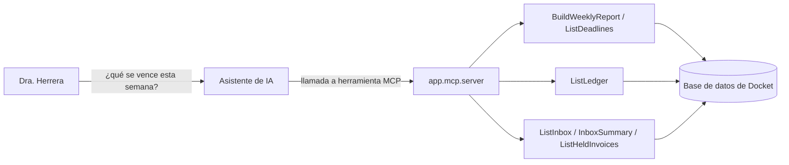

# Servidor MCP

## Propósito

Expone el libro de radicación, los vencimientos y la cola de revisión a un **asistente de IA** (Claude Desktop, Claude Code o cualquier cliente MCP) mediante un servidor Model Context Protocol de **solo lectura**. La Dra. Herrera le puede preguntar a su asistente *"¿qué se vence esta semana?"* en lugar de armar a mano el informe de los viernes. Por MCP no se puede radicar, corregir ni enviar nada.

## Quién lo usa

- **Asistente de IA vía MCP**, en nombre de la coordinadora (COORDINATOR) o de la auxiliar (CLERK): hace preguntas sobre vencimientos, el libro y los pendientes de revisión.
- Las personas no lo llaman directamente; el servidor no valida roles (ver Limitaciones).

## Cómo funciona

- Módulo: `api/app/mcp/server.py`, construido con el SDK de MCP para Python 2.x (`MCPServer`, antes FastMCP). Crea su propio `Container` con la misma configuración (`TAC_*`), ejecuta `bootstrap()` (carga el libro si hace falta) y **reutiliza los casos de uso de libro, vencimientos y radicación**, sin lógica aparte.
- Todas las herramientas están anotadas `read_only_hint=True`, `destructive_hint=False`, `idempotent_hint=True`.
- Transportes: stdio (por defecto) o HTTP "streamable" en el puerto 8001 con `--http`.
- Usa la misma base de datos que la API (`TAC_DATA_DIR` / `TAC_DATABASE_URL`), así que las respuestas reflejan lo que Martha aprobó.

```bash
cd api
uv run python -m app.mcp.server          # stdio (Claude Desktop / Claude Code)
uv run python -m app.mcp.server --http   # HTTP streamable en :8001
```



### Herramientas y recurso

| Nombre | Tipo | Argumentos | Devuelve |
|---|---|---|---|
| `deadlines_this_week` | herramienta | — | `today`, `week` [lunes, domingo], `overdue[]`, `due_this_week[]` (primero lo urgente) |
| `weekly_report` | herramienta | — | el informe semanal completo (`overdue`, `this_week`, `next_week`, `not_filed_yet`…) |
| `list_deadlines` | herramienta | `start`, `end` (ISO; por defecto hoy → hoy + 30 días) | vencimientos abiertos, incluidos documentos sin radicar |
| `search_ledger` | herramienta | `query`, `department`, `document_type`, `limit` (1–100, por defecto 20) | registros del libro |
| `pending_review` | herramienta | — | documentos `NEEDS_REVIEW` con sus códigos de razón **bloqueantes** |
| `inbox_summary` | herramienta | — | conteo por estado |
| `held_invoices` | herramienta | — | facturas retenidas por posible fraude, por hora de llegada: `id`, `filing_number`, `supplier`, `invoice`, `total_amount`, `sender`, `verification_state` (`PENDING_CLERK_APPROVAL`, `AWAITING_VERIFICATION`, `RELEASED`, `REJECTED`), `reasons` (sin `REVIEWED_BY_HUMAN`) |
| `docket://week` | recurso | — | semana actual `"AAAA-MM-DD..AAAA-MM-DD"` |

Las instrucciones del servidor le indican al asistente que las fechas son ISO y los códigos son identificadores en inglés UPPER_SNAKE_CASE, para que los traduzca al usuario.

## Reglas de negocio

| Regla | Fuente | Dónde está en el código |
|---|---|---|
| La coordinadora necesita cada semana los derechos de petición y oficios por vencerse | Dra. Herrera: *"Yo necesito saber cada semana qué derechos de petición y qué oficios están por vencerse"* | `deadlines_this_week`, `weekly_report` |
| Ninguna IA actúa por su cuenta; el asistente solo consulta | Martha: *"No quiero que algo mande las cosas solo y yo no me entere"*; Sistemas no ha aprobado herramientas de IA | herramientas de solo lectura; no se expone ningún caso de uso que modifique |
| Lo que el sistema no tiene claro queda a la vista de una persona | Martha: *"que cuando no esté seguro me pregunte"* | `pending_review` |
| La coordinadora sabe qué facturas retenidas esperan su llamada | Martha: *"se la paso a la doctora Claudia para que verifiquen por teléfono con el proveedor"* | `held_invoices` (solo lectura; liberar o rechazar solo se hace en la aplicación, ver [verificaciones](verifications.md)) |

## Endpoints / pantallas

No hay endpoints REST; solo las herramientas MCP de arriba. El servidor MCP es independiente de la aplicación FastAPI y no usa el sobre `{"code", "data"}`: las herramientas devuelven objetos/listas JSON con los mismos campos de la API REST (`filing_number`, `due_date`, `state`, …).

## Códigos

Las herramientas devuelven los códigos de los módulos que consultan:

| Código | Meaning (EN) | Significado (ES) | ¿Bloquea? |
|---|---|---|---|
| `OVERDUE`, `DUE_TODAY`, `DUE_THIS_WEEK`, `DUE_NEXT_WEEK`, `LATER` | Deadline states (see deadlines) | Estados de vencimiento (ver [vencimientos](deadlines.md)) | — |
| `READY`, `NEEDS_REVIEW`, `APPROVED`, `DISCARDED` | Inbox statuses (`inbox_summary`) | Estados de la bandeja | — |
| `PENDING_CLERK_APPROVAL`, `AWAITING_VERIFICATION`, `RELEASED`, `REJECTED` | Verification states (`held_invoices`) | Estados de verificación: aún en la bandeja de radicación / espera la llamada de la coordinadora / liberada / fraude confirmado | — |
| p. ej. `INVOICE_ACCOUNT_MISMATCH`, `DOCUMENT_UNREADABLE` | Blocking reasons in `pending_review` | Razones bloqueantes en `pending_review` (ver [radicación](filing.md)) | Sí |

## Limitaciones

- **Sin autenticación ni control de rol** en el servidor: quien pueda iniciarlo (stdio) o llegar al puerto 8001 (HTTP) puede leer el libro, incluidos nombres de proveedores, NIT y valores. El transporte HTTP escucha en `0.0.0.0`; hay que restringirlo a nivel de red antes de exponerlo.
- Las llamadas a herramientas no se auditan.
- `deadlines_this_week` no incluye la próxima semana; para eso está `weekly_report`.
- `list_deadlines` usa por defecto hoy → 30 días, así que deja por fuera lo vencido si no se indica `start`.
- Una fecha ISO inválida genera un error de la herramienta (sin código propio).
- El contenedor se crea al importar el módulo; un cambio de configuración requiere reiniciar.

## Cómo se prueba

- `api/tests/mcp/test_mcp_server.py`: qué se vence esta semana (hoy 2026-11-18, semana del 16 al 22 de noviembre, incluye la histórica `TAC-2026-ER-04792`), un rango de fechas incluye documentos sin radicar (`11.eml__0`, `12.eml__0`), `search_ledger("FE-1207")` → `TAC-2026-ER-04790`, `pending_review` muestra `INVOICE_ACCOUNT_MISMATCH` para `05.eml__0`, las herramientas no cambian el consecutivo del libro; `test_held_invoices_tool`: antes de aprobar, `05.eml__0` aparece como `PENDING_CLERK_APPROVAL` con `INVOICE_ACCOUNT_MISMATCH` entre sus razones.

```bash
./scripts/harness-verify.sh api/tests/mcp/test_mcp_server.py
```

## Historial de cambios

- 2026-11-24: nueva herramienta de solo lectura `held_invoices` (facturas retenidas y su estado de verificación).
