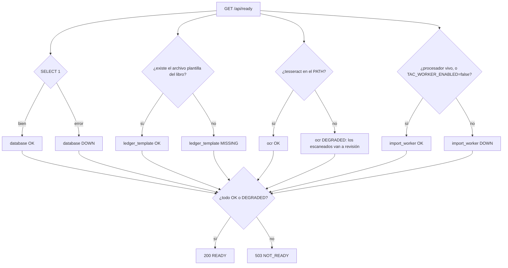

# Observabilidad (monitoreo, disponibilidad y registros)

## Propósito

Le permite a Sistemas de TAC saber si Docket está funcionando y cómo se está usando, sin abrir la aplicación y sin leer datos personales de nadie. Son tres piezas: **métricas de Prometheus** (conteos técnicos y de negocio), una **verificación de disponibilidad** que dice si el servidor puede hacer su trabajo (base de datos, libro del cliente, OCR, procesador de importaciones) y **registros JSON estructurados** en los que cada línea de una solicitud lleva el mismo `request_id`. Es infraestructura transversal (`api/app/shared/infrastructure/observability.py`, conectada en `main.py` y `container.py`), más una sección de solo lectura "Estado del sistema" en [ajustes](settings.md).

## Quién lo usa

- **Sistemas de TAC / operación**: recoge `GET /metrics` con Prometheus, apunta el balanceador o el chequeo de salud de `docker compose` a `GET /api/ready` y envía los registros JSON a su almacén de logs.
- **Auxiliar de radicación (CLERK, Martha)**: ve "Estado del sistema" en `/settings` (base de datos, libro en Excel, OCR, procesador de la cola, conteos de la cola de importación).
- **Coordinadora (COORDINATOR, Dra. Herrera)**: la misma sección si abre `/settings` (no está en su menú).
- **Asistente de IA vía MCP**: sin acceso.

## Cómo funciona

### Identificador de solicitud y registros JSON

1. `configure_logging()` reemplaza los manejadores del logger `docket` por uno que escribe **un objeto JSON por línea**: `at`, `level`, `logger`, `message`, `request_id`, los `fields` adicionales y, si hay error, `exception`.
2. El middleware HTTP `observe_requests` (`main.py`) toma el encabezado `X-Request-ID` que llega o genera uno (16 caracteres hexadecimales), lo guarda en una variable de contexto durante toda la solicitud y lo devuelve en el encabezado `X-Request-ID` de la respuesta. Un caso de soporte puede citarlo y Sistemas encuentra todas las líneas de esa solicitud.
3. Cada solicitud se registra como `{"message": "request", "method", "route", "status", "ms"}`. `route` es la **plantilla de la ruta** (p. ej. `/api/inbox/{document_id}`), nunca la URL real, así los identificadores no llegan a los registros. `/metrics` y `/api/health` no se registran (ruido de los sondeos).

### Métricas (`GET /metrics`)

`Metrics` crea **un registro de Prometheus por instancia de la aplicación** (lo tiene el contenedor), así las pruebas y varias aplicaciones en un mismo proceso no comparten contadores.

| Métrica | Tipo | Etiquetas | Qué cuenta |
|---|---|---|---|
| `docket_http_requests_total` | Counter | `method`, `route`, `status` | Solicitudes HTTP (plantilla de ruta) |
| `docket_http_request_seconds` | Histogram | `route` | Latencia HTTP (rangos de 10 ms a 10 s) |
| `docket_documents_proposed_total` | Counter | `status` | Propuestas hechas (`READY`, `NEEDS_REVIEW`) |
| `docket_review_reasons_total` | Counter | `reason` | Códigos de razón en las propuestas (p. ej. `INVOICE_ACCOUNT_MISMATCH`) |
| `docket_documents_approved_total` | Counter | `action`, `corrected` | Aprobaciones, y si una persona corrigió la propuesta (`TRUE` / `FALSE`) |
| `docket_documents_corrected_total` | Counter | — | Correcciones |
| `docket_holds_escalated_total` | Counter | — | Posibles fraudes que la auxiliar le alertó a la coordinadora (`HOLD_ESCALATED`) |
| `docket_holds_resolved_total` | Counter | `outcome` | Facturas retenidas que resolvió la coordinadora (`RELEASED` / `REJECTED`) |
| `docket_import_job_seconds` | Histogram | — | Duración de cada importación (rangos de 0,5 s a 120 s) |
| `docket_import_jobs` | Gauge | `state` | Importaciones por estado (`QUEUED`, `RUNNING`, `DONE`, `FAILED`), actualizado en cada lectura |

**Las métricas de negocio salen de la auditoría, no del dominio.** `MeteredAuditLog` decora el puerto `AuditLog`: cada `record(...)` se escribe en la auditoría como antes y, para `DOCUMENT_PROPOSED`, `DOCUMENT_APPROVED`, `DOCUMENT_CORRECTED`, `HOLD_ESCALATED`, `HOLD_RELEASED` y `HOLD_REJECTED`, además incrementa un contador. Ningún caso de uso ni clase del dominio sabe del monitoreo. La duración de la importación viene del gancho `on_done` de `ProcessNextImport` (ver [ingesta](ingestion.md)).

**Sin datos personales en las métricas**: las etiquetas son solo códigos (estado, razón, acción, plantilla de ruta, estado de la cola). Ningún NIT, correo, nombre, radicado ni token se vuelve etiqueta.

### Disponibilidad (`GET /api/ready`)



La falta de OCR solo **degrada**: Docket sigue funcionando y los documentos escaneados pasan a revisión humana como `DOCUMENT_UNREADABLE`. `GET /api/health` (`HEALTHY`) sigue como sondeo simple de vida.

## Reglas de negocio

| Regla | Fuente | Dónde está en el código |
|---|---|---|
| Sistemas debe saber a dónde van los datos y quién los ve: el monitoreo no puede volverse otra copia de datos personales | Dra. Herrera: *"La gente de sistemas va a querer saber dónde queda todo eso y quién lo ve."* | etiquetas de `Metrics`; plantilla de ruta en los registros; `test_metrics_expose_business_counts_without_personal_data` |
| El monitoreo no cambia el código de negocio | Regla hexagonal (dominio libre de infraestructura) | decorador `MeteredAuditLog` sobre el puerto `AuditLog`, conectado en `container.py` |
| Un servidor sin OCR sigue funcionando, pero lo dice | Los escaneados sin OCR van a revisión en lugar de adivinarse | `checks["ocr"] = "DEGRADED"` |
| En el cierre de mes, Sistemas puede ver crecer y vaciarse la cola de importación | Picos de fin de mes | `docket_import_jobs`, `docket_import_job_seconds` |
| La tasa de corrección por aprobación se puede medir | Resumen ejecutivo: las correcciones son la medida de acierto | `docket_documents_approved_total{corrected=…}` |

## Endpoints / pantallas

| Método | Ruta | Rol | Respuesta |
|---|---|---|---|
| GET | `/metrics` | ninguno (no aparece en el esquema OpenAPI) | formato de texto de Prometheus (`CONTENT_TYPE_LATEST`), sin sobre `{code, data}` |
| GET | `/api/ready` | ninguno | `200 {"code": "READY", "data": {"checks": {"database", "ledger_template", "ocr", "import_worker"}}}` o `503 {"code": "NOT_READY", …}` |
| GET | `/api/health` | ninguno | `HEALTHY` con `llm_enabled` |
| cualquiera | cualquiera | — | encabezado de respuesta `X-Request-ID` (repite el de la solicitud o uno nuevo) |

Configuración: `TAC_WORKER_ENABLED` (por defecto `true`) y `TAC_WORKER_POLL_SECONDS` (por defecto `0.5`) deciden si se espera el `import_worker`.

Pantalla: "Estado del sistema" en `/settings` (`fetchSystemStatus` → `GET /api/ready` y `GET /api/ingestion/jobs?limit=5`), ver [ajustes](settings.md).

## Códigos

| Código | Meaning (EN) | Significado (ES) | ¿Bloquea? |
|---|---|---|---|
| `READY` | Every check is `OK` or `DEGRADED` (HTTP 200) | Todas las verificaciones están `OK` o `DEGRADED` (HTTP 200) | — |
| `NOT_READY` | At least one check is `DOWN` or `MISSING` (HTTP 503) | Al menos una verificación está `DOWN` o `MISSING` (HTTP 503) | Sí, para el balanceador |
| `OK` | The check passed | La verificación pasó | — |
| `DEGRADED` | Works with reduced capability (OCR missing) | Funciona con capacidad reducida (falta OCR) | No |
| `DOWN` | Database unreachable or worker not running | Base de datos inaccesible o procesador detenido | Sí |
| `MISSING` | The client's ledger template file is not there | No está el archivo plantilla del libro del cliente | Sí |
| `HEALTHY` | Liveness answer | Respuesta de vida del servicio | — |

## Limitaciones

- `/metrics` y `/api/ready` **no tienen autenticación**: solo exponen conteos y estados, pero deberían quedar accesibles únicamente desde la red interna de TAC o el proxy inverso.
- Las métricas viven en memoria por proceso: se reinician al reiniciar, y con varios workers de Uvicorn cada proceso tiene su propio registro (Prometheus debe leer cada uno o el despliegue debe usar un solo proceso).
- Docket no trae reglas de alerta, tableros ni configuración de Prometheus; Sistemas las define (p. ej. `NOT_READY`, `docket_import_jobs{state="QUEUED"}` creciendo, aumento de `FAILED`).
- El nivel de registro está fijo en `INFO` y los registros salen solo por la salida estándar.
- Las líneas que escribe el hilo del procesador de importaciones llevan `request_id` `-` (la importación corre por fuera de la solicitud).
- La verificación de disponibilidad solo revisa que exista el archivo plantilla del libro, no que la copia de trabajo se pueda escribir.

## Cómo se prueba

- `api/tests/api/test_observability.py`: `test_queued_import_is_processed_by_the_worker` (importación `IMPORT_QUEUED` → `DONE` con 17 documentos, conteos en `GET /api/ingestion/jobs`); `test_metrics_expose_business_counts_without_personal_data` (`docket_documents_proposed_total{status="READY"}`, `docket_review_reasons_total{reason="INVOICE_ACCOUNT_MISMATCH"}`, `docket_documents_approved_total`, `docket_import_job_seconds_count 1.0`, y ningún NIT, dominio de proveedor, `@` ni token en la respuesta); `test_request_id_and_readiness` (se repite `X-Request-ID`, `READY` con `database` e `import_worker` en `OK`).

```bash
./scripts/harness-verify.sh api/tests/api/test_observability.py
```

## Historial de cambios

- 2026-11-24: primera versión: registros JSON con `request_id` / `X-Request-ID`, métricas de Prometheus por instancia de la aplicación en `/metrics` (HTTP, conteos de negocio desde la auditoría con `MeteredAuditLog`, cola de importación), disponibilidad `GET /api/ready`, "Estado del sistema" en ajustes.
