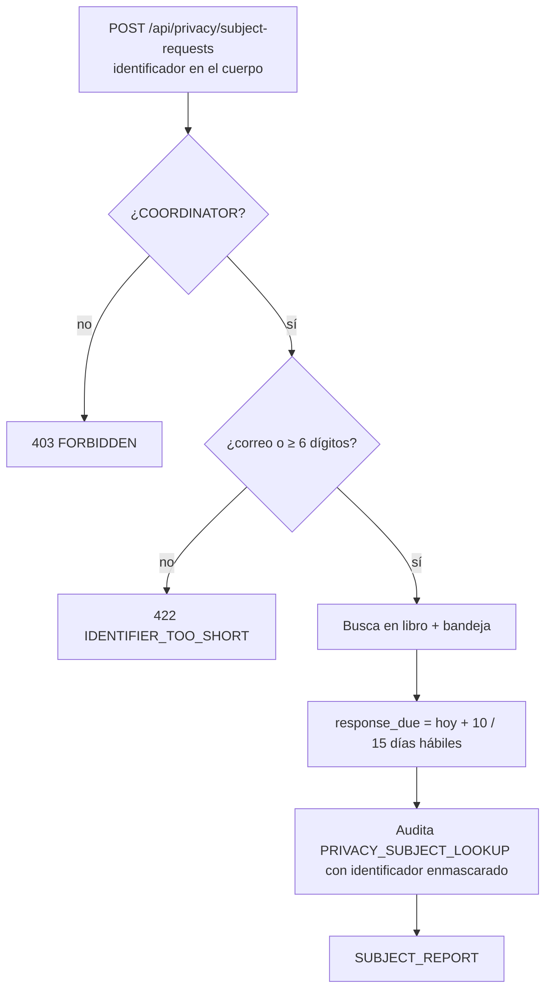

# Protección de datos personales (habeas data, Ley 1581 de 2012)

## Propósito

Docket lee correos llenos de datos personales: cédulas y correos de ciudadanos, solicitudes de viáticos de empleados, cuentas bancarias de proveedores. La Ley 1581 de 2012 y el Decreto 1377 de 2013 obligan a TAC a saber qué datos personales tiene, para qué, con qué base legal y quién los ve, y a responderle a un titular que pregunta qué tiene TAC sobre él (consulta, art. 14) o que pide corregirlos o suprimirlos (reclamo, art. 15) dentro del plazo legal. Este módulo le da a la Dra. Herrera las dos cosas: el **inventario** de datos personales y una **búsqueda por titular** que dice dónde están los datos de una persona y hasta cuándo tiene TAC para responder. También contiene el enmascaramiento compartido que se usa en todo lugar donde un dato personal podría salirse de su finalidad.

## Quién lo usa

- **Coordinadora (COORDINATOR, Dra. Herrera)**: consulta el inventario y las salvaguardas; hace la búsqueda por titular cuando una persona radica una consulta o un reclamo. Solo ella puede hacer la búsqueda.
- **Auxiliar de radicación (CLERK, Martha)**: puede consultar el inventario (el `GET` está abierto a los dos roles); no puede hacer búsquedas por titular (`403 FORBIDDEN`).
- **Asistente de IA vía MCP**: sin acceso.
- **Otros módulos**: usan `mask_personal_data` (`shared/domain/privacy.py`): el clasificador opcional con Claude antes de enviar texto, `DiscardDocument` antes de auditar el motivo de un descarte y `DisposeRecord` antes de auditar la referencia del acta de eliminación.

## Cómo funciona

### Inventario

`privacy/domain/inventory.py` declara `INVENTORY`, una lista de `PersonalDataItem` (`data`, `subjects`, `stored_in`, `purpose`, `legal_basis`, `access`, `retention`) con cuatro entradas: nombre, cédula y correo del remitente; contenido de peticiones y quejas (puede incluir datos sensibles); datos de viáticos; cuenta bancaria y NIT de proveedores. `SAFEGUARDS` enumera lo que los protege (OCR y reglas locales, IA apagada y con enmascaramiento, auditoría y métricas sin datos personales, búsquedas por titular en el cuerpo de la solicitud, eliminación según la TRD). `GET /api/privacy/inventory` devuelve ambos tal cual.

### Búsqueda por titular

`FindDataSubject` (`privacy/application/subject_requests.py`):

1. Normaliza el identificador. Un correo (contiene `@`) se busca como subcadena sin distinguir mayúsculas; cualquier otra cosa se reduce a dígitos (`digits_only`) y debe tener al menos **6 dígitos** (`MIN_ID_DIGITS`); si no, `IDENTIFIER_TOO_SHORT` (un número corto coincidiría con medio libro).
2. Busca en el **libro** (campos `identification`, `sender`) y en la **bandeja** (campos `sender`, `identification`, `document_text`, `email_body`). Cada hallazgo es un `SubjectMatch` con `where` (`LEDGER` / `INBOX`), `reference` (radicado o id del documento), los `fields` que coinciden, `received_date` y `content_available` (falso cuando el contenido ya se eliminó según la [tabla de retención](records.md)).
3. Calcula la fecha límite de respuesta con el calendario de días hábiles: `INQUIRY` → 10 días hábiles (art. 14), `CLAIM` → 15 días hábiles (art. 15).
4. Registra el evento de auditoría `PRIVACY_SUBJECT_LOOKUP` con `kind`, el identificador **enmascarado** (`mask_identifier`: solo los últimos 4 caracteres, p. ej. `***.456`) y la cantidad de coincidencias. El identificador completo nunca se guarda.
5. Devuelve un `SubjectReport` (`kind`, `identifier_masked`, `response_due`, `matches`).



### Enmascaramiento (`shared/domain/privacy.py`)

- `mask_personal_data(text)` reemplaza los correos por `[EMAIL]`, las cédulas / NIT con puntos por `[ID]` y las secuencias largas de dígitos (teléfonos, cuentas) por `[NUMBER]`.
- `mask_identifier(identifier)` deja solo los últimos 4 caracteres (`***` + últimos 4; `***` si es más corto).

## Reglas de negocio

| Regla | Fuente | Dónde está en el código |
|---|---|---|
| Saber qué datos personales se tienen, para qué, con qué base legal y quién los ve | Ley 1581 de 2012; Decreto 1377 de 2013; Dra. Herrera: *"aquí entran datos de personas, de contratos y de pagos. La gente de sistemas va a querer saber dónde queda todo eso y quién lo ve"* | `INVENTORY`, `SAFEGUARDS` |
| Una consulta se responde en 10 días hábiles | Ley 1581 de 2012 art. 14 | `TERMS[INQUIRY]`, `BusinessCalendar.add_business_days` |
| Un reclamo (corrección, actualización o supresión) se responde en 15 días hábiles | Ley 1581 de 2012 art. 15 | `TERMS[CLAIM]` |
| El identificador viaja en el cuerpo de la solicitud, nunca en la URL (quedaría en los registros de acceso) | Privacidad desde el diseño | cuerpo `SubjectRequest`; `subjectRequestAction` en la web |
| La auditoría demuestra que se hizo la búsqueda sin guardar sobre quién fue | Regla del proyecto (auditoría sin datos personales) | `mask_identifier`, `PRIVACY_SUBJECT_LOOKUP` |
| El texto libre que escribe una persona se enmascara antes de auditarlo | Regla del proyecto | `mask_personal_data` en `DiscardDocument` y `DisposeRecord` |
| Los datos personales nunca llegan sin enmascarar al proveedor de IA | Dra. Herrera: *"les pido cuidado con la información"* | `ClaudeClassifier` → `mask_personal_data` |
| Solo la coordinadora hace búsquedas por titular | Ella responde por el área administrativa | `CoordinatorRole` en el endpoint |

## Endpoints / pantallas

| Método | Ruta | Rol | Solicitud | `code` de éxito | Errores |
|---|---|---|---|---|---|
| GET | `/api/privacy/inventory` | cualquiera | — | `PRIVACY_INVENTORY` (`{items: [PersonalDataItem], safeguards: [str]}`) | `401` |
| POST | `/api/privacy/subject-requests` | COORDINATOR | `{"identifier": "80.123.456", "kind": "INQUIRY" \| "CLAIM"}` (`kind` es `INQUIRY` por defecto) | `SUBJECT_REPORT` (`{kind, identifier_masked, response_due, matches: [{where, reference, fields, received_date, content_available}]}`) | `422 IDENTIFIER_TOO_SHORT`, `403 FORBIDDEN`, `401` |

Pantalla: `/compliance` ("Cumplimiento"), sección "Datos personales", ver [cumplimiento](compliance.md).

## Códigos

| Código | Meaning (EN) | Significado (ES) | ¿Bloquea? |
|---|---|---|---|
| `INQUIRY` | Inquiry: what data TAC holds (10 business days) | Consulta: qué datos tiene TAC (10 días hábiles) | — |
| `CLAIM` | Claim: correction, update or deletion (15 business days) | Reclamo: corrección, actualización o supresión (15 días hábiles) | — |
| `LEDGER` / `INBOX` | Where a match was found | Dónde se encontró la coincidencia | — |
| `PRIVACY_INVENTORY` / `SUBJECT_REPORT` | Success responses | Respuestas exitosas | — |
| `PRIVACY_SUBJECT_LOOKUP` | Audit event of a subject lookup (masked identifier) | Evento de auditoría de una búsqueda por titular (identificador enmascarado) | — |
| `IDENTIFIER_TOO_SHORT` | Not an e-mail and fewer than 6 digits | No es un correo y tiene menos de 6 dígitos | Sí (422) |
| `[EMAIL]`, `[ID]`, `[NUMBER]` | Placeholders left by masking | Marcadores que deja el enmascaramiento | — |

## Limitaciones

- Docket **ubica** los datos y calcula el plazo; no registra la solicitud, no hace seguimiento a la respuesta ni aplica la corrección o la supresión. El reclamo lo resuelve una persona (corrige en la pantalla de revisión mientras el documento está abierto, o elimina según la [tabla de retención](records.md) cuando se cumple el tiempo).
- La búsqueda es solo por identificador: no encuentra a una persona por su nombre. Una cédula de 6 dígitos también puede coincidir dentro de un número más largo (los falsos positivos se muestran, nunca se ocultan).
- No se busca en: el maestro de proveedores, la bandeja de salida ni los detalles de la auditoría.
- El enmascaramiento funciona por patrones: no quita **nombres** de personas.
- El inventario es una lista en el código revisada con TAC; cambiarlo exige un cambio de código.
- El aviso de privacidad y las autorizaciones de los titulares están por fuera de Docket.

## Cómo se prueba

- `api/tests/features/privacy/test_subject_requests.py`: se encuentra a un empleado por cédula en la bandeja y en el libro, con fecha de respuesta 2026-12-02 (10 días hábiles); se encuentra a una ciudadana por correo y un reclamo queda para el 2026-12-10 (15 días hábiles, festivo del 8 de diciembre); la auditoría guarda `***.456` y nunca `80.123.456`; se rechazan los identificadores muy cortos; los motivos de descarte quedan enmascarados en la auditoría (`[EMAIL]`); solo la coordinadora hace búsquedas por titular (la auxiliar recibe `403`) y el inventario está abierto a los dos roles.
- `api/tests/features/classification/test_assisted_classifier.py::test_personal_data_is_masked_before_leaving_tac` (enmascaramiento antes de la IA).
- Pantalla: `web/e2e/coordinator.spec.ts` ("compliance: retention schedule and a data subject request"), ver [cumplimiento](compliance.md).

```bash
./scripts/harness-verify.sh api/tests/features/privacy/test_subject_requests.py
```

## Historial de cambios

- 2026-11-24: nuevo módulo `privacy`: inventario de datos personales y salvaguardas, búsqueda por titular con fecha legal de respuesta (art. 14 / art. 15) y auditoría enmascarada; el enmascaramiento pasó a `shared/domain/privacy.py` y ahora también se aplica a los motivos de descarte y a las actas de eliminación en la auditoría.
