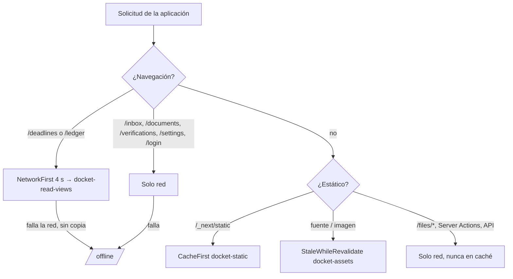

# PWA (aplicación instalable y sin conexión)

## Propósito

Docket es una aplicación web, no nativa, pero se puede **instalar** en el celular, la tableta o el computador y se abre como una aplicación (ícono propio, sin barra del navegador). El service worker deja disponibles, con mala señal o sin conexión, las dos vistas **de consulta** que la coordinadora revisa sobre la marcha: vencimientos y libro. Todo lo que tiene datos personales o cambia algo (bandeja, documentos, archivos originales, aprobaciones, correcciones) funciona solo en línea, porque los datos deben quedarse en los servidores de TAC y nada debe quedar a medias.

## Quién lo usa

- **Coordinadora (COORDINATOR, Dra. Herrera)**: la instala en el celular y revisa "Vencimientos" y "Libro" entre reuniones, aun con poca señal. Sin conexión solo puede leer lo que ya abrió. Liberar o rechazar una factura retenida en "Por verificar" (`/verifications`) siempre necesita conexión: esa pantalla nunca se guarda en caché.
- **Auxiliar de radicación (CLERK, Martha)**: trabaja sobre todo en el computador; la puede instalar ahí o en una tableta. Radicar, corregir y aprobar siempre necesitan conexión.

## Cómo funciona

1. **Manifiesto** (`web/src/app/manifest.ts`, servido en `/manifest.webmanifest`): nombre "Docket · Radicación TAC", nombre corto "Docket", `lang: es-CO`, `start_url: /inbox`, `scope: /`, `display: standalone`, `orientation: any`, fondo `#fff9f3`, color de tema `#0f6b63`, categorías business/productivity y dos accesos directos (al dejar presionado el ícono): "Bandeja" (`/inbox`) y "Vencimientos" (`/deadlines`).
2. **Íconos** (`web/public/icons/`): `icon-192.png`, `icon-512.png`, `icon-maskable-512.png` (`purpose: maskable`, para los íconos adaptables de Android) y `apple-touch-icon.png` (pantalla de inicio de iOS). El layout raíz además define `appleWebApp` (capable, título "Docket"), el color del navegador para tema claro (`#fff9f3`) y oscuro (`#0e0c09`) y `viewport-fit=cover`, para que la aplicación use toda la pantalla respetando las zonas seguras.
3. **Registro** (`shared/ui/organisms/ServiceWorkerProvider.tsx`): `SerwistProvider` registra `/sw.js` **solo en compilaciones de producción**; en desarrollo no corre ningún service worker, así el código siempre está fresco. No recarga la página cuando vuelve la conexión.
4. **Service worker** (`web/src/app/sw.ts`, Serwist):

| Qué | Estrategia | Caché | Notas |
|---|---|---|---|
| Archivos de la compilación en el manifiesto de precarga | precarga | precarga de Serwist | `globIgnores: ["**/files/**"]` en `serwist.config.mjs`: nada bajo `/files` se precarga nunca |
| Navegación a `/deadlines` y `/ledger` (mismo origen, `mode: navigate`) | **NetworkFirst**, espera de red de 4 s | `docket-read-views` | fresca con conexión; la última copia sin conexión o con red lenta |
| `/_next/static/*` (JS/CSS con hash) | CacheFirst | `docket-static` | archivos que no cambian |
| Fuentes e imágenes (mismo origen) | StaleWhileRevalidate, máximo 64 entradas, 30 días | `docket-assets` | |
| Cualquier otra página que falle | respaldo con `/offline` | — | página "Sin conexión" |

   También activa la precarga de navegación y pone en uso las versiones nuevas de inmediato (`skipWaiting`, `clientsClaim`).
5. **Página sin conexión** (`web/src/app/offline/page.tsx`): "Sin conexión — Puede consultar los vencimientos y el libro que ya abrió. Para radicar, corregir o aprobar se necesita conexión: nada se guarda a medias." La protección de rutas (`proxy.ts`) deja pasar `/offline`, `sw.js`, el manifiesto y los íconos sin sesión.
6. **Compilación**: `pnpm build` ejecuta `next build && serwist build serwist.config.mjs`. El segundo paso compila `src/app/sw.ts` (con el manifiesto de precarga inyectado) en `public/sw.js`; va aparte porque Next.js compila con Turbopack.



### Por qué la bandeja y los documentos no se guardan en caché

- Tienen datos personales y financieros: cuentas bancarias de proveedores, NIT y cédulas, derechos de petición y quejas de ciudadanos, adjuntos originales. Una caché en un celular es una copia por fuera de los servidores de TAC, que es justo lo que Sistemas del cliente pidió evitar (por la misma razón la IA viene apagada).
- La bandeja solo tiene sentido en vivo: una copia vieja podría llevar a alguien a actuar sobre un documento que ya se aprobó o se corrigió.
- Aprobar, corregir y descartar son Server Actions (POST) y nunca se guardan ni se encolan para después: aprobar asigna un radicado, y eso es irreversible, así que debe pasar en línea y con una persona viendo el resultado.
- Los originales y el Excel pasan por `/files/*`, que responde `Cache-Control: private, no-store` y está excluido de la precarga.

### Cómo instalarla

- **Android (Chrome)**: menú ⋮ → "Instalar aplicación" (o el aviso de instalación). El ícono adaptable llena la forma del sistema.
- **iOS / iPadOS (Safari)**: Compartir → "Agregar a inicio". Usa `apple-touch-icon.png` y abre en pantalla completa.
- **Computador (Chrome / Edge)**: el ícono de instalar en la barra de direcciones, o menú → "Instalar Docket".
- Necesita una compilación de producción servida por HTTPS (o `localhost`). La aplicación instalada abre en `/inbox`; sin sesión, la protección de rutas la lleva a `/login`.

### Celulares y dispositivos

- El diseño parte del celular: barra inferior de pestañas por debajo de `lg` y barra lateral desde `lg`; un encabezado que nombra a la persona que ingresó en todos los tamaños; zonas seguras; áreas táctiles de 44 px en la navegación y en las acciones principales; la página nunca se desplaza hacia los lados (ver [sesión](session.md)).
- Respeta `prefers-reduced-motion`, `prefers-reduced-transparency` (las barras translúcidas se vuelven opacas) y `prefers-contrast: more`; los colores cumplen WCAG AA en tema claro y oscuro.

| Dispositivo | Ancho | Verificación automática |
|---|---|---|
| Celular | Pixel 7 (412 px) | `web/e2e/mobile.spec.ts`, proyecto `phone` |
| Celular pequeño | 375 px | solo manual |
| Tableta | 768 px | solo manual |
| Escritorio | Desktop Chrome (1280 px) | `web/e2e/filing-flow.spec.ts`, proyecto `desktop` |

Navegadores en las pruebas automáticas: solo Chromium (Playwright). **Lighthouse**: todavía no se ha medido; no hay puntajes registrados.

## Reglas de negocio

| Regla | Dónde está en el código |
|---|---|
| Sin conexión solo están las vistas de consulta (`/deadlines`, `/ledger`) | `READ_VIEWS` en `sw.ts` |
| Los datos personales (bandeja, documentos, archivos originales) nunca se guardan en caché | no hay regla de caché para ellos; `globIgnores: ["**/files/**"]`; `Cache-Control: private, no-store` en `/files/*` |
| Nada irreversible sin conexión: aprobaciones, correcciones y descartes nunca se encolan | no hay sincronización en segundo plano; las Server Actions van a la red |
| La página sin conexión explica qué sigue funcionando | `app/offline/page.tsx` |
| Al cerrar sesión se borran las copias sin conexión de ese dispositivo | `LogoutButton` borra toda caché cuyo nombre empiece por `docket-read-views` antes de `logoutAction` (ver [sesión](session.md)) |

## Endpoints / pantallas

- `/manifest.webmanifest` (desde `app/manifest.ts`), `/sw.js` (generado), `/offline` (`app/offline/page.tsx`), `/icons/*`.
- El service worker nunca llama directamente a la API de Docket: el navegador solo habla con el servidor de Next.js, que es el que tiene el token.

## Códigos

| Código | Meaning (EN) | Significado (ES) | ¿Bloquea? |
|---|---|---|---|
| `NETWORK_ERROR` | The Next.js server cannot reach the API (an online problem, not the device being offline) | No hay conexión con el servidor. | Sí |
| `docket-read-views`, `docket-static`, `docket-assets` | Cache names (not API codes) | Nombres de las cachés | — |

## Limitaciones

- Las copias sin conexión solo se borran cuando la persona sale con "Cerrar sesión"; si la sesión simplemente vence o se cierra el navegador, `docket-read-views` conserva en ese dispositivo las últimas páginas de `/ledger` y `/deadlines`.
- No hay aviso de actualización: las versiones nuevas entran de inmediato (`skipWaiting` + `clientsClaim`), lo que puede cambiar el código debajo de una página abierta.
- Las vistas leídas de la caché no indican cuándo se actualizaron.
- Sin conexión solo están las páginas exactas que ya se abrieron; una búsqueda en el libro que no se haya hecho antes cae en `/offline`.
- No hay prueba sin conexión (Playwright `context.setOffline`) ni medición de Lighthouse todavía; 375 px y 768 px se revisan a mano.
- El service worker no corre en desarrollo (`pnpm dev`), así que el comportamiento sin conexión solo se puede revisar con `pnpm build && pnpm start`.

## Cómo se prueba

- `web/e2e/mobile.spec.ts` (proyecto `phone`, Pixel 7): la barra inferior de pestañas se ve y funciona, no hay desbordamiento horizontal y `/manifest.webmanifest` responde `display: "standalone"`.
- `web/playwright.config.ts`: proyectos `desktop` (Desktop Chrome), `coordinator` (Desktop Chrome, `coordinator.spec.ts`, depende de `desktop`) y `phone` (Pixel 7), `locale: es-CO`, `timezoneId: America/Bogota`, `workers: 1`; el servidor web corre `next start` sobre una compilación de producción, así que se sirve el service worker real.
- Revisión de compilación: `cd web && pnpm build` (falla si `sw.ts` no compila).

```bash
./scripts/harness-verify.sh web/e2e/mobile.spec.ts
cd web && pnpm build
```

## Historial de cambios

- 2026-11-24: primera versión de la documentación.
- 2026-11-24: "Cerrar sesión" borra la caché `docket-read-views` (`LogoutButton`); se quitó la limitación de "las vistas guardadas sobreviven al cierre de sesión". `/verifications` va solo por red.
