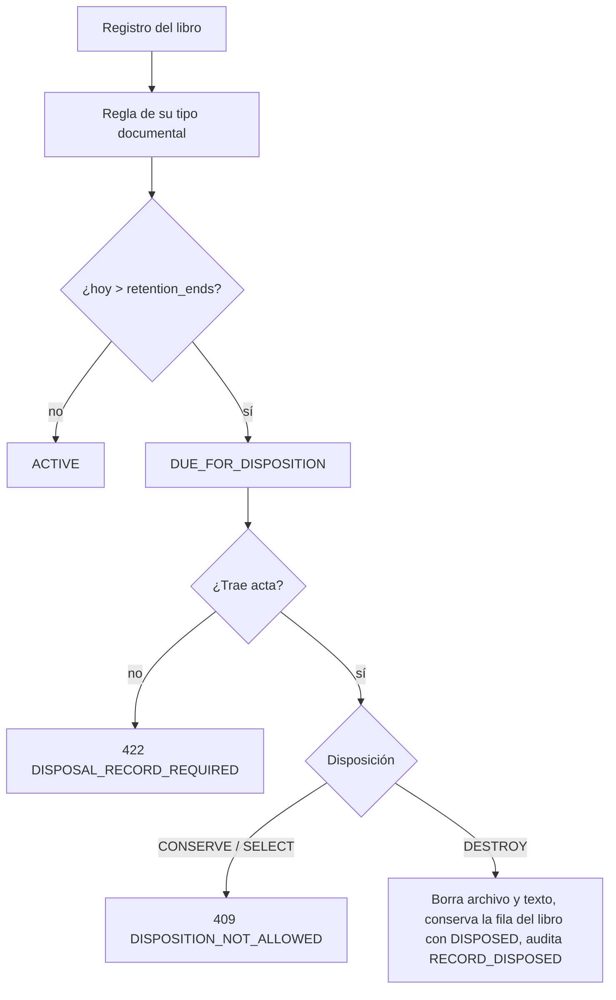

# Retención documental (Ley 594 de 2000)

## Propósito

Aplica la Tabla de Retención Documental (TRD) de TAC a lo que Docket radica. La Ley 594 de 2000 (Ley General de Archivos) exige que cada documento radicado se conserve un tiempo definido y que después se conserve, se seleccione o se elimine con un acta aprobada por el comité de archivo. Sin esto, Docket guardaría datos personales para siempre (en contra de la Ley 1581 de 2012) o dejaría que alguien los borrara sin control. El módulo responde tres preguntas: cuánto se guarda cada tipo documental, qué ya cumplió su tiempo y cómo se elimina un registro sin perder el índice que exige la ley.

## Quién lo usa

- **Coordinadora (COORDINATOR, Dra. Herrera)**: revisa la tabla, consulta qué cumplió su retención (hoy o en una fecha futura) y elimina un registro vencido indicando el acta de eliminación aprobada por el Comité Interno de Archivo. Solo ella puede eliminar.
- **Auxiliar de radicación (CLERK, Martha)**: puede consultar la tabla y la lista (los `GET` están abiertos a los dos roles); la pantalla `/compliance` no está en su menú y a ella no se le muestra el botón de eliminar.
- **Asistente de IA vía MCP**: sin acceso.

## Cómo funciona

1. **La tabla** (`records/domain/retention.py`, `DEFAULT_SCHEDULE`) tiene una `RetentionRule` por `DocumentType`: años en el archivo de gestión (`office_years`), años en el archivo central (`central_years`), la `Disposition` final y el fundamento legal (`basis`). `total_years = office_years + central_years`. Un tipo desconocido usa la regla de `OTHER`.
2. **El tiempo se cuenta desde el cierre del año en que se recibió** (práctica archivística): `retention_ends = 31 de diciembre del año de recibido + total_years`. Una factura recibida el 2026-11-10 se guarda hasta el **2036-12-31**.
3. **Estado** (`retention_status`): `DISPOSED` si el registro del libro tiene la marca `DISPOSED`; `DUE_FOR_DISPOSITION` cuando hoy es posterior a `retention_ends`; en otro caso, `ACTIVE`.
4. **Consulta** (`ListRetention`): cada registro del libro —incluidas las filas históricas del Excel del cliente— se convierte en un `RetentionView` (`filing_number`, `document_type`, `received_date`, `retention_ends`, `disposition`, `status`), filtrado opcionalmente por estado, ordenado por `retention_ends` y paginado (`Page.of`). La fecha `on` le permite a la coordinadora ver qué estará vencido en un día futuro.
5. **Eliminación**: el endpoint primero rechaza la solicitud sin acta (`DISPOSAL_RECORD_REQUIRED`, menos de 3 caracteres). Después `DisposeRecord` solo procede si el registro está `DUE_FOR_DISPOSITION` **y** su disposición es `DESTROY`. Entonces:
   - `InboxRepository.purge_content` vacía el texto extraído y el cuerpo del correo del documento de origen y borra su archivo original (`source_file`). La decisión y el radicado se conservan.
   - El registro del libro conserva su fila (el índice de lo que existió), recibe la marca `DISPOSED` y la nota "Eliminado AAAA-MM-DD según TRD; acta …"; se sincroniza el Excel compartido (`SyncLedger`), donde la marca se lee "Eliminado según la Tabla de Retención Documental".
   - La auditoría registra `RECORD_DISPOSED` con `filing_number` y la referencia del acta enmascarada con `mask_personal_data`.



### La tabla propuesta

Los valores son una **propuesta inicial que debe aprobar el Comité Interno de Archivo de TAC**; no son un concepto jurídico.

| Tipo documental | Gestión | Central | Disposición | Fundamento |
|---|---|---|---|---|
| `INVOICE` | 2 | 8 | `DESTROY` | Soporte contable: 10 años (C. de Co. art. 60; Ley 962 de 2005 art. 28) |
| `TRAVEL_EXPENSE_REQUEST` | 2 | 8 | `DESTROY` | Soporte contable de anticipos: 10 años |
| `PETITION` | 2 | 8 | `SELECT` | Peticiones (Ley 1755 de 2015): valor legal; selección por el comité de archivo |
| `OVERSIGHT_NOTICE` | 2 | 18 | `CONSERVE` | Requerimientos de entes de control: conservación total |
| `COMPLAINT` | 2 | 3 | `DESTROY` | Quejas de usuarios del terminal: valor administrativo |
| `QUOTATION` | 1 | 1 | `DESTROY` | Cotizaciones no adjudicadas: valor administrativo |
| `OTHER` | 2 | 3 | `SELECT` | Sin clasificar: lo decide el comité de archivo |

## Reglas de negocio

| Regla | Fuente | Dónde está en el código |
|---|---|---|
| Cada tipo documental tiene un tiempo de retención y una disposición final (TRD) | Ley 594 de 2000 | `DEFAULT_SCHEDULE`, `RetentionRule` |
| El soporte contable se guarda 10 años | Código de Comercio art. 60; Ley 962 de 2005 art. 28 | reglas de `INVOICE` y `TRAVEL_EXPENSE_REQUEST` |
| Los tiempos se cuentan desde el cierre del año de producción | Práctica archivística | `retention_ends` |
| Nada se elimina antes de tiempo | Ley 594 de 2000 | `DisposeRecord` → `RetentionNotExpiredError` |
| Lo que se debe conservar (o lo que selecciona el comité) nunca lo elimina Docket | Disposiciones de la TRD | `DisposeRecord` → `DispositionNotAllowedError` |
| Una eliminación exige el acta aprobada por el comité | Ley 594 de 2000 (acta de eliminación) | `DisposeRequest.record_reference` (≥ 3 caracteres), `DISPOSAL_RECORD_REQUIRED` |
| La eliminación quita el contenido personal pero deja el índice de lo que existió y cuándo se eliminó | Ley 594 de 2000 (inventario) y Ley 1581 de 2012 (los datos se guardan solo mientras se necesitan) | `purge_content`, marca `DISPOSED`, nota en el libro |
| Solo la coordinadora elimina | La Dra. Herrera responde por el área administrativa | `CoordinatorRole` en el endpoint |
| Toda eliminación queda auditada sin datos personales | Regla del proyecto | `RECORD_DISPOSED`, `mask_personal_data` |

## Endpoints / pantallas

| Método | Ruta | Rol | Solicitud | `code` de éxito | Errores |
|---|---|---|---|---|---|
| GET | `/api/retention/schedule` | cualquiera | — | `RETENTION_SCHEDULE` (lista de reglas con `total_years`) | `401` |
| GET | `/api/retention` | cualquiera | query `status` (`ACTIVE` / `DUE_FOR_DISPOSITION` / `DISPOSED`), `on` (`AAAA-MM-DD`, por defecto hoy), `limit` (50 por defecto, máximo 200), `offset` | `RETENTION_LISTED` (`{items, total, limit, offset}`) | `401`, `422 VALIDATION_ERROR` |
| POST | `/api/retention/{filing_number}/dispose` | COORDINATOR | `{"record_reference": "Acta 07 de 2037"}` | `RECORD_DISPOSED` (el `RetentionView` actualizado) | `404 RECORD_NOT_FOUND`, `409 RETENTION_NOT_EXPIRED`, `409 DISPOSITION_NOT_ALLOWED`, `422 DISPOSAL_RECORD_REQUIRED`, `403 FORBIDDEN` |

Pantalla: `/compliance` ("Cumplimiento"), ver [cumplimiento](compliance.md).

## Códigos

| Código | Meaning (EN) | Significado (ES) | ¿Bloquea? |
|---|---|---|---|
| `CONSERVE` | Total conservation: never destroyed | Conservación total: nunca se elimina | — |
| `DESTROY` | Destroyed once the term ends, with an approved record | Eliminación al cumplir el tiempo, con acta aprobada | — |
| `SELECT` | Selection: the archive committee decides what is kept | Selección: el comité de archivo decide qué se conserva | — |
| `ACTIVE` | Retention term still running | Tiempo de retención vigente | — |
| `DUE_FOR_DISPOSITION` | Term ended; the final disposition can be applied | Cumplió su retención; se puede aplicar la disposición final | — |
| `DISPOSED` | Content destroyed; the ledger row remains as index (also a ledger flag) | Contenido eliminado; la fila del libro queda como índice (también es marca del libro) | — |
| `RETENTION_SCHEDULE` / `RETENTION_LISTED` / `RECORD_DISPOSED` | Success responses (`RECORD_DISPOSED` is also the audit event) | Respuestas exitosas (`RECORD_DISPOSED` también es el evento de auditoría) | — |
| `RECORD_NOT_FOUND` | The filing number is not in the ledger | El radicado no está en el libro | Sí (404) |
| `RETENTION_NOT_EXPIRED` | The retention term has not ended | Aún no se cumple el tiempo de retención | Sí (409) |
| `DISPOSITION_NOT_ALLOWED` | The schedule says conserve or select, not destroy | La tabla exige conservar o seleccionar, no eliminar | Sí (409) |
| `DISPOSAL_RECORD_REQUIRED` | The approved disposal record is missing | Falta el acta de eliminación aprobada | Sí (422) |

## Limitaciones

- La tabla es una **propuesta en el código** (`DEFAULT_SCHEDULE`) pendiente de aprobación por el Comité Interno de Archivo de TAC; cambiarla exige un cambio de código, no de configuración.
- Los registros con `SELECT` no se pueden tramitar en Docket: la selección del comité se hace por fuera del sistema.
- Eliminar una fila **histórica** (radicada antes de Docket, `source_document_id` nulo) marca el registro y la nota llega al Excel compartido mediante la [sincronización del libro](ledger.md#sincronización-en-ambos-sentidos-con-el-excel-compartido), pero Docket no tiene archivo original de esas filas para borrar (el papel u otros archivos quedan por fuera de Docket).
- No se modela la transferencia del archivo de gestión al central: solo cuenta el tiempo total.
- La eliminación borra lo que guarda Docket; las copias reenviadas por correo a las dependencias quedan por fuera de su alcance.
- No hay eliminación masiva: los registros se eliminan uno por uno.

## Cómo se prueba

- `api/tests/features/records/test_retention.py`: una factura recibida en 2026 se guarda hasta el 2036-12-31; nada está vencido el 2026-11-18; el 2037-01-02 `TAC-2026-ER-04818` cumplió su retención, y al eliminarla se vacía el texto y el archivo original, se conserva el radicado, el Excel dice "Eliminado según la Tabla de Retención Documental" y se audita `RECORD_DISPOSED`; nunca antes de tiempo (`RetentionNotExpiredError`) y nunca un oficio de ente de control (`DispositionNotAllowedError`); las filas históricas también se cubren (31 = 28 históricas + 3 radicadas).
- Pantalla: `web/src/features/compliance/__tests__/labels.test.ts` y `web/e2e/coordinator.spec.ts` ("compliance: …"), ver [cumplimiento](compliance.md).

```bash
./scripts/harness-verify.sh api/tests/features/records/test_retention.py
```

## Historial de cambios

- 2026-11-24: nuevo módulo `records`: propuesta de TRD por tipo documental, estado de retención, consulta paginada con fecha de proyección, eliminación controlada (se borra el contenido, se conserva el índice, `RECORD_DISPOSED`).
