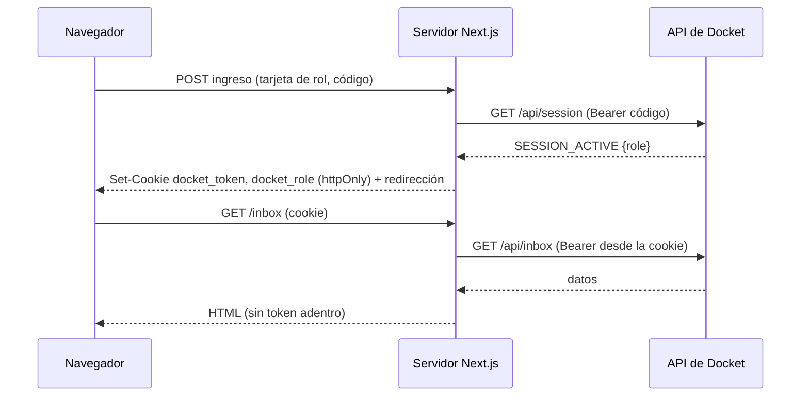

# Sesión y marco de la aplicación

## Propósito

Permite ingresar, mantiene el token de la API **fuera del navegador**, protege todas las rutas y dibuja el marco en el que vive cada pantalla (un encabezado en todas las pantallas que dice quién ingresó, más una barra lateral en escritorio y una barra inferior de pestañas en el celular). Es lo que le da a la auxiliar y a la coordinadora **a cada una su propio espacio de trabajo** (su propio menú y su pantalla de inicio, no solo permisos distintos), y lo que hace seguro construir el resto del frontend con Server Components y Server Actions.

## Quién lo usa

- **Auxiliar de radicación (CLERK, Martha)**: ingresa con "Radicación" y llega a la bandeja.
- **Coordinadora (COORDINATOR, Dra. Herrera)**: ingresa con "Coordinación" y llega a vencimientos, con "Por verificar" de segunda en su menú.

Navegación por rol (`ROLE_NAV` y `ROLE_HOME` en `shared/ui/organisms/AppNav.tsx`; el mismo orden en la barra lateral y en la barra de pestañas):

| Rol | Menú (en orden) | Inicio después de ingresar |
|---|---|---|
| `CLERK` | Bandeja, Vencimientos, Libro, Ajustes | `/inbox` |
| `COORDINATOR` | Vencimientos, Por verificar, Libro, Bandeja, Cumplimiento | `/deadlines` |

Qué ve cada rol en la pantalla (la API aplica las mismas reglas y, si no, responde `FORBIDDEN`):

| Pantalla | CLERK | COORDINATOR |
|---|---|---|
| [Bandeja](inbox.md) | lista + Leer buzón, Subir .eml, Aprobar listos | solo la lista, con la nota "Vista de supervisión" |
| [Revisión de documento](document-review.md) | Aprobar, Corregir, Descartar en documentos abiertos | solo lectura (evidencia, motivos, historial, original) |
| [Libro](ledger.md) | búsqueda + descarga del Excel | igual |
| [Vencimientos](deadlines.md) | informe semanal | igual + su resumen (facturas por verificar, pendientes en radicación) |
| [Por verificar](verifications.md) | no está en su menú; si la abre por URL, solo lectura | liberar o confirmar fraude en facturas retenidas (nota obligatoria) |
| [Ajustes](settings.md) | consulta + reemplazo del maestro de proveedores | solo lectura |
| [Cumplimiento](compliance.md) | no está en su menú; si la abre por URL, solo lectura (sin eliminar ni buscar titulares) | tabla de retención, eliminar registros vencidos con el acta del comité, inventario de datos personales, solicitudes de titulares |

## Cómo funciona

1. **Ingreso** (`/login`, `features/session`): `LoginForm` pregunta "¿Quién ingresa?" con dos tarjetas — "Radicación · Martha Rojas · radica, corrige y aprueba" y "Coordinación · Dra. Claudia Herrera · consulta y vencimientos" — y un "Código de acceso" (campo de contraseña). En la demostración, una ayuda bajo el campo llena el código (`martha-demo` / `herrera-demo`).
2. `loginAction` (Server Action, `api/session-actions.ts`) llama a `GET /api/session` usando el código digitado como token bearer. La API responde `SESSION_ACTIVE` con el `role` real. La acción guarda dos cookies, `docket_token` y `docket_role`, ambas `httpOnly`, `SameSite=Lax`, `path=/`, `Secure` en producción, por 12 horas. Redirige a `ROLE_HOME[data.role]`, el inicio del rol **que devolvió la API**, no el de la tarjeta escogida: `/inbox` para CLERK, `/deadlines` para COORDINATOR.
3. **Protección de rutas** (`web/src/proxy.ts`, proxy de Next.js): sin `docket_token`, toda ruta salvo `/login` redirige a `/login`; con la cookie, `/login` redirige a `/inbox`. Se excluyen los archivos estáticos, los íconos, `manifest.webmanifest`, `sw.js` y `/offline`, para que la PWA funcione sin sesión. `/` redirige a `/inbox`.
4. **Llamadas a la API**: `shared/lib/api-client.ts` (`server-only`) lee la cookie mediante `shared/lib/session.ts` y agrega `Authorization: Bearer <token>`. Desenvuelve el sobre `{code, data}` y lanza `ApiError(code)` ante errores; una falla de conexión se vuelve `NETWORK_ERROR`. Las Server Actions convierten los errores en `{ok: false, code}` y los componentes de cliente muestran `describeError(code)`.
5. **Los archivos** también pasan por route handlers, para que el navegador nunca necesite el token: `/files/documents/{id}` (adjunto original, en línea) y `/files/ledger` (descarga del Excel). Ambos responden `401` sin sesión y envían `Cache-Control: private, no-store`.
6. **Cerrar sesión**: `LogoutButton` (`shared/ui/organisms/LogoutButton.tsx`, de cliente) primero borra las cachés del navegador cuyo nombre empieza por `docket-read-views` (las copias sin conexión del libro y de vencimientos, que tienen NIT y valores) y luego envía `logoutAction`, que borra las dos cookies y redirige a `/login`.
7. **Manejo de errores** (`app/(app)/error.tsx`): cuando una página con sesión no carga (la API se cayó o la sesión expiró), muestra "No se pudo cargar esta vista" (`role="alert"`) con dos salidas: **"Reintentar"** (`reset()`) e **"Ingresar de nuevo"** (un formulario que envía `logoutAction`).



### Marco de la aplicación (`shared/ui/organisms/AppShell.tsx`)

- **Encabezado, en todos los tamaños**: una barra fija translúcida que siempre dice quién ingresó. `SessionSummary` muestra un avatar con las iniciales, el nombre de la persona (de `roleUser` en `shared/i18n/es.ts`: CLERK = Martha Rojas, COORDINATOR = Claudia Herrera) y, desde `md`, el rol y la fecha del caso (p. ej. "Radicación · 18 de nov de 2026"); en el celular, solo el nombre y el avatar. Para lectores de pantalla tiene la etiqueta "Sesión de Martha Rojas, Radicación". Al lado: el cambio de tema y "Cerrar sesión". En el celular el encabezado lleva también el logo; en escritorio dice "Radicación de correspondencia".
- **Escritorio (desde `lg`)**: barra lateral fija con el logo, "Docket / Terminales Andinas de Carga" y la navegación del rol que ingresó (`SessionNav` lee la sesión y le pasa `ROLE_NAV[role]` a `AppNav`; ver la tabla de arriba). El área de trabajo a la derecha usa todo el ancho (sin contenedor de ancho máximo), lo que le sirve a la tabla del libro.
- **Celulares y tabletas (por debajo de `lg`)**: una **barra inferior de pestañas** fija con los mismos destinos del rol (cuatro para la auxiliar, cinco para la coordinadora), ícono + texto, de 56 px de alto (`min-h-14`), respetando las zonas seguras (`env(safe-area-inset-*)`, `viewport-fit=cover`). El contenido tiene margen inferior para que la barra nunca lo tape.
- El destino activo se resalta con `aria-current="page"`; `/documents/*` resalta "Bandeja". El resaltado se calcula en un componente de cliente pequeño (`ActiveAppNav`) para que el resto del marco siga siendo Server Component.
- Los avisos (`sonner`) salen arriba al centro; el tema claro/oscuro viene de `next-themes`.

### Pantallas y estados

- Error de ingreso: el mensaje reemplaza la ayuda bajo el campo, con `role="alert"` y `aria-invalid` en el campo. Mientras ingresa, el botón muestra un indicador de carga y queda deshabilitado.
- El pie del ingreso dice "Nada se reenvía sin su aprobación. Los datos se quedan en los servidores de TAC."
- Mientras llega la información de la sesión (lee las cookies dentro de su propio `<Suspense>`), el encabezado muestra `SessionSummarySkeleton`, así el diseño no salta.

### Accesibilidad

- Enlace "Saltar al contenido" hacia `#main`; zonas de navegación con la etiqueta "Principal"; `lang="es-CO"`.
- Áreas táctiles de 44 px: opciones de la barra lateral (`min-h-11`), pestañas de la barra inferior (56 px), botón y campo del ingreso (`h-11`), tarjetas de rol (64 px). Todo `Button` mide 44 px en pantallas táctiles y 40 px desde `md` (`h-11 md:h-10`; los de ícono `size-11 md:size-10`, incluidos el cambio de tema y "Cerrar sesión").
- Los controles interactivos muestran el cursor de mano (`globals.css`: botones, `role="button"`, pestañas, opciones, `label[for]`…; los deshabilitados muestran `not-allowed`), porque Tailwind v4 deja los botones con el cursor por defecto.
- `prefers-reduced-motion`: animaciones y transiciones reducidas a 1 ms. `prefers-reduced-transparency`: el encabezado y la barra de pestañas dejan de ser translúcidos. `prefers-contrast: more`: bordes y texto secundario más marcados.
- Los colores de texto e interfaz cumplen WCAG AA (4.5:1 en texto, 3:1 en texto grande e interfaz) en tema claro y oscuro (`shared/theme/tokens.css`, skill `theme-web`).

## Reglas de negocio

| Regla | Dónde está en el código |
|---|---|
| El token de la API nunca llega al navegador: vive en una cookie httpOnly y solo se usa en el servidor | `session-actions.ts`, `api-client.ts` (`server-only`), route handlers de archivos |
| Dos roles, CLERK y COORDINATOR; cada uno con su menú y su inicio. La coordinadora no radica, ni corrige, ni aprueba; solo resuelve las facturas retenidas | `ROLE_NAV` / `ROLE_HOME` (`AppNav.tsx`), `SessionNav`; cookie de rol leída por cada plantilla; roles en la API (`require_coordinator`) |
| Después de ingresar, la página de llegada sigue el rol que devuelve la API | `loginAction` → `ROLE_HOME[data.role]` |
| Al cerrar sesión se borran las copias sin conexión con datos del cliente | `LogoutButton` (caché `docket-read-views`) |
| Nada se puede abrir sin sesión | `proxy.ts`, más `401` en los route handlers de archivos |
| El "hoy" del caso es 2026-11-18 | `SessionSummary` (`fetchCaseToday()` → el `today` del API, de `TAC_TODAY`) |

## Endpoints / pantallas

Rutas: `/login` (`app/login/page.tsx`), `/` (redirige a `/inbox`), el layout `app/(app)/layout.tsx` y el manejo de errores `app/(app)/error.tsx` de todas las rutas con sesión; `web/src/proxy.ts`; route handlers `app/files/documents/[id]/route.ts` y `app/files/ledger/route.ts`.

| Desde | Método | Ruta | Para qué |
|---|---|---|---|
| `loginAction` (Server Action) | GET | `/api/session` | validar el código de acceso y conocer el rol (`role`, `today`) |
| `/files/documents/{id}` | GET | `/api/inbox/{id}/source` | adjunto original |
| `/files/ledger` | GET | `/api/ledger/export` | libro en Excel |

Variables de entorno: `DOCKET_API_URL` (obligatoria, sin valor por defecto: si falta, toda llamada falla con `API_NOT_CONFIGURED`). La fecha del caso no se configura en la web: `shared/lib/case-date.ts` la lee de `GET /api/session`, una vez por petición.

## Códigos

| Código | Meaning (EN) | Etiqueta que se muestra | ¿Bloquea? |
|---|---|---|---|
| `INVALID_CREDENTIALS` | Empty or wrong access code (API `UNAUTHORIZED` at login is shown as this) | Código de acceso incorrecto. | Sí |
| `UNAUTHORIZED` | Token rejected later (e.g. during an action) | Su sesión expiró. Vuelva a ingresar. | Sí |
| `NETWORK_ERROR` | The Next.js server cannot reach the API | No hay conexión con el servidor. | Sí |
| `SESSION_ACTIVE` | Login accepted | — | — |
| `CLERK` / `COORDINATOR` | Roles | Radicación / Coordinación | — |

## Limitaciones

- Tokens de demostración compartidos por rol (`TAC_CLERK_TOKEN`, `TAC_COORDINATOR_TOKEN`), no cuentas personales; el inicio de sesión corporativo (SSO) está pendiente. La auditoría registra el rol, no la persona, y el nombre del encabezado es el asignado al rol (`roleUser`), no una identidad autenticada.
- La protección solo revisa que la cookie exista. Un token vencido o revocado se detecta en la primera llamada a la API: las acciones muestran "Su sesión expiró. Vuelva a ingresar."; una página que falla al cargar muestra `error.tsx`, donde la persona escoge "Ingresar de nuevo" (no hay redirección automática).
- Con sesión abierta, `/` y `/login` llevan a cada rol a su inicio (`proxy.ts` lee la cookie del rol): Martha a `/inbox`, la coordinadora a `/deadlines`. (Corregido el 2026-11-24; lo cubre `web/e2e/coordinator.spec.ts`.)

## Cómo se prueba

- `web/e2e/filing-flow.spec.ts`: `/inbox` sin sesión redirige a `/login`; la auxiliar ingresa y llega a `/inbox`; "Cerrar sesión" vuelve a `/login`; la coordinadora ingresa, llega a "Vencimientos" y no ve "Aprobar listos".
- `web/e2e/coordinator.spec.ts` (proyecto `coordinator`, depende de `desktop` para correr después del flujo de la auxiliar): el menú de la auxiliar no tiene "Por verificar"; después de "Cerrar sesión" ingresa la coordinadora y su barra lateral dice exactamente "Vencimientos", "Por verificar", "Libro", "Bandeja".
- `web/e2e/helpers.ts`: `login(page, role)` escoge la tarjeta del rol, llena el código, verifica que el botón "Ingresar" tenga `cursor: pointer`, la ruta de llegada (`/inbox` o `/deadlines`) y que el encabezado (`banner`) nombre a la persona ("Sesión de Martha Rojas" / "Sesión de Claudia Herrera").
- `web/e2e/mobile.spec.ts` (Pixel 7): la barra inferior "Principal" se ve y navega a "Libro"; sin desbordamiento horizontal.
- El módulo de sesión todavía no tiene pruebas Jest.

```bash
./scripts/harness-verify.sh web/e2e/filing-flow.spec.ts web/e2e/coordinator.spec.ts web/e2e/mobile.spec.ts
```

Proyectos de Playwright (`web/playwright.config.ts`): `desktop` (`filing-flow.spec.ts`), `coordinator` (`coordinator.spec.ts`, `dependencies: ["desktop"]`) y `phone` (`mobile.spec.ts`, Pixel 7).

## Historial de cambios

- 2026-11-24: primera versión de la documentación.
- 2026-11-24: navegación por rol (`ROLE_NAV`, `ROLE_HOME`, `SessionNav`); el ingreso redirige al inicio del rol que devuelve la API; `LogoutButton` borra la caché sin conexión `docket-read-views`; `app/(app)/error.tsx` con "Reintentar" / "Ingresar de nuevo"; cursor de mano y botones de 44 px en pantallas táctiles. Se quitaron las limitaciones resueltas (llegada según la tarjeta, página de error genérica, botones de 36 px en el encabezado).
- 2026-11-24: el menú de la coordinadora tiene una quinta opción, "Cumplimiento" (`/compliance`, ícono `Landmark`; `ROLE_NAV.COORDINATOR` = vencimientos, verificaciones, libro, bandeja, cumplimiento).
- 2026-11-24: la pista de la pantalla de ingreso muestra códigos de demostración solo si están `DOCKET_DEMO_CLERK_CODE` / `DOCKET_DEMO_COORDINATOR_CODE` (se leen en cada petición); ningún código vive en el código.
