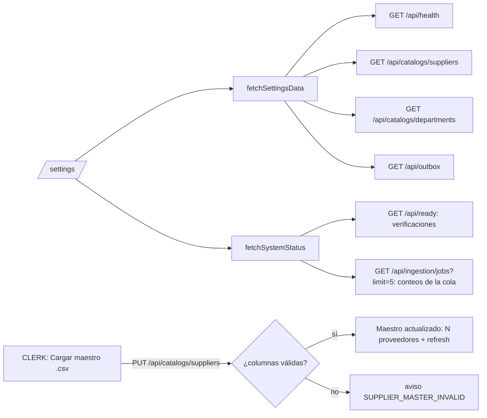

# Ajustes (pantalla)

## Propósito

`/settings` ("Ajustes") reúne en una sola página, casi toda de consulta, aquello de lo que dependen las reglas y lo que el sistema produjo: si el sistema está sano (base de datos, libro en Excel, OCR, cola de importación), si el asistente de IA está encendido, el maestro de proveedores con el que se validan las facturas, las dependencias a las que se reenvían los documentos y la bandeja de salida simulada (los correos que Docket *enviaría* al aprobar). Le permite a Martha cargar un maestro de proveedores recién exportado del ERP sin pedírselo a Sistemas, y a cualquiera revisar qué se "envió" por cada documento aprobado. En el backend corresponde a [catálogos](catalogs.md), a la parte de bandeja de salida de [radicación](filing.md) y a la verificación de disponibilidad de [observabilidad](observability.md).

## Quién lo usa

- **Auxiliar de radicación (CLERK, Martha)**: reemplaza el maestro de proveedores con el CSV que Compras exporta del ERP; consulta dependencias y mensajes de la bandeja de salida.
- **Coordinadora (COORDINATOR, Dra. Herrera)**: consulta todo — estado de la IA, maestro de proveedores, dependencias y bandeja de salida, incluidas las alertas `FRAUD_ALERT` dirigidas a ella. **No puede** reemplazar el maestro de proveedores: el botón de carga no se le muestra y la API le respondería `FORBIDDEN`.

## Cómo funciona

1. `app/(app)/settings/page.tsx` pinta `SettingsTemplate` dentro de `<Suspense>`, con `SettingsSkeleton` mientras carga.
2. `fetchSettingsData` (`features/settings/api/settings-queries.ts`) hace cuatro llamadas a la API en paralelo desde el servidor; `fetchSystemStatus` agrega dos más (`GET /api/ready`, leída con `apiFetch` para que el cuerpo de un `503 NOT_READY` se muestre en lugar de tumbar la página, y `GET /api/ingestion/jobs?limit=5`); la plantilla lee la sesión para decidir si muestra el botón de carga.
3. La página tiene cinco secciones:
   - **Estado del sistema** ("Lo mismo que vigila el monitoreo (métricas en /metrics, verificación en /api/ready)."): una fila por verificación de disponibilidad — "Base de datos" (`database`), "Libro de radicación (Excel)" (`ledger_template`), "OCR para escaneados" (`ocr`), "Procesador de la cola" (`import_worker`) — con una etiqueta "Funciona" (`OK`, verde), "Degradado" (`DEGRADED`, ámbar), "Caído" (`DOWN`) o "Falta" (`MISSING`) (rojo); y una tarjeta "Cola de importación": "N en cola · N procesando · N terminadas · N fallidas" más "Última: <fecha y hora> · N documentos nuevos".
   - **Asistente de IA**: "Apagado" (escudo verde) — "Todo se decide con reglas y OCR locales: ningún documento sale de TAC. Sistemas puede activarlo cuando lo apruebe." — o "Activo" (ámbar) — solo se consulta en textos ambiguos, con los datos personales enmascarados, y su sugerencia siempre pasa a revisión. Refleja `TAC_LLM_ENABLED` (apagado por defecto); no es un interruptor.
   - **Maestro de proveedores**: tabla con proveedor, NIT, correo de facturación, banco · cuenta y "Activo"/"Inactivo". Para CLERK, el botón "Cargar maestro del ERP (.csv)".
   - **Dependencias**: una tarjeta por dependencia con su nombre en español, su correo y lo que recibe.
   - **Bandeja de salida (simulada)**: una tarjeta desplegable por mensaje con su tipo, asunto y destinatario; al abrirla se ve el cuerpo en español. Tipos: "Reenvío a la dependencia", "Devolución al remitente", "Respuesta con radicado existente", "Alerta a la coordinadora".
4. La carga del maestro es una Server Action (`replaceSupplierMasterAction`) que envía el archivo como multipart a la API y luego hace `refresh()` de la ruta para que la tabla muestre el maestro nuevo.



### Pantallas y estados

- **Cargando**: `SettingsSkeleton` (`aria-busy`).
- **Bandeja de salida vacía**: "Aún no hay correos generados."
- **Cargando el maestro**: indicador en el botón, que queda deshabilitado. **Éxito**: "Maestro actualizado: N proveedores." **Error**: la etiqueta en español del código.

### En el celular y sin conexión

- La tabla de proveedores conserva sus columnas y se desplaza horizontalmente dentro de su propio contenedor; la página no se desplaza hacia los lados. Las tarjetas de dependencias van en una columna en el celular y en dos desde `md`. Las tarjetas de la bandeja de salida acomodan su encabezado (etiqueta, asunto, destinatario) en varias líneas.
- **Sin conexión**: el service worker no la guarda; se muestra la página "Sin conexión" (ver [pwa](pwa.md)).

### Accesibilidad

El botón de carga mide 44 px (`h-11`) y el campo de archivo oculto tiene etiqueta ("Maestro de proveedores CSV"). Las etiquetas de estado siempre combinan color, ícono y texto. Los mensajes de la bandeja de salida usan `<details>/<summary>` nativos, así que se abren con el teclado.

## Reglas de negocio

| Regla visible en la pantalla | Dónde está en el código |
|---|---|
| Cualquiera puede ver si el sistema puede hacer su trabajo (y que la falta de OCR solo lo degrada) sin herramientas de Sistemas | "Estado del sistema", `GET /api/ready`, `CHECK_LABEL` / `CHECK_VALUE` |
| La IA está apagada mientras Sistemas no la apruebe; encendida, solo sugiere y siempre pasa a revisión | sección "Asistente de IA", `llm_enabled` de `GET /api/health` |
| Solo la auxiliar reemplaza el maestro de proveedores; el archivo debe ser el CSV del ERP con las columnas esperadas, si no, no cambia nada | `SupplierMasterUpload` solo para CLERK; API `SUPPLIER_MASTER_INVALID`; el reemplazo y el rechazo quedan en auditoría (`SUPPLIER_MASTER_REPLACED` / `SUPPLIER_MASTER_REJECTED`) |
| Los proveedores inactivos se ven como tales (sus facturas generan `SUPPLIER_INACTIVE` en radicación) | etiqueta "Inactivo" |
| Docket nunca envía correos: la bandeja de salida dice "simulada" y aclara que no se envía nada de verdad | descripción de la sección |
| Una factura retenida genera una alerta a la coordinadora | "Alerta a la coordinadora" (`FRAUD_ALERT`, tono de peligro) |

## Endpoints / pantallas

Ruta: `/settings` (`web/src/app/(app)/settings/page.tsx`), módulo `web/src/features/settings/`. Todas las llamadas se hacen en el servidor de Next.js con el token de la cookie httpOnly.

| Desde | Método | Ruta | Para qué |
|---|---|---|---|
| `fetchSettingsData` | GET | `/api/health` | `llm_enabled` |
| `fetchSettingsData` | GET | `/api/catalogs/suppliers` | tabla del maestro (`name`, `nit`, `billing_email`, `bank`, `account_number`, `is_active`) |
| `fetchSettingsData` | GET | `/api/catalogs/departments` | tarjetas de dependencias (`code`, `email`, `receives`) |
| `fetchSettingsData` | GET | `/api/outbox` | mensajes de la bandeja de salida (`kind`, `subject`, `to_address`, `body`, `document_id`) |
| `fetchSystemStatus` | GET | `/api/ready` | verificaciones de disponibilidad (`READY` 200 o `NOT_READY` 503; el cuerpo se lee en ambos casos) |
| `fetchSystemStatus` | GET | `/api/ingestion/jobs?limit=5` | conteos de la cola de importación y la última importación |
| `replaceSupplierMasterAction` (Server Action) | PUT | `/api/catalogs/suppliers` (multipart `file`) | reemplazar el maestro; devuelve `{suppliers: N}` |

## Códigos

| Código | Meaning (EN) | Etiqueta que se muestra | ¿Bloquea? |
|---|---|---|---|
| `READY` / `NOT_READY` | Readiness of the server | — (se muestra mediante las verificaciones) | — |
| `OK` / `DEGRADED` / `DOWN` / `MISSING` | State of one check | Funciona / Degradado / Caído / Falta | — |
| `SUPPLIER_MASTER_INVALID` | The CSV lacks the expected columns | El archivo del maestro no tiene las columnas esperadas. | Sí |
| `FORBIDDEN` | The role cannot replace the master | Su rol no permite esta acción. | Sí |
| `UNAUTHORIZED` | Token rejected | Su sesión expiró. Vuelva a ingresar. | Sí |
| `NETWORK_ERROR` | API unreachable | No hay conexión con el servidor. | Sí |
| `FORWARD_TO_DEPARTMENT` / `RETURN_TO_SENDER` / `REPLY_EXISTING_NUMBER` / `FRAUD_ALERT` | Outbox message kinds | Reenvío a la dependencia / Devolución al remitente / Respuesta con radicado existente / Alerta a la coordinadora | — |
| `ACCOUNTS_PAYABLE`, `PROCUREMENT`, `HUMAN_RESOURCES`, `LEGAL`, `CUSTOMER_SERVICE`, `ADMIN_COORDINATION` | Departments | Cuentas por pagar, Compras, Talento humano, Jurídica, Atención al usuario, Coordinación administrativa | — |
| `SUPPLIER_MASTER_REPLACED` | Success response | — (el aviso se arma con `suppliers`) | — |

## Limitaciones

- Escoger un archivo reemplaza el maestro **de inmediato**: no hay vista previa ni confirmación, y la única forma de deshacerlo es volver a cargar el CSV anterior.
- Las dependencias no se editan desde la pantalla (vienen de `dependencias.csv` en el servidor) y el asistente de IA no se enciende desde la pantalla (es `TAC_LLM_ENABLED`, decisión de Sistemas).
- Las seis consultas van juntas: si alguna falla (salvo un `503` de `/api/ready`, que sí se muestra), toda la página cae en el `app/(app)/error.tsx` compartido ("Reintentar" / "Ingresar de nuevo").
- "Estado del sistema" es una foto tomada al cargar la página; no se actualiza sola.
- La bandeja de salida no tiene paginación ni filtros, y los mensajes no enlazan a su documento.
- Ninguna prueba automática cubre todavía esta pantalla (no hay prueba Jest de `settings` ni paso E2E).

## Cómo se prueba

- Todavía no tiene pruebas propias. Cobertura indirecta: las etiquetas de estado que usa están cubiertas por `web/src/shared/ui/__tests__/StatusBadge.test.tsx`; la validación del maestro, las dependencias y la composición de la bandeja de salida se prueban en el backend (ver [catálogos](catalogs.md) y [radicación](filing.md)).
- Los datos de disponibilidad y de la cola detrás de "Estado del sistema" se prueban en el backend con `api/tests/api/test_observability.py::test_request_id_and_readiness` y `::test_queued_import_is_processed_by_the_worker` (ver [observabilidad](observability.md)).
- Pendiente: una prueba Jest + RTL de `SupplierMasterUpload` (avisos de éxito y de `SUPPLIER_MASTER_INVALID`) y un paso E2E que verifique que la coordinadora no ve "Cargar maestro del ERP (.csv)".

```bash
./scripts/harness-verify.sh web/src/shared/ui/__tests__/StatusBadge.test.tsx
```

## Historial de cambios

- 2026-11-24: primera versión de la documentación de la pantalla.
- 2026-11-24: sección "Estado del sistema" (`fetchSystemStatus`: verificaciones de disponibilidad de `GET /api/ready` y conteos de la cola de importación de `GET /api/ingestion/jobs`).
