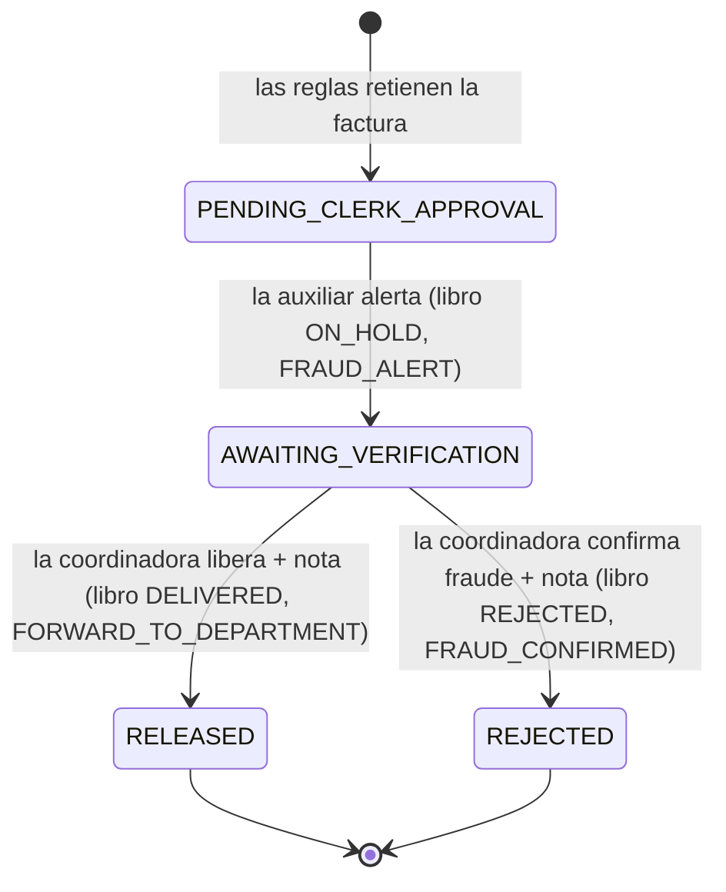

# Verificaciones (facturas retenidas)

## Propósito

Cierra el ciclo de las facturas retenidas por posible fraude. Las reglas de radicación retienen una factura (`HOLD_FOR_VERIFICATION`) cuando su cuenta bancaria no coincide con el maestro de proveedores, el correo pide consignar a otra cuenta, anuncia un cambio de cuenta o llega de un dominio que no es el del proveedor. Antes de esta funcionalidad la auxiliar la radicaba y quedaba "Retenida" en el libro sin forma de resolverla. La práctica de Martha, según la entrevista: *"si la cuenta de la factura no es la que está en el maestro, o el correo llega de una dirección rara, no la mando a ningún lado: se la paso a la doctora Claudia para que verifiquen por teléfono con el proveedor"*.

`/verifications` ("Por verificar") es el espacio de trabajo de la Dra. Herrera para esa llamada: pone lo que llegó al lado de lo que dice el maestro, le indica a quién llamar (al contacto del maestro, nunca al del correo) y deja registrado el resultado. Una factura liberada sigue hacia la dependencia a la que habría ido; un fraude confirmado queda "Rechazada" en el libro y se les avisa a Cuentas por pagar y a Compras que no se pague. El backend vive en el slice de [radicación](filing.md); este documento cubre ambos lados.

## Quién lo usa

- **Coordinadora (COORDINATOR, Dra. Herrera)**: es el único rol que puede liberar o rechazar una factura retenida, siempre con una nota de la llamada. La opción "Por verificar" del menú es suya, y el resumen de la coordinadora en [vencimientos](deadlines.md#la-pantalla-deadlines) enlaza aquí.
- **Auxiliar (CLERK, Martha)**: nunca aprueba una factura retenida: alerta a la coordinadora ("Alertar a la Dra. Herrera" → "Enviar alerta" en [revisión del documento](document-review.md)). La página no está en su menú; si abre la URL ve la misma lista en solo lectura (sin botones de acción); de todas formas la API le responde `FORBIDDEN`.
- **Asistente de IA (MCP)**: la herramienta de solo lectura `held_invoices` lista las mismas facturas y su estado (ver [servidor MCP](mcp.md)).

## Cómo funciona

1. Las reglas retienen la factura (`HOLD_FOR_VERIFICATION`, dependencia `ADMIN_COORDINATION`, `NEEDS_REVIEW`). Queda en la bandeja de la auxiliar: estado de verificación `PENDING_CLERK_APPROVAL`.
2. La auxiliar alerta a la coordinadora (`POST /api/inbox/{id}/escalate`, `EscalateHold`, auditoría `HOLD_ESCALATED`; si intenta aprobarla, la API responde `409 HOLD_REQUIRES_ESCALATION`): recibe número de radicado para que quede trazabilidad, la fila del libro queda `ON_HOLD` con la marca `HOLD_FOR_VERIFICATION` el mensaje `FRAUD_ALERT` sale hacia la coordinación y nada va a Cuentas por pagar. Estado: `AWAITING_VERIFICATION` (`InboxItem.is_awaiting_verification`: aprobada, retenida, sin `hold_resolution`).
3. La coordinadora abre `/verifications`, compara la cuenta y el correo del remitente con el maestro y llama al proveedor al contacto del maestro.
4. Hace clic en **Verificada: liberar** o **Es fraude**, escribe la nota (mínimo 5 caracteres) y confirma. `POST /api/verifications/{id}/release` o `/reject` ejecuta `VerifyHold`:
   - **Liberar** (`HoldOutcome.RELEASED`): la fila del libro pasa a `DELIVERED`, la dependencia sale de `release_department()` (con orden de compra → `ACCOUNTS_PAYABLE`, sin orden → `PROCUREMENT`, la regla de facturas de Martha) y la marca `HOLD_FOR_VERIFICATION` se reemplaza por `VERIFIED_BY_PHONE`; bandeja de salida `FORWARD_TO_DEPARTMENT` ("[TAC-…] Factura verificada: …", pagar solo a la cuenta del maestro).
   - **Rechazar** (`HoldOutcome.REJECTED`): la fila del libro pasa a `REJECTED`, marca `FRAUD_CONFIRMED`; bandeja de salida `FRAUD_CONFIRMED` ("NO PAGAR [TAC-…] intento de fraude confirmado") a Cuentas por pagar y a Compras.
   - En ambos casos: `InboxItem.hold_resolution = HoldResolution(outcome, note, actor, at)`, se sincroniza el Excel compartido (`SyncLedger`: solo se escriben las celdas que cambió Docket y se conservan las ediciones de las personas en la misma fila; ver [libro](ledger.md#sincronización-en-ambos-sentidos-con-el-excel-compartido)) y se registra el evento de auditoría `HOLD_RELEASED` / `HOLD_REJECTED`.
5. La tarjeta pasa a "Resueltas" con el resultado, la fecha y la nota.



### La pantalla (`/verifications`)

- **Encabezado**: antetítulo "Coordinación", título "Por verificar" y la instrucción de verificar por teléfono antes de liberar.
- **Indicadores** (`StatTile`): "Por verificar" (`AWAITING_VERIFICATION`), "En bandeja de radicación" (`PENDING_CLERK_APPROVAL`), "Liberadas" (`RELEASED`), "Fraudes confirmados" (`REJECTED`).
- **Grupos**: "Esperan su verificación", "Aún en la bandeja de radicación", "Resueltas" (los grupos vacíos no se muestran). Orden: orden de llegada (el de la API).
- **Tarjeta** (`HeldInvoiceCard`): insignia de estado, número de radicado, proveedor y número de factura, valor, orden de compra (o "Sin OC"), hora de recepción, enlace "Ver documento", los motivos de fraude en español, la tabla de comparación, el contacto del maestro ("Llame al contacto del maestro, no al del correo"), la resolución si la hay y —solo para la coordinadora y mientras está pendiente— "Si la libera, sigue hacia <dependencia>" más las acciones. Las tarjetas que siguen con la auxiliar indican que Radicación debe aprobarlas primero.
- **Comparación** (`ComparisonTable`): filas "Cuenta bancaria" y "Correo del remitente", columnas "Llegó en el correo" / "Maestro de proveedores". Una diferencia lleva ícono de equis roja, texto en negrilla roja y "no coincide" para lector de pantalla; una coincidencia, un chulo verde. La cuenta se compara sin puntuación (solo dígitos); el correo, por dominio. Los proveedores que no están en el maestro muestran "Proveedor no registrado en el maestro" y no tienen tabla.
- **Acciones** (`VerifyActions`): dos diálogos ("Liberar para pago" / "Confirmar intento de fraude") con nota obligatoria "Nota de la verificación" (texto de ayuda "Con quién habló, a qué número y qué confirmó"); el botón de confirmar queda deshabilitado hasta que la nota tenga 5 caracteres. Avisos: "<radicado> liberada hacia <dependencia>." / "<radicado> rechazada: se avisó para que no se pague."
- **Cargando**: `VerificationsSkeleton`. **Vacío**: "No hay facturas retenidas".

### En el celular y sin conexión

- Los indicadores van en 2×2 en el celular y en una fila de cuatro desde `lg`; la tabla de comparación apila cada fila en el celular (sin encabezados de columna) y pasa a tres columnas desde `sm`; los botones de acción se apilan en el celular y miden ≥ 44 px.
- **Sin conexión**: el service worker no la guarda (solo `/deadlines` y `/ledger`); es una pantalla de decisión y necesita datos en vivo.

## Reglas de negocio

| Regla | Fuente | Dónde está en el código |
|---|---|---|
| Una factura retenida no se envía a ninguna parte hasta que la coordinadora la verifique por teléfono con el proveedor | Entrevista: "se la paso a la doctora Claudia para que verifiquen por teléfono con el proveedor" | `VerifyHold`, `api/app/features/filing/application/verify_hold.py` |
| Solo la coordinadora resuelve; la auxiliar y el asistente de IA solo consultan | Roles del caso (Martha radica, la Dra. Herrera verifica) | `CoordinatorRole` / `require_coordinator` en `api/app/shared/infrastructure/http.py`; `canResolve` en `VerificationsTemplate` |
| Toda resolución lleva una nota de la llamada (≥ 5 caracteres) | Trazabilidad: quién verificó y cómo | `MIN_NOTE_LENGTH`, `VerificationNoteRequiredError`; `resolveHoldAction` también lo valida |
| Solo se puede resolver una factura ya alertada (estado `APPROVED`), retenida, sin resolver y con la fila del libro en `ON_HOLD`, y una sola vez | Evitar doble pago o doble alerta | `HoldNotPendingError`, `InboxItem.is_awaiting_verification` |
| Una factura liberada va a donde la manda la regla de facturas de Martha: con orden de compra → Cuentas por pagar; sin orden → Compras | Entrevista (regla de facturas) | `release_department()` |
| Un fraude confirmado nunca se paga: libro `REJECTED` ("Rechazada - fraude confirmado") y aviso a Cuentas por pagar y a Compras | Propósito de control de fraude de la retención | `compose_hold_rejected`, `LedgerStatus.REJECTED`, `client_vocabulary.py` |
| Se llama al contacto del maestro, no al del correo | Práctica antifraude: el correo puede ser del atacante | `masterContact` en `model/mappers.ts`, texto de la tarjeta |
| El Excel del cliente refleja el resultado; las filas históricas no se tocan | El libro sigue siendo la única fuente del cliente | `ExcelLedgerWorkbook.render` (reescribe las filas con `source_document_id`) |

## Endpoints / pantallas

Router `api/app/features/filing/api/verifications_router.py` (prefijo `/api/verifications`). Caso de uso `VerifyHold` y consulta `ListHeldInvoices` (`filing/application/queries.py`).

| Método | Ruta | Rol | Solicitud | `data` de la respuesta |
|---|---|---|---|---|
| GET | `/api/verifications` | cualquiera | — | lista de registros de la bandeja (las mismas llaves de `/api/inbox`) más `verification_state`, `release_department`, `hold_resolution` (`{outcome, note, actor, at}` o `null`), `master_supplier` (fila del maestro de proveedores con `is_active`, o `null`) |
| POST | `/api/verifications/{id}/release` | COORDINATOR | `{"note": "..."}` | la misma vista del registro, `verification_state` = `RELEASED` |
| POST | `/api/verifications/{id}/reject` | COORDINATOR | `{"note": "..."}` | la misma vista del registro, `verification_state` = `REJECTED` |

Frontend: ruta `/verifications` (`web/src/app/(app)/verifications/page.tsx`), funcionalidad `web/src/features/verifications/`:

| Pieza | Función |
|---|---|
| `api/verification-queries.ts` → `fetchHeldInvoices()` | `GET /api/verifications`, mapeado con `toHeldInvoiceView` |
| `api/verification-actions.ts` → `resolveHoldAction(id, "release" \| "reject", note)` | Server Action: `POST …/release` o `…/reject`, luego `refresh()` |
| `model/mappers.ts` → `toHeldInvoiceView`, `splitByState` | filas de comparación, motivos de fraude en español, agrupación |
| `components/templates/VerificationsTemplate.tsx`, `VerificationsSkeleton.tsx` | página, indicadores y grupos |
| `components/organisms/HeldInvoiceCard.tsx`, `VerifyActions.tsx` | tarjeta y diálogos |
| `components/molecules/ComparisonTable.tsx` | lo que llegó frente al maestro |

Navegación: "Por verificar" solo está en el menú de la coordinadora (`ROLE_NAV` en `shared/ui/organisms/AppNav.tsx`, ver [sesión](session.md)).

## Códigos

| Código | Meaning (EN) | Significado (ES) | ¿Bloquea? |
|---|---|---|---|
| `VERIFICATIONS_LISTED` | Held invoices listed | Facturas retenidas listadas | No |
| `HOLD_RELEASED` | Invoice verified by phone and released (also an audit event) | Factura verificada por teléfono y liberada (también evento de auditoría) | No |
| `HOLD_REJECTED` | Fraud confirmed; invoice rejected (also an audit event) | Fraude confirmado; factura rechazada (también evento de auditoría) | No |
| `FORBIDDEN` (403) | Only the coordinator can resolve | Solo la coordinadora puede resolver | Sí |
| `VERIFICATION_NOTE_REQUIRED` (422) | The note is missing or shorter than 5 characters | Falta la nota o tiene menos de 5 caracteres | Sí |
| `HOLD_NOT_PENDING` (409) | Already resolved, not yet filed, or not a held invoice | Ya fue verificada, aún no se ha radicado o no está retenida | Sí |
| `DOCUMENT_NOT_FOUND` (404) | Unknown document id | No existe el documento | Sí |
| `PENDING_CLERK_APPROVAL` / `AWAITING_VERIFICATION` / `RELEASED` / `REJECTED` | Verification state | Aún en la bandeja de radicación / Por verificar / Liberada para pago / Fraude confirmado | — |
| `VERIFIED_BY_PHONE` | Ledger flag after release | Verificada por teléfono con el proveedor (Dra. Herrera): se libera para pago | No |
| `FRAUD_CONFIRMED` | Ledger flag and outbox kind after rejection | Fraude confirmado por la coordinación: NO PAGAR | No |

## Limitaciones

- La llamada como tal ocurre por fuera de Docket; la nota es la única evidencia y es texto libre.
- Una resolución no se puede deshacer desde la interfaz ni desde la API (una liberación equivocada se maneja por fuera de Docket y se anota en el libro).
- Solo se comparan la cuenta y el correo del remitente; los demás datos del maestro (dígito de verificación del NIT, proveedor inactivo) aparecen como motivos, no como filas de comparación.
- La dependencia de liberación sigue solo la regla de facturas (con o sin orden de compra); la coordinadora no puede escoger otra.
- La coordinadora no recibe otra notificación que el mensaje simulado `FRAUD_ALERT` de la bandeja de salida y la tarjeta del resumen en su inicio.
- No está disponible sin conexión.

## Cómo se prueba

- `api/tests/features/filing/test_verify_hold.py`: `test_held_invoice_waits_for_the_coordinator`, `test_before_martha_approves_it_is_still_with_the_clerk`, `test_release_sends_it_where_the_rules_would_have`, `test_reject_marks_fraud_and_warns_payables_and_procurement`, `test_cannot_resolve_twice_or_without_a_note`, `test_resolution_is_audited_and_the_excel_row_is_updated`.
- `api/tests/api/test_api.py::test_only_the_coordinator_resolves_held_invoices`: listado como coordinadora con `master_supplier`; la auxiliar recibe `FORBIDDEN`; nota corta → `VERIFICATION_NOTE_REQUIRED`; liberar → `HOLD_RELEASED`; segunda resolución → 409 `HOLD_NOT_PENDING`.
- `api/tests/mcp/test_mcp_server.py::test_held_invoices_tool`.
- `web/src/features/verifications/__tests__/mappers.test.ts`: lo que llegó frente al maestro con ambas diferencias marcadas, proveedor no registrado, agrupación según quién debe actuar.
- `web/e2e/coordinator.spec.ts` (proyecto de Playwright `coordinator`, corre después de `desktop`): la auxiliar alerta a la coordinadora sobre la factura sospechosa ("Alertar a la Dra. Herrera" → "Enviar alerta"); el menú de la coordinadora es "Vencimientos, Por verificar, Libro, Bandeja, Cumplimiento"; ella sigue "1 factura por verificar", ve la cuenta del maestro, libera con nota ("liberada hacia Cuentas por pagar") y el libro muestra la fila "Entregado".

```bash
./scripts/harness-verify.sh api/tests/features/filing/test_verify_hold.py api/tests/api/test_api.py api/tests/mcp/test_mcp_server.py
./scripts/harness-verify.sh web/src/features/verifications/__tests__/mappers.test.ts
./scripts/harness-verify.sh web/e2e/coordinator.spec.ts
```

## Historial de cambios

- 2026-11-24: primera versión: verificación de facturas retenidas por la coordinadora (liberar / confirmar fraude), pantalla `/verifications`, herramienta MCP `held_invoices`.
- 2026-11-24: la auxiliar ya no aprueba una factura retenida; alerta a la coordinadora (`HOLD_ESCALATED`, `POST /api/inbox/{id}/escalate`). El efecto en esta cola no cambia.
